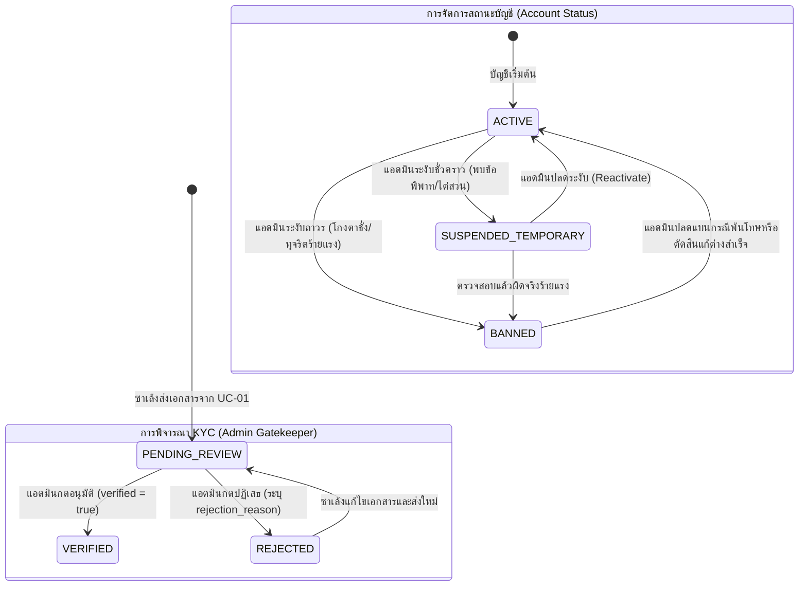

# ฝั่งผู้ดูแลระบบ ลำดับที่ 1: ระบบตรวจสอบและอนุมัติผู้ใช้งาน (`1. ระบบตรวจสอบและอนุมัติผู้ใช้งาน`)

- **Version:** `2.0` | **Status:** `reviewed-post-clarify` | **Owner:** กลุ่ม 2 (แพลตฟอร์มรับซื้อของเก่า/ซาเล้ง)
- **อ้างอิงอาร์ติแฟกต์ที่เกี่ยวข้อง:**
  - ตารางแบ่งฟีเจอร์ฝั่ง **`ผู้ดูแลระบบ`** ลำดับที่ **`1`**
  - สารบัญ Use Cases ระบบกลาง: **`UC-11: ตรวจสอบอนุมัติ KYC และจัดการบทลงโทษผู้ใช้งาน`** ([`docs/srs/use-cases.md`](../../../docs/srs/use-cases.md))
  - บทบาท Stakeholder: **`ผู้ควบคุมทางเข้า (Gatekeeper) และผู้ดูแลระบบ` (`SH-04`)** (SRS หน้า 46: ทีมแอดมินที่ตรวจสอบและอนุมัติบัญชีซาเล้ง ยืนยันตัวตน ใบขับขี่ ทะเบียนรถ ก่อนเปิดสิทธิ์ให้เข้ารับงานในระบบ)
  - ความสัมพันธ์กับ Use Case อื่น:
    - ปลายทางของ **`UC-01`**: ระบบลงทะเบียนและส่งเอกสาร KYC ฝั่งผู้รับซื้อ/ซาเล้ง ([`specs/buyer/01-account-and-kyc/spec.md`](../../buyer/01-account-and-kyc/spec.md))
    - เงื่อนไขบังคับก่อน (**Precondition Gate**) ของ **`UC-04`**: ซาเล้งต้องมีสถานะ `verified = true` และ `account_status = 'ACTIVE'` เท่านั้น จึงจะมีสิทธิ์ค้นหาและกดรับงานในระบบได้ ตามกฎ `D-00-01`
    - รองรับผลสืบเนื่องจาก **`UC-10`** และ **`UC-13`**: การลงโทษผู้ใช้งานที่ถูกรายงานข้อพิพาท โกงตาชั่ง กดราคา หรือเบี้ยวนัดหมายซ้ำซาก (`No-show`)
  - ความต้องการที่เกี่ยวข้อง:
    - **`UC-11`**: ตรวจสอบอนุมัติ KYC และจัดการบทลงโทษผู้ใช้งาน
    - **`REQ-QA-001`**: ประสิทธิภาพการประมวลผลและการอัปเดตสถานะผู้ใช้งานต้องตอบสนองภายใน `< 2.0 วินาที` (P95)
    - **`REQ-SEC-001`**: บันทึก Audit Log ทุกเหตุการณ์การอนุมัติ, ปฏิเสธ KYC, การระงับสิทธิ์ (Suspend/Ban), และการปลดระงับ แบบ Append-only
    - **`REQ-SEC-002` / `CC-06`**: ปกปิดหมายเลขบัตรประชาชนเป็น `1-1002-XXXXX-XX-X` (Masking) และคุ้มครองภาพถ่ายเอกสารประจำตัวตามกฎหมาย PDPA
    - **`REQ-UX-001` / `CC-01`**: ออกแบบหน้าจอแดชบอร์ดแอดมินให้ใช้งานง่าย รองรับการกดสัมผัสด้วยปุ่มขนาดใหญ่ไม่น้อยกว่า `48px`
    - **`CC-03` / `D-00-01`**: ควบคุมสิทธิ์แอดมินผ่าน Role-based Access Control (`X-Admin-Role: ADMIN`) ป้องกันผู้ใช้ทั่วไปเข้าถึงเส้นทาง API แอดมิน
    - **`CC-04`**: จัดการสถานะคำขอ KYC และสถานะบัญชีแบบ ACID ป้องกันสภาวะ Race Condition

---

## 1. ขอบเขตการทำงาน (Feature Scope)

1. **คิวการตรวจสอบและอนุมัติเอกสาร KYC ซาเล้ง (`Driver KYC Review Queue & Verification` — `UC-11`, `REQ-QA-001`, `D-00-01`, `D-A01-02`):**
   - แอดมินสามารถเรียกดูคิวคำขอตรวจสอบ KYC ของซาเล้งที่มีสถานะเป็น **`PENDING_REVIEW`** (`collector_kyc_submissions`)
   - ระบบแสดงรายละเอียดคำขอประกอบด้วย:
     1. รหัสซาเล้ง (`saleng_id`) และชื่อ-นามสกุลตามบัตรประชาชน (`full_name`)
     2. หมายเลขบัตรประชาชน 13 หลัก โดยในหน้ารวมจะทำการ Masking เป็น `1-1002-XXXXX-XX-X` ตาม `REQ-SEC-002`
     3. ภาพถ่ายหน้าบัตรประชาชน (`id_card_photo_url`)
     4. ภาพถ่ายหน้าตรงถือบัตรประชาชน (`selfie_photo_url`)
     5. ภาพถ่ายยานพาหนะพร้อมป้ายทะเบียน (`vehicle_photo_url`)
     6. วันที่และเวลาที่ส่งเอกสาร (`submitted_at`)
   - แอดมินสามารถดำเนินการได้ 2 รูปแบบ:
     - **อนุมัติ (`Approve KYC`):** ปรับสถานะคำขอเป็น `VERIFIED`, ปรับ `saleng_profiles.verified = true`, `saleng_profiles.kyc_status = 'VERIFIED'` และบันทึกเวลาที่อนุมัติ (`reviewed_at`, `reviewed_by`) ทำให้ซาเล้งเริ่มรับงานใน `UC-04` ได้ทันที
     - **ปฏิเสธ (`Reject KYC`):** แอดมินต้องระบุเหตุผลในการปฏิเสธ (`rejection_reason` เช่น ภาพไม่ชัดเจน, ข้อมูลไม่ตรงกับบัตร, ป้ายทะเบียนไม่ตรงกับรถ) ปรับสถานะคำขอและโปรไฟล์เป็น `REJECTED`, `verified = false` เพื่อให้ซาเล้งสามารถส่งเอกสารใหม่ใน `UC-01` ได้

2. **การจัดการสิทธิ์และบทลงโทษผู้ใช้งาน (`User Access & Penalty Control` — `UC-11`, `REQ-SEC-001`, `D-A01-03`, `D-A01-04`):**
   - แอดมินสามารถค้นหาและตรวจสอบสถานะบัญชีของผู้ใช้งานในระบบได้ทั้ง 2 บทบาท:
     1. **ซาเล้ง / ผู้รับซื้อ (`saleng_profiles`):** สำหรับเคสโกงตาชั่ง, กดราคาไม่เป็นธรรม, พฤติกรรมไม่สุภาพ หรือละเมิดข้อตกลง
     2. **ผู้ขายของเก่า (`sellers`):** สำหรับเคสเบี้ยวนัดหมายซ้ำซาก (`No-show`), ให้ข้อมูลเท็จ หรือปนเปื้อนขยะอันตราย
   - วงจรสถานะบัญชี 3 ระดับ (`Account Status Lifecycle`):
     - **`ACTIVE`**: บัญชีปกติ ใช้งานระบบได้ตามปกติ
     - **`SUSPENDED_TEMPORARY`**: ระงับสิทธิ์ชั่วคราว (เช่น ติดโทษแบน 7 วัน, 30 วัน หรือระงับเพื่อรอไต่สวน) บังคับยกเลิกเซสชันปัจจุบัน และไม่สามารถกดรับงาน/สร้างประกาศได้
     - **`BANNED`**: ระงับสิทธิ์ถาวร (เพิกถอนบัญชีออกจากระบบถาวร ไม่สามารถเข้าสู่ระบบได้อีก)
   - แอดมินสามารถใส่เหตุผลประกอบบทลงโทษ (`penalty_reason`) และเลือกปลดระงับสิทธิ์ (**Reactivate**) ให้บัญชีกลับมาเป็น `ACTIVE` ได้เมื่อพ้นโทษหรือเคลียร์ข้อพิพาทสำเร็จ

3. **การควบคุมความปลอดภัยและสิทธิ์ผู้ดูแลระบบ (`Admin RBAC & Gatekeeper Enforcement` — `CC-03`, `REQ-SEC-001`, `D-A01-05`):**
   - ทุก Endpoint ของ Admin (`/api/v1/admin/...`) ต้องผ่านการตรวจสอบสิทธิ์ `X-Admin-Role: ADMIN` หากไม่มีหรือผิดพลาดจะส่งกลับ `HTTP 403 Forbidden` พร้อมข้อความแจ้งเตือนภาษาไทย
   - ระบบทำงานในโหมด Online-only (`CC-05` แอดมินไม่มีการใช้งานโหมดออฟไลน์เพื่อความปลอดภัยในการควบคุมสิทธิ์แบบเรียลไทม์)

4. **การบันทึกประวัติความปลอดภัยและการคุ้มครองข้อมูลส่วนบุคคล (`Audit Logging & PDPA` — `REQ-SEC-001`, `REQ-SEC-002`, `CC-06`):**
   - ทุกการกระทำของแอดมินต้องบันทึกลงตาราง `audit_logs` แบบ Append-only ประกอบด้วย:
     - `ADMIN_APPROVED_KYC`: อนุมัติ KYC ของซาเล้ง
     - `ADMIN_REJECTED_KYC`: ปฏิเสธ KYC พร้อมบันทึกเหตุผล
     - `ADMIN_PENALIZED_USER`: ระงับสิทธิ์ผู้ใช้ (Suspend หรือ Ban) พร้อมระบุบทบาทและเหตุผล
     - `ADMIN_UNSUSPENDED_USER`: ปลดระงับสิทธิ์ผู้ใช้งานกลับสู่สถานะปกติ
   - บันทึกรหัสแอดมิน (`actor_id`), รหัสเป้าหมาย (`entity_id`), บทบาท (`actor_role = 'ADMIN'`), วันเวลา (`timestamp`) และรายละเอียด (`details`) ครบถ้วน

---

## 2. เกณฑ์การยอมรับ (`Acceptance Criteria`)

- **`AC-A01-01` (Driver KYC Queue & Inspection — `UC-11`, `REQ-QA-001`, `D-00-01`):**
  - แอดมินสามารถเรียกดูรายการคำขอ KYC ที่ค้างตรวจสอบ (`PENDING_REVIEW`) ได้อย่างถูกต้อง
  - แสดงภาพบัตรประชาชน, ภาพเซลฟี่, ภาพรถ และป้ายทะเบียน พร้อม Masking เลขบัตรประชาชนเป็น `1-1002-XXXXX-XX-X` ตามมาตรฐาน PDPA
  - เวลาตอบสนองในการดึงข้อมูลต้องไม่เกิน `2.0 วินาที` (P95)

- **`AC-A01-02` (Driver KYC Approval & Rejection — `UC-11`, `D-00-01`):**
  - เมื่อแอดมินกดอนุมัติคำขอ: ระบบปรับสถานะ KYC เป็น `VERIFIED`, ปรับ `saleng_profiles.verified = true` และบันทึก `reviewed_by`, `reviewed_at`
  - เมื่อแอดมินกดปฏิเสธคำขอ: แอดมินต้องระบุ `rejection_reason` ระบบปรับสถานะเป็น `REJECTED`, ปรับ `saleng_profiles.verified = false` และบันทึกเหตุผลให้ซาเล้งทราบ

- **`AC-A01-03` (User Penalty Enforcement for Saleng & Seller — `UC-11`, `REQ-SEC-001`):**
  - แอดมินสามารถค้นหาผู้ใช้งาน (ซาเล้ง หรือ ผู้ขาย) และสั่งปรับสถานะเป็น `SUSPENDED_TEMPORARY` หรือ `BANNED` พร้อมระบุเหตุผล `penalty_reason` ได้
  - บัญชีที่ถูกระงับสิทธิ์จะไม่สามารถดำเนินการในระบบได้ (หากพยายามเข้าใช้งาน API จะได้รับ `HTTP 403 Forbidden` พร้อมเหตุผลการระงับ)

- **`AC-A01-04` (Reactivate & Penalty Revocation — `UC-11`, `REQ-SEC-001`):**
  - แอดมินสามารถปลดระงับสิทธิ์บัญชีที่ถูกระงับให้กลับมามีสถานะเป็น `ACTIVE` ได้ พร้อมล้างเหตุผลการระงับ และอนุญาตให้ผู้ใช้กลับเข้าสู่ระบบได้ตามปกติ

- **`AC-A01-05` (Admin Audit Logging & RBAC Protection — `REQ-SEC-001`, `REQ-SEC-002`, `CC-03`, `CC-06`):**
  - ทุกการอนุมัติ/ปฏิเสธ KYC และทุกการสั่งลงโทษ/ปลดระงับบัญชี ต้องถูกบันทึกประวัติลงใน `audit_logs` อย่างสมบูรณ์
  - การเรียกใช้ Admin API โดยไม่มี Header สิทธิ์ `X-Admin-Role: ADMIN` ต้องถูกปฏิเสธด้วย `HTTP 403 Forbidden` ทันที

---

## 3. ขอบเขตและสิ่งที่ไม่ทำในรอบนี้ (`Scope & Non-goals`)

| อยู่ในขอบเขตที่ต้องทำ (In-Scope) | อยู่นอกขอบเขตและไม่ทำในรอบนี้ (Non-goals / Out of Scope) |
| :--- | :--- |
| ตรวจสอบและอนุมัติคำขอ KYC ซาเล้งบุคคลธรรมดา (`saleng_profiles`) | ไม่ทำระบบเชื่อมโยง API ตรวจสอบทะเบียนนิติบุคคล DBD อัตโนมัติ (เป็น Manual หรือรองรับใน Phase ถัดไป) |
| สั่งระงับสิทธิ์ชั่วคราว (`SUSPENDED_TEMPORARY`) และถาวร (`BANNED`) ทั้งซาเล้งและผู้ขาย | ไม่ทำระบบหักเงินค่าปรับ หรือระบบริบเงินมัดจำ/กระเป๋าเงินอัตโนมัติ (เน้นการควบคุมสิทธิ์บัญชี) |
| ปลดระงับสิทธิ์ (`Reactivate`) ให้กลับมาใช้งานได้ตามปกติ | ไม่ทำระบบยื่นอุทธรณ์ข้อพิพาทผ่านแชตสดภายในแอปแอดมิน (ใช้การจัดการผ่านศูนย์ข้อพิพาท `UC-13`) |
| บันทึก Audit Log ทุกเหตุการณ์การจัดการผู้ใช้ตาม `REQ-SEC-001` | ไม่ทำระบบจดจำใบหน้า AI อัตโนมัติ (Face Recognition) แอดมินเป็นผู้ตรวจสอบและตัดสินใจ (`Human-in-the-loop`) |
| หน้าจอ Admin Dashboard SPA แบบ Responsive ปุ่มกดทัชทาร์เก็ต $\ge 48\text{px}$ | ไม่รองรับ Offline Mode สำหรับแอดมิน (`CC-05` แอดมินทำงานแบบ Online-only เสมอ) |

---

## 4. ประเด็นคำถามเปิดที่ได้รับการคลี่คลายแล้ว (`Resolved Questions & Decisions`)

| รหัส | ประเด็นคำถาม | ข้อสรุปและทางเลือกที่เลือก | การตัดสินใจ (`Decision ID`) |
| :---: | :--- | :--- | :---: |
| **`Q-01`** | การปรับรหัส Use Case และ Version ให้สอดคล้องกับ SRS กลาง | ปรับแก้รหัส Use Case จาก `UC-01` เป็น **`UC-11: ตรวจสอบอนุมัติ KYC และจัดการบทลงโทษผู้ใช้งาน`** ตามสารบัญหลัก [`docs/srs/use-cases.md`](../../../docs/srs/use-cases.md) และตั้งเป็น Version `2.0` | **`D-A01-01`** |
| **`Q-02`** | ขอบเขตการตรวจสอบ KYC ใน MVP นี้ (Saleng vs นิติบุคคล DBD-ID) | มุ่งเน้นตรวจสอบคัดกรองซาเล้งรายย่อยบุคคลธรรมดา (`saleng_profiles`) ที่ส่งเอกสารมาจาก Buyer 01 เพื่อเปิดสิทธิ์ `verified = true` ตาม `D-00-01` ส่วน DBD-ID กำหนดเป็น Non-goals | **`D-A01-02`** |
| **`Q-03`** | สถานะบทลงโทษ (Penalty Statuses) และผลกระทบเชิงระบบ | กำหนด 3 สถานะบัญชี: `ACTIVE` (ปกติ), `SUSPENDED_TEMPORARY` (ระงับชั่วคราว/รอไต่สวน), `BANNED` (ระงับถาวร) บัญชีที่ติดโทษจะถูกระงับสิทธิ์และได้รับ `HTTP 403` | **`D-A01-03`** |
| **`Q-04`** | ผู้ใช้งานที่สามารถถูกลงโทษได้ (Target User Accounts) | รองรับการลงโทษได้ทั้ง 2 บทบาท: ฝั่งซาเล้ง (`saleng_profiles`) สำหรับเคสโกงตาชั่ง/กดราคา และฝั่งผู้ขาย (`sellers`) สำหรับเคสเบี้ยวนัดหมาย No-show ซ้ำซาก | **`D-A01-04`** |
| **`Q-05`** | สิทธิ์การเข้าถึงของแอดมิน (Admin RBAC & Authentication) | ตรวจสอบสิทธิ์ผ่าน Header `X-Admin-Role: ADMIN` ตาม `CC-03` หากไม่ใช่แอดมินจะถูกปฏิเสธด้วย `HTTP 403 Forbidden` และบันทึก Audit Log ทุกรายการ | **`D-A01-05`** |
| **`Q-06`** | ขอบเขตหน้าจอผู้ดูแลระบบ (Admin Frontend UI Scope) | พัฒนา Admin View SPA ใน `frontend/src/components/admin/` ประกอบด้วย KYC Review Queue และ User Penalty Control ทัชทาร์เก็ตปุ่มกด $\ge 48\text{px}$ ตาม `CC-01` | **`D-A01-06`** |

---

## 5. แผนภาพลำดับสถานะ (State Transitions)

---

## 6. โครงสร้างข้อมูลจำลองและ API สำหรับ Admin Feature 01

### 6.1 โครงสร้างข้อมูลตาราง (Database Schema)

- **`collector_kyc_submissions`:**
  - `id`: string (UUID)
  - `saleng_id`: string
  - `id_card_no`: string (13 หลัก)
  - `full_name`: string
  - `id_card_photo_url`: string
  - `selfie_photo_url`: string
  - `vehicle_photo_url`: Optional[string]
  - `status`: string (`PENDING_REVIEW`, `VERIFIED`, `REJECTED`)
  - `rejection_reason`: Optional[string]
  - `submitted_at`: string (ISO 8601)
  - `reviewed_at`: Optional[string]
  - `reviewed_by`: Optional[string]

- **ฟิลด์สถานะบัญชีใน `saleng_profiles` และ `sellers`:**
  - `account_status`: string (`ACTIVE`, `SUSPENDED_TEMPORARY`, `BANNED`) — ค่าเริ่มต้น `ACTIVE`
  - `penalty_reason`: Optional[string] — เหตุผลในการระงับสิทธิ์
  - `penalized_at`: Optional[string] — วันเวลาที่ถูกลงโทษ

### 6.2 รายการเส้นทาง API แอดมิน (Admin Endpoints)

| Method | Path | หน้าที่ | สิทธิ์ที่ต้องการ |
| :---: | :--- | :--- | :---: |
| `GET` | `/api/v1/admin/kyc/submissions` | ดึงรายการคำขอ KYC ตามสถานะ (เช่น `PENDING_REVIEW`) พร้อม Masking เลขบัตร | `ADMIN` (`CC-03`) |
| `POST` | `/api/v1/admin/kyc/review` | อนุมัติหรือปฏิเสธคำขอ KYC พร้อมระบุเหตุผล | `ADMIN` (`CC-03`) |
| `GET` | `/api/v1/admin/users` | ดึงรายชื่อผู้ใช้งานทั้งหมด (ซาเล้งและผู้ขาย) พร้อมสถานะบัญชี | `ADMIN` (`CC-03`) |
| `POST` | `/api/v1/admin/users/penalty` | สั่งระงับสิทธิ์บัญชี (Suspend/Ban) พร้อมระบุเหตุผล | `ADMIN` (`CC-03`) |
| `POST` | `/api/v1/admin/users/reactivate` | ปลดระงับสิทธิ์ให้บัญชีกลับมาเป็น `ACTIVE` | `ADMIN` (`CC-03`) |
