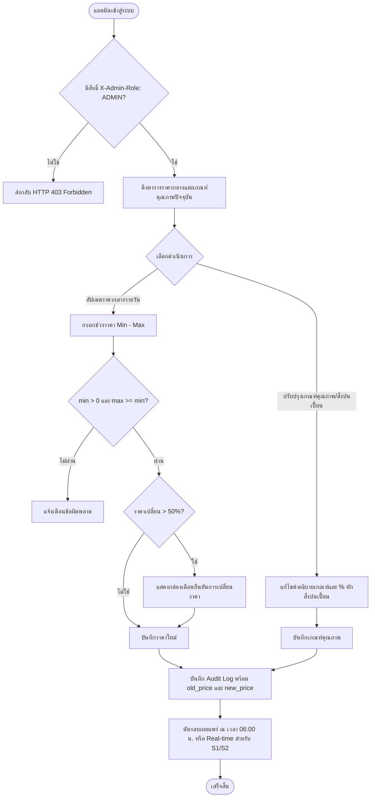

# ฝั่งผู้ดูแลระบบ ลำดับที่ 2: ระบบจัดการราคากลางและหมวดหมู่วัสดุ (`2. ระบบจัดการราคากลางและหมวดหมู่วัสดุ`)

- **Version:** `2.0` | **Status:** `reviewed-post-clarify` | **Owner:** กลุ่ม 2 (แพลตฟอร์มรับซื้อของเก่า/ซาเล้ง)
- **อ้างอิงอาร์ติแฟกต์ที่เกี่ยวข้อง:**
  - ตารางแบ่งฟีเจอร์ฝั่ง **`ผู้ดูแลระบบ`** ลำดับที่ **`2`**
  - สารบัญ Use Cases ระบบกลาง: **`UC-03: ตรวจสอบราคากลางประจำวัน`** และ **`UC-05: ประเมินราคาของชิ้นใหญ่เหมาจ่าย`** ([`docs/srs/use-cases.md`](../../../docs/srs/use-cases.md))
  - บทบาท Stakeholder: **`ผู้ดูแลระบบ (Admin) และผู้ควบคุมราคากลาง` (`SH-04`)**, **`ตัวแทนลานรับซื้อของเก่า` (`SH-03`)** (ผู้ให้ข้อมูลราคาตลาดอ้างอิง), **`ตัวแทนซาเล้ง` (`SH-01`)**, **`ตัวแทนผู้ขาย` (`SH-02`)**
  - Business Rule: **`BR-01: ราคาที่แสดงต้องเป็นช่วง (ต่ำสุด–สูงสุด) ไม่ใช่ตัวเลขตายตัว`** ([`specs/000-shared/constraints.md`](../../000-shared/constraints.md))
  - ความต้องการที่เกี่ยวข้อง:
    - **`REQ-DAT-001`**: ตารางราคากลางอ้างอิงรายวันจำแนกตามประเภทและเกรดวัสดุ พร้อมระบุวันเวลาอัปเดตล่าสุด
    - **`REQ-FN-003`**: กำหนดเกณฑ์คุณภาพการคัดแยก เงื่อนไขการหักน้ำหนักสิ่งปนเปื้อน และช่วงราคาเหมาจ่ายของขยะชิ้นใหญ่
    - **`REQ-BR-002` / `D-00-02`**: การล็อกราคา (Price Snapshot) ณ จังหวะที่ซาเล้งกดรับงาน (`S2 -> S3`) เพื่อใช้คำนวณและอนุญาตส่วนต่างราคาหน้างานไม่เกิน `±15%`
    - **`REQ-SEC-001`**: บันทึกประวัติการปรับปรุงราคาและเกณฑ์คุณภาพลงใน Audit Log แบบ Append-only
    - **`REQ-UX-001` / `CC-01`**: หน้าจอแดชบอร์ดแอดมิน Responsive SPA ทัชทาร์เก็ตปุ่มกด $\ge 48\text{px}$ ทุกปุ่ม
    - **`CC-03`**: ควบคุมสิทธิ์แอดมินผ่าน Header `X-Admin-Role: ADMIN` (ส่งกลับ `HTTP 403 Forbidden` หากไม่มีสิทธิ์)
    - **`CC-05`**: ระบบทำงานในโหมด Online-only เพื่อความถูกต้องของราคาแบบเรียลไทม์

---

## 1. ขอบเขตการทำงาน (Feature Scope)

1. **การควบคุมและเผยแพร่ราคากลางประจำวัน (`Daily Benchmark Price Publishing` — `REQ-DAT-001`, `BR-01`, `D-A02-01`, `D-A02-02`):**
   - แอดมินสามารถเรียกดู ตรวจสอบ และอัปเดตตารางราคากลางอ้างอิงของวัสดุรีไซเคิลแต่ละประเภท (เช่น กระดาษลัง `3–4 บาท/กก.`, กระดาษขาวดำ `6–7 บาท/กก.`, ขวดแก้ว `1–2 บาท/กก.`, ขวดพลาสติก `5–8 บาท/กก.`, เศษเหล็ก `7–10 บาท/กก.`)
   - **เวลาตัดรอบเผยแพร่ราคา (`D-A02-01`):** แอดมินสามารถอัปเดตราคาล่วงหน้าได้ตลอดเวลา โดยระบบมีรอบเวลาตัดรอบเผยแพร่ราคากลางประจำวันอย่างเป็นทางการ ณ เวลา **`06:00 น.`** ของทุกวัน เพื่อให้สอดคล้องกับเวลาที่ซาเล้งเริ่มวิ่งงานและหน้าราคาฝั่งผู้ขาย (`specs/seller/04-pricing-and-decision/`)
   - **กลไกราคาสำรองอัตโนมัติ (`Fallback to Previous Price`):** หากวันใดแอดมินไม่ได้เข้ามาอัปเดตราคาใหม่ก่อนเวลา `06:00 น.` ระบบจะดึงตารางราคาฐานของวันก่อนหน้ามาใช้งานอัตโนมัติ พร้อมแสดงวันเวลาอัปเดตล่าสุดให้ผู้ใช้ทราบ
   - **กฎการตรวจสอบความถูกต้องของราคา (`Price Validation Rules` — `D-A02-02`):**
     - ต้องระบุเป็นช่วงราคา: `min_price_per_unit > 0` และ `max_price_per_unit >= min_price_per_unit`
     - ค่าราคารองรับทศนิยมไม่เกิน 2 ตำแหน่ง
     - มีระบบเตือนยืนยัน (Confirmation Warning) กรณีราคาที่กรอกมีการเปลี่ยนแปลงเพิ่มขึ้นหรือลดลงเกิน `50%` เทียบกับราคาก่อนหน้า เพื่อป้องกันการพิมพ์ตัวเลขผิดพลาด

2. **การกำหนดเกณฑ์คุณภาพและการหักสิ่งปนเปื้อน (`Quality Grading & Contamination Rules` — `REQ-FN-003`, `D-A02-03`):**
   - แอดมินสามารถกำหนดและปรับปรุงคำอธิบายสภาพวัสดุ เงื่อนไขการคัดแยก และสูตรการหักน้ำหนักสิ่งปนเปื้อน
   - กำหนดระดับคุณภาพมาตรฐาน 3 ระดับ (`D-A02-03`):
     1. **`GRADE_A` (สะอาด/แห้ง/คัดแยกสมบูรณ์):** ไม่หักสิ่งปนเปื้อน (หักน้ำหนัก `0%`) คำนวณราคาที่ขอบบนของช่วง (`max_price`)
     2. **`GRADE_B` (ปนเปื้อนเล็กน้อย/ชื้นเล็กน้อย):** หักน้ำหนักสิ่งปนเปื้อน **`5%`** ของน้ำหนักชั่งจริง หรือคิดราคาที่ค่าเฉลี่ยกึ่งกลางช่วง
     3. **`GRADE_C` (ปนเปื้อนมาก/เปียกน้ำ/คละเกรด):** หักน้ำหนักสิ่งปนเปื้อน **`10%`** ของน้ำหนักชั่งจริง หรือคิดราคาที่ขอบล่างของช่วง (`min_price`)

3. **การจัดการช่วงราคาประเมินของขยะชิ้นใหญ่เหมาจ่าย (`Bulky Waste Lump-sum Pricing` — `REQ-FN-003`, `D-A02-04`):**
   - แอดมินสามารถจัดการช่วงราคาประเมินและเกณฑ์สภาพของขยะชิ้นใหญ่ที่คิดราคาเป็น **"ชิ้น/เครื่อง" (`PIECE`)**
   - หมวดหมู่มาตรฐานครอบคลุม:
     - `ตู้เย็น` (`200–300 บาท/เครื่อง`)
     - `เครื่องซักผ้า` (`150–250 บาท/เครื่อง`)
     - `เครื่องปรับอากาศ/แอร์` (`300–500 บาท/เครื่อง`)
     - `โทรทัศน์/จอภาพ` (`50–150 บาท/เครื่อง`)
     - `เฟอร์นิเจอร์/เตียง/เบาะ` (`0–100 บาท/ชิ้น` ขึ้นอยู่กับสภาพและความต้องการคนช่วยยกตาม `REQ-FN-004`)

4. **ผลกระทบต่อคำขอในระบบและความต่อเนื่องของข้อมูล (`Impact on Active Orders` — `REQ-BR-002`, `D-00-02`, `D-A02-05`):**
   - **ออเดอร์สถานะ `S1 (Draft)` และ `S2 (Pending)`:** เมื่อแอดมินอัปเดตราคากลางใหม่ ระบบจะคำนวณราคาประเมินใหม่ตามเรตราคากลางล่าสุดทันที
   - **ออเดอร์สถานะ `S3 (Claimed)` ถึง `S7 (Completed)`:** **ล็อกราคาเดิมตาม Price Snapshot** ณ จังหวะที่ซาเล้งกดรับงาน (`S2 -> S3`) เพื่อให้การชั่งจริงหน้างานและการออกใบเสร็จดิจิทัลมีความแน่นอน และอนุญาตให้ส่วนต่างราคาหน้างานไม่เกิน `±15%` ตามเกณฑ์ `D-00-02`

5. **ความปลอดภัย สิทธิ์การเข้าถึง และ Audit Logging (`Admin RBAC & Audit Trail` — `REQ-SEC-001`, `CC-03`, `CC-05`, `D-A02-06`):**
   - บังคับการตรวจสอบ Header `X-Admin-Role: ADMIN` ในทุก API Endpoint แอดมิน หากไม่มีสิทธิ์จะส่งกลับ `HTTP 403 Forbidden`
   - ระบบทำงานแบบ Online-only (`CC-05`)
   - บันทึก Audit Log แบบ Append-only ทุกครั้งที่มีการแก้ไขราคาหรือเกณฑ์คุณภาพ:
     - `ADMIN_UPDATED_BENCHMARK_PRICE`: บันทึกรหัสหมวดหมู่, ช่วงราคาเดิม (`old_min`, `old_max`), และช่วงราคาใหม่ (`new_min`, `new_max`)
     - `ADMIN_UPDATED_GRADING_RULES`: บันทึกเกณฑ์คุณภาพ คำอธิบาย และเปอร์เซ็นต์การหักสิ่งปนเปื้อน

---

## 2. เกณฑ์การยอมรับ (`Acceptance Criteria`)

- **`AC-A02-01` (Daily Benchmark Price Publishing — `REQ-DAT-001`, `BR-01`, `D-A02-01`, `D-A02-02`):**
  - แอดมินสามารถเรียกดูและอัปเดตช่วงราคากลาง (`ต่ำสุด–สูงสุด`) ของขยะแต่ละประเภทผ่านระบบแอดมินได้
  - ระบบตรวจสอบ `min_price > 0` และ `max_price >= min_price` พร้อมทศนิยมไม่เกิน 2 ตำแหน่ง
  - ระบบมีรอบตัดเวลาเผยแพร่ราคารายวัน ณ เวลา `06:00 น.` และหากไม่มีการอัปเดต ระบบจะใช้ราคาฐานของวันก่อนหน้าโดยอัตโนมัติ พร้อมแสดงวันเวลาอัปเดตล่าสุด

- **`AC-A02-02` (Quality Grading & Contamination Rules — `REQ-FN-003`, `D-A02-03`):**
  - แอดมินสามารถกำหนดและปรับปรุงเกณฑ์คุณภาพ 3 ระดับ (`GRADE_A`, `GRADE_B`, `GRADE_C`) และกำหนดเงื่อนไขการหักน้ำหนักสิ่งปนเปื้อน (`0%`, `5%`, `10%`) ของแต่ละหมวดหมู่วัสดุได้

- **`AC-A02-03` (Bulky Waste Lump-sum Price Management — `REQ-FN-003`, `D-A02-04`):**
  - แอดมินสามารถกำหนดและปรับปรุงช่วงราคาประเมินเหมาจ่ายสำหรับขยะชิ้นใหญ่ (หน่วย `PIECE`) เช่น ตู้เย็น, เครื่องซักผ้า, แอร์, ทีวี ได้อย่างถูกต้อง

- **`AC-A02-04` (Price Snapshot Integrity on Ongoing Orders — `REQ-BR-002`, `D-00-02`, `D-A02-05`):**
  - เมื่อมีการอัปเดตราคากลางใหม่ คำขอในสถานะ `S1` และ `S2` จะได้รับราคาประเมินใหม่
  - คำขอในสถานะ `S3` ถึง `S7` จะยังคงใช้ราคาเดิมตาม Price Snapshot ที่ล็อกไว้ ณ เวลาที่ซาเล้งกดรับงานอย่างเคร่งครัด

- **`AC-A02-05` (Admin RBAC & Price Audit Logging — `REQ-SEC-001`, `CC-03`, `CC-05`, `D-A02-06`):**
  - ทุกการแก้ไขราคากลางและเกณฑ์คุณภาพ ต้องถูกบันทึกลงใน `audit_logs` แบบ Append-only (`ADMIN_UPDATED_BENCHMARK_PRICE`, `ADMIN_UPDATED_GRADING_RULES`) พร้อมรหัสแอดมินและค่าราคาก่อน-หลังแก้
  - การเรียกใช้ Admin API โดยไม่มีสิทธิ์ `X-Admin-Role: ADMIN` ต้องถูกปฏิเสธด้วย `HTTP 403 Forbidden`

---

## 3. ขอบเขตและสิ่งที่ไม่ทำในรอบนี้ (`Scope & Non-goals`)

| อยู่ในขอบเขตที่ต้องทำ (In-Scope) | อยู่นอกขอบเขตและไม่ทำในรอบนี้ (Non-goals / Out of Scope) |
| :--- | :--- |
| จัดการราคากลางรายวันของวัสดุ 3 กลุ่มหลักตามน้ำหนัก (`kg`) | ไม่ทำระบบเชื่อมโยง API ตลาดซื้อขายขยะรีไซเคิลต่างประเทศแบบ Real-time (แอดมินเป็นผู้ป้อนราคา) |
| จัดการช่วงราคาเหมาจ่ายของขยะชิ้นใหญ่เป็นรายชิ้น (`PIECE`) | ไม่ทำระบบประมูลราคา (Bidding System) ขยะชิ้นใหญ่ (ใช้การประเมินราคาตามช่วงมาตรฐาน) |
| กำหนดระดับคุณภาพ 3 ระดับและการหักสิ่งปนเปื้อน (0%, 5%, 10%) | ไม่ทำระบบตรวจจับคุณภาพขยะอัตโนมัติด้วย AI Image Classification (ใช้การตรวจตาชั่งและสภาพหน้างาน) |
| ป้องกัน Human Error ด้วยการแจ้งเตือนยืนยันหากราคาเปลี่ยนเกิน $\pm 50\%$ | ไม่รองรับการใช้งานโหมดออฟไลน์สำหรับหน้าจอแอดมิน (`CC-05` Online-only เสมอ) |
| บันทึก Audit Log ทุกครั้งที่แก้ไขราคาหรือเกณฑ์คุณภาพ | ไม่ทำระบบพยากรณ์แนวโน้มราคาขยะล่วงหน้าด้วย Machine Learning |

---

## 4. ประเด็นคำถามเปิดที่ได้รับการคลี่คลายแล้ว (`Resolved Questions & Decisions`)

| รหัส | ประเด็นคำถาม | ข้อสรุปและทางเลือกที่เลือก | การตัดสินใจ (`Decision ID`) |
| :---: | :--- | :--- | :---: |
| **`Q-01`** | เวลาตัดรอบเผยแพร่ราคากลางประจำวันขัดแย้งกัน (`08:30 น.` vs `06:00 น.`) | กำหนดเวลาตัดรอบเผยแพร่ราคากลางประจำวันทางการ ณ เวลา **`06:00 น.`** ของทุกวัน เพื่อให้สอดคล้องกับฝั่งผู้ขาย (`AC-S04-01`) และเวลาเริ่มวิ่งงานของซาเล้ง หากไม่ได้อัปเดตให้ใช้ราคาของวันก่อนหน้าอัตโนมัติ | **`D-A02-01`** |
| **`Q-02`** | กฎการตรวจสอบความถูกต้องของช่วงราคากลาง (`BR-01`) | บังคับ `min_price > 0`, `max_price >= min_price`, ทศนิยมไม่เกิน 2 ตำแหน่ง และมีระบบเตือนยืนยันหากราคาขยับเกิน `±50%` จากวันก่อนหน้า | **`D-A02-02`** |
| **`Q-03`** | โครงสร้างเกณฑ์คุณภาพและการหักน้ำหนักสิ่งปนเปื้อน | กำหนด 3 ระดับมาตรฐาน: `GRADE_A` (สะอาด/แห้ง หัก 0%), `GRADE_B` (ปนเปื้อน/ชื้นเล็กน้อย หัก 5%), `GRADE_C` (ปนเปื้อนมาก/เปียกน้ำ หัก 10%) | **`D-A02-03`** |
| **`Q-04`** | หมวดหมู่และช่วงราคาขยะชิ้นใหญ่เหมาจ่าย (`REQ-FN-003`) | กำหนดหน่วยเป็น `PIECE` ครอบคลุม: ตู้เย็น (200–300 บ.), เครื่องซักผ้า (150–250 บ.), แอร์ (300–500 บ.), ทีวี (50–150 บ.), เตียง/เฟอร์นิเจอร์ (0–100 บ.) | **`D-A02-04`** |
| **`Q-05`** | ผลกระทบต่อออเดอร์ในระบบเมื่อมีการปรับราคากลาง | ออเดอร์ `S1` และ `S2` คำนวณราคาใหม่ตามเรตล่าสุด, ส่วนออเดอร์ `S3..S7` ล็อกราคาเดิมตาม Price Snapshot ณ เวลาที่กดรับงาน (`REQ-BR-002`, `D-00-02`) | **`D-A02-05`** |
| **`Q-06`** | สิทธิ์การเข้าถึงและความปลอดภัยสำหรับระบบราคากลาง | ตรวจสอบ Header `X-Admin-Role: ADMIN` (`HTTP 403`), ทำงานแบบ Online-only (`CC-05`), บันทึก Audit Log `ADMIN_UPDATED_BENCHMARK_PRICE` และ `ADMIN_UPDATED_GRADING_RULES` พร้อมค่าเก่าและใหม่ | **`D-A02-06`** |

---

## 5. แผนภาพลำดับสถานะและการทำงาน (Workflow Diagram)

---

## 6. โครงสร้างข้อมูลจำลองและ API สำหรับ Admin Feature 02

### 6.1 โครงสร้างข้อมูลตาราง (Database Schema)

- **`benchmark_prices` (ราคากลางรายวัน):**
  - `id`: string (UUID)
  - `category_code`: string (เช่น `MAT-CARDBOARD`, `MAT-PLASTIC-BOTTLE`, `BULKY-FRIDGE`)
  - `category_name`: string (ชื่อภาษาไทย)
  - `unit`: string (`kg` หรือ `piece`)
  - `min_price_per_unit`: float (ราคาต่ำสุด)
  - `max_price_per_unit`: float (ราคาสูงสุด)
  - `grading_condition`: string (คำอธิบายเงื่อนไขเกรด A)
  - `effective_date`: string (วันที่บังคับใช้ YYYY-MM-DD)
  - `updated_at`: string (วันเวลาที่อัปเดต ISO 8601)
  - `updated_by`: string (รหัสแอดมิน)

- **`quality_grading_rules` (เกณฑ์คุณภาพและการหักสิ่งปนเปื้อน):**
  - `category_code`: string
  - `grade_level`: string (`GRADE_A`, `GRADE_B`, `GRADE_C`)
  - `description`: string (คำอธิบายสภาพวัสดุ)
  - `contamination_deduction_percent`: float (0.0, 5.0, 10.0)
  - `price_multiplier`: float (1.0, 0.95, 0.90)

### 6.2 รายการเส้นทาง API แอดมิน (Admin Endpoints)

| Method | Path | หน้าที่ | สิทธิ์ที่ต้องการ |
| :---: | :--- | :--- | :---: |
| `GET` | `/api/v1/admin/benchmark-prices` | ดึงรายการราคากลางและเกณฑ์คุณภาพทั้งหมด | `ADMIN` (`CC-03`) |
| `PUT` | `/api/v1/admin/benchmark-prices/{category_code}` | แก้ไขช่วงราคากลางของหมวดหมู่วัสดุ | `ADMIN` (`CC-03`) |
| `PUT` | `/api/v1/admin/benchmark-prices/grading/{category_code}` | แก้ไขเกณฑ์คุณภาพและการหักสิ่งปนเปื้อน | `ADMIN` (`CC-03`) |
| `POST` | `/api/v1/admin/benchmark-prices/batch-update` | อัปเดตราคากลางหลายหมวดหมู่พร้อมกันสำหรับรอบวันใหม่ | `ADMIN` (`CC-03`) |
| `GET` | `/api/v1/admin/benchmark-prices/history/{category_code}` | ดึงประวัติการปรับราคาของหมวดหมู่วัสดุ | `ADMIN` (`CC-03`) |
