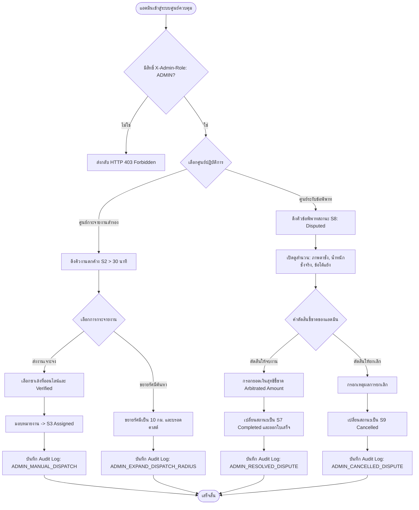

# ฝั่งผู้ดูแลระบบ ลำดับที่ 3: ศูนย์ควบคุมการจับคู่งานและข้อพิพาท (`3. ศูนย์ควบคุมการจับคู่งานและข้อพิพาท`)

- **Version:** `2.0` | **Status:** `reviewed-post-clarify` | **Owner:** กลุ่ม 2 (แพลตฟอร์มรับซื้อของเก่า/ซาเล้ง)
- **อ้างอิงอาร์ติแฟกต์ที่เกี่ยวข้อง:**
  - ตารางแบ่งฟีเจอร์ฝั่ง **`ผู้ดูแลระบบ`** ลำดับที่ **`3`**
  - สารบัญ Use Cases ระบบกลาง: **`UC-13: จัดการข้อพิพาทและงานตกค้าง`** ([`docs/srs/use-cases.md`](../../../docs/srs/use-cases.md))
  - บทบาท Stakeholder: **`ผู้ดูแลระบบ (Admin) และผู้ควบคุมศูนย์กระจายงาน` (`SH-04`)**, **`ตัวแทนซาเล้ง` (`SH-01`)**, **`ตัวแทนผู้ขาย` (`SH-02`)**
  - State Machine ที่เกี่ยวข้อง: **`MD-STM-04`**
    - **`S2: รอผู้รับซื้อ / รอผู้รับงาน (Pending / Open)`**
    - **`S8: อยู่ระหว่างตรวจสอบข้อพิพาท (Disputed / Frozen)`**
    - **`S7: สำเร็จ / ปิดงาน (Completed)`**
    - **`S9: ยกเลิกใบงาน (Cancelled)`**
  - ความต้องการที่เกี่ยวข้อง:
    - **`REQ-FN-005`**: การยืนยันน้ำหนักสองฝ่าย (`Dual-party Weight Confirmation`) และการบันทึกหลักฐานภาพตาชั่ง
    - **`REQ-FN-004`**: ภาพถ่ายของเก่าและการประเมินสภาพ
    - **`REQ-BR-002` / `D-00-02`**: การล็อกราคา Price Snapshot และการคุมส่วนต่างราคาหน้างาน
    - **`REQ-SEC-001`**: บันทึกประวัติการตัดสินและกระจายงานลงใน Audit Log แบบ Append-only
    - **`REQ-UX-001` / `CC-01`**: หน้าจอแดชบอร์ดแอดมิน Responsive SPA ทัชทาร์เก็ตปุ่มกด $\ge 48\text{px}$ ทุกปุ่ม
    - **`CC-03`**: ควบคุมสิทธิ์แอดมินผ่าน Header `X-Admin-Role: ADMIN` (ส่งกลับ `HTTP 403 Forbidden` หากไม่มีสิทธิ์)
    - **`CC-05`**: ระบบทำงานในโหมด Online-only เพื่อความถูกต้องของคิวงานและคำตัดสินแบบเรียลไทม์

---

## 1. ขอบเขตการทำงาน (Feature Scope)

1. **ระบบคัดกรองและกระจายงานกรณีสำรอง (`Manual Dispatch Fallback` — `UC-13`, `D-A03-02`, `D-A03-03`):**
   - แอดมินสามารถเรียกดูคิวคำขอนัดหมายสถานะ `S2 (Pending)` ที่ตกค้างเกิน **30 นาที** นับจากเวลาโพสต์ หรือคำขอที่ใกล้ถึงเวลานัดหมายภายใน 1 ชั่วโมง เพื่อป้องกันคำขอตกค้างในระบบ
   - กลไกการแทรกแซงกระจายงาน 2 รูปแบบ (`D-A03-03`):
     1. **Direct Assign:** แอดมินเลือกมอบหมายงานเจาะจงให้ซาเล้งที่มีสถานะ `Online` และผ่านการยืนยันตัวตน (`verified = True`) ในพื้นที่ โดยระบบจะส่งงานให้ซาเล้งรายนั้นทันที
     2. **Expand Radius Broadcast:** แอดมินกดขยายรัศมีการค้นหาจากปกติ 5.0 กม. เป็น **10.0 กม.** เพื่อกระจายสัญญาณคำขอไปยังซาเล้งในวงกว้าง
   - ป้องกันการมอบหมายซ้ำซ้อนด้วย Concurrency Lock (`CC-04`)

2. **ศูนย์จัดการและตัดสินข้อพิพาทหน้างาน (`Dispute Resolution & Arbitration` — `UC-13`, `REQ-FN-005`, `D-A03-01`, `D-A03-04`, `D-A03-05`):**
   - รับเรื่องร้องเรียนที่ถูกส่งเข้าสู่สถานะ **`S8: อยู่ระหว่างตรวจสอบข้อพิพาท (Disputed / Frozen)`** เมื่อผู้ขายปฏิเสธผลการชั่งน้ำหนักหน้างาน (`AC-04-08`, `AC-S06-02`)
   - ระบบแสดงชุดสำนวนหลักฐานประกอบการตัดสิน 4 มิติ (`Dispute Dossier` — `D-A03-04`):
     1. *ข้อมูลคำขอเดิม:* รายการขยะ, น้ำหนักประเมิน, ช่วงราคาประเมินเบื้องต้น (`est_min – est_max`), และ Price Snapshot ที่ล็อกไว้
     2. *ข้อมูลหน้างานจากซาเล้ง:* น้ำหนักชั่งจริงแยกหมวด (`actual_weight_kg`), ภาพถ่ายหน้าตาชั่งดิจิทัล (`scale_photo_url`), และราคาที่เสนอใหม่ (`re_quoted_price`)
     3. *ข้อมูลข้อโต้แย้งจากผู้ขาย:* เหตุผลการปฏิเสธ (`dispute_reason`) และภาพถ่ายของเก่าของผู้ขาย
     4. *ข้อมูลคู่กรณี:* ข้อมูลติดต่อผู้ขายและซาเล้ง พร้อมเวลาที่เกิดเหตุการณ์
   - ทางเลือกในการตัดสินชี้ขาดของแอดมิน (`D-A03-05`):
     1. **ตัดสินให้ปิดงาน (`RESOLVE_COMPLETE -> S7`):** แอดมินสามารถกรอก **"ยอดเงินสุทธิที่ตัดสินชี้ขาด" (Arbitrated Amount บาท)** เช่น ยึดตามราคาชั่งจริง หรือยอมรับยอดประนีประนอม พร้อมระบุหมายเหตุชี้ขาด และออกใบเสร็จดิจิทัล
     2. **ตัดสินให้ยกเลิกรายการ (`RESOLVE_CANCEL -> S9`):** ยกเลิกคำขอ ไม่มีการชำระเงิน พร้อมระบุเหตุผลการยกเลิก

3. **ความปลอดภัย สิทธิ์การเข้าถึง และ Audit Logging (`Admin RBAC & Audit Trail` — `REQ-SEC-001`, `CC-03`, `CC-05`, `D-A03-06`):**
   - ตรวจสอบ Header `X-Admin-Role: ADMIN` ทุก API Endpoint แอดมิน หากไม่มีสิทธิ์จะส่งกลับ `HTTP 403 Forbidden`
   - แอดมินทำงานแบบ Online-only (`CC-05`)
   - บันทึก Audit Log แบบ Append-only ทุกครั้งที่มีการแทรกแซงคิวงานหรือตัดสินข้อพิพาท:
     - `ADMIN_MANUAL_DISPATCH`: บันทึกการส่งงานให้ซาเล้งเจาะจง
     - `ADMIN_EXPAND_DISPATCH_RADIUS`: บันทึกการขยายรัศมีการค้นหา
     - `ADMIN_RESOLVED_DISPUTE`: บันทึกการตัดสินให้จบงาน (`S8 -> S7`) พร้อมยอดเงินชี้ขาด
     - `ADMIN_CANCELLED_DISPUTE`: บันทึกการสั่งยกเลิกข้อพิพาท (`S8 -> S9`)

---

## 2. เกณฑ์การยอมรับ (`Acceptance Criteria`)

- **`AC-A03-01` (Stalled Pending Orders Queue & Manual Dispatch — `UC-13`, `D-A03-02`, `D-A03-03`):**
  - แอดมินสามารถเรียกดูคิวคำขอสถานะ `S2 (Pending)` ที่ตกค้างเกิน 30 นาที หรือใกล้ถึงเวลานัดหมาย พร้อมแสดงระยะเวลาที่รอและพิกัดตำบล/แขวง
  - แอดมินสามารถเลือกซาเล้งที่ออนไลน์ในพื้นที่และกดยืนยันกระจายงานโดยตรง (`Direct Assign`) ได้สำเร็จ คำขอเปลี่ยนเป็น `S3 (Assigned)`
  - แอดมินสามารถกดปุ่มขยายรัศมีการค้นหา (`Expand Radius`) เป็น 10.0 กม. ได้สำเร็จ

- **`AC-A03-02` (Dispute Inspection Dossier Display — `UC-13`, `REQ-FN-005`, `D-A03-04`):**
  - แอดมินสามารถเรียกดูรายการข้อพิพาทในสถานะ `S8 (Disputed)` และเปิดดูชุดหลักฐานได้ครบถ้วน: รูปถ่ายหน้าตาชั่ง, น้ำหนักชั่งจริง, ราคาเสนอใหม่, เหตุผลการปฏิเสธของผู้ขาย และราคาประเมินเดิม

- **`AC-A03-03` (Dispute Resolution to Complete — `UC-13`, `D-A03-01`, `D-A03-05`):**
  - แอดมินสามารถระบุยอดเงินสุทธิที่ตัดสินชี้ขาด (Arbitrated Amount > 0 บาท) และกดยืนยันชี้ขาดให้จบงานได้
  - คำขอเปลี่ยนสถานะจาก `S8 -> S7 (Completed)` และระบบสร้างใบเสร็จดิจิทัลตามยอดเงินที่แอดมินระบุ

- **`AC-A03-04` (Dispute Resolution to Cancel — `UC-13`, `D-A03-01`, `D-A03-05`):**
  - แอดมินสามารถตัดสินสั่งยกเลิกคำขอที่เกิดข้อพิพาทพร้อมระบุเหตุผลได้
  - คำขอเปลี่ยนสถานะจาก `S8 -> S9 (Cancelled)` โดยไม่มีการทำธุรกรรมชำระเงิน

- **`AC-A03-05` (Admin RBAC & Dispute Audit Trail — `REQ-SEC-001`, `CC-03`, `CC-05`, `D-A03-06`):**
  - ทุกการเรียกใช้ Admin Dispatch & Dispute API ต้องตรวจสอบ Header `X-Admin-Role: ADMIN` หากไม่มีจะส่งกลับ `HTTP 403 Forbidden`
  - ทุกแอ็กชันการตัดสินและการกระจายงานต้องบันทึกลง `audit_logs` แบบ Append-only พร้อมรหัสแอดมินและข้อมูลหลักฐาน

---

## 3. ขอบเขตและสิ่งที่ไม่ทำในรอบนี้ (`Scope & Non-goals`)

| อยู่ในขอบเขตที่ต้องทำ (In-Scope) | อยู่นอกขอบเขตและไม่ทำในรอบนี้ (Non-goals / Out of Scope) |
| :--- | :--- |
| แสดงคิวงานตกค้าง `S2` ที่เกิน 30 นาที และเปิดให้แอดมินมอบหมายงานตรงหรือขยายรัศมี | ไม่ทำระบบ AI โทรศัพท์อัตโนมัติ (Automated Voice Bot) โทรหาซาเล้งเพื่อกดรับงาน |
| แสดงชุดหลักฐานข้อพิพาท `S8` (ภาพตาชั่ง, น้ำหนักจริง, ราคาเสนอใหม่, เหตุผลโต้แย้ง) | ไม่ทำระบบวิเคราะห์เสียงพูดหรือวิดีโอสดระหว่างคู่กรณีด้วย AI อัตโนมัติ |
| ให้แอดมินระบุยอดเงินชี้ขาดและตัดสินให้จบงาน (`-> S7`) หรือยกเลิก (`-> S9`) | ไม่ทำระบบหักเงินมัดจำล่วงหน้าจากกระเป๋าเงินซาเล้ง (Escrow Wallet) ใน MVP นี้ |
| บันทึกประวัติและเหตุผลการตัดสินลง Audit Log ทุกขั้นตอน | ไม่ทำระบบส่งเรื่องฟ้องร้องต่อหน่วยงานราชการภายนอกอัตโนมัติ |
| หน้าจอแอดมิน Responsive SPA ทัชทาร์เก็ตปุ่มกด $\ge 48\text{px}$ ทุกปุ่ม | ไม่รองรับการใช้งานโหมดออฟไลน์สำหรับหน้าจอแอดมิน (`CC-05` Online-only เสมอ) |

---

## 4. ประเด็นคำถามเปิดที่ได้รับการคลี่คลายแล้ว (`Resolved Questions & Decisions`)

| รหัส | ประเด็นคำถาม | ข้อสรุปและทางเลือกที่เลือก | การตัดสินใจ (`Decision ID`) |
| :---: | :--- | :--- | :---: |
| **`Q-01`** | ความขัดแย้งของรหัสสถานะ State Machine ระหว่าง `S8` และ `S9` | กำหนดสถานะข้อพิพาทอย่างเป็นทางการคือ **`S8: อยู่ระหว่างตรวจสอบข้อพิพาท (Disputed / Frozen)`** โดยเมื่อแอดมินตัดสินจบงานจะเปลี่ยนเป็น **`S7 (Completed)`** และหากตัดสินยกเลิกจะเปลี่ยนเป็น **`S9 (Cancelled)`** ตาม `glossary.md` และโค้ดปัจจุบัน | **`D-A03-01`** |
| **`Q-02`** | เกณฑ์เวลาในการระบุว่าเป็น "งานตกค้าง" (`Stalled/Timeout Pending`) | กำหนดให้คำขอสถานะ `S2` ที่ไม่มีซาเล้งกดรับเกิน **30 นาที** นับจากเวลาโพสต์ หรือเวลาปัจจุบันเข้าใกล้เวลานัดหมายภายใน 1 ชั่วโมง จะถูกดึงเข้าคิวงานตกค้างของแอดมิน | **`D-A03-02`** |
| **`Q-03`** | ทางเลือกในการกระจายงานกรณีสำรอง (`Manual Dispatch Fallback`) | แอดมินมี 2 ทางเลือก: 1. มอบหมายเจาะจงให้ซาเล้งที่ออนไลน์และผ่าน KYC (`Direct Assign`) 2. กดขยายรัศมีการค้นหาจาก 5 กม. เป็น 10 กม. (`Expand Radius Broadcast`) | **`D-A03-03`** |
| **`Q-04`** | ชุดข้อมูลหลักฐานในสำนวนข้อพิพาท (`Dispute Dossier`) | แสดง 4 มิติ: 1. ข้อมูลคำขอเดิมและ Price Snapshot 2. ข้อมูลชั่งจริงและภาพตาชั่งจากซาเล้ง 3. ข้อโต้แย้งและเหตุผลจากผู้ขาย 4. ข้อมูลติดต่อคู่กรณี | **`D-A03-04`** |
| **`Q-05`** | ทางเลือกในการตัดสินชี้ขาดข้อพิพาทของแอดมิน | แอดมินมี 2 ทางเลือก: 1. ตัดสินให้ปิดงาน (`RESOLVE_COMPLETE -> S7`) พร้อมระบุยอดเงินชี้ขาดสุทธิ (Arbitrated Amount บาท) 2. ตัดสินสั่งยกเลิกคำขอ (`RESOLVE_CANCEL -> S9`) พร้อมระบุเหตุผล | **`D-A03-05`** |
| **`Q-06`** | การควบคุมสิทธิ์ Admin RBAC และ Audit Trail | ตรวจสอบ Header `X-Admin-Role: ADMIN` (`HTTP 403`), ทำงานแบบ Online-only (`CC-05`), บันทึก Audit Log 4 แอ็กชัน (`ADMIN_MANUAL_DISPATCH`, `ADMIN_EXPAND_DISPATCH_RADIUS`, `ADMIN_RESOLVED_DISPUTE`, `ADMIN_CANCELLED_DISPUTE`) | **`D-A03-06`** |

---

## 5. แผนภาพลำดับสถานะและการทำงาน (Workflow Diagram)

---

## 6. โครงสร้างข้อมูลจำลองและ API สำหรับ Admin Feature 03

### 6.1 โครงสร้างข้อมูลตาราง `dispute_reports`
- `dispute_id`: String (รหัสข้อพิพาท `DISP-YYYYMMDD-XXXX`)
- `order_id`: String (รหัสคำขอที่เกี่ยวข้อง)
- `seller_id`: String (รหัสผู้ขาย)
- `buyer_id`: String (รหัสซาเล้ง)
- `dispute_reason`: String (เหตุผลการร้องเรียน)
- `status`: String (`PENDING_ADMIN`, `RESOLVED_COMPLETED`, `RESOLVED_CANCELLED`)
- `arbitrated_amount`: Optional[Float] (ยอดเงินสุทธิที่ตัดสินชี้ขาด)
- `arbitration_note`: Optional[String] (หมายเหตุคำตัดสิน)
- `arbitrated_by`: Optional[String] (รหัสแอดมินผู้ชี้ขาด)
- `arbitrated_at`: Optional[String] (วันเวลาที่ตัดสิน)
- `created_at`: String (วันเวลาที่ร้องเรียน)

### 6.2 รายการ API สำหรับแอดมิน
- `GET /api/v1/admin/dispatch/stalled-orders`: ดึงรายการคำขอตกค้าง (`S2` > 30 นาที)
- `POST /api/v1/admin/dispatch/assign`: มอบหมายงานให้ซาเล้งเจาะจง (`order_id`, `saleng_id`)
- `POST /api/v1/admin/dispatch/expand-radius`: ขยายรัศมีการค้นหาของคำขอ (`order_id`, `new_radius_km`)
- `GET /api/v1/admin/disputes`: ดึงรายการข้อพิพาทสถานะ `PENDING_ADMIN` (`S8`)
- `GET /api/v1/admin/disputes/{dispute_id}`: ดึงสำนวนหลักฐานข้อพิพาทฉบับเต็ม
- `POST /api/v1/admin/disputes/{dispute_id}/resolve`: ตัดสินชี้ขาดให้จบงาน (`action: RESOLVE_COMPLETE`, `arbitrated_amount`, `note`) หรือยกเลิก (`action: RESOLVE_CANCEL`, `note`)
