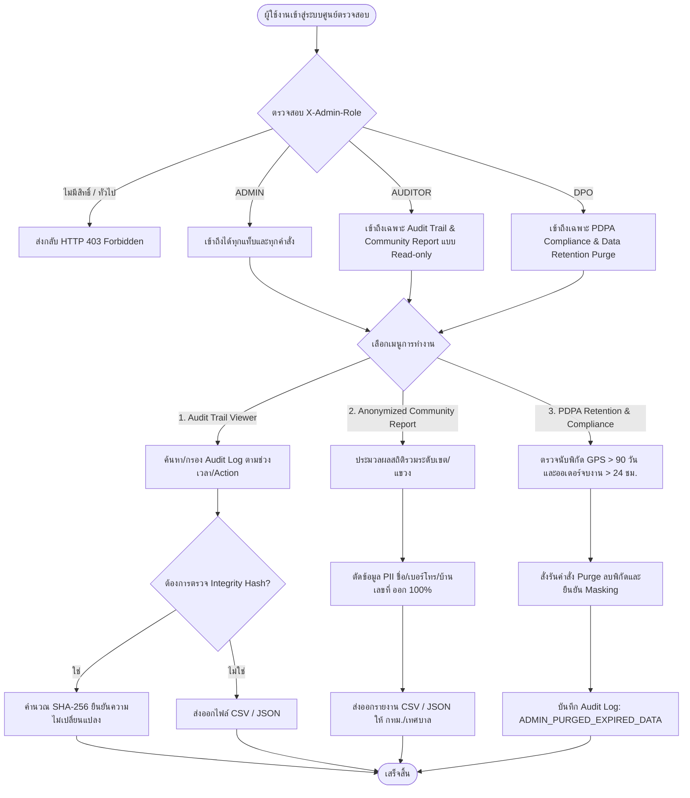

# ฝั่งผู้ดูแลระบบ ลำดับที่ 4: ระบบตรวจสอบ ความปลอดภัย และปฏิบัติตามกฎหมาย (`4. ระบบตรวจสอบ ความปลอดภัย และปฏิบัติตามกฎหมาย`)

- **Version:** `2.0` | **Status:** `reviewed-post-clarify` | **Owner:** กลุ่ม 2 (แพลตฟอร์มรับซื้อของเก่า/ซาเล้ง)
- **อ้างอิงอาร์ติแฟกต์ที่เกี่ยวข้อง:**
  - ตารางแบ่งฟีเจอร์ฝั่ง **`ผู้ดูแลระบบ`** ลำดับที่ **`4`**
  - สารบัญ Use Cases ระบบกลาง: **`UC-13: ตัดสินข้อพิพาท (S8) และตรวจสอบ Audit Log / PDPA Compliance`** ([`docs/srs/use-cases.md`](../../../docs/srs/use-cases.md))
  - บทบาท Stakeholder:
    - **`SH-05`**: ฝ่ายดูแลลูกค้า / ทีม Support
    - **`SH-07`**: ผู้ดูแลระบบ / ฝ่ายไอทีและความปลอดภัยข้อมูล
    - **`SH-09`**: เจ้าหน้าที่คุ้มครองข้อมูลส่วนบุคคล (`DPO`)
    - **`SH-10`**: ผู้ตรวจสอบ (`Auditor`) / หน่วยงานกำกับดูแล (`กทม. / เทศบาล`)
  - การตัดสินใจทางเทคนิค: **`P-07` (`TASKS-ROUTE T-10`)**: บันทึก `Audit Trail Log` แบบ Append-only ทุกครั้งที่กดรับงานและทำธุรกรรม
  - ความต้องการและข้อจำกัดที่เกี่ยวข้อง:
    - **`REQ-SEC-001`**: บันทึกประวัติการเปลี่ยนสถานะใบงาน การแก้ไขราคากลาง และการตัดสินข้อพิพาทลงใน Audit Log แบบ Append-only พร้อม SHA-256 Hash
    - **`REQ-SEC-002`**: การปกปิดข้อมูลส่วนบุคคล (`PDPA Data Masking`) ซ่อนบ้านเลขที่และพิกัดละเอียด
    - **`REQ-UX-001` / `CC-01`**: หน้าจอแดชบอร์ด Responsive SPA ทัชทาร์เก็ตปุ่มกด $\ge 48\text{px}$ ทุกปุ่ม
    - **`CC-03`**: ควบคุมสิทธิ์การเข้าถึงผ่าน Header `X-Admin-Role` แยก 4 บทบาท (`ADMIN`, `AUDITOR`, `DPO`, `SUPPORT`)
    - **`CC-05`**: ระบบทำงานในโหมด Online-only เพื่อความถูกต้องของการตรวจสอบข้อมูลแบบเรียลไทม์
    - **`CT-01`**: นโยบายความคุ้มครองข้อมูลส่วนบุคคล (PDPA) และรายงานชุมชนแบบไม่ระบุตัวตน

---

## 1. ขอบเขตการทำงาน (Feature Scope)

1. **ระบบสืบค้น กรอง และส่งออกร่องรอยตรวจสอบธุรกรรม (`Audit Trail Log Viewer & Export` — `P-07`, `T-10`, `REQ-SEC-001`, `D-A04-01`, `D-A04-05`):**
   - ผู้ดูแลระบบ (`SH-07`) และผู้ตรวจสอบ (`SH-10 / Auditor`) สามารถเรียกดูประวัติการเปลี่ยนแปลงข้อมูลสำคัญในระบบย้อนหลัง
   - รองรับตัวกรองหลายมิติ: ประเภทแอ็กชัน (`action`), บทบาทผู้กระทำ (`actor_role`), รหัสผู้กระทำ (`actor_id`), ช่วงวันที่ (`start_date` ถึง `end_date`)
   - รองรับการส่งออกข้อมูลบันทึกในรูปแบบไฟล์ `CSV` และ `JSON`
   - ระบบยืนยันความไม่เปลี่ยนแปลง (`Immutable Log`): ทุกระเบียนคำนวณและเก็บบันทึก `log_hash` ด้วยอัลกอริทึม **SHA-256** พร้อม API ตรวจสอบความถูกต้องของ Hash (`Verify Integrity`) เพื่อยืนยันว่าไม่มีการแก้ไขหรือลบย้อนหลัง

2. **ระบบควบคุมการเข้าถึงตามบทบาท (`Role-Based Access Control — RBAC Enforcement` — `AC-A04-02`, `CC-03`, `D-A04-02`):**
   - ตรวจสอบบทบาทเจ้าหน้าที่ผ่าน Header `X-Admin-Role` อย่างเข้มงวด:
     1. **`ADMIN` (ผู้ดูแลระบบ/ไอที `SH-07`):** สิทธิ์เข้าถึงเต็มรูปแบบทุกโมดูล (KYC, ราคากลาง, กระจายงาน/ข้อพิพาท, Audit Log, Compliance)
     2. **`AUDITOR` (ผู้ตรวจสอบภายนอก/ภายใน `SH-10`):** สิทธิ์ Read-only เข้าถึงเฉพาะ Audit Trail Log Viewer, Anonymized Community Report, และการตรวจสอบความถูกต้องของ Hash (หากเรียก API แก้ไขจะส่งกลับ `HTTP 403 Forbidden`)
     3. **`DPO` (เจ้าหน้าที่คุ้มครองข้อมูล `SH-09`):** สิทธิ์เข้าถึงแดชบอร์ด PDPA Compliance ตรวจสอบสถานะ Data Masking และสั่ง Purge ข้อมูลพิกัดที่หมดอายุ
     4. **`SUPPORT` (ทีมช่วยเหลือลูกค้า `SH-05`):** สิทธิ์เข้าถึงข้อมูลสนับสนุนผู้ใช้ แต่ถูกบล็อกไม่ให้เข้าถึง Audit Trail Log เชิงลึกหรือดาวน์โหลดรายงานตรวจสอบ
   - ผู้ใช้งานทั่วไป (`Seller`, `Collector`) และบทบาทที่ไม่ได้รับอนุญาตจะถูกปฏิเสธด้วย `HTTP 403 Forbidden`

3. **ระบบจัดการระยะเวลาจัดเก็บและทำลายข้อมูลส่วนบุคคล (`PDPA Data Retention & Purge Policy` — `CT-01`, `REQ-SEC-002`, `D-A04-04`):**
   - กำหนดเกณฑ์ระยะเวลาการจัดเก็บข้อมูล (`Retention Period`):
     1. **พิกัด GPS ซาเล้ง (`Saleng.currentLocation`):** เก็บรักษาไว้สูงสุด **90 วัน** เพื่อประโยชน์ในการตรวจสอบเส้นทางและข้อพิพาท หลังจาก 90 วันระบบจะ Purge ทิ้ง
     2. **ข้อมูลที่อยู่บ้านเลขที่ผู้ขาย (`addressText` / `lat, lng` ละเอียด):** เปิดเผยให้ซาเล้งเฉพาะช่วงกำลังเดินทางรับซื้อ (`S3..S6`) และหลังจากจบงาน (`S7/S9`) เกิน **24 ชั่วโมง** ระบบจะคืนสถานะเป็น Masked ถาวร
   - เปิด Endpoint ให้ DPO ตรวจสอบสถานะการจัดเก็บข้อมูล (`Retention Status`) และสั่งดำเนินการล้างข้อมูลที่หมดอายุ (`Purge Expired Data`)

4. **ระบบรายงานสถิติปริมาณขยะรีไซเคิลชุมชนแบบไม่ระบุตัวตน (`Anonymized Community Report` — `CT-01`, `REQ-SEC-002`, `D-A04-03`):**
   - รวบรวมและจัดกลุ่มข้อมูลสถิติขยะรีไซเคิลระดับชุมชน (ระดับเขต/แขวง) ส่งออกให้สำนักสิ่งแวดล้อม กทม. และเทศบาล (`SH-10`)
   - แสดงมิติข้อมูล: แขวง, เขต, ช่วงเวลา (เดือน/ปี), หมวดหมู่วัสดุ, น้ำหนักรวม (`กก.`), มูลค่าซื้อขายรวม (`บาท`), และจำนวนครั้งที่รับซื้อสำเร็จ
   - **รับประกันปลอดข้อมูลส่วนบุคคล 100%:** ปราศจากชื่อผู้ขาย, เบอร์โทรศัพท์, บ้านเลขที่, และพิกัดตำแหน่งรายบุคคล ส่งออกเป็นไฟล์ `CSV` และ `JSON`

---

## 2. เกณฑ์การยอมรับ (`Acceptance Criteria`)

- **`AC-A04-01` (Audit Trail Log Query, Filtering & Export — `P-07`, `REQ-SEC-001`, `D-A04-01`, `D-A04-05`):**
  - แอดมินและ Auditor สามารถเรียกดูรายการบันทึก Audit Log พร้อมตัวกรองตาม `action`, `actor_role`, `start_date`, และ `end_date`
  - สามารถส่งออกบันทึก Audit Log ออกเป็นไฟล์ `CSV` และ `JSON` ได้อย่างถูกต้อง และตอบสนองภายใน `< 2.0 วินาที` (P95 ตาม `REQ-OP-001`)

- **`AC-A04-02` (Immutable Audit Integrity & Hash Verification — `P-07`, `REQ-SEC-001`, `D-A04-05`):**
  - ทุกระเบียนในตาราง `audit_logs` มีฟิลด์ `log_hash` ที่คำนวณด้วย `SHA-256` จากข้อมูลระเบียนแบบ Append-only
  - แอดมินและ Auditor สามารถเรียกใช้ฟังก์ชันตรวจสอบความสมบูรณ์ (`Verify Integrity`) เพื่อยืนยันว่าไม่มีระเบียนใดถูกดัดแปลงย้อนหลัง

- **`AC-A04-03` (Role-Based Access Control Enforcement — `AC-A04-02`, `CC-03`, `D-A04-02`):**
  - ระบบตรวจสอบ Header `X-Admin-Role` อย่างเข้มงวด:
    - อนุญาตให้ `AUDITOR` เรียกดู Audit Log และดาวน์โหลดรายงานสถิติได้ แต่ปฏิเสธการแก้ไขข้อมูลด้วย `HTTP 403 Forbidden`
    - อนุญาตให้ `DPO` เรียกดูสถานะ Compliance และสั่ง Purge ข้อมูลหมดอายุได้
    - ปฏิเสธผู้ใช้ที่ไม่มีบทบาทหรือบทบาททั่วไป (`Seller`, `Collector`, `Support`) ที่พยายามเข้าถึง API ตรวจสอบด้วย `HTTP 403 Forbidden`

- **`AC-A04-04` (PDPA Data Retention & Purge Management — `CT-01`, `REQ-SEC-002`, `D-A04-04`):**
  - แอดมินและ DPO สามารถเรียกดูสถานะการจัดเก็บข้อมูล (`Retention Status`) ว่ามีพิกัดหรือข้อมูลที่รอทำลายกี่รายการ
  - เมื่อสั่งประมวลผล Purge ระบบจะล้างข้อมูลพิกัด GPS ที่มีอายุเกิน 90 วัน และยืนยันการ Masking ข้อมูลที่อยู่บ้านเลขที่หลังจบงานเกิน 24 ชั่วโมง

- **`AC-A04-05` (Anonymized Community Waste Report — `AC-A04-03`, `REQ-SEC-002`, `CT-01`, `D-A04-03`):**
  - ระบบสามารถประมวลผลและส่งออกรายงานสถิติขยะชุมชนจัดกลุ่มตามเขต/แขวง โดยไม่มีข้อมูลส่วนบุคคล (`No PII 100%`)
  - รองรับการส่งออกข้อมูลทั้งรูปแบบ `CSV` และ `JSON` พร้อมสรุปน้ำหนักรวมและมูลค่ารวม

---

## 3. ขอบเขตและสิ่งที่ไม่ทำในรอบนี้ (`Scope & Non-goals`)

| อยู่ในขอบเขตที่ต้องทำ (In-Scope) | อยู่นอกขอบเขตและไม่ทำในรอบนี้ (Non-goals / Out of Scope) |
| :--- | :--- |
| ตารางสืบค้นและส่งออก Audit Trail Log (CSV / JSON) พร้อม SHA-256 Hash | ไม่ทำระบบเชื่อมต่อ Blockchain / Distributed Ledger ภายนอกใน MVP นี้ |
| การบังคับใช้ RBAC 4 บทบาท (`ADMIN`, `AUDITOR`, `DPO`, `SUPPORT`) ผ่าน Header | ไม่ทำระบบ Single Sign-On (SSO) ด้วย SAML 2.0 / Active Directory ภายนอก |
| แดชบอร์ดตรวจสอบสถานะ PDPA Retention และ API สั่ง Purge พิกัดเกิน 90 วัน | ไม่ทำระบบลายเซ็นดิจิทัลเข้ารหัสขั้นสูง (PKI Hardware Token) สำหรับ Auditor |
| รายงานสถิติขยะชุมชนแบบไม่ระบุตัวตน (Anonymized Report) ตามเขต/แขวง | ไม่ทำระบบส่งข้อมูล Real-time API ตรงเข้าสู่เซิร์ฟเวอร์สำนักสิ่งแวดล้อม กทม. |
| หน้าจอ Responsive SPA ทัชทาร์เก็ตปุ่มกด $\ge 48\text{px}$ ทุกปุ่ม ในโหมด Online-only | ไม่รองรับการใช้งานโหมดออฟไลน์สำหรับหน้าจอตรวจสอบความปลอดภัย (`CC-05`) |

---

## 4. ประเด็นคำถามเปิดที่ได้รับการคลี่คลายแล้ว (`Resolved Questions & Decisions`)

| รหัส | ประเด็นคำถาม | ข้อสรุปและทางเลือกที่เลือก | การตัดสินใจ (`Decision ID`) |
| :---: | :--- | :--- | :---: |
| **`Q-01`** | เงื่อนไขการกรองและการส่งออก Audit Trail Log | กรองได้ตาม `action`, `actor_id`, `actor_role`, ช่วงวันที่ `start_date` ถึง `end_date` พร้อม pagination และมีปุ่มดาวน์โหลดไฟล์ `CSV` และ `JSON` | **`D-A04-01`** |
| **`Q-02`** | ตารางสิทธิ์ Role-Based Access Control (RBAC Matrix) | กำหนด Header `X-Admin-Role`: `ADMIN` (สิทธิ์เต็ม), `AUDITOR` (Read-only Audit Log & Community Report ห้ามแก้ไข), `DPO` (จัดการ PDPA Compliance & Purge), `SUPPORT` (ดูข้อมูลช่วยเหลือทั่วไป ห้ามดู Audit Log) | **`D-A04-02`** |
| **`Q-03`** | โครงสร้างรายงานสถิติขยะชุมชน (Anonymized Report) | จัดกลุ่มสถิติระดับเขต/แขวง รายเดือน/ปี แสดงน้ำหนักรวม มูลค่ารวม รอบรับซื้อ โดยตัดข้อมูล PII ออก 100% ส่งออกเป็น `CSV` และ `JSON` สำหรับ กทม./เทศบาล | **`D-A04-03`** |
| **`Q-04`** | นโยบายระยะเวลาจัดเก็บและทำลายข้อมูลส่วนบุคคล (Data Retention) | พิกัด GPS ซาเล้งเก็บสูงสุด **90 วัน** แล้ว Purge ทิ้ง, บ้านเลขที่ผู้ขายเปิดเผยเฉพาะช่วงเดินทาง และกลับมา Masked ถาวรหลังจบงานเกิน **24 ชั่วโมง** | **`D-A04-04`** |
| **`Q-05`** | กลไกยืนยันความไม่เปลี่ยนแปลงของ Audit Log (Immutable Hash) | ทุกระเบียนใน `audit_logs` คำนวณ `log_hash` ด้วย `SHA-256` บันทึกแบบ Append-only พร้อมมี API ให้ Auditor ตรวจสอบ Integrity ป้องกันการแก้ไขย้อนหลัง | **`D-A04-05`** |
| **`Q-06`** | โครงสร้างหน้าจอแดชบอร์ดความปลอดภัยและตรวจสอบ | หน้าจอ SPA 3 แท็บ: (1) Audit Trail Viewer, (2) Anonymized Community Report, (3) PDPA Compliance & Retention ทัชทาร์เก็ต $\ge 48\text{px}$ Online-only | **`D-A04-06`** |

---

## 5. แผนภาพลำดับการทำงาน (Workflow Diagram)

---

## 6. โครงสร้างข้อมูลและ API สำหรับ Admin Feature 04

### 6.1 โครงสร้างข้อมูลตาราง `audit_logs` (ขยายเพื่อรองรับ `SHA-256 Hash`)
- `log_id`: String (UUID)
- `action`: String (`ADMIN_MANUAL_DISPATCH`, `ORDER_CLAIMED`, `BENCHMARK_UPDATED`, `DISPUTE_RESOLVED`, `DATA_PURGED`, ฯลฯ)
- `entity_id`: String (รหัสอ้างอิงของข้อมูลที่เกี่ยวข้อง)
- `actor_id`: String (รหัสผู้กระทำ เช่น `admin-01`, `saleng-01`)
- `actor_role`: String (`ADMIN`, `AUDITOR`, `DPO`, `COLLECTOR`, `SELLER`)
- `details`: Dict / JSON (รายละเอียดข้อมูลก่อน-หลัง)
- `timestamp`: String (ISO 8601 UTC)
- `log_hash`: String (SHA-256 Checksum ของระเบียนเพื่อยืนยัน Immutability)

### 6.2 รายการ API สำหรับ Admin Feature 04
- `GET /api/v1/admin/compliance/audit-logs`: สืบค้นและกรอง Audit Log (`action`, `actor_role`, `start_date`, `end_date`, `limit`, `offset`)
- `GET /api/v1/admin/compliance/audit-logs/export`: ส่งออก Audit Log เป็นไฟล์ `CSV` หรือ `JSON` (`format=csv|json`)
- `GET /api/v1/admin/compliance/audit-logs/verify-integrity`: ตรวจสอบความสมบูรณ์ของ `SHA-256 Hash` ทุกระเบียน
- `GET /api/v1/admin/compliance/reports/community-waste`: ดึงรายงานสถิติปริมาณขยะชุมชนจัดกลุ่มตามเขต/แขวง แบบปลอด PII 100%
- `GET /api/v1/admin/compliance/reports/community-waste/export`: ส่งออกรายงานชุมชนเป็นไฟล์ `CSV` หรือ `JSON` สำหรับ กทม./เทศบาล
- `GET /api/v1/admin/compliance/retention-status`: ตรวจสอบสถานะข้อมูลส่วนบุคคลและจำนวนพิกัด GPS ที่ค้างเกิน 90 วัน
- `POST /api/v1/admin/compliance/purge-expired`: สั่งลบพิกัด GPS ที่หมดอายุเกิน 90 วัน และยืนยันการ Masking ข้อมูลที่อยู่หลังจบงานเกิน 24 ชม.
