# แผนสถาปัตยกรรมและเทคโนโลยี: ระบบบัญชีและการยืนยันตัวตนซาเล้ง (`specs/buyer/01-account-and-kyc/plan.md`)

- **Version:** `1.0` | **Status:** `ready-for-tasks` | **Owner:** กลุ่ม 2 (แพลตฟอร์มรับซื้อของเก่า/ซาเล้ง)
- **อ้างอิงสเปก:** [`specs/buyer/01-account-and-kyc/spec.md`](./spec.md) (v2.0)
- **ข้อจำกัดกลาง:** [`specs/000-shared/constraints.md`](../../000-shared/constraints.md) (`CC-01..CC-06`, `REQ-SEC-001..002`, `REQ-OP-001..002`, `D-00-01..03`)

---

## 1. เทคโนโลยีที่ใช้ (Tech Stack)

> [!NOTE]
> **หมายเหตุด้านเทคโนโลยี:** เทคโนโลยีที่ใช้ในโมดูลนี้ **`"ทีมเลือกเอง ไม่ได้มาจาก spec"`** เพื่อให้สอดคล้องกับสถาปัตยกรรมของโครงการทั้งระบบ:

- **Backend Framework:** **Python 3.11 + FastAPI**
  - สถาปัตยกรรม REST API แบบแยก Router, Controller (Service Layer) และ Data Access Layer
  - ตรวจสอบความถูกต้องของข้อมูล (Validation & Sanitization) ด้วย **Pydantic v2**
  - จัดการข้อผิดพลาดตามมาตรฐาน HTTP Status Codes (`400 Bad Request`, `401 Unauthorized`, `403 Forbidden`, `404 Not Found`, `409 Conflict`, `422 Unprocessable Entity`)
- **Database & Storage:** **Supabase (PostgreSQL 15+)**
  - จัดเก็บและเชื่อมโยงข้อมูล `saleng_profiles`, `collector_otps`, `collector_sessions`, `collector_kyc_submissions`, และ `audit_logs`
  - รองรับ Concurrency Control ด้วยคอลัมน์ `version` และ Unique Constraints (ตาม `CC-04`)
- **Frontend Framework:** **React 18 + Vite + TailwindCSS**
  - พัฒนาเป็น Single-Page Application (SPA) แบบ Mobile-First ตามข้อกำหนด `CC-01` (Viewport 375px–414px)
  - แคชเซสชันโทเคน (`session_token`) และข้อมูลโปรไฟล์/ยานพาหนะลงใน `localStorage` (`CC-05`, `REQ-OP-001`)
  - ปุ่มและองค์ประกอบ UI ออกแบบตาม `REQ-UX-001` (ความสูงขั้นต่ำ 48px สำหรับใช้งานกลางแจ้ง)
- **Automated Testing Suite:**
  - หลังบ้าน: **Pytest** พร้อม `TestClient` (FastAPI)
  - หน้าบ้าน: **Vitest + React Testing Library + JSDOM**

---

## 2. สถาปัตยกรรมระบบ (System Architecture)

```mermaid
flowchart TD
    subgraph Frontend ["Frontend (Mobile-First SPA - CC-01)"]
        UI_Login["CollectorPhoneLoginForm\n(กรอกเบอร์โทร + ขอ OTP + ยืนยัน 6 หลัก - AC-B01-01)"]
        UI_Profile["CollectorProfileCard\n(แสดงชื่อ + เบอร์โทร Masked + ป้ายสถานะ KYC - AC-B01-01)"]
        UI_Vehicle["VehicleConfigCard\n(เลือกประเภทยานพาหนะ + ระบุทะเบียน + ปรับความจุ กก. - AC-B01-02)"]
        UI_KycModal["KycSubmissionModal\n(กรอกเลข ปชช. 13 หลัก + แนบรูป 4 จุด - AC-B01-03)"]
        UI_KycBanner["KycStatusBanner\n(แถบแสดงสถานะ 4 ขั้น: UNVERIFIED / PENDING / VERIFIED / REJECTED)"]
        UI_GateModal["UnverifiedGateModal\n(ป๊อปอัปแจ้งเตือนบล็อกการรับงานเมื่อ verified=false - AC-B01-04)"]
        UI_Panel["CollectorAccountPanel\n(แผงแดชบอร์ดหลักจัดการบัญชีและ KYC ซาเล้ง)"]
    end

    subgraph Backend_API ["FastAPI Service Layer"]
        API_RequestOtp["POST /api/v1/collectors/auth/request-otp\n(ขอรหัส OTP ซาเล้ง - AC-B01-01)"]
        API_VerifyOtp["POST /api/v1/collectors/auth/verify-otp\n(ยืนยัน OTP + ออก Session Token - AC-B01-01)"]
        API_Logout["POST /api/v1/collectors/auth/logout\n(ออกจากระบบ + บันทึก Audit Log - AC-B01-05)"]
        API_GetProfile["GET /api/v1/collectors/{id}/profile\n(ดึงโปรไฟล์ + ข้อมูลรถ + สถานะ KYC)"]
        API_UpdateProfile["PUT /api/v1/collectors/{id}/profile\n(แก้ไขชื่อที่แสดง displayName)"]
        API_UpdateVehicle["PUT /api/v1/collectors/{id}/vehicle\n(บันทึกประเภทยานพาหนะและความจุ - AC-B01-02)"]
        API_SubmitKyc["POST /api/v1/collectors/{id}/kyc/submit\n(ส่งเอกสารยืนยันตัวตน Thai-ID/DBD-ID - AC-B01-03)"]
        API_GetKycStatus["GET /api/v1/collectors/{id}/kyc/status\n(ตรวจสอบสถานะและเหตุผลปฏิเสธ - AC-B01-03)"]
        API_JobClaimGate["GET /api/v1/collectors/{id}/job-claim-gate\n(ตรวจสอบสิทธิ์กดรับงานตามกฎ D-00-01 - AC-B01-04)"]
        API_MockApproval["POST /api/v1/collectors/{id}/mock-kyc-approval\n(จำลองการอนุมัติสำหรับ Dev/Test - Q-06)"]
        API_MockRejection["POST /api/v1/collectors/{id}/mock-kyc-rejection\n(จำลองการปฏิเสธสำหรับ Dev/Test - Q-06)"]
    end

    subgraph Core_Services ["Business Logic & Services"]
        SVC_Auth["CollectorAuthService\n(จัดการ OTP Generation, Verification, Session Management, Latency < 2.0s)"]
        SVC_Vehicle["CollectorVehicleService\n(ตรวจสอบความถูกต้องของประเภทยานพาหนะ และค่าน้ำหนักบรรทุกตาม BR-03)"]
        SVC_Kyc["CollectorKycService\n(จัดการคำขอ KYC 4 สถานะ, ตรวจสอบเลข ปชช. 13 หลัก, และ Unverified Gate)"]
        SVC_Audit["AuditLogService\n(บันทึกเหตุการณ์ลงใน audit_logs แบบ Append-only - REQ-SEC-001)"]
    end

    subgraph Database ["Supabase / PostgreSQL (CC-04)"]
        DB_Collectors["saleng_profiles (หรือ collectors)"]
        DB_Otps["collector_otps"]
        DB_Sessions["collector_sessions"]
        DB_Kyc["collector_kyc_submissions"]
        DB_Audit["audit_logs (REQ-SEC-001)"]
    end

    UI_Login --> API_RequestOtp
    UI_Login --> API_VerifyOtp
    UI_Profile --> API_GetProfile
    UI_Vehicle --> API_UpdateVehicle
    UI_KycModal --> API_SubmitKyc
    UI_KycBanner --> API_GetKycStatus
    UI_GateModal --> API_JobClaimGate
    API_RequestOtp --> SVC_Auth
    API_VerifyOtp --> SVC_Auth
    API_UpdateVehicle --> SVC_Vehicle
    API_SubmitKyc --> SVC_Kyc
    API_JobClaimGate --> SVC_Kyc
    API_MockApproval --> SVC_Kyc
    API_MockRejection --> SVC_Kyc
    SVC_Auth --> DB_Otps
    SVC_Auth --> DB_Sessions
    SVC_Vehicle --> DB_Collectors
    SVC_Kyc --> DB_Kyc
    SVC_Kyc --> DB_Collectors
    SVC_Kyc --> SVC_Audit
    SVC_Audit --> DB_Audit
```



---

## 3. โครงสร้างฐานข้อมูลและ Data Models

### 3.1 DDL Schema สำหรับ Supabase / PostgreSQL (`CC-04`)

```sql
-- 1. ตารางข้อมูลโปรไฟล์และประเภทยานพาหนะของซาเล้ง (saleng_profiles)
CREATE TABLE IF NOT EXISTS saleng_profiles (
    saleng_id VARCHAR(64) PRIMARY KEY,
    phone VARCHAR(20) NOT NULL UNIQUE,
    phone_masked VARCHAR(20) NOT NULL,
    display_name VARCHAR(100) NOT NULL,
    avatar_url TEXT,
    vehicle_type VARCHAR(50) DEFAULT 'TRICYCLE', -- 'TRICYCLE', 'SIDE_CAR_MOTORCYCLE', 'PICKUP_TRUCK'
    license_plate VARCHAR(50),
    max_capacity_kg NUMERIC(8, 2) DEFAULT 150.0,
    verified BOOLEAN DEFAULT FALSE,
    kyc_status VARCHAR(30) DEFAULT 'UNVERIFIED', -- 'UNVERIFIED', 'PENDING_REVIEW', 'VERIFIED', 'REJECTED'
    rejection_reason TEXT,
    rating NUMERIC(3, 2) DEFAULT 5.0,
    completed_jobs_count INTEGER DEFAULT 0,
    is_online BOOLEAN DEFAULT FALSE,
    current_location JSONB, -- { "lat": 13.75, "lng": 100.50 }
    created_at TIMESTAMPTZ DEFAULT NOW(),
    updated_at TIMESTAMPTZ DEFAULT NOW()
);

-- 2. ตารางรหัส OTP สำหรับเข้าสู่ระบบ (collector_otps)
CREATE TABLE IF NOT EXISTS collector_otps (
    id UUID PRIMARY KEY DEFAULT gen_random_uuid(),
    phone VARCHAR(20) NOT NULL,
    otp_code VARCHAR(10) NOT NULL,
    expires_at TIMESTAMPTZ NOT NULL,
    is_used BOOLEAN DEFAULT FALSE,
    created_at TIMESTAMPTZ DEFAULT NOW()
);

-- 3. ตารางเซสชันโทเคน (collector_sessions)
CREATE TABLE IF NOT EXISTS collector_sessions (
    token VARCHAR(128) PRIMARY KEY,
    saleng_id VARCHAR(64) REFERENCES saleng_profiles(saleng_id) ON DELETE CASCADE,
    created_at TIMESTAMPTZ DEFAULT NOW(),
    expires_at TIMESTAMPTZ NOT NULL,
    is_active BOOLEAN DEFAULT TRUE
);

-- 4. ตารางประวัติการส่งเอกสารยืนยันตัวตน KYC (collector_kyc_submissions)
CREATE TABLE IF NOT EXISTS collector_kyc_submissions (
    id UUID PRIMARY KEY DEFAULT gen_random_uuid(),
    saleng_id VARCHAR(64) REFERENCES saleng_profiles(saleng_id) ON DELETE CASCADE,
    id_card_no VARCHAR(20) NOT NULL,
    full_name VARCHAR(150) NOT NULL,
    id_card_photo_url TEXT NOT NULL,
    selfie_photo_url TEXT NOT NULL,
    vehicle_photo_url TEXT,
    status VARCHAR(30) DEFAULT 'PENDING_REVIEW', -- 'PENDING_REVIEW', 'VERIFIED', 'REJECTED'
    rejection_reason TEXT,
    submitted_at TIMESTAMPTZ DEFAULT NOW(),
    reviewed_at TIMESTAMPTZ,
    reviewed_by VARCHAR(64)
);
```

### 3.2 Pydantic Data Models (`backend/app/models/collector_account_models.py`)

- **`CollectorOtpRequest`**: ตรวจสอบความถูกต้องเบอร์โทรศัพท์มือถือ 10 หลัก (Regex `^0[689]\d{8}$`)
- **`CollectorOtpVerifyRequest`**: ตรวจสอบเบอร์โทรและรหัส OTP 6 หลัก
- **`CollectorAuthResponse`**: ข้อมูลผลลัพธ์หลังยืนยัน OTP (`saleng_id`, `display_name`, `phone_masked`, `session_token`, `verified`, `kyc_status`, `vehicle_type`)
- **`VehicleProfileUpdateRequest`**: อัปเดตประเภทยานพาหนะ (`TRICYCLE`, `SIDE_CAR_MOTORCYCLE`, `PICKUP_TRUCK`), เลขทะเบียนรถ, และค่าน้ำหนักบรรทุกสูงสุด `max_capacity_kg > 0`
- **`KycSubmissionRequest`**: ส่งเอกสาร KYC (`id_card_no` ตรวจเลข 13 หลัก, `full_name`, `id_card_photo_url`, `selfie_photo_url`, `vehicle_photo_url`)
- **`KycStatusResponse`**: สถานะปัจจุบัน (`kyc_status`, `verified`, `rejection_reason`, `submitted_at`, `reviewed_at`)
- **`JobClaimGateCheckResponse`**: ตรวจสอบสิทธิ์กดรับงาน (`can_claim_job: bool`, `reason: Optional[str]`, `required_action: Optional[str]`)

---

## 4. การออกแบบ API Endpoints (`backend/app/api/v1/collector_account.py`)

| เส้นทาง API (`Route`) | Method | คำอธิบายและบทบาท | Request Body | Response Model / Status |
| :--- | :---: | :--- | :--- | :---: |
| `/api/v1/collectors/auth/request-otp` | `POST` | ขอรับรหัส OTP 6 หลักสำหรับการเข้าสู่ระบบ | `CollectorOtpRequest` | `200 OK` (`mock_otp`, `expires_in`) |
| `/api/v1/collectors/auth/verify-otp` | `POST` | ยืนยันรหัส OTP และออก Session Token | `CollectorOtpVerifyRequest` | `200 OK` (`CollectorAuthResponse`) |
| `/api/v1/collectors/auth/logout` | `POST` | ออกจากระบบและยกเลิกเซสชัน | None (Auth Header) | `200 OK` (`message`) |
| `/api/v1/collectors/{id}/profile` | `GET` | ดึงข้อมูลโปรไฟล์และสถานะยานพาหนะ | None | `200 OK` (`CollectorProfileResponse`) |
| `/api/v1/collectors/{id}/profile` | `PUT` | อัปเดตชื่อที่แสดง (`displayName`) | `CollectorProfileUpdateRequest` | `200 OK` |
| `/api/v1/collectors/{id}/vehicle` | `PUT` | ตั้งค่าประเภทยานพาหนะและความจุรถ | `VehicleProfileUpdateRequest` | `200 OK` |
| `/api/v1/collectors/{id}/kyc/submit` | `POST` | ส่งเอกสารยืนยันตัวตน Thai-ID/DBD-ID | `KycSubmissionRequest` | `201 Created` (`KycStatusResponse`) |
| `/api/v1/collectors/{id}/kyc/status` | `GET` | ตรวจสอบสถานะการยืนยันตัวตน | None | `200 OK` (`KycStatusResponse`) |
| `/api/v1/collectors/{id}/job-claim-gate` | `GET` | ตรวจสอบสิทธิ์การกดรับงานตามกฎ `D-00-01` | None | `200 OK` หรือ `403 Forbidden` |
| `/api/v1/collectors/{id}/mock-kyc-approval` | `POST` | จำลองการอนุมัติ KYC สำหรับ Dev/Test | None | `200 OK` (`verified=True`) |
| `/api/v1/collectors/{id}/mock-kyc-rejection` | `POST` | จำลองการปฏิเสธ KYC พร้อมระบุเหตุผล | `MockKycReviewRequest` | `200 OK` (`verified=False`) |

---

## 5. แผนการเชื่อมต่อระบบภายนอกและ Shared Services

1. **เชื่อมต่อกับระบบฐานข้อมูลกลาง (`backend/app/core/supabase.py`):**
   - ขยายโครงสร้าง `saleng_profiles` เดิมให้รองรับฟิลด์ `kyc_status`, `id_card_no`, `rejection_reason`
   - เพิ่มคอลเลกชัน `collector_otps`, `collector_sessions`, และ `collector_kyc_submissions`
2. **เชื่อมต่อกับ Seller 03 (`specs/seller/03-buyer-search-and-selection/`):**
   - เฉพาะซาเล้งที่มีสถานะ `verified = true` เท่านั้นที่จะแสดงในหน้าผลการค้นหาซาเล้งใกล้เคียงของผู้ขาย
3. **เชื่อมต่อกับ Buyer 04 (`specs/buyer/04-job-and-route-management/` / `specs/002-route/`):**
   - API รับงาน (`Claim Job`) ใน `UC-04` จะเรียกใช้ `CollectorKycService.assert_can_claim_job(saleng_id)` หากยังไม่ผ่าน KYC ระบบจะโยน `HTTP 403 Forbidden` ทันที
   - ค่าน้ำหนักบรรทุกสูงสุด `max_capacity_kg` จะถูกนำไปใช้ตรวจสอบไม่ให้น้ำหนักสะสมในเที่ยววิ่งเกินความจุรถตามกฎ `BR-03`
4. **บันทึกประวัติลง Audit Log (`REQ-SEC-001`):**
   - เรียกใช้ `supabase_store.add_audit_log` บันทึกทุกกิจกรรมด้านความปลอดภัย

---

## 6. แผนการพัฒนาหน้าจอ (Frontend Mobile-First SPA — `CC-01`)

พัฒนาคอมโพเนนต์ React 18 บนขนาดจอมือถือ (375px–414px) พร้อมปุ่มขนาดใหญ่ตาม `REQ-UX-001` (>= 48px):

1. **`CollectorPhoneLoginForm.jsx`:**
   - หน้าจอกรอกเบอร์มือถือและรหัส OTP 6 หลัก พร้อมปุ่มกดขนาดใหญ่ 48px ชัดเจน
2. **`CollectorProfileCard.jsx`:**
   - การ์ดแสดงข้อมูลส่วนตัวซาเล้ง, เบอร์โทรที่ถูก Mask PII (`08X-XXX-XXXX`), คะแนนดาวเฉลี่ย และป้ายสถานะ KYC
3. **`VehicleConfigCard.jsx`:**
   - แผงเลือกประเภทยานพาหนะ 3 แบบ (`TRICYCLE`, `SIDE_CAR_MOTORCYCLE`, `PICKUP_TRUCK`) พร้อมไอคอนประกอบ
   - ฟิลด์ระบุเลขทะเบียนรถ และช่องระบุน้ำหนักบรรทุกสูงสุด (กก.)
4. **`KycStatusBanner.jsx`:**
   - แถบเตือนสถานะ KYC 4 รูปแบบ:
     - สีเทา: ยังไม่ส่งเอกสาร (`UNVERIFIED`) พร้อมปุ่ม "ยืนยันตัวตนเลย"
     - สีส้ม: กำลังตรวจสอบ (`PENDING_REVIEW`)
     - สีเขียว: ยืนยันตัวตนแล้ว 100% (`VERIFIED`)
     - สีแดง: ไม่ผ่านการอนุมัติ (`REJECTED`) พร้อมแสดงเหตุผลและปุ่มส่งใหม่
5. **`KycSubmissionModal.jsx`:**
   - ป๊อปอัปกรอกเลขบัตร ปชช. 13 หลัก, ชื่อ-นามสกุล, และแนบรูปถ่าย 4 ภาพ
6. **`CollectorAccountPanel.jsx`:**
   - หน้าจอแดชบอร์ดหลักรวมส่วนหัว, แบนเนอร์สถานะ KYC, ข้อมูลยานพาหนะ, และปุ่มจำลองการอนุมัติสำหรับทดสอบ

---

## 7. การตัดสินใจเชิงสถาปัตยกรรม (`P-01` ถึง `P-06`)

| รหัสการตัดสินใจ | ประเด็นและแนวทางแก้ไข | รองรับ REQ / AC / ข้อจำกัด |
| :---: | :--- | :--- |
| **`P-01`** | **ระบบยืนยันตัวตนเข้าใช้งานด้วย Phone OTP และคงสภาพเซสชัน:** ซาเล้งเข้าสู่ระบบด้วยเบอร์โทรและ OTP 6 หลัก พร้อมออก `session_token` จัดเก็บใน `localStorage` รองรับการใช้งานต่อเนื่องและออฟไลน์ | `UC-01`, `REQ-QA-001`, `REQ-SEC-002`, `REQ-OP-001`, `CC-05`, `AC-B01-01`, `Q-01` |
| **`P-02`** | **การกำหนดประเภทยานพาหนะและขีดจำกัดความจุมาตรฐาน:** รองรับรถ 3 รูปแบบ (`TRICYCLE` 150 กก., `SIDE_CAR_MOTORCYCLE` 300 กก., `PICKUP_TRUCK` 1,000 กก.) และเปิดให้ปรับความจุจริงเพื่อใช้ใน `UC-04` | `REQ-FN-001`, `MD-DOM-04`, `BR-03`, `AC-B01-02`, `Q-04` |
| **`P-03`** | **ระบบส่งและตรวจสอบเอกสาร Thai-ID / DBD-ID:** บันทึกข้อมูลบัตรประชาชน 13 หลักและภาพถ่ายหลักฐาน 4 จุด ตรวจสอบความถูกต้องของเลขบัตร | `SC-04`, `REQ-QA-001`, `AC-B01-03`, `Q-02` |
| **`P-04`** | **วงจรสถานะ KYC 4 ขั้นตอน:** ควบคุมการเปลี่ยนสถานะระหว่าง `UNVERIFIED` ➔ `PENDING_REVIEW` ➔ `VERIFIED` / `REJECTED` พร้อมแจ้งเหตุผลและเปิดให้ส่งเอกสารใหม่ได้ | `MD-DOM-04`, `D-00-01`, `AC-B01-03`, `Q-03` |
| **`P-05`** | **การบังคับใช้กฎเหล็ก Unverified Gate ก่อนกดรับงาน:** บล็อกการกดรับงานด้วย `HTTP 403 Forbidden` หาก `verified = false` ตามข้อกำหนดความปลอดภัยของระบบกลาง | `D-00-01`, `REQ-SEC-001`, `AC-B01-04`, `Q-05` |
| **`P-06`** | **ระบบจำลองการอนุมัติสำหรับ Dev/Test และ Audit Trail:** เปิด Endpoint จำลอง `mock-kyc-approval` / `rejection` และบันทึกทุกกิจกรรมลงตาราง `AuditLog` แบบ Append-only | `REQ-SEC-001`, `EV-08`, `AC-B01-05`, `Q-06` |

---

## 8. ตารางตรวจสอบความครบถ้วนของข้อจำกัดกลาง (Constraints Traceability Table)

| รหัส Constraint | ข้อกำหนดใน Constraint กลาง (`specs/000-shared/constraints.md`) | การปฏิบัติตามในแผนงานนี้ | การเชื่อมโยงการตัดสินใจ |
| :---: | :--- | :--- | :---: |
| **`CC-01`** | Mobile-First Web SPA รองรับมือถือราคาประหยัด (`RAM >= 2 GB`, Android 9.0+) | พัฒนา UI ด้วย React 18 + TailwindCSS ออกแบบปุ่มใหญ่ >= 48px ตาม `REQ-UX-001` สำหรับซาเล้งใช้งานกลางแจ้ง | `P-01`, `P-02` |
| **`CC-02`** | GPS Sync Interval ทุก 60 วินาทีขณะเปิดสถานะ Online | ไม่เกี่ยวกับโมดูลนี้โดยตรง (เป็นหน้าที่ของ Buyer 03 และ Buyer 05) แต่โมดูลนี้เตรียมฟิลด์ `is_online` และ `current_location` ไว้รองรับ | สอดคล้อง |
| **`CC-03`** | Road Distance API รัศมี <= 5.0 กม. พร้อม Haversine Fallback | ไม่เกี่ยวกับโมดูลนี้โดยตรง (ใช้ใน Buyer 02, Buyer 04, Buyer 05) | สอดคล้อง |
| **`CC-04`** | PostgreSQL + Concurrency Control / Optimistic Locking | ใช้ตารางใน Supabase/PostgreSQL พร้อมคอลัมน์ `version` และ Unique Constraints บนเบอร์โทร | `P-01`, `P-03` |
| **`CC-05`** | Offline Cache ใน IndexedDB / Local Storage | แคชเซสชันโทเคนและข้อมูลโปรไฟล์/ยานพาหนะลงใน `localStorage` ให้เปิดดูได้แม้ออฟไลน์ | `P-01` |
| **`CC-06`** | PDPA & PII Masking ซ่อนบ้านเลขที่และพิกัดละเอียด | ซ่อนและแปลงเบอร์โทรศัพท์ซาเล้งเป็น `08X-XXX-XXXX` และคุ้มครองข้อมูลบัตรประชาชน | `P-01`, `P-03` |
| **`REQ-SEC-001`** | บันทึกประวัติการเปลี่ยนสถานะใบงานลงในตาราง Audit Log | บันทึกทุกการลงทะเบียน, เข้าสู่ระบบ, อัปเดตข้อมูลรถ, ส่งเอกสาร KYC, และผลอนุมัติลง `audit_logs` | `P-06` |
| **`REQ-SEC-002`** | แปลงเบอร์โทรศัพท์เป็น `08X-XXX-XXXX` | แสดงผลเบอร์โทรศัพท์ของซาเล้งบนหน้าจอด้วยรูปแบบ Masked PII เสมอ | `P-01` |
| **`REQ-OP-001`** | โหมด Offline Queue สำหรับดูข้อมูลที่แคชไว้ | ซาเล้งสามารถเปิดดูข้อมูลโปรไฟล์และสถานะยานพาหนะเดิมได้แม้ไม่มีสัญญาณอินเทอร์เน็ต | `P-01` |
| **`REQ-OP-002`** | Haversine Fallback สำหรับการคำนวณระยะทาง | ไม่เกี่ยวกับโมดูลนี้โดยตรง เพราะโมดูลนี้ไม่คำนวณระยะทางถนน | สอดคล้อง |
| **`D-00-01`** | KYC เป็น Precondition ของระบบผู้ซื้อ | **นำไปใช้โดยตรง:** ซาเล้งต้องผ่านการยืนยันตัวตน `verified = true` เท่านั้นจึงจะสามารถกดรับงานใน `UC-04` ได้ | `P-04`, `P-05` |
| **`D-00-02`** | ซ่อนพิกัดผู้ขายจนกว่าจะรับงาน | ไม่เกี่ยวกับโมดูลนี้โดยตรง (เป็นหน้าที่ของ Buyer 02 และ 04) | สอดคล้อง |
| **`D-00-03`** | ขอบเขตหยุดที่สถานะมีผู้รับงานแล้ว | โมดูลนี้ครอบคลุมการยืนยันตัวตนและการตั้งค่ายานพาหนะเพื่อเตรียมความพร้อมสู่การรับงาน | `P-02`, `P-05` |

