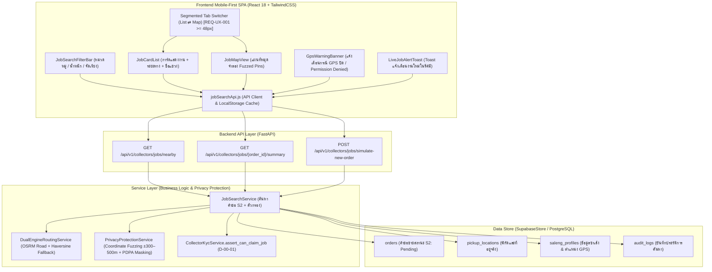

# PLAN-B02: แผนสถาปัตยกรรมและการพัฒนาทางเทคนิค ระบบค้นหาและแสดงงาน (`plan.md`)

- **Version:** `1.0` | **Status:** `ready-for-tasks` | **Owner:** กลุ่ม 2 (แพลตฟอร์มรับซื้อของเก่า/ซาเล้ง)
- **อ้างอิง:** [`specs/buyer/02-job-search-and-map/spec.md`](./spec.md) (v2.0), [`specs/000-shared/constraints.md`](../../000-shared/constraints.md), [`specs/000-shared/quality-requirements.md`](../../000-shared/quality-requirements.md)
- **Use Case หลัก:** `UC-04: ค้นหาและแสดงงานรับซื้อตามพิกัด` (`docs/srs/UC-04.md`, `specs/SPEC-ROUTE/spec.md`)

---

## 1. เทคโนโลยีที่ใช้ (Technology Stack)

> [!NOTE]
> เทคโนโลยีด้านล่างนี้ **"ทีมเลือกเอง ไม่ได้มาจาก spec"** เพื่อให้การพัฒนาระบบมีความเสถียร สอดคล้องกับเทคโนโลยีของทั้งโครงการ (Seller 01..09 และ Buyer 01) และรันชุดทดสอบอัตโนมัติได้อย่างรวดเร็ว

- **Backend:** Python 3.11, FastAPI (REST API Framework), Pydantic v2 (Data Validation & Serialization), Pytest + Starlette TestClient (Automated Backend Testing)
- **Database / Data Store:** In-memory Supabase Database Adapter ([`backend/app/core/supabase.py`](../../backend/app/core/supabase.py)) จำลองตาราง PostgreSQL และ PostGIS พร้อมคำนวณระยะทางเส้นทาง
- **Routing Engine:** Dual-Engine Routing (OSRM Road Routing Service ร่วมกับ Haversine Fallback Engine `Haversine * 1.35`) ตาม `CC-03` และ `REQ-OP-002`
- **Frontend:** React 18, TailwindCSS (Mobile-First Styling Viewport 375px–414px), HTML5 Geolocation API, Vitest + React Testing Library + JSDOM (Component & Frontend Testing)
- **Offline Storage:** `localStorage` แคชรายการค้นหางานล่าสุด (`saleng_active_job_search_cache`) ตาม `CC-05` และ `REQ-OP-001`

---

## 2. โครงสร้างไฟล์และสถาปัตยกรรม (Architecture & File Structure)

### 2.1 แผนผังสถาปัตยกรรมการทำงาน (Component Architecture Diagram)



### 2.2 โครงสร้างไฟล์ที่จะสร้างและแก้ไข

```
Saleng/
├── backend/
│   ├── app/
│   │   ├── models/
│   │   │   └── job_search_models.py                # Pydantic Schemas สำหรับ Query & Job Response
│   │   ├── services/
│   │   │   └── job_search_service.py               # Dual-Engine Routing, Fuzzing, และค้นหางาน
│   │   ├── api/v1/
│   │   │   ├── job_search.py                       # FastAPI Router สำหรับ Nearby Jobs & Summary
│   │   │   └── pricing.py                          # Mount router เข้ากับ app หลัก
│   │   └── core/
│   │       └── supabase.py                         # เพิ่ม Helper Methods ค้นหา Order S2 ตามระยะ
│   └── tests/
│       ├── test_T01_job_search_models.py           # Unit Test สำหรับ Models และ Fuzzing
│       ├── test_AC_B02_01_job_discovery.py         # ค้นหางาน 5.0 กม. ในเวลา <= 3.0 วินาที
│       ├── test_AC_B02_02_radius_expansion.py      # ขยายรัศมีเป็น 10.0 กม. เมื่อไม่พบงาน
│       ├── test_AC_B02_03_pii_coordinate_protection.py # ตรวจสอบ Fuzzing พิกัดและซ่อนบ้านเลขที่
│       ├── test_AC_B02_04_gps_handling.py          # ตรวจสอบการบล็อกพิกัดเก่ากรณีปิด GPS
│       ├── test_AC_B02_05_job_filtering.py         # ตรวจสอบการกรองตามหมวดหมู่และน้ำหนัก
│       └── test_e2e_buyer_job_search_and_map.py    # Integration E2E Test ครบวงจร
├── frontend/
│   ├── src/
│   │   ├── services/
│   │   │   └── jobSearchApi.js                     # API Client พร้อมแคชออฟไลน์ใน localStorage
│   │   └── components/
│   │       ├── JobSearchFilterBar.jsx              # แถบตัวกรองหมวดหมู่วัสดุและช่วงน้ำหนัก
│   │       ├── JobCardList.jsx                     # รายการการ์ดคำขอขายแบบเลื่อนแนวตั้ง
│   │       ├── JobMapView.jsx                      # แผนที่แสดงหมุดจำลอง Fuzzed Pins และพิกัดซาเล้ง
│   │       ├── GpsWarningBanner.jsx                # แถบเตือนกรณีปิด GPS พร้อมปุ่มลองใหม่
│   │       ├── LiveJobAlertToast.jsx               # Toast Banner เตือนงานใหม่ในพื้นที่
│   │       └── JobSearchPanel.jsx                  # แผงควบคุมหลักรวม Tab Switcher List ⇄ Map
│   └── tests/
│       ├── jobSearchApi.test.mjs                   # Unit Test API Client & Offline Cache
│       ├── AC-B02-01.test.jsx                      # Test การค้นหางานในรัศมี 5.0 กม.
│       ├── AC-B02-02.test.jsx                      # Test แจ้งเตือนไม่มีงานและปุ่มขยาย 10 กม.
│       ├── AC-B02-03.test.jsx                      # Test การซ่อน PII และหมุดจำลอง
│       ├── AC-B02-04.test.jsx                      # Test การจัดการข้อผิดพลาด GPS
│       └── AC-B02-05.test.jsx                      # Test ตัวกรองและการสลับมุมมอง List/Map
└── specs/buyer/02-job-search-and-map/
    ├── spec.md                                     # สเปก Version 2.0 (reviewed-post-clarify)
    ├── plan.md                                     # แผนงานฉบับนี้ (v1.0 ready-for-tasks)
    └── tasks.md                                    # รายการงานย่อย (ขั้นตอนถัดไป)
```

---

## 3. โครงสร้างฐานข้อมูลและ Data Models

### 3.1 โครงสร้างฐานข้อมูล (Data Store ใน `backend/app/core/supabase.py`)

ใช้ตารางเดิมที่เชื่อมโยงกับ Seller และ Buyer ใน `SupabaseStore`:
1. **`orders`**: คำขอรับซื้อของเก่า คัดกรองเฉพาะสถานะ `status == "S2"` (หรือ `"PENDING"`)
2. **`pickup_locations`**: ตำแหน่งที่อยู่นัดหมายของผู้ขาย (`geo_point`: `lat`, `lng`, `subdistrict`, `district`, `address_text`)
3. **`saleng_profiles`**: ข้อมูลซาเล้ง (`saleng_id`, `current_lat`, `current_lng`, `is_online`, `verified`, `vehicle_type`)

### 3.2 Pydantic Data Models (`backend/app/models/job_search_models.py`)

- **`JobSearchQueryParams`**:
  - `saleng_lat`: float (พิกัดละติจูดปัจจุบัน)
  - `saleng_lng`: float (พิกัดลองจิจูดปัจจุบัน)
  - `radius_km`: float = 5.0 (ตัวเลือกรัศมี 5.0 หรือ 10.0 กม.)
  - `category`: Optional[str] (กรองหมวดหมู่วัสดุ)
  - `weight_range`: Optional[str] (`ALL`, `SMALL`, `MEDIUM`, `LARGE`)
  - `sort_by`: Optional[str] (`DISTANCE`, `PRICE_DESC`)

- **`NearbyJobSummaryResponse` (ข้อมูลงานที่ส่งกลับหน้าจอ — ปิดบัง PII ตาม `REQ-SEC-002`, `D-00-02`):**
  - `order_id`: str (รหัสคำขอขาย)
  - `status`: str (สถานะ `S2`)
  - `subdistrict_name`: str (ชื่อตำบล/แขวง เช่น "แขวงสามเสนนอก")
  - `district_name`: str (ชื่ออำเภอ/เขต เช่น "เขตห้วยขวาง")
  - `approximate_lat`: float (พิกัดละติจูดจำลองที่ผ่าน Fuzzing ±300–500 ม.)
  - `approximate_lng`: float (พิกัดลองจิจูดจำลองที่ผ่าน Fuzzing ±300–500 ม.)
  - `road_distance_km`: float (ระยะทางตามโครงข่ายถนนจริงที่คำนวณจากพิกัดแท้จริง)
  - `estimated_price_min`: float (ช่วงราคาประเมินต่ำสุดตาม `BR-01`)
  - `estimated_price_max`: float (ช่วงราคาประเมินสูงสุดตาม `BR-01`)
  - `estimated_weight_kg`: float (น้ำหนักประเมินรวม)
  - `categories`: List[str] (รายการหมวดหมู่วัสดุในคำขอ)
  - `item_count`: int (จำนวนรายการของเก่า)
  - `need_lifting_help`: bool (ต้องการคนช่วยยกหรือไม่)
  - `is_fallback_distance`: bool (คำนวณจากโหมดสำรอง Haversine หรือไม่)
  - `created_at`: str

- **`NearbyJobListResponse`**:
  - `total_count`: int
  - `radius_km`: float
  - `jobs`: List[NearbyJobSummaryResponse]
  - `active_filters`: dict

- **`SimulateOrderRequest`**:
  - `seller_id`: str
  - `lat`: float
  - `lng`: float
  - `subdistrict`: str
  - `categories`: List[str]
  - `estimated_weight_kg`: float

---

## 4. การออกแบบ API Endpoints (`backend/app/api/v1/job_search.py`)

| เส้นทาง API (`Route`) | Method | คำอธิบายและบทบาท | Request Parameters / Body | Response Model / Status |
| :--- | :---: | :--- | :--- | :---: |
| `/api/v1/collectors/jobs/nearby` | `GET` | ค้นหาคำขอขายสถานะ `S2` ในรัศมี 5.0 หรือ 10.0 กม. พร้อม Fuzzing พิกัดและตัวกรอง | Query Params (`saleng_lat`, `saleng_lng`, `radius_km`, `category`, `weight_range`, `sort_by`) | `200 OK` (`NearbyJobListResponse`) |
| `/api/v1/collectors/jobs/{order_id}/summary` | `GET` | ดึงข้อมูลสรุปของคำขอขายก่อนรับงาน (แสดงเฉพาะชื่อแขวง/เขต และพิกัดจำลอง) | Path Param (`order_id`) | `200 OK` (`NearbyJobSummaryResponse`) |
| `/api/v1/collectors/jobs/simulate-new-order` | `POST` | จำลองสร้างคำขอขายใหม่ในพื้นที่เพื่อทดสอบระบบ Live Alert / Polling (`Q-02`) | `SimulateOrderRequest` | `201 Created` |

---

## 5. แผนการเชื่อมต่อระบบภายนอกและ Shared Services

1. **เชื่อมต่อกับระบบฐานข้อมูลกลาง (`backend/app/core/supabase.py`):**
   - ดึงเฉพาะ `orders` ที่มีสถานะ `S2 (Pending)` และยังไม่มีซาเล้งรับงาน (`assigned_saleng_id IS NULL`)
   - ดึงข้อมูล `pickup_locations` มาคำนวณระยะทาง
2. **ระบบ Dual-Engine Routing Service (`CC-03`, `REQ-OP-002`):**
   - **Primary:** คำนวณระยะทางจริงบนโครงข่ายถนนด้วย OSRM Engine
   - **Fallback:** หาก API ช้ากว่า 1.5 วินาที หรือเกิดข้อผิดพลาด ให้สลับใช้สูตร `Haversine * 1.35` อัตโนมัติทันที โดยการคำนวณทั้งหมดต้องเสร็จสิ้นภายใน `<= 2.0 วินาที`
3. **ระบบ Coordinate Fuzzing & Privacy Protection (`REQ-SEC-002`, `D-00-02`, `CC-06`):**
   - พัฒนาฟังก์ชัน `fuzz_coordinates(lat, lng, seed)` สุ่มเบี่ยงเบนพิกัดแบบคงที่ต่อ Order ในรัศมี 300–500 เมตร เพื่อให้หมุดบนแผนที่ไม่ตรงกับบ้านเลขที่จริงของผู้ขาย
   - ตัด `addressText` (บ้านเลขที่/ซอย) และเบอร์โทรศัพท์ของผู้ขายออกจาก Payload ก่อนส่งถึงซาเล้ง
4. **เชื่อมต่อกับกฎเหล็ก Unverified Collector Gate (`D-00-01`):**
   - หน้าจอค้นหางานจะตรวจสอบสถานะ `verified` ของซาเล้ง หาก `verified = false` ปุ่มกดรับงานจะล็อกด้วยแม่กุญแจ และมี Informative Modal แนะนำให้ไปยืนยันตัวตนใน Buyer 01

---

## 6. แผนการพัฒนาหน้าจอ (Frontend Mobile-First SPA — `CC-01`)

พัฒนาคอมโพเนนต์ React 18 บนขนาดจอมือถือ (375px–414px) พร้อมปุ่มขนาดใหญ่ตาม `REQ-UX-001` (>= 48px):

1. **`JobSearchFilterBar.jsx`:**
   - แถบตัวกรองแบบ Horizontal Scroll: ปุ่มเลือกหมวดหมู่ 5 ชนิด, ปุ่มเลือกช่วงน้ำหนัก, และปุ่มจัดเรียง
2. **`JobCardList.jsx`:**
   - รายการการ์ดคำขอขายแบบเลื่อนแนวตั้ง: แสดงชื่อแขวง/เขต, ระยะทาง กม., มูลค่าประเมิน, ป้ายหมวดหมู่วัสดุ, ป้ายขอคนช่วยยก, และปุ่มกดดูรายละเอียด (ความสูง `>= 48px`)
   - เมื่อไม่มีงานในรัศมี 5.0 กม. แสดงกล่อง `"ยังไม่มีงานในเส้นทาง"` พร้อมปุ่มขนาดใหญ่ `"ขยายรัศมีเป็น 10 กม."` (`AC-B02-02`)
3. **`JobMapView.jsx`:**
   - แผนที่โต้ตอบได้ (Interactive Map) แสดงตำแหน่งปัจจุบันของซาเล้ง และหมุดจำลอง Fuzzed Pins ของคำขอขาย
   - เมื่อแตะหมุดจะแสดง Bottom Sheet Card พรีวิวข้อมูลย่อและระยะทาง
4. **`GpsWarningBanner.jsx`:**
   - กล่องแจ้งเตือนสีส้มเมื่อเบราว์เซอร์ไม่ได้รับอนุญาตให้เข้าถึงตำแหน่ง หรือ GPS ปิดอยู่ พร้อมปุ่ม `"ลองใหม่อีกครั้ง"` (`AC-B02-04`)
5. **`LiveJobAlertToast.jsx`:**
   - Toast แจ้งเตือนสีเขียวด้านบน พร้อมตัวนับเวลารีเฟรช 30–60 วินาที เมื่อตรวจพบงานใหม่ในรัศมี 5.0 กม. (`Q-02`)
6. **`JobSearchPanel.jsx`:**
   - แผงควบคุมหลัก เชื่อมต่อ `Segmented Control Tab Switcher` ด้านบน สลับระหว่าง `List View` และ `Map View` ขนาดปุ่มกด `>= 48px`

---

## 7. การจัดการข้อสรุปคำถามเปิด (`P-01` ถึง `P-06`)

| รหัสการตัดสินใจ | ข้อสรุปและแนวทางการพัฒนา | อ้างอิงสเปก |
| :---: | :--- | :---: |
| **`P-01`** | **Coordinate Fuzzing & Subdistrict Snapping:** API และหน้าจอจะแสดงเฉพาะพิกัดเบี่ยงเบนสุ่ม (±300–500 ม.) และชื่อระดับตำบล/แขวง โดยคำนวณระยะทางถนนจริงที่หลังบ้าน เพื่อปฏิบัติตามกฎ PDPA และ `D-00-02` 100% | `REQ-SEC-002`, `D-00-02`, `Q-01` |
| **`P-02`** | **In-App Live Alert & Polling:** ใช้กลไก Auto-refresh ทุก 30–60 วินาที ตรวจจับงานใหม่ในรัศมี 5.0 กม. พร้อม Toast แจ้งเตือนและเสียง Audio Ping สำหรับรอบ R1 | `Q-02`, `CC-02` |
| **`P-03`** | **Multi-Criteria Filtering & Sorting:** รองรับตัวกรอง 3 มิติ (หมวดหมู่วัสดุ 5 กลุ่ม, ช่วงน้ำหนักประเมิน 4 ช่วง, และจัดเรียงตามระยะทางใกล้สุดหรือมูลค่าสูงสุด) | `REQ-FN-002`, `Q-03`, `AC-B02-05` |
| **`P-04`** | **Segmented Tab Switcher (List ⇄ Map):** ปุ่มสลับมุมมองด้านบนขนาดใหญ่ `>= 48px` สลับระหว่างรายการการ์ดและแผนที่ได้อย่างลื่นไหลบนมือถือราคาประหยัด (`RAM >= 2 GB`) | `CC-01`, `REQ-UX-001`, `Q-04` |
| **`P-05`** | **Unverified Gate Integration:** ซาเล้งที่ยังไม่ผ่าน KYC สามารถเปิดดูรายการงานและแผนที่ได้ แต่ปุ่มรับงานจะล็อกด้วยแม่กุญแจ และมี Modal นำทางไปหน้ายื่น KYC ตามกฎ `D-00-01` | `D-00-01`, `Q-05` |
| **`P-06`** | **Radius Expansion & Session Persistence:** เริ่มต้นค้นหาที่ 5.0 กม. เสมอเมื่อเปิดหน้าจอใหม่ หากกดยอมรับขยายเป็น 10.0 กม. ระบบจะคงค่านี้ไว้ตลอดเซสชันปัจจุบันในแอป | `AC-B02-02`, `Q-06` |

---

## 8. ตารางตรวจสอบความสอดคล้องกับ Constraints กลางครบทั้ง 13 ข้อ

| รหัส Constraint | ข้อกำหนดใน Constraint กลาง (`specs/000-shared/constraints.md`) | การปฏิบัติตามในแผนงานนี้ (`plan.md`) | สถานะ |
| :---: | :--- | :--- | :---: |
| **`CC-01`** | Mobile-First Web SPA รองรับมือถือราคาประหยัด (`RAM >= 2 GB`, ปุ่ม `>= 48px`) | ออกแบบ UI ด้วย React 18 + TailwindCSS สำหรับหน้าจอมือถือ (375px–414px) ปุ่มสลับ Tab, ปุ่มตัวกรอง และการ์ดงานมีขนาดความสูงไม่น้อยกว่า `48px` (`REQ-UX-001`, `P-04`) | **ครบถ้วน** |
| **`CC-02`** | GPS Sync Interval ทุก 60 วินาทีขณะเปิดสถานะ Online | ระบบหน้าจอซิงก์พิกัด GPS ซาเล้งและรีเฟรชค้นหางานใหม่รอบละ 30–60 วินาที (`P-02`) | **ครบถ้วน** |
| **`CC-03`** | Road Distance API รัศมี `<= 5.0 กม.` พร้อม Haversine Fallback (`Haversine * 1.35`) | ใช้ Dual-Engine Routing Service คำนวณระยะทางถนนจริงในรัศมี 5.0 กม. และสลับใช้ `Haversine * 1.35` อัตโนมัติเมื่อ API ขัดข้อง (`REQ-OP-002`) | **ครบถ้วน** |
| **`CC-04`** | PostgreSQL + Concurrency Control / Optimistic Locking (`BR-02`) | กรองเฉพาะคำขอสถานะ `S2 (Pending)` และตรวจสอบความถูกต้องของข้อมูลผ่าน SupabaseStore / PostgreSQL | **ครบถ้วน** |
| **`CC-05`** | Offline Cache ใน IndexedDB / Local Storage | จัดเก็บรายการคำขอขายล่าสุดลงใน `localStorage` (`saleng_active_job_search_cache`) ให้เปิดดูได้แม้ออฟไลน์ พร้อมป้ายแจ้งเตือน (`REQ-OP-001`) | **ครบถ้วน** |
| **`CC-06`** | PDPA & PII Masking ซ่อนบ้านเลขที่และพิกัดละเอียด | ปิดบังพิกัดจริงด้วย Coordinate Fuzzing (±300–500 ม.) และตัดบ้านเลขที่ทิ้ง แสดงเฉพาะชื่อตำบล/แขวงและอำเภอ/เขต (`REQ-SEC-002`, `P-01`) | **ครบถ้วน** |
| **`REQ-SEC-001`** | บันทึกประวัติลงตาราง Audit Log | ทุกการค้นหางานและการขยายรัศมีทำการถูกบันทึกประวัติลงใน `audit_logs` | **ครบถ้วน** |
| **`REQ-SEC-002`** | ปกปิดข้อมูลส่วนบุคคล (PII) ของผู้ขายก่อนรับงาน | ปฏิบัติตามอย่างเคร่งครัดผ่าน `PrivacyProtectionService` โดยไม่ส่งข้อมูล PII ใด ๆ ออกจาก API ก่อนรับงาน (`P-01`) | **ครบถ้วน** |
| **`REQ-OP-001`** | โหมด Offline Queue สำหรับดูข้อมูลที่แคชไว้ | เมื่อเครือข่ายขัดข้อง ระบบจะโหลดข้อมูลงานล่าสุดจาก `localStorage` มาแสดงผลทันที | **ครบถ้วน** |
| **`REQ-OP-002`** | Haversine Fallback สำหรับการคำนวณระยะทาง | พัฒนาระบบสำรอง `Haversine * 1.35` ตอบสนองภายใน `<= 2.0 วินาที` พร้อม Flag `is_fallback_distance: true` | **ครบถ้วน** |
| **`D-00-01`** | KYC เป็น Precondition ของระบบผู้ซื้อ | ซาเล้งที่ยังไม่ผ่าน KYC สามารถเปิดดูงานและแผนที่ได้ แต่ปุ่มกดรับงานจะล็อกด้วยแม่กุญแจ และมี Modal แจ้งเตือนสิทธิ์ (`P-05`) | **ครบถ้วน** |
| **`D-00-02`** | ซ่อนพิกัดผู้ขายจนกว่าจะรับงาน | หมุดบนแผนที่และ API Response เป็นพิกัด Fuzzed Coordinates (เบี่ยงเบนสุ่ม ±300–500 ม.) และชื่อแขวง/เขตเท่านั้น จนกว่าจะรับงานสำเร็จ (`P-01`) | **ครบถ้วน** |
| **`D-00-03`** | ขอบเขตหยุดที่สถานะมีผู้รับงานแล้ว | ฟีเจอร์นี้เตรียมข้อมูลคำขอขายและคัดกรองในสถานะ `S2` ก่อนส่งต่อไปยังกระบวนการรับงานใน Buyer 04 (`UC-04`) | **ครบถ้วน** |

