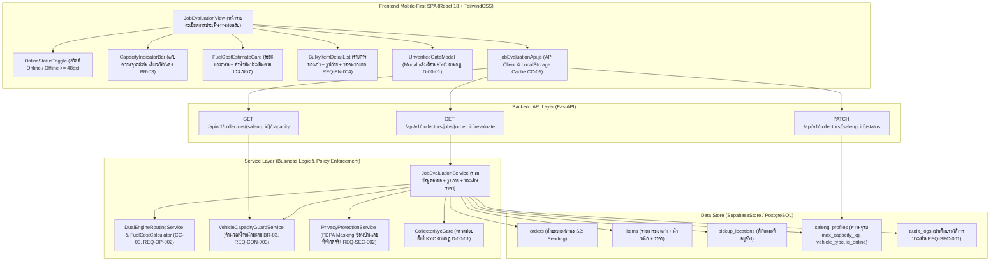

# PLAN-B03: แผนสถาปัตยกรรมและการพัฒนาทางเทคนิค ระบบประเมินงานและค่าน้ำมันก่อนรับ (`plan.md`)

- **Version:** `1.0` | **Status:** `ready-for-tasks` | **Owner:** กลุ่ม 2 (แพลตฟอร์มรับซื้อของเก่า/ซาเล้ง)
- **อ้างอิง:** [`specs/buyer/03-pre-acceptance-evaluation/spec.md`](./spec.md) (v2.0), [`specs/000-shared/constraints.md`](../../000-shared/constraints.md), [`specs/000-shared/quality-requirements.md`](../../000-shared/quality-requirements.md)
- **Use Case หลัก:** `UC-04: ค้นหาและแสดงงานรับซื้อตามพิกัด` (`docs/srs/UC-04.md`, `specs/SPEC-ROUTE/spec.md`)
- **User Story อ้างอิง:** User Story (3Cs บนหน้า 62): **`Feature: แสดงระยะทางและค่าน้ำมันโดยประมาณก่อนรับงาน`** (`Card 02` บนซ้ายของหน้า 62)

---

## 1. เทคโนโลยีที่ใช้ (Technology Stack)

> [!NOTE]
> เทคโนโลยีด้านล่างนี้ **"ทีมเลือกเอง ไม่ได้มาจาก spec"** เพื่อให้การพัฒนาระบบมีความเสถียร สอดคล้องกับเทคโนโลยีของทั้งโครงการ (Seller 01..09 และ Buyer 01..02) และรันชุดทดสอบอัตโนมัติได้อย่างรวดเร็ว

- **Backend:** Python 3.11, FastAPI (REST API Framework), Pydantic v2 (Data Validation & Serialization), Pytest + Starlette TestClient (Automated Backend Testing)
- **Database / Data Store:** In-memory Supabase Database Adapter ([`backend/app/core/supabase.py`](../../backend/app/core/supabase.py)) จำลองตาราง PostgreSQL และ PostGIS พร้อมคำนวณระยะทางเส้นทางและน้ำหนักสะสมของซาเล้ง
- **Routing & Fuel Cost Engine:** Dual-Engine Routing Service (คำนวณระยะทางถนนจริงร่วมกับ Haversine Fallback Engine `Haversine * 1.35` ตาม `CC-03`, `REQ-OP-002`) พร้อมระบบคำนวณค่าน้ำมันตามประเภทยานพาหนะ (`vehicle_type`)
- **Frontend:** React 18, TailwindCSS (Mobile-First Styling Viewport 375px–414px, ปุ่มกดขนาดใหญ่ `>= 48px` ตาม `REQ-UX-001`), HTML5 Geolocation API, Vitest + React Testing Library + JSDOM (Component & Frontend Testing)
- **Offline Storage:** `localStorage` แคชผลการประเมินคำขอขายล่าสุด (`saleng_active_job_eval_cache`) ตาม `CC-05` และ `REQ-OP-001`

---

## 2. โครงสร้างไฟล์และสถาปัตยกรรม (Architecture & File Structure)

### 2.1 แผนผังสถาปัตยกรรมการทำงาน (Component Architecture Diagram)



### 2.2 โครงสร้างไฟล์ที่จะสร้างและแก้ไข

```
Saleng/
├── backend/
│   ├── app/
│   │   ├── models/
│   │   │   └── job_evaluation_models.py            # Pydantic Schemas สำหรับ Evaluation, Capacity, Status
│   │   ├── services/
│   │   │   └── job_evaluation_service.py           # คำนวณค่าน้ำมัน, ตรวจสอบความจุรถสะสม, จัดการ PII
│   │   ├── api/v1/
│   │   │   ├── job_evaluation.py                   # FastAPI Router สำหรับ Job Evaluation & Capacity Check
│   │   │   └── pricing.py                          # Mount router เข้ากับ FastAPI app หลัก
│   │   └── core/
│   │       └── supabase.py                         # เพิ่ม Helper Methods ค้นหาและอัปเดต Current Load
│   └── tests/
│       ├── test_T01_job_evaluation_models.py       # Unit Test Schema, Fuel Formula, Capacity Math
│       ├── test_AC_B03_01_fuel_cost_estimation.py  # ทดสอบการประเมินระยะทางและค่าน้ำมันตามประเภทรถ
│       ├── test_AC_B03_02_routing_timeout_fallback.py # ทดสอบ Dual-Engine Fallback และ Timeout Handling
│       ├── test_AC_B03_03_capacity_and_online_toggle.py # ทดสอบตรวจความจุรถ BR-03 และสลับ Online/Offline
│       ├── test_AC_B03_04_pii_masking.py           # ทดสอบการซ่อนบ้านเลขที่และพิกัดจริงในหน้าประเมิน
│       └── test_e2e_buyer_pre_acceptance_evaluation.py # Integration E2E Test ครบวงจรการประเมินก่อนรับ
├── frontend/
│   ├── src/
│   │   ├── services/
│   │   │   └── jobEvaluationApi.js                 # API Client พร้อมแคชออฟไลน์ใน localStorage
│   │   └── components/
│   │       ├── CapacityIndicatorBar.jsx            # แถบแสดงความจุรถสะสม เขียว/ฟ้า/แดง (BR-03)
│   │       ├── OnlineStatusToggle.jsx              # สวิตช์สลับสถานะ Online / Offline (CC-02) >= 48px
│   │       ├── FuelCostEstimateCard.jsx            # การ์ดแสดงระยะทางถนน, ค่าความคลาดเคลื่อน, ค่าน้ำมัน
│   │       ├── BulkyItemDetailList.jsx             # รายการของเก่า, รูปถ่าย (REQ-FN-004), ป้ายขอคนช่วยยก
│   │       └── JobEvaluationView.jsx               # หน้าจอประเมินงานหลัก พร้อมปุ่มกดรับงานและ Gate Modal
│   └── tests/
│       ├── jobEvaluationApi.test.mjs               # Unit Test API Client & Offline Cache
│       ├── AC-B03-01.test.jsx                      # Test การแสดงระยะทางและค่าน้ำมันตามประเภทรถ
│       ├── AC-B03-02.test.jsx                      # Test ระบบสำรองระยะทางเมื่อแผนที่ขัดข้อง
│       ├── AC-B03-03.test.jsx                      # Test ตรวจสอบความจุรถเกินและการสลับ Online/Offline
│       ├── AC-B03-04.test.jsx                      # Test การปกปิด PII และแสดงพิกัดจำลอง
│       └── AC-B03-05.test.jsx                      # Test การล็อกปุ่มรับงานสำหรับ Unverified KYC
└── specs/buyer/03-pre-acceptance-evaluation/
    ├── spec.md                                     # สเปก Version 2.0 (reviewed-post-clarify)
    ├── plan.md                                     # แผนงานฉบับนี้ (v1.0 ready-for-tasks)
    └── tasks.md                                    # รายการงานย่อย (ขั้นตอนถัดไป)
```

---

## 3. โครงสร้างฐานข้อมูลและ Data Models

### 3.1 โครงสร้างฐานข้อมูล (Data Store ใน `backend/app/core/supabase.py`)

ใช้ตารางเดิมที่เชื่อมโยงกับ Seller และ Buyer ใน `SupabaseStore`:
1. **`orders`**: คำขอรับซื้อของเก่า (`status == "S2"`, `assigned_saleng_id IS NULL`)
2. **`items`**: รายการของเก่าในคำขอ (`category_code`, `category_group`, `name`, `est_weight_kg`, `est_min_price`, `est_max_price`, `photo_urls`, `sub_category`)
3. **`pickup_locations`**: ที่อยู่นัดรับของผู้ขาย (`lat`, `lng`, `subdistrict`, `district`, `address_text`)
4. **`saleng_profiles`**: ข้อมูลซาเล้ง (`saleng_id`, `current_lat`, `current_lng`, `is_online`, `verified`, `vehicle_type`, `max_capacity_kg`, `current_load_kg`)
5. **`audit_logs`**: บันทึกประวัติการประเมินงานและสลับสถานะ (`action = "JOB_EVALUATION_VIEWED"`, `"STATUS_TOGGLED"`)

### 3.2 Pydantic Data Models (`backend/app/models/job_evaluation_models.py`)

- **`FuelRateConfig`**:
  - `TRICYCLE`: 0.00 บาท/กม.
  - `MOTORCYCLE`: 2.50 บาท/กม.
  - `PICKUP`: 4.50 บาท/กม.
  - `DEFAULT`: 2.50 บาท/กม.

- **`EvaluatedItemSummary`**:
  - `item_id`: str
  - `category_code`: str
  - `category_name`: str
  - `category_group`: str (`GENERAL_WEIGHT`, `BOXED_PACKAGING`, `BULKY_FLAT_RATE`)
  - `est_weight_kg`: float
  - `est_min_price`: float
  - `est_max_price`: float
  - `sub_category`: Optional[str]
  - `photo_urls`: List[str]

- **`JobEvaluationResponse` (ข้อมูลประเมินงานส่งกลับหน้าจอ — ปิดบัง PII ตาม `REQ-SEC-002`, `D-00-02`):**
  - `order_id`: str
  - `status`: str (สถานะ `S2`)
  - `subdistrict_name`: str (ชื่อแขวง/ตำบล)
  - `district_name`: str (ชื่อเขต/อำเภอ)
  - `approximate_lat`: float (พิกัดจำลอง Fuzzed)
  - `approximate_lng`: float (พิกัดจำลอง Fuzzed)
  - `road_distance_km`: float (ระยะทางคำนวณตามถนนจริง)
  - `is_fallback_distance`: bool (คำนวณจากสูตรสำรอง Haversine หรือไม่)
  - `vehicle_type`: str (ประเภทยานพาหนะของซาเล้ง เช่น `MOTORCYCLE`)
  - `fuel_rate_per_km`: float (อัตราค่าน้ำมันต่อกม. เช่น 2.50)
  - `estimated_fuel_cost`: float (ค่าน้ำมันประเมิน = `round(road_distance_km * fuel_rate_per_km, 2)`)
  - `total_est_min_price`: float
  - `total_est_max_price`: float
  - `total_est_weight_kg`: float (น้ำหนักประเมินรวมของงานนี้)
  - `need_lifting_help`: bool (ขอคนช่วยยกหรือไม่)
  - `items`: List[EvaluatedItemSummary] (รายการของเก่าและรูปถ่าย)
  - `collector_current_load_kg`: float (น้ำหนักบรรทุกปัจจุบันในรถซาเล้ง)
  - `collector_max_capacity_kg`: float (ความจุสูงสุดของรถซาเล้ง)
  - `projected_total_load_kg`: float (น้ำหนักสะสมรวมหากรับงานนี้)
  - `is_capacity_exceeded`: bool (น้ำหนักสะสมเกินความจุรถหรือไม่ตาม `BR-03`)
  - `remaining_capacity_kg`: float (ความจุรถที่เหลืออยู่)
  - `can_claim_job`: bool (สามารถกดรับงานได้หรือไม่ ตรวจสอบทั้งความจุ, สถานะ Online, และ KYC)
  - `claim_block_reason`: Optional[str] (เหตุผลที่บล็อกปุ่มรับงาน เช่น `"CAPACITY_EXCEEDED"`, `"OFFLINE"`, `"UNVERIFIED_KYC"`)
  - `collector_is_online`: bool (สถานะ Online ของซาเล้ง)
  - `collector_is_verified`: bool (สถานะ KYC ของซาเล้ง)
  - `created_at`: str

- **`CollectorStatusToggleRequest`**:
  - `saleng_id`: str
  - `is_online`: bool
  - `current_lat`: Optional[float]
  - `current_lng`: Optional[float]

- **`CollectorCapacityResponse`**:
  - `saleng_id`: str
  - `current_load_kg`: float
  - `max_capacity_kg`: float
  - `remaining_capacity_kg`: float
  - `vehicle_type`: str
  - `load_percentage`: float

---

## 4. การออกแบบ API Endpoints (`backend/app/api/v1/job_evaluation.py`)

| เส้นทาง API (`Route`) | Method | คำอธิบายและบทบาท | Request Parameters / Body | Response Model / Status |
| :--- | :---: | :--- | :--- | :---: |
| `/api/v1/collectors/jobs/{order_id}/evaluate` | `GET` | ประเมินรายละเอียดคำขอขาย คำนวณระยะทาง ค่าน้ำมัน และตรวจความจุรถก่อนรับ | Path: `order_id`<br>Query: `saleng_id`, `saleng_lat`, `saleng_lng`, `force_fallback` | `200 OK` (`JobEvaluationResponse`) |
| `/api/v1/collectors/{saleng_id}/status` | `PATCH` | สลับสถานะความพร้อมรับงาน `Online / Offline` พร้อมซิงก์พิกัดล่าสุด | Path: `saleng_id`<br>Body: `CollectorStatusToggleRequest` | `200 OK` (`saleng_profile`) |
| `/api/v1/collectors/{saleng_id}/capacity` | `GET` | ดึงข้อมูลความจุรถและน้ำหนักสะสมปัจจุบันของซาเล้งตามกฎ `BR-03` | Path: `saleng_id` | `200 OK` (`CollectorCapacityResponse`) |

---

## 5. แผนการเชื่อมต่อระบบภายนอกและ Shared Services

1. **ระบบ Dual-Engine Routing Service (`CC-03`, `REQ-OP-002`, `D-B03-02`):**
   - **Primary Engine:** คำนวณระยะทางถนนจริง (Road Network Routing สัมประสิทธิ์ 1.20)
   - **Fallback Engine:** หาก Maps API ขัดข้องหรือตอบสนองช้าเกิน 1.5 วินาที สลับไปใช้สูตร `Haversine * 1.35` ทันทีภายใน `<= 2.0 วินาที` พร้อมกำหนด Flag `is_fallback_distance = True`
2. **ระบบคำนวณค่าน้ำมันตามประเภทยานพาหนะ (`Card 02`, `D-B03-01`):**
   - ดึงข้อมูล `vehicle_type` ของซาเล้งจากโปรไฟล์ และคูณอัตราค่าน้ำมันมาตรฐาน:
     - `TRICYCLE`: `0.00 บาท/กม.`
     - `MOTORCYCLE`: `2.50 บาท/กม.`
     - `PICKUP`: `4.50 บาท/กม.`
   - ค่าความคลาดเคลื่อนระยะทางไม่เกิน `15%` ตาม `REQ-QA-002` และ `AC-04-11`
3. **ระบบตรวจสอบและจำกัดความจุรถซาเล้ง (`BR-03`, `REQ-CON-003`, `D-B03-03`, `D-B03-04`):**
   - ดึงน้ำหนักปัจจุบันในรถ `current_load_kg` (จากงานที่อยู่ในสถานะ `S3` หรือ `S4`) รวมกับ `total_est_weight_kg` ของงานที่กำลังประเมิน
   - หากผลรวมเกิน `max_capacity_kg` ระบบจะตั้งค่า `is_capacity_exceeded = True`, `can_claim_job = False`, และ `claim_block_reason = "CAPACITY_EXCEEDED"`
4. **ระบบคุ้มครองข้อมูลส่วนบุคคล PII Masking (`REQ-SEC-002`, `D-00-02`, `CC-06`):**
   - ปิดบังพิกัดจริงด้วย Coordinate Fuzzing (±300–500 ม.)
   - ตัด `addressText` (บ้านเลขที่/ซอย) และเบอร์โทรศัพท์ของผู้ขายทิ้ง 100% ก่อนรับงาน
5. **ระบบรักษาความปลอดภัย Unverified Collector Gate (`D-00-01`, `D-B03-06`):**
   - หาก `collector_is_verified = False` ระบบตั้งค่า `can_claim_job = False` และ `claim_block_reason = "UNVERIFIED_KYC"`

---

## 6. แผนการพัฒนาหน้าจอ (Frontend Mobile-First SPA — `CC-01`, `REQ-UX-001`)

พัฒนาคอมโพเนนต์ React 18 สำหรับหน้าจอมือถือ (375px–414px) พร้อมปุ่มขนาดใหญ่ตาม `REQ-UX-001` (>= 48px):

1. **`CapacityIndicatorBar.jsx` (`BR-03`, `REQ-CON-003`):**
   - แถบแสดงความจุรถสะสม (Visual Capacity Bar):
     - สีฟ้า/เขียว: น้ำหนักปกติ (`<= max_capacity_kg`) แสดงตัวเลข เช่น `145 / 200 กก. (เหลือ 55 กก.)`
     - สีแดงกะพริบ: น้ำหนักเกินความจุ (`> max_capacity_kg`) แสดงตัวเลข เช่น `230 / 200 กก. (เกิน 30 กก. ⚠️)`
2. **`OnlineStatusToggle.jsx` (`CC-02`, `REQ-UX-001`):**
   - สวิตช์สลับสถานะความสูง `>= 48px` สลับระหว่าง `"🟢 พร้อมรับงาน (Online)"` และ `"⏸️ พักรับงาน (Offline)"`
   - แสดงข้อความเตือนเมื่อสถานะเป็น `Offline` ว่าปุ่มรับงานจะถูกระงับชั่วคราว
3. **`FuelCostEstimateCard.jsx` (`Card 02`, `AC-B03-01`):**
   - การ์ดสรุปการเดินทาง: แสดงระยะทางถนนจริง (กม.), ค่าน้ำมันโดยประมาณ (บาท), ป้ายระบุประเภทยานพาหนะ, และป้าย `"⚡ ระยะทางประเมินสำรอง"` หากเข้าโหมด Fallback
4. **`BulkyItemDetailList.jsx` (`REQ-FN-003`, `REQ-FN-004`):**
   - รายการสิ่งของที่จะไปรับ: แสดงชื่อวัสดุ, หมวดหมู่ (รวมของชิ้นใหญ่แบบเหมาจ่าย BULKY_FLAT_RATE), รูปถ่ายของเก่าจากผู้ขาย (`photoUrls`), และป้ายสัญลักษณ์ขอคนช่วยยกของหนัก (`💪 ขอคนช่วยยก`)
5. **`JobEvaluationView.jsx` (หน้าจอหลัก):**
   - รวมทุกคอมโพเนนต์เข้าด้วยกันบนจอมือถือ
   - ปุ่มกดรับงานหลักที่ด้านล่าง (Fixed Bottom Button) ความสูง `>= 48px`:
     - หากพร้อมรับงาน: ปุ่มสีเขียวเด่นชัด `"✅ กดรับงานนี้ (ไปยัง Buyer 04)"`
     - หากน้ำหนักเกิน: ปุ่มสีเทาล็อก `"⛔ น้ำหนักเกินความจุรถ (ไม่สามารถรับได้)"`
     - หากสถานะ Offline: ปุ่มสีเทาล็อก `"⏸️ กรุณาเปิดสถานะ Online เพื่อรับงาน"`
     - หากยังไม่ผ่าน KYC: ปุ่มสีเทาล็อกพร้อมไอคอนแม่กุญแจ `"🔒 ยืนยันตัวตนเพื่อรับงาน"`
   - กล่องแจ้งเตือน Unverified Gate Modal (`D-00-01`) เมื่อซาเล้งยังไม่ผ่าน KYC พยายามกดรับงาน

---

## 7. การจัดการข้อสรุปคำถามเปิดจากการ Clarify (`D-B03-01` ถึง `D-B03-06`)

| รหัสการตัดสินใจ | ข้อสรุปและแนวทางการพัฒนา | อ้างอิงสเปก |
| :---: | :--- | :---: |
| **`D-B03-01`** | **สูตรค่าน้ำมันตามประเภทยานพาหนะ (`Q-01`):** คำนวณจาก `road_distance_km * fuel_rate` โดยอิงตาม `vehicle_type`: รถปั่น = 0.00 บ./กม., มอเตอร์ไซค์พ่วงข้าง = 2.50 บ./กม., รถกระบะ = 4.50 บ./กม. (Default = 2.50 บ./กม.) | `Card 02`, `REQ-FN-002`, `AC-04-11` |
| **`D-B03-02`** | **Dual-Engine Routing Fallback (`Q-02`):** ยึดตาม `CC-03` และ `REQ-OP-002` สลับใช้สูตร `Haversine * 1.35` อัตโนมัติเมื่อบริการแผนที่ภายนอกช้ากว่า 1.5 วินาที พร้อมแสดงป้ายโหมดสำรอง | `CC-03`, `REQ-OP-002`, `AC-B03-02` |
| **`D-B03-03`** | **การสะสมน้ำหนักตรวจความจุรถ (`Q-03`):** นำน้ำหนักปัจจุบันในรถ `current_load_kg` + น้ำหนักประเมินของงานใหม่ เทียบกับ `max_capacity_kg` เพื่อให้จัดสรรพื้นที่รถได้ถูกต้อง 100% ตาม `BR-03` | `BR-03`, `REQ-CON-003`, `AC-B03-03` |
| **`D-B03-04`** | **การบล็อกปุ่มรับงานเมื่อเกินความจุ (`Q-04`):** หากน้ำหนักรวมเกิน `max_capacity_kg` ให้เปลี่ยนแถบความจุเป็นสีแดง และ **Disable ปุ่มกดรับงาน** พร้อมแจ้งเตือนให้เคลียร์รอบวิ่งก่อน | `BR-03`, `REQ-CON-003` |
| **`D-B03-05`** | **สถานะ Offline (`Q-05`):** ซาเล้งสถานะ Offline สามารถเปิดดูรายละเอียดและประเมินงานได้ แต่ปุ่มรับงานจะล็อกพร้อมข้อความเตือนให้สลับเป็น Online ก่อน | `CC-02`, `AC-B03-03` |
| **`D-B03-06`** | **Unverified KYC Gate (`Q-06`):** ซาเล้งที่ยังไม่ผ่าน KYC สามารถดูรายละเอียดงานได้ แต่ปุ่มรับงานจะล็อกด้วยแม่กุญแจ และมี Modal นำทางไปยื่นเอกสาร KYC ตามกฎ `D-00-01` | `D-00-01`, `AC-B03-05` |

---

## 8. ตารางตรวจสอบความสอดคล้องกับ Constraints กลางครบทั้ง 13 ข้อ

| รหัส Constraint | ข้อกำหนดใน Constraint กลาง (`specs/000-shared/constraints.md`) | การปฏิบัติตามในแผนงานนี้ (`plan.md`) | สถานะ |
| :---: | :--- | :--- | :---: |
| **`CC-01`** | Mobile-First Web SPA รองรับมือถือราคาประหยัด (`RAM >= 2 GB`, ปุ่ม `>= 48px`) | ออกแบบ UI ด้วย React 18 + TailwindCSS สำหรับจอมือถือ (375px–414px) ปุ่มสลับ Online/Offline และปุ่มรับงานมีความสูงไม่น้อยกว่า `48px` (`REQ-UX-001`) | **ครบถ้วน** |
| **`CC-02`** | GPS Sync Interval ทุก 60 วินาทีขณะเปิดสถานะ Online | รองรับสลับสถานะ Online/Offline โดยเมื่อ Online จะเปิดรอบ GPS Sync และรีเฟรชระยะทางทุก 60 วินาที | **ครบถ้วน** |
| **`CC-03`** | Road Distance API รัศมี `<= 5.0 กม.` พร้อม Haversine Fallback (`Haversine * 1.35`) | ใช้ Dual-Engine Routing คำนวณระยะทางถนนจริง และสลับใช้ `Haversine * 1.35` อัตโนมัติเมื่อบริการแผนที่ขัดข้อง (`D-B03-02`) | **ครบถ้วน** |
| **`CC-04`** | PostgreSQL + Concurrency Control / Optimistic Locking (`BR-02`) | ตรวจสอบสถานะคำขอขาย `S2 (Pending)` และข้อมูลความจุผ่าน SupabaseStore / PostgreSQL | **ครบถ้วน** |
| **`CC-05`** | Offline Cache ใน IndexedDB / Local Storage | จัดเก็บข้อมูลการประเมินคำขอขายล่าสุดลงใน `localStorage` (`saleng_active_job_eval_cache`) ให้เปิดดูได้แม้ออฟไลน์ (`REQ-OP-001`) | **ครบถ้วน** |
| **`CC-06`** | PDPA & PII Masking ซ่อนบ้านเลขที่และพิกัดละเอียด | ตัดบ้านเลขที่ทิ้ง แสดงเฉพาะชื่อตำบล/แขวง และใช้พิกัดจำลอง Fuzzed Coordinates (±300–500 ม.) (`REQ-SEC-002`) | **ครบถ้วน** |
| **`REQ-SEC-001`** | บันทึกประวัติลงตาราง Audit Log | ทุกการเปิดดูรายละเอียดงานและการสลับสถานะ Online/Offline ถูกบันทึกลงใน `audit_logs` | **ครบถ้วน** |
| **`REQ-SEC-002`** | ปกปิดข้อมูลส่วนบุคคล (PII) ของผู้ขายก่อนรับงาน | ปิดบังบ้านเลขที่และเบอร์โทรศัพท์ของผู้ขายอย่างเคร่งครัดจนกว่าจะรับงานสำเร็จ (`D-00-02`) | **ครบถ้วน** |
| **`REQ-OP-001`** | โหมด Offline Queue สำหรับดูข้อมูลที่แคชไว้ | เมื่อเครือข่ายขัดข้อง สามารถเปิดดูรายละเอียดงาน ขนาด และรูปถ่ายที่แคชไว้ได้ | **ครบถ้วน** |
| **`REQ-OP-002`** | Haversine Fallback สำหรับการคำนวณระยะทาง | ระบบสำรอง `Haversine * 1.35` ตอบสนองภายใน `<= 2.0 วินาที` พร้อม Flag `is_fallback: true` | **ครบถ้วน** |
| **`D-00-01`** | KYC เป็น Precondition ของระบบผู้ซื้อ | ซาเล้งที่ยังไม่ผ่าน KYC สามารถเปิดดูรายละเอียดและประเมินงานได้ แต่ปุ่มรับงานล็อกด้วยรูปกุญแจและมี Gate Modal (`D-B03-06`) | **ครบถ้วน** |
| **`D-00-02`** | ซ่อนพิกัดผู้ขายจนกว่าจะรับงาน | แสดงเฉพาะพิกัดจำลอง Fuzzed Coordinates และชื่อตำบล/แขวง จนกว่าจะกดรับงานใน Buyer 04 | **ครบถ้วน** |
| **`D-00-03`** | ขอบเขตหยุดที่สถานะมีผู้รับงานแล้ว | ฟีเจอร์นี้เตรียมข้อมูลและประเมินก่อนรับงาน ก่อนส่งต่อไปยังกระบวนการรับงานใน Buyer 04 (`UC-04`) | **ครบถ้วน** |

