# PLAN-B04: แผนสถาปัตยกรรมและการพัฒนาทางเทคนิค ระบบจัดการงานและเส้นทาง (`plan.md`)

- **Version:** `1.0` | **Status:** `ready-for-tasks` | **Owner:** กลุ่ม 2 (แพลตฟอร์มรับซื้อของเก่า/ซาเล้ง)
- **อ้างอิง:** [`specs/buyer/04-job-and-route-management/spec.md`](./spec.md) (v2.0), [`specs/000-shared/constraints.md`](../../000-shared/constraints.md), [`specs/000-shared/quality-requirements.md`](../../000-shared/quality-requirements.md)
- **Use Case หลัก:** 
  - `UC-04: ค้นหาและแสดงงานรับซื้อตามพิกัด` (`docs/srs/UC-04.md`, `specs/SPEC-ROUTE/spec.md`)
  - `UC-09: อัปเดตสถานะงานและพิกัดภาคสนาม` (การออกเดินทางและการนำทาง GPS)
  - `UC-12: รับงานหรือปฏิเสธงาน` (การกดรับงาน การข้ามงาน และการสละสิทธิ์ยกเลิกงาน)
- **Business Rules ที่เกี่ยวข้อง:** `BR-02` (`REQ-BR-002`), `BR-03` (`REQ-CON-003`)

---

## 1. เทคโนโลยีที่ใช้ (Technology Stack)

> [!NOTE]
> เทคโนโลยีด้านล่างนี้ **"ทีมเลือกเอง ไม่ได้มาจาก spec"** เพื่อให้การพัฒนาระบบมีความเสถียร สอดคล้องกับสถาปัตยกรรมทั้งระบบของโครงการ (Seller 01..09 และ Buyer 01..03) และรองรับการทำงานแบบ Mobile-First SPA บนอุปกรณ์สมาร์ตโฟนราคาประหยัด

- **Backend:** Python 3.11, FastAPI (REST API Framework), Pydantic v2 (Data Validation & Serialization), Pytest + Starlette TestClient (Automated Backend Testing)
- **Database / Concurrency Store:** In-memory Supabase Database Adapter ([`backend/app/core/supabase.py`](../../backend/app/core/supabase.py)) จำลองตาราง PostgreSQL และ PostGIS พร้อมกลไก **`Optimistic Concurrency Control (OCC)`** ผ่านฟิลด์ `version` ในตาราง `orders` เพื่อรับประกันความถูกต้องของการกดรับงาน 1 ต่อ 1 ตามกฎ `BR-02` และ `CC-04`
- **GPS Navigation Protocol:** Deep Link URL Scheme มาตรฐานเปิดแอปนำทางภายนอก (Google Maps / Apple Maps) ด้วยพิกัดจริง `https://www.google.com/maps/dir/?api=1&destination={dest_lat},{dest_lng}` ตาม `D-B04-03`
- **Frontend:** React 18, TailwindCSS (Mobile-First Viewport 375px–414px, Touch Target Buttons `>= 48px` ตาม `REQ-UX-001` และ `CC-01`), Vitest + React Testing Library + JSDOM
- **Offline Storage & Sync Queue:** `localStorage` แคชรายการงานที่รับแล้ว (`saleng_active_schedule_cache`) และเก็บคิวอัปเดตสถานะออฟไลน์ (`offline_transit_queue`) พร้อม `idempotency_key` ตาม `CC-05`, `REQ-OP-001`, และ `D-B04-06`

---

## 2. โครงสร้างไฟล์และสถาปัตยกรรม (Architecture & File Structure)

### 2.1 แผนผังสถาปัตยกรรมการทำงาน (Component Architecture Diagram)

```mermaid
flowchart TD
    subgraph Frontend["Frontend Mobile-First SPA (React 18 + TailwindCSS)"]
        UI_QueueView["ActiveJobQueueView (หน้ารวมคิวงานและตารางนัดหมายสะสม)"]
        UI_JobCard["ActiveJobCard (การ์ดงานที่รับแล้ว + ที่อยู่จริง + เบอร์โทร + ปุ่มนำทาง)"]
        UI_RouteBar["RouteOptimizationBar (แถบลำดับจุดแวะรับ + ETA + ระยะทางรวม)"]
        UI_CancelModal["CollectorCancelModal (Modal ระบุเหตุผลยกเลิกงาน)"]
        UI_ConflictModal["ClaimConflictModal (Modal แจ้งเตือนเมื่อมีคนรับงานตัดหน้า HTTP 409)"]
        SVC_ApiClient["jobRouteApi.js (API Client & Offline Queue & Cache CC-05)"]
    end

    subgraph Backend["Backend API Layer (FastAPI)"]
        API_Claim["POST /api/v1/collectors/jobs/{order_id}/claim (Atomic Claim BR-02)"]
        API_Skip["POST /api/v1/collectors/jobs/{order_id}/skip (Skip Job A2)"]
        API_Active["GET /api/v1/collectors/{saleng_id}/active-jobs (Active Queue & Route)"]
        API_Transit["POST /api/v1/collectors/jobs/{order_id}/start-transit (S3 -> S4 UC-09)"]
        API_Cancel["POST /api/v1/collectors/jobs/{order_id}/cancel (Revert to S2 MD-STM-04)"]
    end

    subgraph ServiceLayer["Service Layer (Business Logic & Policy Enforcement)"]
        SVC_RouteManager["JobRouteManagementService (จัดการคิวงานและสลับสถานะ)"]
        SVC_AtomicClaim["AtomicClaimService (PostgreSQL OCC version column CC-04)"]
        SVC_RouteOpt["RouteOptimizationEngine (Nearest-Neighbor & Time Slot Ordering)"]
        SVC_PDPAUnmask["AddressUnmaskingService (เปิดเผย PII เฉพาะผู้รับงานสำเร็จ REQ-SEC-002)"]
        SVC_SellerNotify["SellerNotificationDispatcher (แจ้งเตือนผู้ขาย AC-S05-02..04)"]
    end

    subgraph DataStore["Data Store (SupabaseStore / PostgreSQL)"]
        DB_Orders["orders (status: S2..S4, collector_id, version)"]
        DB_Pickups["pickup_locations (address_text, lat, lng)"]
        DB_Profiles["saleng_profiles (verified, is_online, vehicle_type, current_load_kg)"]
        DB_Audit["audit_logs (บันทึกประวัติการรับ/ยกเลิกงาน REQ-SEC-001)"]
    end

    UI_QueueView --> UI_JobCard
    UI_QueueView --> UI_RouteBar
    UI_JobCard --> UI_CancelModal
    UI_QueueView --> UI_ConflictModal
    UI_QueueView --> SVC_ApiClient

    SVC_ApiClient --> API_Claim
    SVC_ApiClient --> API_Skip
    SVC_ApiClient --> API_Active
    SVC_ApiClient --> API_Transit
    SVC_ApiClient --> API_Cancel

    API_Claim --> SVC_AtomicClaim
    API_Skip --> SVC_RouteManager
    API_Active --> SVC_RouteOpt
    API_Transit --> SVC_RouteManager
    API_Cancel --> SVC_RouteManager

    SVC_AtomicClaim --> DB_Orders
    SVC_AtomicClaim --> SVC_PDPAUnmask
    SVC_AtomicClaim --> SVC_SellerNotify
    SVC_AtomicClaim --> DB_Audit

    SVC_RouteManager --> DB_Orders
    SVC_RouteManager --> DB_Profiles
    SVC_RouteManager --> DB_Audit
    SVC_RouteManager --> SVC_SellerNotify

    SVC_RouteOpt --> DB_Orders
    SVC_RouteOpt --> DB_Pickups
```



### 2.2 โครงสร้างไฟล์ที่จะสร้างและแก้ไข

```
Saleng/
├── backend/
│   ├── app/
│   │   ├── models/
│   │   │   └── job_route_models.py                 # Pydantic Models สำหรับ Claim, Active Jobs, Start Transit, Cancel
│   │   ├── services/
│   │   │   └── job_route_service.py                # ตรรกะ Atomic Claim (OCC), Route Ordering, State Reversion
│   │   ├── api/v1/
│   │   │   ├── job_route.py                        # FastAPI Router สำหรับ Claim, Active, Transit, Cancel
│   │   │   └── pricing.py                          # Mount router เข้ากับ FastAPI app
│   │   └── core/
│   │       └── supabase.py                         # เพิ่ม OCC claim_order, revert_order, list_active_collector_jobs
│   └── tests/
│       ├── test_T01_job_route_models.py            # ทดสอบ Data Model Validation & Schemas
│       ├── test_AC_B04_01_atomic_claim.py          # ทดสอบ Single Collector Atomic Claim (OCC & 409 Conflict)
│       ├── test_AC_B04_02_skip_job.py              # ทดสอบ Skip Job (คงสถานะ S2)
│       ├── test_AC_B04_03_address_unmasking.py     # ทดสอบ Unmasking PII และ Google Maps URL Scheme
│       ├── test_AC_B04_04_active_queue_route.py    # ทดสอบ Active Jobs Queue & Route Ordering (BR-03)
│       ├── test_AC_B04_05_in_transit_lock.py       # ทดสอบ เปลี่ยนเป็น S4 และล็อกปุ่มยกเลิกผู้ขาย (BR-03)
│       ├── test_AC_B04_06_collector_cancel.py      # ทดสอบ ซาเล้งยกเลิกงานแล้วคืนสถานะกลับ S2 (MD-STM-04)
│       └── test_e2e_buyer_job_route_management.py  # E2E Integration Test ครบวงจร
├── frontend/
│   ├── src/
│   │   ├── services/
│   │   │   └── jobRouteApi.js                      # API Client + LocalStorage Cache + Offline Transit Queue
│   │   └── components/
│   │       ├── ActiveJobCard.jsx                   # การ์ดงานที่รับแล้ว แสดงที่อยู่จริง เบอร์โทรผู้ขาย ปุ่มนำทาง
│   │       ├── RouteOptimizationBar.jsx            # แถบลำดับจุดแวะรับ ETA และระยะทางรวม
│   │       ├── CollectorCancelModal.jsx            # Modal ระบุเหตุผลยกเลิกงาน (รถเสีย/อุบัติเหตุ/ฉุกเฉิน)
│   │       ├── ClaimConflictModal.jsx              # Modal แจ้งเตือนเมื่อรับงานไม่ทัน (มีคนรับไปแล้ว)
│   │       └── ActiveJobQueueView.jsx              # หน้ารวมคิวงานและตารางนัดหมายสะสม (Mobile-First SPA)
│   └── tests/
│       ├── jobRouteApi.test.mjs                    # Unit Test สำหรับ API Client และ Offline Queue
│       ├── AC-B04-01.test.jsx                      # Component Test: Atomic Claim & 409 Conflict Handling
│       ├── AC-B04-02.test.jsx                      # Component Test: Skip Job & Back Navigation
│       ├── AC-B04-03.test.jsx                      # Component Test: Address Unmasking & Navigation Link
│       ├── AC-B04-04.test.jsx                      # Component Test: Active Queue List & Capacity Display
│       ├── AC-B04-05.test.jsx                      # Component Test: Start Transit & Status Update
│       └── AC-B04-06.test.jsx                      # Component Test: Collector Cancel & Revert Confirmation
└── specs/buyer/04-job-and-route-management/
    ├── spec.md                                     # ข้อกำหนดระบบ (v2.0 reviewed-post-clarify)
    ├── plan.md                                     # แผนการพัฒนาทางเทคนิคฉบับนี้
    └── tasks.md                                    # รายการงานย่อยที่จะแตกในขั้นตอน /tasks
```

---

## 3. การออกแบบฐานข้อมูลและโมเดลข้อมูล (Database & Data Models)

### 3.1 Pydantic Request & Response Schemas (`job_route_models.py`)

```python
from pydantic import BaseModel, Field
from typing import List, Optional

class ClaimJobRequest(BaseModel):
    """คำขอกดรับงานของซาเล้ง (BR-02, CC-04)"""
    saleng_id: str = Field(..., description="รหัสประจำตัวซาเล้ง")
    expected_version: int = Field(..., description="OCC Version ของคำขอขายที่อ่านได้ล่าสุด")

class ClaimJobResponse(BaseModel):
    """ข้อมูลตอบกลับเมื่อกดรับงานสำเร็จ (เปิดเผย PII ตาม REQ-SEC-002, D-00-02)"""
    order_id: str
    status: str = Field("S3", description="สถานะใหม่ (S3: มีผู้รับงานแล้ว)")
    collector_id: str
    address_text: str = Field(..., description="บ้านเลขที่และซอยฉบับเต็ม (เปิดเผยหลังรับงาน)")
    dest_lat: float = Field(..., description="พิกัดละติจูดแท้จริงของผู้ขาย")
    dest_lng: float = Field(..., description="พิกัดลองจิจูดแท้จริงของผู้ขาย")
    seller_phone: str = Field(..., description="เบอร์โทรศัพท์ผู้ขายสำหรับติดต่อ")
    seller_name: str = Field(..., description="ชื่อผู้ขาย")
    subdistrict_name: str
    district_name: str
    total_est_weight_kg: float
    total_est_price_min: float
    total_est_price_max: float
    claimed_at: str
    version: int
    navigation_url: str = Field(..., description="URL Scheme นำทางผ่าน Google Maps")

class ActiveJobSummary(BaseModel):
    """สรุปข้อมูลงานที่อยู่ในคิวปฏิบัติการของซาเล้ง (S3 หรือ S4)"""
    order_id: str
    status: str = Field(..., description="S3: Assigned หรือ S4: In-Transit")
    pickup_slot_time: str = Field(..., description="ช่วงเวลานัดหมาย เช่น 09:00 - 11:00")
    address_text: str
    dest_lat: float
    dest_lng: float
    seller_name: str
    seller_phone: str
    total_est_weight_kg: float
    total_est_price_min: float
    total_est_price_max: float
    road_distance_km: float
    estimated_arrival_minutes: int
    sequence_order: int = Field(..., description="ลำดับจุดแวะรับตาม Route Optimization")
    need_lifting_help: bool
    navigation_url: str

class ActiveQueueResponse(BaseModel):
    """รายการคิวงานและตารางนัดหมายสะสมของซาเล้ง (BR-03, D-B04-02)"""
    saleng_id: str
    total_active_jobs: int
    current_load_kg: float = Field(..., description="น้ำหนักบรรทุกสะสมรวมในรถปัจจุบัน")
    max_capacity_kg: float = Field(200.0, description="ความจุสูงสุดของรถซาเล้ง")
    remaining_capacity_kg: float
    capacity_percentage: float
    total_route_distance_km: float
    jobs: List[ActiveJobSummary]

class StartTransitRequest(BaseModel):
    """คำขอยืนยันออกเดินทางไปยังจุดนัดรับ (UC-09, S3 -> S4)"""
    saleng_id: str
    current_lat: Optional[float] = None
    current_lng: Optional[float] = None

class StartTransitResponse(BaseModel):
    """ผลการยืนยันออกเดินทาง"""
    order_id: str
    status: str = Field("S4", description="กำลังเดินทาง (In-Transit)")
    started_at: str
    seller_notified: bool = Field(True, description="ส่งแจ้งเตือนให้ผู้ขายแล้ว")
    seller_cancel_locked: bool = Field(True, description="ล็อกปุ่มยกเลิกผู้ขายตาม BR-03")
    navigation_url: str

class CollectorCancelJobRequest(BaseModel):
    """คำขอยกเลิกงานของซาเล้ง (D-B04-04)"""
    saleng_id: str
    reason: str = Field(..., description="VEHICLE_BREAKDOWN | ACCIDENT | PERSONAL_EMERGENCY | OTHER")
    note: Optional[str] = Field(None, description="คำอธิบายเพิ่มเติม")

class CollectorCancelJobResponse(BaseModel):
    """ผลการยกเลิกงานและคืนสถานะ"""
    order_id: str
    status: str = Field("S2", description="คืนสถานะกลับเป็น S2: รอผู้รับงาน เพื่อให้ซาเล้งอื่นรับต่อ")
    message: str
    cancelled_at: str
    reverted_to_pending: bool = True
```

### 3.2 การปรับปรุงตารางใน In-memory Supabase Database Adapter

1. **ตาราง `orders`:**
   - เพิ่มฟิลด์ `version: int` (ค่าเริ่มต้น 1) สำหรับกลไก Optimistic Locking
   - เพิ่มฟิลด์ `claimed_at: datetime`, `in_transit_at: datetime`, `cancel_reason: str`
   - ตรวจสอบเงื่อนไขการอัปเดตแบบ Atomic:
     `UPDATE orders SET status = 'S3', collector_id = :saleng_id, version = version + 1 WHERE id = :order_id AND status = 'S2' AND version = :expected_version`
2. **ตาราง `audit_logs`:**
   - บันทึก Event:
     - `COLLECTOR_CLAIMED_JOB` (`order_id`, `saleng_id`, `version`)
     - `COLLECTOR_STARTED_TRANSIT` (`order_id`, `saleng_id`)
     - `COLLECTOR_CANCELLED_JOB` (`order_id`, `saleng_id`, `reason`, `note`)
     - `COLLECTOR_SKIPPED_JOB` (`order_id`, `saleng_id`)

---

## 4. การออกแบบ API (API Endpoints & Contracts)

### 4.1 ตารางสรุป API Endpoints

| Method | Endpoint Path | หน้าที่และกฎควบคุม | Response Code | รหัส AC ที่รองรับ |
| :---: | :--- | :--- | :---: | :---: |
| **`POST`** | `/api/v1/collectors/jobs/{order_id}/claim` | กดรับงานด้วย Optimistic Concurrency Control (`version`) ตรวจสอบความจุรถ `<= 200 กก.` และเปิดเผย PII | `200 OK`<br>`409 Conflict` (มีผู้รับแล้ว)<br>`400 Bad Request` | `AC-B04-01`, `AC-B04-03`, `BR-02` |
| **`POST`** | `/api/v1/collectors/jobs/{order_id}/skip` | ข้ามงาน ปิดหน้ารายละเอียด และคงสถานะ `S2` | `200 OK` | `AC-B04-02` |
| **`GET`** | `/api/v1/collectors/{saleng_id}/active-jobs` | ดึงรายการงานที่รับแล้วในคิว (`S3` และ `S4`) พร้อมจัดลำดับเส้นทางและคำนวณน้ำหนักสะสม | `200 OK` | `AC-B04-04`, `BR-03` |
| **`POST`** | `/api/v1/collectors/jobs/{order_id}/start-transit` | ยืนยันออกเดินทาง เปลี่ยนสถานะเป็น `S4 (In-Transit)` ล็อกปุ่มยกเลิกผู้ขาย และส่งแจ้งเตือน | `200 OK` | `AC-B04-05`, `BR-03` |
| **`POST`** | `/api/v1/collectors/jobs/{order_id}/cancel` | สละสิทธิ์/ยกเลิกงาน คืนสถานะคำขอกลับเป็น `S2 (Pending)` และบันทึกประวัติ Audit Log | `200 OK` | `AC-B04-06`, `MD-STM-04` |

---

## 5. แผนเชื่อมต่อระบบภายนอกและการแจ้งเตือน (External Integrations)

1. **การเชื่อมต่อแอปนำทาง GPS ภายนอก (`Google Maps / Apple Maps Navigation Protocol` — `D-B04-03`):**
   - ใน Mobile-First Web SPA เมื่อซาเล้งกดปุ่ม `"นำทางด้วย GPS"` ระบบสร้างลิงก์ Deep Link:
     ```javascript
     const navUrl = `https://www.google.com/maps/dir/?api=1&destination=${dest_lat},${dest_lng}&travelmode=driving`;
     window.open(navUrl, '_blank');
     ```
   - Fallback รองรับ URI Scheme: `geo:${dest_lat},${dest_lng}?q=${dest_lat},${dest_lng}` สำหรับอุปกรณ์ Android รุ่นประหยัด
2. **การส่ง Event แจ้งเตือนไปยังระบบติดตามของผู้ขาย (`Seller Notification Integration` — `D-B04-05`):**
   - เมื่อรับงานสำเร็จ (`S2 -> S3`): ส่ง Event พร้อมข้อมูลซาเล้ง (ชื่อ, เบอร์โทร, ประเภท/ทะเบียนรถ, รูปโปรไฟล์, คะแนนรีวิว) ไปยังโมดูล `specs/seller/05-booking-and-status-tracking` เพื่ออัปเดตการ์ดติดตาม `CollectorProfileCard` ของผู้ขายทันที
   - เมื่อเริ่มออกเดินทาง (`S3 -> S4`): อัปเดตสถานะเป็น `S4: กำลังเดินทางมา` พร้อมคำนวณ ETA ให้ผู้ขายเห็นบน Stepper

---

## 6. แผนการพัฒนาหน้าจอ (Frontend Component Plan — Viewport 375px–414px)

```
+-------------------------------------------------------------+
|  <- คิวงานในความรับผิดชอบ (Active Queue)     [ 🟢 ออนไลน์อยู่ ] |
|-------------------------------------------------------------|
|  ⚖️ ความจุรถสะสมรอบนี้: 85.0 / 200 กก. (42%)                  |
|  [========-------------] เหลือรับได้อีก 115.0 กก.            |
|-------------------------------------------------------------|
|  🗺️ ลำดับจุดแวะรับที่คุ้มค่า (2 จุดแวะ | รวม 2.8 กม. | ~20 นาที)|
|  [ 1. สุทธิสาร (1.2 กม.) ] -> [ 2. จันทรเกษม (1.6 กม.) ]     |
|-------------------------------------------------------------|
|  [ การ์ดงานที่ 1 (จุดแวะถัดไป) - นัดหมาย 09:00 - 11:00 ]      |
|  📍 123/45 ซอยประชาราษฎร์บำเพ็ญ 24 (แขวงสามเสนนอก เขตห้วยขวาง) |
|  👤 ผู้ขาย: คุณวิภาดา (โทร: 081-987-6543) [ 📞 แตะเพื่อโทร ] |
|  📦 ลังกระดาษ 30 กก., ขวด PET 15 กก. (~250 - 380 บาท)        |
|  💪 ขอคนช่วยยก                                               |
|                                                             |
|  +-------------------------------------------------------+  |
|  | [ 🗺️ นำทางด้วย GPS (Google Maps) ] (min-h: 48px)       |  |
|  +-------------------------------------------------------+  |
|  | [ 🚀 เริ่มออกเดินทาง (S3 -> S4) ]    (min-h: 48px)       |  |
|  +-------------------------------------------------------+  |
|  | [ ⚠️ สละสิทธิ์/ยกเลิกงาน ]          (min-h: 48px)       |  |
|  +-------------------------------------------------------+  |
+-------------------------------------------------------------+
```

### รายละเอียดคอมโพเนนต์หลัก:
1. **`ActiveJobQueueView.jsx`:** หน้าจอหลักแสดงคิวงานที่รับแล้วทั้งหมด มี Segmented View, Summary Header, Capacity Bar, และ Route Overview Bar
2. **`ActiveJobCard.jsx`:** การ์ดแสดงรายละเอียดงานที่รับแล้ว (`S3` หรือ `S4`) แสดงบ้านเลขที่จริงและเบอร์โทรผู้ขาย พร้อมปุ่มกดขนาดใหญ่ `>= 48px` (`REQ-UX-001`):
   - ปุ่ม `"นำทางด้วย GPS"` (สีฟ้า/น้ำเงิน เปิด Google Maps)
   - ปุ่ม `"เริ่มออกเดินทาง"` (สีเขียว สำหรับเปลี่ยนสถานะ `S3 -> S4`)
   - ปุ่ม `"สละสิทธิ์/ยกเลิกงาน"` (สีเทา/แดงอ่อน เปิด Modal ระบุเหตุผล)
3. **`RouteOptimizationBar.jsx`:** แถบแสดงลำดับจุดแวะรับ (1 -> 2 -> 3) พร้อมระยะทางถนนจริงและ ETA รวม
4. **`CollectorCancelModal.jsx`:** Modal ยืนยันการยกเลิกงาน พร้อมตัวเลือกเหตุผล (รถเสีย / อุบัติเหตุ / เหตุฉุกเฉิน) และคำเตือนเรื่องการคืนสถานะคำขอให้เพื่อนร่วมอาชีพ
5. **`ClaimConflictModal.jsx`:** Modal แจ้งเตือนเมื่อเกิดกรณี 409 Conflict (มีซาเล้งคนอื่นกดรับงานตัดหน้าไปก่อน)

---

## 7. การจัดการคำถามเปิดและการตัดสินใจ (Decisions & Open Questions)

- **`D-B04-01` (Concurrency Control ด้วย PostgreSQL OCC):** ใช้ Optimistic Concurrency Control ผ่านฟิลด์ `version` ในฐานข้อมูล PostgreSQL/Supabase ตาม `CC-04` และ `BR-02` ตัด Redis Lock ออกจากสเปก
- **`D-B04-02` (การสะสมคิวงานและ Route Ordering):** รับงานสะสมในสถานะ `S3` ได้หลายงานตราบใดที่น้ำหนักรวมไม่เกิน `200.0 กก.` (`BR-03`) และจัดลำดับจุดแวะด้วย Greedy Nearest-Neighbor
- **`D-B04-03` (การนำทาง GPS ใน Mobile-First Web SPA):** เปิดแอปนำทางภายนอก (Google Maps / Apple Maps) ผ่าน URL Scheme มาตรฐาน แทนการทำ Turn-by-turn ในเว็บแอป
- **`D-B04-04` (การยกเลิกงานและคืนสถานะคำขอ):** เมื่อซาเล้งกดยกเลิกในสถานะ `S3` ระบบจะคืนสถานะคำขอขายกลับเป็น `S2 (Pending)` โดยอัตโนมัติ เพื่อให้ซาเล้งคนอื่นรับต่อได้ทันที และบันทึกลง `audit_logs`
- **`D-B04-05` (การผูกข้อมูลซาเล้งส่งให้ผู้ขาย):** เมื่อรับงานสำเร็จ ระบบจะผูกข้อมูลซาเล้งและส่ง Event แจ้งเตือนไปยังหน้าจอติดตามของผู้ขายทันที
- **`D-B04-06` (การแคชตารางงานและคิวออฟไลน์):** จัดเก็บตารางงานที่รับแล้วลงใน `localStorage` ให้เปิดดูที่อยู่จริงและเบอร์โทรได้แม้ออฟไลน์ และเก็บคำขอเปลี่ยนสถานะใน `Offline Queue` พร้อม `idempotency_key`

---

## 8. ตารางตรวจสอบความครบถ้วนของข้อจำกัดกลาง (Central Constraints Traceability)

| รหัส Constraint | ข้อกำหนดใน Constraint กลาง (`specs/000-shared/constraints.md`) | ผลการวิเคราะห์และการนำไปใช้ในแผนนี้ |
| :---: | :--- | :--- |
| **`CC-01`** | Mobile-First Web SPA รองรับมือถือราคาประหยัด (`RAM >= 2 GB`, ปุ่ม `>= 48px`) | พัฒนาหน้าจอด้วย React 18 + TailwindCSS ปุ่มกดและทัชทาร์เก็ตทุกปุ่มใน `ActiveJobCard` และ Modal มีขนาดความสูงไม่น้อยกว่า `48px` (`REQ-UX-001`) |
| **`CC-02`** | GPS Sync Interval ทุก 60 วินาทีขณะเปิดสถานะ Online | รองรับการส่งพิกัด GPS อัปเดตระหว่างการเดินทางในสถานะ `S4 (In-Transit)` |
| **`CC-03`** | Road Distance API รัศมี <= 5.0 กม. พร้อม Haversine Fallback | คำนวณระยะทางรวมของคิวงานและ ETA ด้วย Dual-Engine Routing Service และสลับใช้ `Haversine * 1.35` อัตโนมัติเมื่อเกิดข้อผิดพลาด |
| **`CC-04`** | PostgreSQL + Concurrency Control / Optimistic Locking (`BR-02`) | ใช้ `Optimistic Concurrency Control (OCC)` ผ่านฟิลด์ `version` ในตาราง `orders` รับประกันว่าคำขอขายมีซาเล้งรับได้เพียง 1 คนเท่านั้น หากชนกันจะตอบกลับ HTTP 409 Conflict |
| **`CC-05`** | Offline Cache ใน IndexedDB / Local Storage | จัดเก็บตารางงานที่รับแล้วลงใน `localStorage` (`saleng_active_schedule_cache`) เปิดดูได้แม้ออฟไลน์ พร้อมคิวออฟไลน์ `offline_transit_queue` สำหรับการกดออกเดินทาง |
| **`CC-06`** | PDPA & PII Masking ซ่อนบ้านเลขที่และพิกัดละเอียด | ในหน้ารายการก่อนรับงานยังคงซ่อน PII แต่เมื่อรับงานสำเร็จเข้าสู่สถานะ `S3` ระบบจะเปิดเผยบ้านเลขที่จริงและเบอร์โทรให้เฉพาะซาเล้งที่รับงานตามกฎ `REQ-SEC-002` |
| **`REQ-SEC-001`** | บันทึกประวัติลงตาราง Audit Log | บันทึกประวัติการกดรับงาน (`COLLECTOR_CLAIMED_JOB`), การออกเดินทาง (`COLLECTOR_STARTED_TRANSIT`), และการยกเลิกงาน (`COLLECTOR_CANCELLED_JOB`) ลงใน `audit_logs` |
| **`REQ-SEC-002`** | ปกปิดข้อมูลส่วนบุคคล (PII) ของผู้ขายก่อนรับงาน | ปลดล็อกและส่ง `address_text`, `dest_lat`, `dest_lng`, และ `seller_phone` ผ่าน API ให้เฉพาะซาเล้งที่มี `collector_id` ตรงกับใบงานเท่านั้น |
| **`REQ-OP-001`** | โหมด Offline Queue สำหรับดูข้อมูลที่แคชไว้ | เมื่อออฟไลน์ ซาเล้งสามารถเปิดดูที่อยู่ เบอร์โทรผู้ขาย และเส้นทางที่แคชไว้ได้ พร้อมส่งคำสั่งออกเดินทางผ่าน Offline Queue |
| **`REQ-OP-002`** | Haversine Fallback สำหรับการคำนวณระยะทาง | คำนวณระยะทางของจุดแวะรับในคิวงานด้วยสูตรสำรองกรณีเครือข่ายขัดข้อง |
| **`D-00-01`** | KYC เป็น Precondition ของระบบผู้ซื้อ | ตรวจสอบสิทธิ์ว่าซาเล้งต้องผ่าน KYC (`verified = true`) ก่อนจึงจะอนุญาตให้ส่งคำขอกดรับงาน (`POST /claim`) ได้ |
| **`D-00-02`** | ซ่อนพิกัดผู้ขายจนกว่าจะรับงาน | ฟังก์ชันเปิดเผยพิกัดแท้จริงและบ้านเลขที่จะทำงานเมื่อคำขอเข้าสู่สถานะ `S3 (Assigned)` เท่านั้น |
| **`D-00-03`** | ขอบเขตหยุดที่สถานะมีผู้รับงานแล้ว | ฟีเจอร์นี้จัดการช่วงสถานะ `S2 -> S3 (มีผู้รับงานแล้ว)` และ `S3 -> S4 (กำลังเดินทาง)` ก่อนส่งต่อไปยังขั้นตอนการชั่งน้ำหนักหน้างาน (`S5`) ใน Buyer 05 |

