# PLAN-B05: แผนสถาปัตยกรรมและการพัฒนาทางเทคนิค ระบบสื่อสาร (`plan.md`)

- **Version:** `1.0` | **Status:** `ready-for-tasks` | **Owner:** กลุ่ม 2 (แพลตฟอร์มรับซื้อของเก่า/ซาเล้ง)
- **อ้างอิง:** [`specs/buyer/05-communication/spec.md`](./spec.md) (v2.0), [`specs/000-shared/constraints.md`](../../000-shared/constraints.md), [`specs/000-shared/quality-requirements.md`](../../000-shared/quality-requirements.md)
- **Use Case หลัก:** 
  - `UC-08: สื่อสารผ่านข้อความมาตรฐานและแจ้งเตือนสถานะนัดหมาย` ([`docs/srs/use-cases.md`](../../../docs/srs/use-cases.md))
- **ฟีเจอร์ที่เกี่ยวข้อง:**
  - ฝั่งผู้ขาย ลำดับที่ 3: ระบบค้นหาและเลือกผู้รับซื้อ ([`specs/seller/03-buyer-search-and-selection/spec.md`](../../seller/03-buyer-search-and-selection/spec.md) — `AC-S03-04` Direct Contact with PDPA Masking)
  - ฝั่งผู้ขาย ลำดับที่ 8: ระบบแจ้งเตือนและการช่วยเหลือ ([`specs/seller/08-notifications-and-help/spec.md`](../../seller/08-notifications-and-help/spec.md))
- **Business Rules & State Machine ที่เกี่ยวข้อง:**
  - `MD-STM-04`: สถานะ `S2..S6` (เปิดแชตและโทรด่วน) และสถานะ `S7 (Completed)` / `S8 (Cancelled)` (ล็อกห้องแชตเป็น Read-Only ทันที)
  - `REQ-SEC-002` / `CC-06`: คุ้มครองข้อมูลส่วนบุคคล (PDPA Masking เบอร์โทรและที่อยู่ผู้ขายก่อนรับงานใน `S2`)
  - `REQ-UX-001` / `CC-01`: ทัชทาร์เก็ตปุ่มกดขนาดใหญ่ `>= 48px` และแถบ Quick Replies 4 รูปแบบ (Digital Literacy)
  - `REQ-OP-001` / `CC-05`: โหมด Offline Cache สำหรับเปิดดูประวัติแชตที่แคชไว้ใน `localStorage`
  - `REQ-SEC-001`: บันทึก Audit Log ทุกการส่งข้อความและการกดโทรด่วน

---

## 1. เทคโนโลยีที่ใช้ (Technology Stack)

> [!NOTE]
> รายการเทคโนโลยีด้านล่างนี้ **"ทีมเลือกเอง ไม่ได้มาจาก spec"** เพื่อให้การพัฒนาระบบมีความเสถียร สอดคล้องกับสถาปัตยกรรมทั้งระบบของโครงการ (Seller 01..09 และ Buyer 01..04) และรองรับการทำงานแบบ Mobile-First SPA บนสมาร์ตโฟนราคาประหยัด

- **Backend:** Python 3.11, FastAPI (REST API Framework), Pydantic v2 (Data Validation & Serialization), Pytest + Starlette TestClient (Automated Backend Testing)
- **Database / Concurrency Store:** In-memory Supabase Database Adapter ([`backend/app/core/supabase.py`](../../backend/app/core/supabase.py)) จำลองตาราง `chat_messages` และเชื่อมโยงกับตาราง `orders`, `sellers`, `saleng_profiles`, และ `audit_logs`
- **Native Quick Call Protocol:** Deep Link URL Scheme มาตรฐานเปิดแอปโทรศัพท์ของเครื่อง (`tel:<seller_phone>`) ตาม `D-B05-02` (ไม่ใช้ WebRTC/VoIP เพื่อประหยัด RAM/CPU บนมือถือตาม `CC-01`)
- **Frontend:** React 18, TailwindCSS (Mobile-First Viewport 375px–414px, ทัชทาร์เก็ตทุกปุ่มกดสูง `>= 48px` ตาม `REQ-UX-001` และ `CC-01`), Vitest + React Testing Library + JSDOM
- **Offline Storage & Cache:** `localStorage` แคชประวัติข้อความแชตล่าสุด (`saleng_chat_cache_{order_id}`) ตาม `CC-05`, `REQ-OP-001`, และ `D-B05-06`

---

## 2. โครงสร้างไฟล์และสถาปัตยกรรม (Architecture & File Structure)

### 2.1 แผนผังสถาปัตยกรรมการทำงาน (Component Architecture Diagram)

```mermaid
flowchart TD
    subgraph Frontend["Frontend Mobile-First SPA (React 18 + TailwindCSS)"]
        UI_ChatView["ChatView (หน้าจอหลักห้องแชต)"]
        UI_ChatHeader["ChatHeader (ชื่อผู้ขาย + ป้ายสถานะ + ปุ่มโทรด่วน tel: >= 48px)"]
        UI_MessageList["ChatMessageList (รายการข้อความแยกฝั่ง ซาเล้ง/ผู้ขาย)"]
        UI_QuickReplies["QuickRepliesBar (แถบปุ่มลัด 4 ข้อความด่วน >= 48px)"]
        UI_ChatInput["ChatInputBar (กล่องพิมพ์ข้อความอิสระ + ปุ่มส่ง >= 48px)"]
        UI_ReadOnlyNotice["ReadOnlyNoticeBanner (ป้ายเตือนห้องแชตปิดเมื่อ S7/S8)"]
        SVC_ApiClient["communicationApi.js (API Client & LocalStorage Cache)"]
    end

    subgraph Backend["Backend API Layer (FastAPI)"]
        API_GetMsg["GET /api/v1/collectors/chat/{order_id}/messages (ดึงประวัติแชต + สิทธิ์)"]
        API_SendMsg["POST /api/v1/collectors/chat/{order_id}/messages (ส่งข้อความ/Quick Reply)"]
        API_CallLog["POST /api/v1/collectors/chat/{order_id}/call-log (บันทึก Audit การโทร)"]
        API_QuickReplies["GET /api/v1/collectors/chat/quick-replies (รายการข้อความด่วน)"]
    end

    subgraph ServiceLayer["Service Layer (Business Logic & Policy Enforcement)"]
        SVC_CommManager["CommunicationService (จัดการห้องแชตและข้อความ)"]
        SVC_PDPAGuard["PrivacyGuardPolicy (ตรวจสอบสถานะ S2: Mask PII / S7..S8: Read-Only)"]
        SVC_AuditLogger["AuditLogDispatcher (บันทึก Audit Logs REQ-SEC-001)"]
    end

    subgraph DataStore["Data Store (SupabaseStore / In-Memory Mock)"]
        DB_Messages["chat_messages (order_id, sender_id, message_text, is_quick_reply, sent_at)"]
        DB_Orders["orders (status: S2..S8, seller_id, collector_id)"]
        DB_Sellers["sellers (display_name, phone)"]
        DB_Audit["audit_logs (COLLECTOR_SENT_MESSAGE, COLLECTOR_INITIATED_CALL)"]
    end

    UI_ChatView --> UI_ChatHeader
    UI_ChatView --> UI_MessageList
    UI_ChatView --> UI_QuickReplies
    UI_ChatView --> UI_ChatInput
    UI_ChatView --> UI_ReadOnlyNotice
    UI_ChatView --> SVC_ApiClient

    SVC_ApiClient --> API_GetMsg
    SVC_ApiClient --> API_SendMsg
    SVC_ApiClient --> API_CallLog
    SVC_ApiClient --> API_QuickReplies

    API_GetMsg --> SVC_CommManager
    API_SendMsg --> SVC_CommManager
    API_CallLog --> SVC_AuditLogger
    API_QuickReplies --> SVC_CommManager

    SVC_CommManager --> SVC_PDPAGuard
    SVC_CommManager --> DB_Messages
    SVC_CommManager --> DB_Orders
    SVC_CommManager --> DB_Sellers
    SVC_CommManager --> DB_Audit

    SVC_AuditLogger --> DB_Audit
```



### 2.2 โครงสร้างไฟล์ที่จะสร้างและแก้ไข

```
Saleng/
├── backend/
│   ├── app/
│   │   ├── models/
│   │   │   └── communication_models.py       # [สร้างใหม่] Pydantic models สำหรับ ChatMessage, QuickReplies, CallLog
│   │   ├── services/
│   │   │   └── communication_service.py      # [สร้างใหม่] Chat & Call service logic พร้อม PDPA masking & Read-only guard
│   │   ├── api/v1/
│   │   │   ├── communication.py              # [สร้างใหม่] FastAPI router สำหรับ Chat & Communication
│   │   │   └── pricing.py                    # [แก้ไข] เมานต์ communication_router เข้ากับแอพ
│   │   └── core/
│   │       └── supabase.py                   # [แก้ไข] เพิ่มตาราง chat_messages และ helper methods ใน SupabaseStore
│   └── tests/
│       ├── test_T01_communication_models.py  # [สร้างใหม่] ทดสอบ Schemas และ Validation
│       ├── test_AC_B05_01_chat_messaging.py  # [สร้างใหม่] ทดสอบการส่งและดึงข้อความแชต (AC-B05-01)
│       ├── test_AC_B05_02_quick_replies.py   # [สร้างใหม่] ทดสอบข้อความด่วนสำเร็จรูป 4 ข้อความ (AC-B05-02)
│       ├── test_AC_B05_03_quick_call.py      # [สร้างใหม่] ทดสอบการสร้างลิงก์ tel: และ Audit Log (AC-B05-03)
│       ├── test_AC_B05_04_pre_claim_pdpa.py  # [สร้างใหม่] ทดสอบการซ่อนเบอร์โทรและที่อยู่ในสถานะ S2 (AC-B05-04)
│       ├── test_AC_B05_05_post_job_lock.py   # [สร้างใหม่] ทดสอบการล็อก Read-Only เมื่อคำขอเป็น S7/S8 (AC-B05-05)
│       └── test_e2e_buyer_communication.py   # [สร้างใหม่] Integration E2E Test ครบวงจรระบบสื่อสาร
├── frontend/
│   ├── src/
│   │   ├── services/
│   │   │   └── communicationApi.js           # [สร้างใหม่] API Client แชตและโทร พร้อมแคช localStorage
│   │   └── components/
│   │       ├── ChatHeader.jsx                # [สร้างใหม่] ส่วนหัวห้องแชต + ป้ายสถานะ + ปุ่มโทรด่วน (>= 48px)
│   │       ├── ChatMessageList.jsx           # [สร้างใหม่] รายการข้อความแยกฝั่งซาเล้ง/ผู้ขาย
│   │       ├── QuickRepliesBar.jsx           # [สร้างใหม่] แถบปุ่มลัด 4 ข้อความด่วน (>= 48px)
│   │       ├── ChatInputBar.jsx              # [สร้างใหม่] ช่องพิมพ์ข้อความอิสระและปุ่มส่ง (>= 48px)
│   │       ├── ReadOnlyNoticeBanner.jsx      # [สร้างใหม่] ป้ายเตือนห้องแชตปิดเมื่อจบงาน S7/S8
│   │       └── ChatView.jsx                  # [สร้างใหม่] หน้าจอห้องแชตหลักรวบรวมทุกคอมโพเนนต์
│   └── tests/
│       ├── communicationApi.test.mjs         # [สร้างใหม่] Unit Tests Frontend API Client & Offline Cache
│       ├── AC-B05-01.test.jsx                # [สร้างใหม่] Component Test ส่งข้อความและแสดงประวัติ
│       ├── AC-B05-02.test.jsx                # [สร้างใหม่] Component Test ปุ่มลัด Quick Replies 4 รูปแบบ
│       ├── AC-B05-03.test.jsx                # [สร้างใหม่] Component Test ปุ่มโทรด่วน Native Phone Dialer
│       ├── AC-B05-04.test.jsx                # [สร้างใหม่] Component Test การปกปิดเบอร์โทรในสถานะ S2
│       ├── AC-B05-05.test.jsx                # [สร้างใหม่] Component Test การล็อก Read-Only เมื่อ S7/S8
│       └── AC-B05-06.test.jsx                # [สร้างใหม่] Component Test แคชข้อความออฟไลน์
└── specs/buyer/05-communication/
    ├── spec.md                               # [มีอยู่แล้ว v2.0]
    └── plan.md                               # [ไฟล์นี้]
```

---

## 3. การออกแบบฐานข้อมูลและการจัดเก็บข้อมูล (Data Models & Storage Schema)

### 3.1 ตารางข้อความแชต (`chat_messages`)

ขยายคลาส `SupabaseStore` ใน [`backend/app/core/supabase.py`](../../backend/app/core/supabase.py) เพิ่มตาราง `self.chat_messages: List[Dict[str, Any]]`:

```python
chat_message_schema = {
    "message_id": "msg-001",                   # Primary Key (UUID string)
    "order_id": "order-s2-01",                 # Foreign Key -> orders.order_id
    "sender_id": "saleng-01",                  # รหัสผู้ส่ง (saleng-01 หรือ seller-01)
    "sender_role": "COLLECTOR",                # "COLLECTOR" หรือ "SELLER"
    "message_text": "กำลังเดินทางไปครับ",      # ข้อความที่ส่ง (string สูงสุด 500 ตัวอักษร)
    "is_quick_reply": True,                    # True หากส่งจากปุ่มข้อความด่วน
    "sent_at": "2026-11-04T10:30:00Z"          # เวลาที่ส่ง (ISO 8601 UTC)
}
```

### 3.2 กฎการเปิดเผยข้อมูลตามสถานะคำขอขาย (`Privacy Guard Matrix` — `MD-STM-04`, `REQ-SEC-002`)

| สถานะคำขอ (`Status`) | สิทธิ์เข้าถึงห้องแชต | การแสดงชื่อผู้ขาย | การแสดงเบอร์โทรศัพท์ผู้ขาย | ปุ่มโทรด่วน (`Quick Call`) | สิทธิ์การส่งข้อความใหม่ |
| :---: | :---: | :---: | :---: | :---: | :---: |
| **`S2` (Direct Request)** | อนุญาต | ชื่อเรียก (`displayName`) | **ปิดบัง (Hidden/Masked)** | **ปิดใช้งาน (Disabled)** | อนุญาต (ส่งเพื่อสอบถามก่อนรับงาน) |
| **`S3..S6` (รับงานแล้ว)** | อนุญาต | ชื่อเรียก (`displayName`) | **เปิดเผยเบอร์จริง (`081-xxx`)** | **เปิดใช้งาน (Active `>= 48px`)** | อนุญาต (Custom Text + Quick Replies) |
| **`S7` (สำเร็จ/ปิดงาน)** | อ่านได้อย่างเดียว | ชื่อเรียก (`displayName`) | **ซ่อนเบอร์โทรศัพท์** | **ซ่อนปุ่ม (Hidden)** | **ปิดกั้น (Read-Only Mode)** |
| **`S8` (ยกเลิก)** | อ่านได้อย่างเดียว | ชื่อเรียก (`displayName`) | **ซ่อนเบอร์โทรศัพท์** | **ซ่อนปุ่ม (Hidden)** | **ปิดกั้น (Read-Only Mode)** |

---

## 4. การออกแบบ API (API Endpoints Specification)

ติดตั้ง Router ภายใต้ Prefix `/api/v1/collectors/chat`:

### 4.1 `GET /api/v1/collectors/chat/{order_id}/messages`
- **คำอธิบาย:** ดึงประวัติข้อความแชตทั้งหมดของใบงาน พร้อมข้อมูลคู่สนทนาและสิทธิ์การแชต
- **Query Parameters:** `saleng_id: str`
- **Response Model:** `ChatRoomResponse`
```json
{
  "order_id": "order-s2-01",
  "order_status": "S3",
  "is_read_only": false,
  "read_only_reason": null,
  "seller_info": {
    "seller_id": "seller-01",
    "display_name": "คุณวิภาดา",
    "phone": "081-234-5678",
    "phone_masked": false,
    "subdistrict": "แขวงสามเสนนอก"
  },
  "messages": [
    {
      "message_id": "msg-001",
      "order_id": "order-s2-01",
      "sender_id": "saleng-01",
      "sender_role": "COLLECTOR",
      "message_text": "กำลังเดินทางไปครับ",
      "is_quick_reply": true,
      "sent_at": "2026-11-04T10:30:00Z"
    }
  ]
}
```

### 4.2 `POST /api/v1/collectors/chat/{order_id}/messages`
- **คำอธิบาย:** ส่งข้อความแชตใหม่ (ข้อความอิสระ หรือ Quick Reply)
- **Request Body:** `SendChatMessageRequest`
```json
{
  "saleng_id": "saleng-01",
  "message_text": "กำลังเดินทางไปครับ",
  "is_quick_reply": true
}
```
- **Response Model:** `ChatMessageResponse` (HTTP 201 Created)
- **Error Responses:**
  - `403 Forbidden`: หากสถานะคำขอเป็น `S7` หรือ `S8` (ห้องแชตล็อกเป็น Read-only)
  - `400 Bad Request`: หากข้อความว่างเปล่าหรือยาวเกิน 500 ตัวอักษร

### 4.3 `POST /api/v1/collectors/chat/{order_id}/call-log`
- **คำอธิบาย:** บันทึก Audit Log เมื่อซาเล้งกดปุ่มโทรด่วนหาผู้ขาย
- **Request Body:** `LogCallRequest`
```json
{
  "saleng_id": "saleng-01",
  "dialed_phone": "081-234-5678"
}
```
- **Response:** `{"status": "logged", "action": "COLLECTOR_INITIATED_CALL"}`

### 4.4 `GET /api/v1/collectors/chat/quick-replies`
- **คำอธิบาย:** ดึงรายการข้อความด่วนสำเร็จรูป 4 ข้อความมาตรฐาน (`D-B05-03`)
- **Response:**
```json
{
  "quick_replies": [
    { "id": "qr-01", "text": "กำลังเดินทางไปครับ", "emoji": "🚚" },
    { "id": "qr-02", "text": "ถึงหน้าบ้านแล้วครับ", "emoji": "📍" },
    { "id": "qr-03", "text": "ช่วยออกมารับหน่อยครับ", "emoji": "🚪" },
    { "id": "qr-04", "text": "ขอเลื่อนเวลาประมาณ 15 นาทีครับ", "emoji": "⏰" }
  ]
}
```

---

## 5. แผนเชื่อมต่อระบบภายนอกและการจำลอง (External Integrations & Protocols)

1. **Native Phone Dialer Protocol (`tel:<phone>`):**
   - ในคอมโพเนนต์ React ปุ่มโทรด่วนจะผูกกับแท็ก `<a href="tel:${sellerPhone}">` เพื่อเรียก Native Dialer ของ Android/iOS
   - พร้อมมี Handler ดักจับการคลิกเพื่อยิง `POST /call-log` บันทึกประวัติลง `audit_logs`
2. **Audit Log System (`REQ-SEC-001`):**
   - ทุกครั้งที่มีการส่งข้อความ (`COLLECTOR_SENT_MESSAGE`) และการกดโทรด่วน (`COLLECTOR_INITIATED_CALL`) ระบบจะบันทึกลง `audit_logs` พร้อม timestamp และรหัสคู่สนทนา

---

## 6. แผนการพัฒนาหน้าจอ (Frontend Component Plan)

ทุกคอมโพเนนต์พัฒนาด้วย React 18 + TailwindCSS สำหรับหน้าจอมือถือ (Viewport 375px–414px) โดยทัชทาร์เก็ตปุ่มกดทั้งหมดต้องมีขนาดความสูงไม่น้อยกว่า `48px` ตาม `REQ-UX-001` และ `CC-01`:

1. **`ChatHeader.jsx`:**
   - แสดงปุ่มย้อนกลับ (Back Button `>= 48px`)
   - แสดงชื่อผู้ขาย (`displayName`), ป้ายสถานะงาน (เช่น `S3: รับงานแล้ว`, `S4: กำลังเดินทาง`)
   - ปุ่มโทรด่วน (`data-testid="quick-call-btn"`, ขนาดความสูง `>= 48px`, สีเขียว Emerald):
     - ในสถานะ `S3..S6`: แสดงเบอร์โทรและกดโทรได้
     - ในสถานะ `S2`: ปิดการกด (Disabled) พร้อมป้ายเตือน "รับงานก่อนจึงจะโทรได้"
     - ในสถานะ `S7..S8`: ซ่อนปุ่มโทรด่วน
2. **`ChatMessageList.jsx`:**
   - แสดงฟีดข้อความเรียงตามเวลา
   - กล่องข้อความซาเล้ง: ชิดขวา สีพื้นหลังเขียวมรกต (`bg-emerald-600 text-white`)
   - กล่องข้อความผู้ขาย: ชิดซ้าย สีพื้นหลังเทาอ่อน (`bg-slate-100 text-slate-800`)
   - ป้ายกำกับเล็กระบุ `ส่งด่วน ⚡` หากเป็น Quick Reply
3. **`QuickRepliesBar.jsx`:**
   - แถบแนวนอนเลื่อนได้ (Horizontal Scrolling) แสดงปุ่มลัด 4 ข้อความ
   - แต่ละปุ่มมีความสูงไม่น้อยกว่า `48px` (`min-h-[48px]`), มีขอบมนและไอคอน Emoji เด่นชัด
   - ปิดการทำงานอัตโนมัติหากห้องแชตอยู่ในโหมด Read-only
4. **`ChatInputBar.jsx`:**
   - ช่องป้อนข้อความอิสระ (`input[type="text"]` หรือ `textarea`)
   - ปุ่มส่งข้อความ (`data-testid="send-message-btn"`, ขนาดความกว้าง/สูงอย่างน้อย `48x48px`)
   - ปิดการทำงาน (Disabled) เมื่อคำขอขายอยู่ในสถานะ `S7`, `S8` หรือไม่มีสัญญาณอินเทอร์เน็ต
5. **`ReadOnlyNoticeBanner.jsx`:**
   - แสดงแบนเนอร์สีเทา/ส้มแจ้งเตือนเมื่อคำขออยู่ในสถานะ `S7: สำเร็จ` หรือ `S8: ยกเลิก`:
     - *"การทำธุรกรรมเสร็จสิ้นแล้ว ห้องแชตถูกปิดเพื่อความปลอดภัยของข้อมูลส่วนบุคคลตามกฎหมาย PDPA"*
6. **`ChatView.jsx`:**
   - รวมคอมโพเนนต์ทั้งหมดเข้าด้วยกัน
   - จัดการโหลดข้อมูลผ่าน `communicationApi.js`
   - จัดการแคชประวัติข้อความลง `localStorage` และแสดงป้ายเตือนโหมดออฟไลน์เมื่อ `!navigator.onLine`

---

## 7. การจัดการคำถามเปิดและการตัดสินใจ (Decisions Traceability)

| รหัสการตัดสินใจ | ข้อกำหนดในสเปก (`spec.md` v2.0) | ผลกระทบต่อแผนการพัฒนาทางเทคนิค (`plan.md`) |
| :---: | :--- | :--- |
| **`D-B05-01`** | อนุญาตให้แชตได้ใน `S2` (Direct Request) แต่ Mask เบอร์โทรและที่อยู่ | API และ UI ตรวจสอบสถานะ `S2` หากยังไม่ได้รับงาน ให้ซ่อนฟิลด์ `phone` และปิดปุ่มโทรด่วน |
| **`D-B05-02`** | ปุ่มโทรด่วนใช้ Native Dialer (`tel:`) ไม่ทำ In-App VoIP | คอมโพเนนต์ `ChatHeader` ใช้แท็ก `<a>` ที่มี `href="tel:..."` ไม่ติดตั้งไลบรารี WebRTC |
| **`D-B05-03`** | ติดตั้งข้อความด่วน 4 ข้อความมาตรฐาน (Digital Literacy) | สร้าง Endpoint `GET /quick-replies` และคอมโพเนนต์ `QuickRepliesBar` ขนาดปุ่ม `>= 48px` |
| **`D-B05-04`** | แชตรองรับเฉพาะข้อความและ Quick Replies (ไม่ทำรูป/เสียง) | ตัดฟิลด์รูปภาพและเสียงออกจาก Payload; Schema รองรับเฉพาะ string `message_text` |
| **`D-B05-05`** | เมื่อจบงาน `S7` หรือ `S8` ล็อกเป็น Read-only และซ่อนปุ่มโทร | Service Layer ตรวจสอบสถานะคำขอ หากเป็น `S7/S8` จะปฏิเสธการส่งข้อความด้วย HTTP 403 และ UI ซ่อนปุ่มโทร |
| **`D-B05-06`** | แคชประวัติแชตใน `localStorage` เปิดดูได้แม้ออฟไลน์ | โมดูล `communicationApi.js` บันทึกประวัติข้อความลง `localStorage` และดึงขึ้นมาแสดงเมื่อเน็ตหลุด |

---

## 8. ตารางตรวจสอบความครบถ้วนของข้อจำกัดกลาง (Constraints Traceability Matrix)

| รหัส Constraint | ข้อกำหนดใน Constraint กลาง (`specs/000-shared/constraints.md`) | เกี่ยวข้องหรือไม่ | รายละเอียดการปฏิบัติตามในแผนนี้ |
| :---: | :--- | :---: | :--- |
| **`CC-01`** | Mobile-First Web SPA รองรับมือถือราคาประหยัด (`RAM >= 2 GB`, ปุ่ม `>= 48px`) | **เกี่ยวข้อง** | ออกแบบ UI ด้วย React 18 + TailwindCSS ปุ่มโทรด่วน, ปุ่ม Quick Replies, และปุ่มส่งข้อความมีความสูงไม่น้อยกว่า `48px` (`REQ-UX-001`) และไม่ใช้ In-App VoIP เพื่อประหยัด RAM/CPU |
| **`CC-02`** | GPS Sync Interval ทุก 60 วินาทีขณะเปิดสถานะ Online | ไม่เกี่ยวข้องโดยตรง | ไม่กระทบโดยตรงต่อระบบแชต (ระบบ GPS Sync จัดการอยู่ใน Buyer 02 และ 04) |
| **`CC-03`** | Road Distance API รัศมี <= 5.0 กม. พร้อม Haversine Fallback | ไม่เกี่ยวข้องโดยตรง | การคำนวณระยะทางจัดการอยู่ในขั้นตอนค้นหาและประเมินงาน (Buyer 02, 03, 04) |
| **`CC-04`** | PostgreSQL + Concurrency Control / Optimistic Locking (`BR-02`) | **เกี่ยวข้อง** | ตรวจสอบสถานะและเวอร์ชันคำขอขายก่อนส่งข้อความ บันทึกข้อความลงในตารางที่มีความสัมพันธ์กับ `orders` |
| **`CC-05`** | Offline Cache ใน IndexedDB / Local Storage | **เกี่ยวข้อง** | แคชประวัติข้อความแชตล่าสุดของใบงานลงใน `localStorage` (`saleng_chat_cache_{order_id}`) เพื่อให้ซาเล้งเปิดดูจุดสังเกตหน้าบ้านแม้ออฟไลน์ (`REQ-OP-001`) |
| **`CC-06`** | PDPA & PII Masking ซ่อนบ้านเลขที่และพิกัดละเอียด | **เกี่ยวข้อง** | ในสถานะ `S2` ห้องแชตจะซ่อนเบอร์โทรศัพท์และบ้านเลขที่จริงของผู้ขาย และซ่อนเบอร์โทรทันทีเมื่อเข้าสู่ `S7` หรือ `S8` (`REQ-SEC-002`) |
| **`REQ-SEC-001`** | บันทึกประวัติลงตาราง Audit Log | **เกี่ยวข้อง** | บันทึกประวัติการส่งข้อความ (`COLLECTOR_SENT_MESSAGE`) และการกดโทรด่วน (`COLLECTOR_INITIATED_CALL`) ลงใน `audit_logs` |
| **`REQ-SEC-002`** | ปกปิดข้อมูลส่วนบุคคล (PII) ของผู้ขายก่อนรับงาน | **เกี่ยวข้อง** | ซ่อนเบอร์โทรศัพท์จริงของผู้ขายในสถานะ `S2` และปิดการใช้งานปุ่มโทรด่วนจนกว่าจะเข้าสู่สถานะ `S3` |
| **`REQ-OP-001`** | โหมด Offline Queue สำหรับดูข้อมูลที่แคชไว้ | **เกี่ยวข้อง** | ประวัติแชตเปิดดูได้แม้ออฟไลน์ พร้อมป้ายแจ้งเตือนเครือข่ายขัดข้องและไม่อนุญาตให้ส่งข้อความใหม่ |
| **`REQ-OP-002`** | Haversine Fallback สำหรับการคำนวณระยะทาง | ไม่เกี่ยวข้องโดยตรง | ฟีเจอร์นี้เป็นระบบสื่อสารข้อความและโทรด่วน ไม่มีการคำนวณระยะทาง |
| **`D-00-01`** | KYC เป็น Precondition ของระบบผู้ซื้อ | **เกี่ยวข้อง** | ซาเล้งต้องผ่าน KYC จึงจะสามารถเข้าถึงคำขอขายและติดต่อสื่อสารกับผู้ขายได้ |
| **`D-00-02`** | ซ่อนพิกัดผู้ขายจนกว่าจะรับงาน | **เกี่ยวข้อง** | ในสถานะ `S2` ซาเล้งเห็นเพียงชื่อเรียกและตำบล/แขวงของผู้ขายในห้องแชต |
| **`D-00-03`** | ขอบเขตหยุดที่สถานะมีผู้รับงานแล้ว | **เกี่ยวข้อง** | ฟีเจอร์นี้ครอบคลุมการสื่อสารระหว่างการปฏิบัติงาน (`S2..S6`) และล็อกห้องแชตเมื่อสิ้นสุดงาน (`S7/S8`) |

