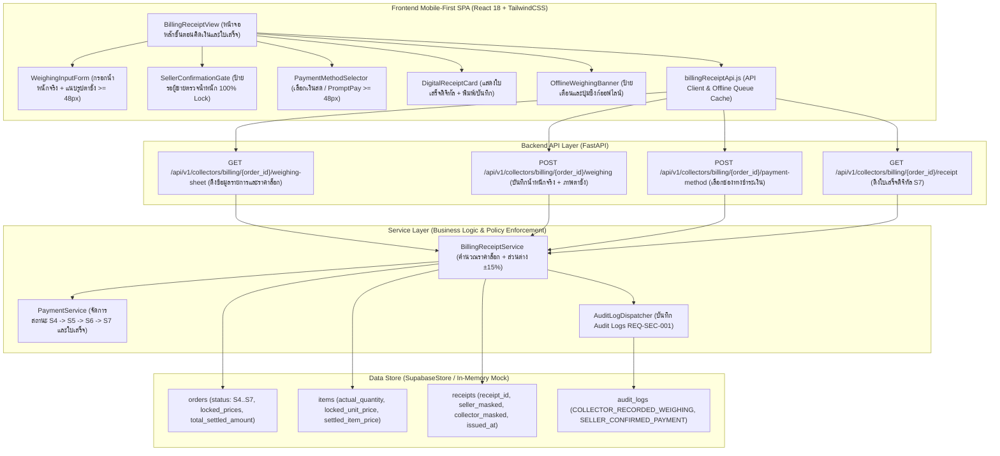

# PLAN-B06: แผนสถาปัตยกรรมและการพัฒนาทางเทคนิค ระบบคิดเงินและออกใบเสร็จ (`plan.md`)

- **Version:** `1.0` | **Status:** `ready-for-tasks` | **Owner:** กลุ่ม 2 (แพลตฟอร์มรับซื้อของเก่า/ซาเล้ง)
- **อ้างอิง:** [`specs/buyer/06-billing-and-receipt/spec.md`](./spec.md) (v2.0), [`specs/000-shared/constraints.md`](../../000-shared/constraints.md), [`specs/000-shared/quality-requirements.md`](../../000-shared/quality-requirements.md)
- **Use Case หลัก:** 
  - `UC-05: ชั่งน้ำหนักจริงที่หน้างาน ถ่ายภาพตาชั่ง และตรวจสอบเกณฑ์ส่วนต่าง ±15%` ([`docs/srs/use-cases.md`](../../../docs/srs/use-cases.md))
  - `UC-06: ยืนยันหรือปฏิเสธผลชั่งจริง/ราคาใหม่` (ฝั่งผู้ขายตรวจสอบผลชั่ง)
  - `UC-07: ชำระเงิน ออกใบเสร็จดิจิทัล และซิงก์ข้อมูลจากคิวออฟไลน์` ([`docs/srs/use-cases.md`](../../../docs/srs/use-cases.md))
- **ฟีเจอร์คู่ขนานฝั่งผู้ขาย:**
  - ฝั่งผู้ขาย ลำดับที่ 6: ระบบชำระเงินและตรวจสอบ ([`specs/seller/06-payment-and-verification/spec.md`](../../seller/06-payment-and-verification/spec.md))
- **Business Rules & State Machine ที่เกี่ยวข้อง:**
  - `MD-STM-04`: วงจรชีวิตงาน `S4 (Weighing)` -> `S5 (Re-Quote / Weight Confirmation)` -> `S6 (Settled / Pending Payment)` -> `S7 (Completed)` และ `S8 (Disputed)`
  - `REQ-FN-002`: บันทึกน้ำหนักชั่งจริงหน้างานและแนบภาพถ่ายหน้าตาชั่งดิจิทัล
  - `REQ-FN-004`: ผู้ขายตรวจสอบและยืนยันน้ำหนักชั่งจริงก่อนสรุปยอดเงิน (Seller Confirmation Gate 100%)
  - `REQ-FN-005` / `SC-03`: สร้างใบเสร็จดิจิทัล (`DigitalReceipt`) รหัสอ้างอิงไม่ซ้ำ น้ำหนักชั่งจริง ราคาล็อกต่อหน่วย และยอดชำระสุทธิ
  - `REQ-BR-002`: ใช้ราคาต่อหน่วยที่ล็อกไว้ตอนนัดหมาย (`locked_unit_price`) มาคำนวณยอดชำระสุทธิ
  - `REQ-OP-001` / `CT-02` (หน้า 44): โหมดกึ่งออฟไลน์ในจุดอับสัญญาณพร้อม Offline Queue ซิงก์เมื่อมีสัญญาณ
  - `REQ-SEC-001`: บันทึกประวัติการเปลี่ยนสถานะใบงานลงใน Audit Log
  - `REQ-SEC-002` / `CC-06`: ปกปิดข้อมูลส่วนบุคคล (PII Masking) เบอร์โทรศัพท์บนใบเสร็จดิจิทัลเป็น `08X-XXX-XXXX`
  - `REQ-UX-001` / `CC-01`: ทัชทาร์เก็ตปุ่มกดขนาดใหญ่ `>= 48px` รองรับสมาร์ตโฟนราคาประหยัด

---

## 1. เทคโนโลยีที่ใช้ (Technology Stack)

> [!NOTE]
> รายการเทคโนโลยีด้านล่างนี้ **"ทีมเลือกเอง ไม่ได้มาจาก spec"** เพื่อให้การพัฒนาระบบมีความเสถียร สอดคล้องกับสถาปัตยกรรมทั้งระบบของโครงการ (Seller 01..09 และ Buyer 01..05) และรองรับการทำงานแบบ Mobile-First SPA บนสมาร์ตโฟนราคาประหยัด
> 
- **Backend:** Python 3.11, FastAPI (REST API Framework), Pydantic v2 (Data Validation & Serialization), Pytest + Starlette TestClient (Automated Backend Testing)
- **Database / Concurrency Store:** In-memory Supabase Database Adapter ([`backend/app/core/supabase.py`](../../backend/app/core/supabase.py)) เชื่อมโยงกับตาราง `orders`, `items`, `receipts`, `sellers`, `saleng_profiles`, และ `audit_logs`
- **Frontend:** React 18, TailwindCSS (Mobile-First Viewport 375px–414px, ทัชทาร์เก็ตทุกปุ่มกดสูง `>= 48px` ตาม `REQ-UX-001` และ `CC-01`), Vitest + React Testing Library + JSDOM
- **Semi-Offline Storage & Queue:** `localStorage` แคชค่าน้ำหนักหน้างานและคิวคำสั่ง (`saleng_weighing_offline_queue`) พร้อม `idempotency_key` ตาม `CC-05`, `REQ-OP-001`, `CT-02` และ `D-B06-05`
- **Native PromptPay Protocol:** แสดงภาพ QR Code PromptPay มาตรฐาน (EMVCo QR standard) ของผู้ขาย เพื่อให้ซาเล้งเปิดแอปธนาคารสแกนจ่ายหน้างาน โดยไม่ใช้ Payment Gateway ภายนอกตาม `D-B06-04`

---

## 2. โครงสร้างไฟล์และสถาปัตยกรรม (Architecture & File Structure)

### 2.1 แผนผังสถาปัตยกรรมการทำงาน (Component Architecture Diagram)



### 2.2 โครงสร้างไฟล์ที่จะสร้างและแก้ไข

```
Saleng/
├── backend/
│   ├── app/
│   │   ├── models/
│   │   │   └── billing_models.py             # [สร้างใหม่] Pydantic models สำหรับใบชั่งน้ำหนัก, บันทึกผลชั่ง, ชำระเงิน, ใบเสร็จ
│   │   ├── services/
│   │   │   └── billing_service.py            # [สร้างใหม่] Billing logic คำนวณราคาล็อก, ตรวจเกณฑ์ ±15%, และเชื่อมโยง PaymentCore
│   │   ├── api/v1/
│   │   │   ├── billing.py                    # [สร้างใหม่] FastAPI router สำหรับ Billing & Weighing ฝั่งซาเล้ง
│   │   │   └── pricing.py                    # [แก้ไข] เมานต์ billing_router เข้ากับแอพภายใต้ /api/v1/collectors
│   │   └── core/
│   │       └── supabase.py                   # [แก้ไข/ตรวจสอบ] เพิ่ม helper methods สำหรับดึงข้อมูลใบชั่งน้ำหนักและอัปเดตช่องทางชำระเงิน
│   └── tests/
│       ├── test_T01_billing_models.py        # [สร้างใหม่] ทดสอบ Schemas และ Validation ของระบบคิดเงินและใบเสร็จ
│       ├── test_AC_B06_01_actual_weight.py   # [สร้างใหม่] ทดสอบการกรอกน้ำหนักจริงและภาพตาชั่ง (AC-B06-01)
│       ├── test_AC_B06_02_price_calc.py      # [สร้างใหม่] ทดสอบการคำนวณยอดเงินตามราคาที่ล็อกไว้ (AC-B06-02)
│       ├── test_AC_B06_03_seller_gate.py     # [สร้างใหม่] ทดสอบการบล็อกหน้าจอจนกว่าผู้ขายจะยืนยัน (AC-B06-03)
│       ├── test_AC_B06_04_payment_method.py  # [สร้างใหม่] ทดสอบการเลือกช่องทางเงินสด/PromptPay (AC-B06-04)
│       ├── test_AC_B06_05_digital_receipt.py # [สร้างใหม่] ทดสอบการออกใบเสร็จดิจิทัลและ PDPA Masking (AC-B06-05)
│       └── test_e2e_buyer_billing_receipt.py # [สร้างใหม่] Integration E2E Test ครบวงจรระบบคิดเงินและใบเสร็จ
├── frontend/
│   ├── src/
│   │   ├── services/
│   │   │   └── billingReceiptApi.js          # [สร้างใหม่] API Client คิดเงินและใบเสร็จ พร้อมแคช Offline Queue
│   │   └── components/
│   │       ├── WeighingInputForm.jsx         # [สร้างใหม่] ฟอร์มกรอกน้ำหนักจริง + แนบภาพถ่ายหน้าตาชั่ง (>= 48px)
│   │       ├── SellerConfirmationGate.jsx    # [สร้างใหม่] หน้าจอรอผู้ขายตรวจสอบและกดยืนยัน (100% Lock)
│   │       ├── PaymentMethodSelector.jsx     # [สร้างใหม่] ปุ่มตัวเลือกชำระเงินสด / PromptPay (>= 48px)
│   │       ├── DigitalReceiptCard.jsx        # [สร้างใหม่] การ์ดแสดงใบเสร็จดิจิทัล พร้อมปุ่มบันทึก/พิมพ์
│   │       └── BillingReceiptView.jsx        # [สร้างใหม่] หน้าจอหลักรวบรวมทุกขั้นตอนคิดเงินและใบเสร็จ
│   └── tests/
│       ├── billingReceiptApi.test.mjs        # [สร้างใหม่] Unit Tests Frontend API Client & Offline Queue
│       ├── AC-B06-01.test.jsx                # [สร้างใหม่] Component Test กรอกน้ำหนักจริงและแนบภาพตาชั่ง
│       ├── AC-B06-02.test.jsx                # [สร้างใหม่] Component Test คำนวณยอดเงินตาม locked_unit_price
│       ├── AC-B06-03.test.jsx                # [สร้างใหม่] Component Test ประตูรอผู้ขายยืนยันน้ำหนัก 100% Lock
│       ├── AC-B06-04.test.jsx                # [สร้างใหม่] Component Test เลือกวิธีจ่ายเงิน เงินสด/PromptPay
│       ├── AC-B06-05.test.jsx                # [สร้างใหม่] Component Test แสดงใบเสร็จดิจิทัลและ Mask เบอร์โทร
│       └── AC-B06-06.test.jsx                # [สร้างใหม่] Component Test คิวออฟไลน์และการซิงก์ผลชั่ง
└── specs/buyer/06-billing-and-receipt/
    ├── spec.md                               # [มีอยู่แล้ว v2.0]
    └── plan.md                               # [ไฟล์นี้]
```

---

## 3. การออกแบบฐานข้อมูลและการจัดเก็บข้อมูล (Data Models & Storage Schema)

### 3.1 ความสัมพันธ์ของข้อมูลในฐานข้อมูล (`Data Relationships`)

1. **ตาราง `orders`:**
   - `order_id`: UUID string (Primary Key)
   - `status`: สถานะงาน (`S4: Weighing` -> `S5: Re-Quote` -> `S6: Pending Payment` -> `S7: Completed`)
   - `scale_photo_url`: URL ภาพถ่ายหน้าตาชั่งดิจิทัล (string)
   - `total_settled_amount`: ยอดเงินสุทธิรวมหลังชั่งจริง (float)
   - `seller_confirmed_weight`: ยืนยันน้ำหนักแล้วหรือไม่ (boolean)
   - `payment_method`: `"CASH"` หรือ `"PROMPTPAY"` (string)
   - `version`: Optimistic Concurrency Control version (integer)
2. **ตาราง `items`:**
   - `item_id`: UUID string
   - `order_id`: Foreign Key -> `orders.order_id`
   - `actual_quantity`: น้ำหนักชั่งจริงหน้างาน (float กก. หรือ กระสอบ)
   - `locked_unit_price`: ราคาต่อหน่วยที่ล็อกไว้ตอนนัดหมาย (`REQ-BR-002`)
   - `settled_item_price`: ยอดเงินสุทธิของรายการ (`actual_quantity * locked_unit_price`)
3. **ตาราง `receipts`:**
   - `receipt_id`: รหัสอ้างอิงใบเสร็จไม่ซ้ำ เช่น `REC-YYYYMMDD-XXXX`
   - `order_id`: Foreign Key -> `orders.order_id`
   - `seller_phone_masked`: เบอร์โทรศัพท์ผู้ขายที่ Mask แล้ว (`08X-XXX-XXXX`)
   - `collector_phone_masked`: เบอร์โทรศัพท์ซาเล้งที่ Mask แล้ว (`08X-XXX-XXXX`)
   - `total_amount`: ยอดเงินสุทธิรวม (บาท)
   - `issued_at`: วันที่และเวลาออกใบเสร็จ (ISO 8601 UTC)

---

## 4. การออกแบบ API (API Endpoints Specification)

ติดตั้ง Router ภายใต้ Prefix `/api/v1/collectors/billing`:

### 4.1 `GET /api/v1/collectors/billing/{order_id}/weighing-sheet`
- **คำอธิบาย:** ดึงข้อมูลใบชั่งน้ำหนัก รายการสิ่งของที่จะรับซื้อ และราคาต่อหน่วยที่ล็อกไว้ (`locked_unit_price`)
- **Query Parameters:** `saleng_id: str`
- **Response Model:** `WeighingSheetResponse`
```json
{
  "order_id": "order-s2-01",
  "order_status": "S4",
  "seller_name": "คุณวิภาดา รัชดา",
  "seller_phone_masked": "081-XXX-5678",
  "items": [
    {
      "item_id": "item-01",
      "category_code": "MAT-CARDBOARD",
      "category_name": "กระดาษลัง",
      "estimated_quantity": 20.0,
      "unit": "กก.",
      "locked_unit_price": 3.5
    }
  ]
}
```

### 4.2 `POST /api/v1/collectors/billing/{order_id}/weighing`
- **คำอธิบาย:** ซาเล้งบันทึกค่าน้ำหนักชั่งจริงหน้างาน พร้อมแนบรูปถ่ายหน้าตาชั่งดิจิทัล (`REQ-FN-002`)
- **Request Body:** `SubmitWeighingRequest`
```json
{
  "saleng_id": "saleng-01",
  "scale_photo_url": "https://storage.saleng.app/scales/scale-01.jpg",
  "items": [
    {
      "item_id": "item-01",
      "actual_quantity": 25.0
    }
  ],
  "idempotency_key": "idemp-weigh-001"
}
```
- **Response Model:** `WeighingResultResponse` (HTTP 200 OK)
  - คำนวณส่วนต่างน้ำหนักเทียบที่ประเมิน (`±15%` ตาม `MD-STM-04`)
  - หากส่วนต่างเกิน `±15%` สถานะเปลี่ยนเป็น `S5: Re-Quote Pending`
  - หากไม่เกิน สถานะยังคงต้องรอผู้ขายยืนยันตัวเลขน้ำหนัก (100% Confirmation Gate)

### 4.3 `POST /api/v1/collectors/billing/{order_id}/payment-method`
- **คำอธิบาย:** ซาเล้งเลือกช่องทางการชำระเงินค่าของเก่า (`CASH` หรือ `PROMPTPAY`) ในสถานะ `S6`
- **Request Body:** `SelectPaymentMethodRequest`
```json
{
  "saleng_id": "saleng-01",
  "payment_method": "PROMPTPAY"
}
```
- **Response Model:** `PaymentMethodSelectionResponse`

### 4.4 `GET /api/v1/collectors/billing/{order_id}/receipt`
- **คำอธิบาย:** ดึงใบเสร็จดิจิทัลสรุปรายการเมื่อใบงานเสร็จสิ้น (`S7`)
- **Response Model:** `DigitalReceiptResponse` (HTTP 200 OK)

---

## 5. แผนเชื่อมต่อระบบภายนอกและการจำลอง (External Integrations & Protocols)

1. **PromptPay EMVCo QR Protocol (`D-B06-04`):**
   - ฝั่งผู้ขายแสดง QR Code PromptPay บนหน้าจอตามมาตรฐาน EMVCo QR
   - ซาเล้งเปิดแอปธนาคารใดก็ได้สแกนจ่ายเงิน โดยไม่ผ่าน Payment Gateway เพื่อลดค่าธรรมเนียมและประหยัดทรัพยากรเครื่องตาม `CC-01`
2. **Audit Log System (`REQ-SEC-001`):**
   - บันทึกประวัติการส่งผลชั่งจริง (`COLLECTOR_RECORDED_WEIGHING`) และการเลือกวิธีชำระเงิน (`COLLECTOR_SELECTED_PAYMENT_METHOD`) ลงในตาราง `audit_logs`
3. **Image Storage Upload Protocol:**
   - ภาพถ่ายหน้าตาชั่งดิจิทัลส่งเป็น URL (`scale_photo_url`) หรือจำลองการอัปโหลดเข้า Mock Storage เพื่อส่งต่อให้ผู้ขายตรวจสอบ

---

## 6. แผนการพัฒนาหน้าจอ (Frontend Component Plan)

ทุกคอมโพเนนต์พัฒนาด้วย React 18 + TailwindCSS สำหรับหน้าจอมือถือ (Viewport 375px–414px) โดยทัชทาร์เก็ตปุ่มกดทั้งหมดต้องมีขนาดความสูงไม่น้อยกว่า `48px` ตาม `REQ-UX-001` และ `CC-01`:

1. **`WeighingInputForm.jsx`:**
   - แสดงรายการสิ่งของที่จะรับซื้อ พร้อมราคาต่อหน่วยที่ล็อกไว้ (`locked_unit_price`)
   - ช่องกรอกค่าน้ำหนักจริง (`data-testid="actual-weight-input"`, ความสูง `>= 48px`)
   - ช่องใส่/อัปโหลดภาพถ่ายตาชั่ง (`data-testid="scale-photo-input"`)
   - ปุ่มกดยืนยันผลชั่ง (`data-testid="submit-weighing-btn"`, ขนาด `>= 48px`, สีเขียว Emerald)
2. **`SellerConfirmationGate.jsx`:**
   - แสดงแอนิเมชันหรือป้ายแจ้งเตือน: *"กำลังรอผู้ขายตรวจสอบและยืนยันตัวเลขน้ำหนักจริง..."*
   - บล็อกปุ่มข้ามไปยังขั้นตอนชำระเงิน 100% จนกว่าผู้ขายจะกดยืนยันสำเร็จ (สถานะเปลี่ยนเป็น `S6`)
3. **`PaymentMethodSelector.jsx`:**
   - แสดงยอดเงินสุทธิรวมตัวเลขขนาดใหญ่เด่นชัด (เช่น `฿ 185.00`)
   - ปุ่มตัวเลือก 2 ช่องทาง:
     - 💵 **`เงินสด (Cash)`:** ปุ่มขนาดความสูง `>= 48px`
     - 📱 **`PromptPay QR Code`:** ปุ่มขนาดความสูง `>= 48px` พร้อมป้ายคำแนะนำเปิดแอปธนาคารสแกน
   - ป้ายแจ้งเตือน: *"กรุณารอให้ผู้ขายได้รับเงินและกดยืนยันบนหน้าจอของผู้ขายเพื่อปิดงาน"*
4. **`DigitalReceiptCard.jsx`:**
   - การ์ดใบเสร็จดิจิทัลสวยงาม: รหัสใบเสร็จ `REC-YYYYMMDD-XXXX`, วันที่-เวลา, สรุปรายการน้ำหนักและราคา, ยอดสุทธิรวม
   - แสดงเบอร์โทรศัพท์ที่ Mask แล้ว (`08X-XXX-XXXX` ตาม `REQ-SEC-002`)
   - ปุ่มพิมพ์หรือบันทึกใบเสร็จ (`data-testid="save-receipt-btn"`, ขนาดความสูง `>= 48px`)
5. **`BillingReceiptView.jsx`:**
   - หน้าจอหลักรวบรวมทุกคอมโพเนนต์เข้าด้วยกัน
   - สลับหน้าจออัตโนมัติตามสถานะใบงาน (`S4 -> S5 -> S6 -> S7`)
   - มีแบนเนอร์แจ้งเตือนโหมดออฟไลน์ (`data-testid="offline-weighing-banner"`) และปุ่มกดซิงก์ข้อมูลเมื่อต่อเน็ต

---

## 7. การจัดการคำถามเปิดและการตัดสินใจ (Decisions Traceability)

| รหัสการตัดสินใจ | ข้อกำหนดในสเปก (`spec.md` v2.0) | ผลกระทบต่อแผนการพัฒนาทางเทคนิค (`plan.md`) |
| :---: | :--- | :--- |
| **`D-B06-01`** | ปรับลำดับสถานะ State Machine ให้ตรงกับ `MD-STM-04` | Service และ API จัดการสถานะ `S4 -> S5 -> S6 -> S7` และอ้างอิง `UC-05`, `UC-06`, `UC-07` |
| **`D-B06-02`** | บังคับแนบรูปถ่ายหน้าตาชั่งดิจิทัล (`scale_photo_url`) | Schema ตรวจสอบ `scale_photo_url` ต้องไม่ว่างเปล่า และ UI มีปุ่มอัปโหลดรูป |
| **`D-B06-03`** | ใช้ราคาต่อหน่วยที่ล็อกไว้ตอนนัดหมาย (`locked_unit_price`) | สูตรคำนวณราคาใช้ `locked_unit_price` คูณ `actual_weight` ตาม `REQ-BR-002` |
| **`D-B06-04`** | ซาเล้งเลือกวิธีจ่าย (เงินสด/PromptPay) ผู้ขายกดยืนยันรับเงินเพื่อเข้า `S7` | ปิดงานเข้าสู่ `S7` ผ่านขั้นตอนผู้ขายกดยืนยันรับเงินตามสเปก Seller 06 |
| **`D-B06-05`** | รองรับ Offline Queue เมื่ออยู่ในจุดอับสัญญาณ | โมดูล `billingReceiptApi.js` เก็บผลชั่งใน `localStorage` พร้อม `idempotency_key` |
| **`D-B06-06`** | ออกใบเสร็จดิจิทัลรหัสไม่ซ้ำพร้อม Mask เบอร์โทรศัพท์ | สร้างตาราง `receipts` และส่งผลสรุปใบเสร็จพร้อม Masking ตาม `REQ-SEC-002` |

---

## 8. ตารางตรวจสอบความครบถ้วนของข้อจำกัดกลาง (Constraints Traceability Matrix)

| รหัส Constraint | ข้อกำหนดใน Constraint กลาง (`specs/000-shared/constraints.md`) | เกี่ยวข้องหรือไม่ | รายละเอียดการปฏิบัติตามในแผนนี้ |
| :---: | :--- | :---: | :--- |
| **`CC-01`** | Mobile-First Web SPA รองรับมือถือราคาประหยัด (`RAM >= 2 GB`, ปุ่ม `>= 48px`) | **เกี่ยวข้อง** | ออกแบบหน้าจอด้วย React 18 + TailwindCSS ช่องกรอกน้ำหนัก, ปุ่มอัปโหลดรูป, ปุ่มเลือกช่องทางชำระเงิน และปุ่มบันทึกใบเสร็จมีความสูงไม่น้อยกว่า `48px` (`REQ-UX-001`) และไม่ใช้ Payment SDK หนักเครื่อง |
| **`CC-02`** | GPS Sync Interval ทุก 60 วินาทีขณะเปิดสถานะ Online | ไม่เกี่ยวข้องโดยตรง | อยู่ระหว่างการชั่งน้ำหนักหน้างาน (`S4..S7`) พิกัด GPS ล็อกอยู่กับสถานที่นัดรับ |
| **`CC-03`** | Road Distance API รัศมี <= 5.0 กม. พร้อม Haversine Fallback | ไม่เกี่ยวข้องโดยตรง | การคำนวณระยะทางเสร็จสิ้นในขั้นตอนเดินทาง (Buyer 02, 03, 04) |
| **`CC-04`** | PostgreSQL + Concurrency Control / Optimistic Locking (`BR-02`) | **เกี่ยวข้อง** | ใช้ Optimistic Concurrency Control ผ่านฟิลด์ `version` ในตาราง `orders` ป้องกันการบันทึกผลชั่งหรือชำระเงินซ้ำซ้อน |
| **`CC-05`** | Offline Cache ใน IndexedDB / Local Storage | **เกี่ยวข้อง** | แคชตารางชั่งน้ำหนักและคิวคำสั่ง (`saleng_weighing_offline_queue`) ใน `localStorage` รองรับการทำงานในซอยอับสัญญาณ (`CT-02` หน้า 44, `REQ-OP-001`) |
| **`CC-06`** | PDPA & PII Masking ซ่อนบ้านเลขที่และพิกัดละเอียด | **เกี่ยวข้อง** | บนใบเสร็จดิจิทัลและหน้าจอยอดสรุป ระบบปกปิดเบอร์โทรศัพท์ของผู้ขายและซาเล้งเป็น `08X-XXX-XXXX` ตาม `REQ-SEC-002` |
| **`REQ-SEC-001`** | บันทึกประวัติลงตาราง Audit Log | **เกี่ยวข้อง** | บันทึกประวัติการส่งผลชั่งจริง (`COLLECTOR_RECORDED_WEIGHING`), การเปลี่ยนสถานะงาน (`ORDER_WEIGHING_RECORDED`), และการชำระเงินลงใน `audit_logs` |
| **`REQ-SEC-002`** | ปกปิดข้อมูลส่วนบุคคล (PII) ของผู้ขายก่อนรับงาน | **เกี่ยวข้อง** | ปกปิดเบอร์โทรศัพท์และข้อมูลส่วนบุคคลของผู้ขายบนใบเสร็จดิจิทัลหลังเสร็จสิ้นธุรกรรม |
| **`REQ-OP-001`** | โหมด Offline Queue สำหรับดูข้อมูลที่แคชไว้ | **เกี่ยวข้อง** | ซาเล้งสามารถกรอกค่าน้ำหนักและบันทึกลง Offline Queue ได้แม้ออฟไลน์ พร้อมปุ่มกดซิงก์เมื่อสัญญาณเน็ตกลับมา |
| **`REQ-OP-002`** | Haversine Fallback สำหรับการคำนวณระยะทาง | ไม่เกี่ยวข้องโดยตรง | ฟีเจอร์นี้เป็นระบบคิดเงิน ชั่งน้ำหนัก และออกใบเสร็จ ไม่มีการคำนวณระยะทางถนน |
| **`D-00-01`** | KYC เป็น Precondition ของระบบผู้ซื้อ | **เกี่ยวข้อง** | ซาเล้งต้องผ่าน KYC ก่อนจึงจะสามารถรับงาน ชั่งน้ำหนัก และออกใบเสร็จได้ |
| **`D-00-02`** | ซ่อนพิกัดผู้ขายจนกว่าจะรับงาน | **เกี่ยวข้อง** | ในสถานะ `S4..S7` ซาเล้งได้รับงานและเดินทางถึงหน้างานเรียบร้อยแล้ว |
| **`D-00-03`** | ขอบเขตหยุดที่สถานะมีผู้รับงานแล้ว | **เกี่ยวข้อง** | ฟีเจอร์นี้ครอบคลุมการปฏิบัติงานหน้างานตั้งแต่ชั่งน้ำหนัก (`S4`), ยืนยันราคา (`S5`), ชำระเงิน (`S6`), จนถึงสำเร็จและออกใบเสร็จ (`S7`) |

