# แผนสถาปัตยกรรมและเทคโนโลยี: ระบบบัญชีและการเข้าใช้งานของผู้ขาย (`specs/seller/01-account-and-access/plan.md`)

- **Version:** `1.0` | **Status:** `ready-for-tasks` | **Owner:** กลุ่ม 2 (แพลตฟอร์มรับซื้อของเก่า/ซาเล้ง)
- **อ้างอิงสเปก:** [`specs/seller/01-account-and-access/spec.md`](./spec.md) (v2.0)
- **ข้อจำกัดกลาง:** [`specs/000-shared/constraints.md`](../../000-shared/constraints.md) (`CC-01..CC-06`, `REQ-SEC-001..002`, `REQ-OP-001..002`, `D-00-01..03`)

---

## 1. เทคโนโลยีที่ใช้ (Tech Stack)

> [!NOTE]
> **หมายเหตุด้านเทคโนโลยี:** เทคโนโลยีที่ใช้ในโมดูลนี้ **`"ทีมเลือกเอง ไม่ได้มาจาก spec"`** เพื่อให้สอดคล้องกับสถาปัตยกรรมทั้งระบบของโครงการ:

- **Backend Framework:** **Python 3.11 + FastAPI**
  - สถาปัตยกรรม REST API แบบแยก Router, Controller (Service Layer) และ Data Access Layer
  - ตรวจสอบความถูกต้องของข้อมูล (Validation & Sanitization) ด้วย **Pydantic v2**
  - จัดการข้อผิดพลาดตามมาตรฐาน HTTP Status Codes (`400 Bad Request`, `401 Unauthorized`, `403 Forbidden`, `404 Not Found`, `409 Conflict`, `422 Unprocessable Entity`)
- **Database & Storage:** **Supabase (PostgreSQL 15+)**
  - ตาราง `sellers`, `seller_otps`, `seller_sessions`, `pickup_locations`, และ `audit_logs`
  - รองรับ Concurrency Control ด้วยคอลัมน์ `version` และ Unique Constraints (ตาม `CC-04`)
- **Frontend Framework:** **React 18 + Vite + TailwindCSS**
  - พัฒนาเป็น Single-Page Application (SPA) แบบ Mobile-First ตามข้อกำหนด `CC-01` (Viewport 375px–414px)
  - รองรับ HTML5 Geolocation API พร้อมระบบ Fallback Mock Coordinates สำหรับการทดสอบ
  - แคชเซสชันโทเคน (`session_token`) และรายการที่อยู่นัดหมายลงใน `localStorage` (`CC-05`, `REQ-OP-001`)
- **Automated Testing Suite:**
  - หลังบ้าน: **Pytest** พร้อม `TestClient` (FastAPI)
  - หน้าบ้าน: **Vitest + React Testing Library + JSDOM**

---

## 2. สถาปัตยกรรมระบบ (System Architecture)

```mermaid
flowchart TD
    subgraph Frontend ["Frontend (Mobile-First SPA - CC-01)"]
        UI_Login["PhoneOtpLoginForm\n(กรอกเบอร์โทร + ขอ OTP + ยืนยัน 6 หลัก - AC-S01-01)"]
        UI_Profile["SellerProfileCard\n(แสดงชื่อ + เบอร์โทร Masked 08X-XXX-XXXX - AC-S01-03)"]
        UI_LocationList["PickupLocationList\n(รายการที่อยู่นัดหมาย + ป้าย Default - AC-S01-02)"]
        UI_LocationModal["PickupLocationModal\n(เพิ่ม/แก้ไขที่อยู่ + ปุ่ม GPS Pinning - Q-02, Q-03)"]
        UI_AccountPanel["AccountAccessPanel\n(แผงแดชบอร์ดหลักจัดการบัญชีและที่อยู่)"]
    end

    subgraph Backend_API ["FastAPI Service Layer"]
        API_RequestOtp["POST /api/v1/sellers/auth/request-otp\n(ขอรหัส OTP เข้าสู่ระบบ - AC-S01-01)"]
        API_VerifyOtp["POST /api/v1/sellers/auth/verify-otp\n(ยืนยัน OTP + ออก Session Token - AC-S01-01)"]
        API_Logout["POST /api/v1/sellers/auth/logout\n(ออกจากระบบ + บันทึก Audit Log - AC-S01-05)"]
        API_GetProfile["GET /api/v1/sellers/{seller_id}/profile\n(ดึงโปรไฟล์ + Masked Phone - AC-S01-03)"]
        API_UpdateProfile["PUT /api/v1/sellers/{seller_id}/profile\n(แก้ไขชื่อที่แสดง displayName)"]
        API_ListLocations["GET /api/v1/sellers/{seller_id}/locations\n(ดึงรายการที่อยู่นัดหมาย - AC-S01-02)"]
        API_CreateLocation["POST /api/v1/sellers/{seller_id}/locations\n(เพิ่มที่อยู่นัดหมายใหม่ - AC-S01-02)"]
        API_UpdateLocation["PUT /api/v1/sellers/{seller_id}/locations/{loc_id}\n(แก้ไขที่อยู่นัดหมาย)"]
        API_DeleteLocation["DELETE /api/v1/sellers/{seller_id}/locations/{loc_id}\n(ลบที่อยู่นัดหมาย)"]
        API_SetDefault["PATCH /api/v1/sellers/{seller_id}/locations/{loc_id}/default\n(ตั้งเป็นที่อยู่เริ่มต้น - Q-03)"]
    end

    subgraph Core_Services ["Business Logic & Services"]
        SVC_Auth["SellerAuthService\n(จัดการ OTP Generation, Verification, Session Management, Latency < 2.0s)"]
        SVC_Location["PickupLocationService\n(จัดการที่อยู่นัดหมาย, Geolocation, Default Location Toggle, PII Protection)"]
        SVC_Audit["AuditLogService\n(บันทึกเหตุการณ์ลงใน audit_logs แบบ Append-only - REQ-SEC-001)"]
    end

    subgraph Database ["Supabase / PostgreSQL (CC-04)"]
        DB_Sellers["sellers"]
        DB_Otps["seller_otps"]
        DB_Sessions["seller_sessions"]
        DB_Locations["pickup_locations"]
        DB_Audit["audit_logs (REQ-SEC-001)"]
    end

    UI_Login --> API_RequestOtp
    UI_Login --> API_VerifyOtp
    UI_Profile --> API_GetProfile
    UI_Profile --> API_UpdateProfile
    UI_Profile --> API_Logout
    UI_LocationList --> API_ListLocations
    UI_LocationModal --> API_CreateLocation
    UI_LocationModal --> API_UpdateLocation
    UI_LocationList --> API_DeleteLocation
    UI_LocationList --> API_SetDefault

    API_RequestOtp --> SVC_Auth
    API_VerifyOtp --> SVC_Auth
    API_Logout --> SVC_Auth
    API_GetProfile --> SVC_Auth
    API_UpdateProfile --> SVC_Auth
    API_ListLocations --> SVC_Location
    API_CreateLocation --> SVC_Location
    API_UpdateLocation --> SVC_Location
    API_DeleteLocation --> SVC_Location
    API_SetDefault --> SVC_Location

    SVC_Auth --> DB_Sellers
    SVC_Auth --> DB_Otps
    SVC_Auth --> DB_Sessions
    SVC_Auth --> DB_Audit
    SVC_Location --> DB_Locations
    SVC_Location --> DB_Audit
```



---

## 3. การตัดสินใจเชิงสถาปัตยกรรม (Architectural Decisions — `P-01` ถึง `P-06`)

### `P-01`: Seller Phone Registration & OTP Authentication Service (`UC-01`, `AC-S01-01`, `Q-01`)
- **บริบท:** ผู้ขายบ้านพักอาศัยต้องการความสะดวก รวดเร็วในการเข้าใช้งานโดยไม่ต้องจำรหัสผ่านซับซ้อนตาม `REQ-UX-002` และต้องการการตอบสนองที่รวดเร็วภายใน `< 2.0 วินาที` (`REQ-QA-001`)
- **การตัดสินใจ:**
  1. สร้าง `SellerAuthService` ให้บริการขอและยืนยันรหัส OTP 6 หลัก
  2. ในโหมดทดสอบ กำหนด OTP เริ่มต้นเป็น `123456` หรือสุ่มตัวเลข 6 หลัก โดยมีอายุใช้งาน 5 นาที (300 วินาที)
  3. เมื่อยืนยัน OTP ถูกต้อง ระบบจะตรวจสอบว่ามีเบอร์โทรนี้ในระบบหรือไม่:
     - หากเป็นผู้ใช้ใหม่: สร้างข้อมูลในตาราง `sellers` อัตโนมัติ พร้อมกำหนดชื่อเริ่มต้น เช่น `"ผู้ขาย (08X-XXX-1234)"`
     - หากเป็นผู้ใช้เดิม: คืนข้อมูลโปรไฟล์เดิม
  4. สร้าง `session_token` (UUIDv4) บันทึกลงในตาราง `seller_sessions` กำหนดอายุใช้งาน 30 วัน

### `P-02`: Pickup Location CRUD & GPS Pinning Service (`UC-01`, `UC-02`, `AC-S01-02`, `Q-02`, `Q-03`)
- **บริบท:** ผู้ขายต้องมีที่อยู่นัดหมายเพื่อใช้ส่งของเก่าใน `UC-02` โดยต้องมีพิกัด `geoPoint` และข้อความที่อยู่ชัดเจน และผู้ขายอาจมีหลายที่อยู่
- **การตัดสินใจ:**
  1. สร้าง `PickupLocationService` และตาราง `pickup_locations` รองรับการเพิ่ม แก้ไข ลบ และดูรายการที่อยู่
  2. แต่ละที่อยู่มีโครงสร้างข้อมูลตาม `MD-DOM-04`: `label` (ป้ายกำกับ เช่น "บ้าน"), `sub_district` (ตำบล/แขวง), `address_text` (บ้านเลขที่/ซอย/จุดสังเกต), `geo_point` (`lat`, `lng`), และ `is_default`
  3. ระบบอนุญาตให้มี `is_default = true` ได้เพียง 1 ที่อยู่ต่อผู้ขาย โดยหากมีการตั้งค่าที่อยู่ใหม่เป็น default ระบบจะปลดสถานะ default ของที่อยู่อื่นของผู้ขายรายนั้นโดยอัตโนมัติ

### `P-03`: PII Protection & Data Separation in API (`REQ-SEC-002`, `EV-09`, `DR-02`, `AC-S01-03`, `Q-04`)
- **บริบท:** ข้อมูลบ้านเลขที่ `addressText`, พิกัดละเอียด `geoPoint`, และเบอร์โทรศัพท์ `phone` เป็นข้อมูลส่วนบุคคล (`PII`) ที่ต้องได้รับการคุ้มครองตาม PDPA
- **การตัดสินใจ:**
  1. สร้างฟังก์ชันยูทิลิตี้ `mask_phone(phone: str) -> str` แปลงเบอร์โทรศัพท์เป็น `08X-XXX-XXXX` สำหรับ Response และการแสดงผลหน้าจอ
  2. แยกฟิลด์ `sub_district` ออกจาก `address_text` อย่างเด็ดขาดในระดับ Schema เพื่อให้ใน `UC-04` (ค้นหางานของซาเล้ง) ระบบสามารถส่งเฉพาะ `sub_district` และระยะทางคร่าว ๆ ได้อย่างปลอดภัย โดยไม่เปิดเผยบ้านเลขที่จริงจนกว่าซาเล้งจะกดรับงาน

### `P-04`: Session Token & LocalStorage Persistence (`CC-05`, `REQ-OP-001`, `AC-S01-04`)
- **บริบท:** ผู้ใช้ควรเปิดแอปพลิเคชันขึ้นมาใช้งานต่อได้ทันทีโดยไม่ต้องกรอกเบอร์และขอ OTP ใหม่ทุกครั้ง และต้องดูข้อมูลที่อยู่ที่บันทึกไว้ได้แม้ในภาวะออฟไลน์
- **การตัดสินใจ:**
  1. พัฒนา `accountApi.js` ให้จัดเก็บ `saleng_seller_token`, `saleng_seller_profile`, และ `saleng_seller_locations` ลงใน `localStorage`
  2. เมื่อแอปพลิเคชันเริ่มต้น (App Mount) ให้ตรวจสอบ Token ใน `localStorage` เพื่อฟื้นฟูสถานะการเข้าสู่ระบบอัตโนมัติ
  3. หากไม่มีสัญญาณอินเทอร์เน็ต ให้โหลดข้อมูลที่อยู่นัดหมายจาก `localStorage` มาแสดงผล พร้อมระบุป้ายเตือนสถานะออฟไลน์

### `P-05`: Security Audit Logging for Account & Address Actions (`REQ-SEC-001`, `EV-08`, `AC-S01-05`)
- **บริบท:** ทุกการเข้าสู่ระบบและแก้ไขข้อมูลสำคัญต้องมีหลักฐานตรวจสอบย้อนหลังได้แบบ Append-only
- **การตัดสินใจ:**
  1. บันทึกเหตุการณ์ลงในตาราง `audit_logs` ทุกครั้งที่มีการ:
     - `OTP_REQUESTED`: มีการขอรหัส OTP
     - `LOGIN_SUCCESS`: เข้าสู่ระบบสำเร็จพร้อมรหัสผู้ขาย
     - `LOGOUT`: ออกจากระบบ
     - `LOCATION_CREATED`: เพิ่มที่อยู่นัดหมายใหม่
     - `LOCATION_UPDATED`: แก้ไขข้อมูลที่อยู่นัดหมาย
     - `LOCATION_DELETED`: ลบที่อยู่นัดหมาย
     - `DEFAULT_LOCATION_CHANGED`: เปลี่ยนที่อยู่เริ่มต้น
  2. บันทึก Metadata ครบถ้วน: `actor_id` (`seller_id`), `action`, `entity_type`, `entity_id`, `details`, และ `timestamp`

### `P-06`: Precondition Readiness for Scrap Posting (`CC-03`, `MD-STM-04`, `UC-02`)
- **บริบท:** การโพสต์ขายของเก่าใน `UC-02` ต้องใช้ข้อมูลที่อยู่นัดหมายจากโมดูลนี้
- **การตัดสินใจ:**
  1. จัดเตรียม API `GET /api/v1/sellers/{seller_id}/locations/default` เพื่อให้โมดูลโพสต์ขายของเก่า (`UC-02`) เรียกดึงที่อยู่นัดหมายเริ่มต้นไปกรอกให้อัตโนมัติ
  2. กำหนด Validation Rule ว่าผู้ขายต้องมีที่อยู่นัดหมายอย่างน้อย 1 รายการก่อนที่จะสามารถยืนยันโพสต์งานสู่สถานะ `S2 (Pending/Open)` ได้

---

## 4. โครงสร้างข้อมูลและ Schema (Data Models & Schemas)

### 4.1 SQL Database Schema (DDL สำหรับ Supabase / PostgreSQL)

```sql
-- 1. ตารางบัญชีผู้ขาย (Sellers)
CREATE TABLE sellers (
    id UUID PRIMARY KEY DEFAULT gen_random_uuid(),
    seller_id VARCHAR(64) UNIQUE NOT NULL, -- รหัสผู้ขาย เช่น SEL-XXXXX
    phone VARCHAR(20) NOT NULL,            -- เบอร์โทรศัพท์ PII (เช่น 0812345678)
    display_name VARCHAR(100) NOT NULL,    -- ชื่อที่แสดง
    status VARCHAR(20) NOT NULL DEFAULT 'ACTIVE', -- ACTIVE, SUSPENDED
    created_at TIMESTAMPTZ NOT NULL DEFAULT NOW(),
    updated_at TIMESTAMPTZ NOT NULL DEFAULT NOW()
);

-- 2. ตารางรหัส OTP ชั่วคราว (Seller OTPs)
CREATE TABLE seller_otps (
    id UUID PRIMARY KEY DEFAULT gen_random_uuid(),
    phone VARCHAR(20) NOT NULL,
    otp_code VARCHAR(6) NOT NULL,
    expires_at TIMESTAMPTZ NOT NULL,
    is_used BOOLEAN NOT NULL DEFAULT FALSE,
    created_at TIMESTAMPTZ NOT NULL DEFAULT NOW()
);

-- 3. ตารางเซสชันการเข้าสู่ระบบ (Seller Sessions)
CREATE TABLE seller_sessions (
    id UUID PRIMARY KEY DEFAULT gen_random_uuid(),
    session_token VARCHAR(128) UNIQUE NOT NULL,
    seller_id VARCHAR(64) NOT NULL REFERENCES sellers(seller_id),
    phone VARCHAR(20) NOT NULL,
    expires_at TIMESTAMPTZ NOT NULL,
    created_at TIMESTAMPTZ NOT NULL DEFAULT NOW()
);

-- 4. ตารางที่อยู่นัดหมายรับของเก่า (Pickup Locations - MD-DOM-04)
CREATE TABLE pickup_locations (
    id UUID PRIMARY KEY DEFAULT gen_random_uuid(),
    location_id VARCHAR(64) UNIQUE NOT NULL, -- รหัสที่อยู่ เช่น LOC-XXXXX
    seller_id VARCHAR(64) NOT NULL REFERENCES sellers(seller_id),
    label VARCHAR(50) NOT NULL DEFAULT 'บ้าน', -- ป้ายกำกับ เช่น "บ้าน", "ที่ทำงาน"
    sub_district VARCHAR(100) NOT NULL,     -- ตำบล/แขวง (แสดงผลสาธารณะก่อนรับงาน REQ-SEC-002)
    address_text TEXT NOT NULL,             -- บ้านเลขที่ ซอย ถนน (PII)
    geo_point JSONB NOT NULL,               -- พิกัด {"lat": 13.7563, "lng": 100.5018} (PII)
    is_default BOOLEAN NOT NULL DEFAULT FALSE, -- ที่อยู่เริ่มต้น
    created_at TIMESTAMPTZ NOT NULL DEFAULT NOW(),
    updated_at TIMESTAMPTZ NOT NULL DEFAULT NOW()
);

-- 5. ตาราง Audit Log ด้านความปลอดภัย (Append-only - REQ-SEC-001)
CREATE TABLE audit_logs (
    id UUID PRIMARY KEY DEFAULT gen_random_uuid(),
    log_id VARCHAR(64) UNIQUE NOT NULL,
    action VARCHAR(64) NOT NULL,
    actor_id VARCHAR(64) NOT NULL,
    actor_role VARCHAR(20) NOT NULL DEFAULT 'SELLER',
    target_entity VARCHAR(64) NOT NULL,
    entity_id VARCHAR(64) NOT NULL,
    details JSONB,
    created_at TIMESTAMPTZ NOT NULL DEFAULT NOW()
);
```

### 4.2 Pydantic Data Models (`backend/app/models/account_models.py`)

- `OtpRequest`: `phone: str` (ต้องเป็นตัวเลข 10 หลักขึ้นต้นด้วย 0)
- `OtpRequestResponse`: `phone_masked: str`, `expires_in_seconds: int`, `message: str`
- `OtpVerifyRequest`: `phone: str`, `otp_code: str` (ตัวเลข 6 หลัก)
- `AuthSessionResponse`: `session_token: str`, `seller_id: str`, `phone_masked: str`, `display_name: str`, `expires_at: str`
- `SellerProfileResponse`: `seller_id: str`, `phone_masked: str`, `display_name: str`, `status: str`, `created_at: str`
- `SellerProfileUpdateRequest`: `display_name: str`
- `GeoPoint`: `lat: float`, `lng: float`
- `PickupLocationCreateRequest`: `label: str`, `sub_district: str`, `address_text: str`, `geo_point: GeoPoint`, `is_default: bool = False`
- `PickupLocationUpdateRequest`: `label: Optional[str]`, `sub_district: Optional[str]`, `address_text: Optional[str]`, `geo_point: Optional[GeoPoint]`, `is_default: Optional[bool]`
- `PickupLocationResponse`: `location_id: str`, `seller_id: str`, `label: str`, `sub_district: str`, `address_text: str`, `geo_point: GeoPoint`, `is_default: bool`, `created_at: str`
- `PickupLocationListResponse`: `seller_id: str`, `total_locations: int`, `locations: List[PickupLocationResponse]`

---

## 5. รายการ API Endpoints

| Method | Path | ความรับผิดชอบ | รองรับ REQ / AC |
| :---: | :--- | :--- | :---: |
| **`POST`** | `/api/v1/sellers/auth/request-otp` | ขอรหัส OTP สำหรับเบอร์โทรศัพท์ (6 หลัก) | `UC-01`, `AC-S01-01`, `P-01` |
| **`POST`** | `/api/v1/sellers/auth/verify-otp` | ยืนยัน OTP และสร้างหรือดึงบัญชีผู้ขาย + ออกเซสชันโทเคน (< 2.0s) | `UC-01`, `REQ-QA-001`, `AC-S01-01`, `P-01` |
| **`POST`** | `/api/v1/sellers/auth/logout` | ออกจากระบบ และบันทึก Audit Log | `REQ-SEC-001`, `AC-S01-05`, `P-05` |
| **`GET`** | `/api/v1/sellers/{seller_id}/profile` | ดึงข้อมูลโปรไฟล์ผู้ขาย พร้อมเบอร์โทรศัพท์แบบ PDPA Masking | `UC-01`, `REQ-SEC-002`, `AC-S01-03`, `P-03` |
| **`PUT`** | `/api/v1/sellers/{seller_id}/profile` | แก้ไขชื่อที่แสดง (`displayName`) ของผู้ขาย | `UC-01`, `AC-S01-01`, `P-01` |
| **`GET`** | `/api/v1/sellers/{seller_id}/locations` | ดึงรายการที่อยู่นัดหมายทั้งหมดของผู้ขาย | `UC-01`, `UC-02`, `AC-S01-02`, `P-02` |
| **`POST`** | `/api/v1/sellers/{seller_id}/locations` | เพิ่มที่อยู่นัดหมายใหม่ พร้อมพิกัด GPS และตำบล/แขวง | `UC-01`, `UC-02`, `MD-DOM-04`, `AC-S01-02`, `P-02` |
| **`PUT`** | `/api/v1/sellers/{seller_id}/locations/{loc_id}` | แก้ไขข้อมูลที่อยู่นัดหมาย | `UC-01`, `AC-S01-02`, `P-02` |
| **`DELETE`** | `/api/v1/sellers/{seller_id}/locations/{loc_id}` | ลบที่อยู่นัดหมาย | `UC-01`, `AC-S01-02`, `P-02` |
| **`PATCH`** | `/api/v1/sellers/{seller_id}/locations/{loc_id}/default` | กำหนดที่อยู่นี้เป็นที่อยู่เริ่มต้น (Default Location) | `UC-01`, `Q-03`, `AC-S01-02`, `P-02` |
| **`GET`** | `/api/v1/sellers/{seller_id}/locations/default` | ดึงที่อยู่นัดหมายเริ่มต้นเพื่อใช้สร้างคำขอขายใน `UC-02` | `UC-02`, `P-06` |

---

## 6. แผนการพัฒนาหน้าจอ (UI Plan)

1. **`PhoneOtpLoginForm.jsx` (`UC-01`, `REQ-UX-002`, `data-req="UC-01"`):**
   - หน้าจอกรอกเบอร์โทรศัพท์ 10 หลัก พร้อมปุ่ม "ขอรับรหัส OTP"
   - ช่องกรอกรหัส OTP 6 หลัก แสดงตัวนับเวลาถอยหลัง (Cooldown 60s) สำหรับขอรหัสใหม่
   - ปุ่มยืนยัน OTP เพื่อเข้าสู่ระบบ พร้อมสถานะโหลด (Loading spinner)
2. **`SellerProfileCard.jsx` (`UC-01`, `REQ-SEC-002`, `data-req="UC-01"`):**
   - การ์ดแสดงข้อมูลโปรไฟล์: ชื่อผู้ขาย (`displayName`), เบอร์โทรศัพท์แบบ PDPA Masking `08X-XXX-XXXX`, ป้ายสถานะบัญชี (`Active`)
   - ปุ่มแก้ไขชื่อโปรไฟล์ และปุ่มออกจากระบบ (Logout)
3. **`PickupLocationList.jsx` (`UC-01`, `UC-02`, `data-req="UC-01"`):**
   - รายการแสดงการ์ดที่อยู่นัดหมายแต่ละแห่ง: ป้ายกำกับ ("บ้าน", "ร้านค้า"), ตำบล/แขวง, รายละเอียดบ้านเลขที่, ป้ายกำกับ "ที่อยู่เริ่มต้น (Default)"
   - ปุ่มกดตั้งเป็นค่าเริ่มต้น (Set as Default), ปุ่มแก้ไข, และปุ่มลบ
4. **`PickupLocationModal.jsx` (`UC-01`, `UC-02`, `Q-02`, `Q-03`, `data-req="UC-01"`):**
   - ฟอร์มป๊อปอัปสำหรับเพิ่มหรือแก้ไขที่อยู่นัดหมาย
   - ปุ่ม **"ดึงตำแหน่งปัจจุบัน (Use Current Location GPS)"** เพื่อดึงพิกัด lat/lng อัตโนมัติจากเบราว์เซอร์
   - ช่องกรอกป้ายชื่อที่อยู่, ตำบล/แขวง (`subDistrict`), บ้านเลขที่และซอย (`addressText`), ช่องติ๊กเลือก "ตั้งเป็นที่อยู่เริ่มต้น"
5. **`AccountAccessPanel.jsx` (`CC-01`, `data-req="UC-01"`):**
   - แผงควบคุมหลัก Mobile-First Dashboard (375px–414px) รวม `SellerProfileCard`, `PickupLocationList`, และเปิดปิด `PickupLocationModal`

---

## 7. ตารางตรวจสอบความครบถ้วนของข้อจำกัดกลาง (Constraints Checklist — ครบทั้ง 13 ข้อ)

| รหัส Constraint | ข้อกำหนดใน Constraint กลาง (`specs/000-shared/constraints.md`) | สถานะการนำไปใช้ในโมดูลนี้ | รายละเอียดการปฏิบัติตาม |
| :---: | :--- | :---: | :--- |
| **`CC-01`** | Mobile-First Web SPA รองรับมือถือราคาประหยัด (`RAM >= 2 GB`) | **นำไปใช้** | ออกแบบ UI ด้วย React 18 + TailwindCSS สำหรับจอมือถือ 375px–414px น้ำหนักเบา ใช้งานสะดวก |
| **`CC-02`** | GPS Sync Interval ทุก 60 วินาทีขณะเปิดสถานะ Online | **ไม่เกี่ยวกับ feature นี้ เพราะ** | ขั้นตอนนี้เป็นการลงทะเบียนและปักหมุดที่อยู่บ้านของผู้ขาย ไม่ใช่การติดตามพิกัดยานพาหนะของซาเล้งขณะวิ่งรถ |
| **`CC-03`** | Road Distance API รัศมี <= 5 กม. พร้อม Haversine Fallback | **ไม่เกี่ยวกับ feature นี้ เพราะ** | โมดูลบัญชีและที่อยู่ไม่มีการคำนวณระยะทางบนโครงข่ายถนน |
| **`CC-04`** | PostgreSQL + Concurrency Control / Optimistic Locking | **นำไปใช้** | ใช้ Supabase (PostgreSQL 15+) พร้อม Unique Constraints บน `phone`, `session_token`, และ `location_id` ป้องกันข้อมูลซ้ำซ้อน |
| **`CC-05`** | Offline Cache ใน IndexedDB / Local Storage | **นำไปใช้** | จัดเก็บ `session_token`, ข้อมูลโปรไฟล์, และรายการที่อยู่นัดหมายลงใน `localStorage` เพื่อให้เปิดดูข้อมูลได้แม้ออฟไลน์ |
| **`CC-06`** | PDPA & PII Masking ซ่อนบ้านเลขที่และพิกัดละเอียด | **นำไปใช้** | เบอร์โทรศัพท์จะถูกแปลงเป็น `08X-XXX-XXXX` และแยกฟิลด์ `sub_district` สำหรับแสดงสาธารณะ ส่วน `address_text` และ `geo_point` เป็น PII |
| **`REQ-SEC-001`** | บันทึกประวัติการเปลี่ยนสถานะใบงานลงในตาราง Audit Log | **นำไปใช้** | ทุกการขอ OTP, เข้าสู่ระบบสำเร็จ, ออกจากระบบ, และการเพิ่ม/แก้ไข/ลบที่อยู่นัดหมาย ต้องบันทึกลง `audit_logs` แบบ Append-only |
| **`REQ-SEC-002`** | แปลงเบอร์โทรศัพท์เป็น `08X-XXX-XXXX` | **นำไปใช้** | ใช้ฟังก์ชัน `mask_phone` ปิดบังเบอร์โทรศัพท์ในหน้าจอโปรไฟล์และ Response ทุกเส้นทาง |
| **`REQ-OP-001`** | โหมด Offline Queue สำหรับดูข้อมูลที่แคชไว้ | **นำไปใช้** | ข้อมูลโปรไฟล์และที่อยู่นัดหมายสามารถเปิดดูจากแคชในเครื่องได้ตลอดเวลาแม้ไม่มีอินเทอร์เน็ต |
| **`REQ-OP-002`** | Haversine Fallback สำหรับการคำนวณระยะทาง | **ไม่เกี่ยวกับ feature นี้ เพราะ** | ไม่มีการคำนวณระยะทางถนนในระบบบัญชีผู้ขาย |
| **`D-00-01`** | KYC เป็น Precondition ของระบบผู้ซื้อ | **นำไปใช้** | ยึดตาม D-01: ผู้ขายใช้ระบบเข้าใช้งานแบบ Lightweight ด้วยเบอร์โทรศัพท์ + OTP ไม่ต้องทำ KYC บัตรประชาชนเหมือนซาเล้ง |
| **`D-00-02`** | ซ่อนพิกัดผู้ขายจนกว่าจะรับงาน | **นำไปใช้** | แยกเก็บ `sub_district` เพื่อส่งให้ซาเล้งดูเฉพาะตำบล/แขวงในระยะค้นหา (`S1`) ส่วน `address_text` และ `geo_point` จะถูกปกป้อง |
| **`D-00-03`** | ขอบเขตหยุดที่สถานะมีผู้รับงานแล้ว | **ไม่เกี่ยวกับ feature นี้ เพราะ** | โมดูลนี้เป็นระบบจัดการบัญชีและที่อยู่นัดหมายก่อนเริ่มสร้างคำขอ (`Precondition`) |

---

## 8. กลยุทธ์การทดสอบอัตโนมัติ (Automated Testing Strategy)

1. **Unit Tests (Backend):**
   - `test_T01_account_models.py`: ทดสอบ Pydantic Validation, Phone Format Validation, Data Sanitization, และ Store Functions ใน Supabase
2. **Automated AC Tests (Backend):**
   - `test_AC_S01_01_seller_auth.py`: ทดสอบการขอ OTP, การยืนยัน OTP, การออก session_token และเกณฑ์เวลาตอบสนอง `< 2.0 วินาที`
   - `test_AC_S01_02_pickup_locations.py`: ทดสอบการเพิ่ม แก้ไข ลบที่อยู่ และการสลับที่อยู่เริ่มต้น (`is_default`)
   - `test_AC_S01_03_pii_masking.py`: ทดสอบการ Masking เบอร์โทรศัพท์เป็น `08X-XXX-XXXX` และการแยกโครงสร้าง `sub_district`
   - `test_AC_S01_04_session_persistence.py`: ทดสอบการคงสภาพ Token และการตรวจสอบความถูกต้องของเซสชัน
   - `test_AC_S01_05_audit_logging.py`: ทดสอบการบันทึก Audit Log ลงในตาราง `audit_logs` ครบทุก Action
3. **Frontend Tests (Vitest + JSDOM):**
   - `accountApi.test.mjs`: ทดสอบ API Client, Token Storage, และ LocalStorage Caching เมื่อออฟไลน์
   - `AC-S01-01.test.jsx`: ทดสอบคอมโพเนนต์ `PhoneOtpLoginForm` การกรอกเบอร์โทร การนับเวลาถอยหลัง และการยืนยัน OTP
   - `AC-S01-02.test.jsx`: ทดสอบคอมโพเนนต์ `PickupLocationList` และ `PickupLocationModal` การเพิ่มที่อยู่ และปุ่มปักหมุด GPS
   - `AC-S01-03.test.jsx`: ทดสอบการแสดงผลเบอร์โทรศัพท์แบบ PDPA Masking บน `SellerProfileCard`
4. **Integration E2E Test (Backend):**
   - `test_e2e_account_and_access.py`: ทดสอบครบวงจร ตั้งแต่ขอ OTP -> ยืนยันเข้าสู่ระบบ -> ได้รับ Token -> สร้างที่อยู่นัดหมาย 2 แห่ง -> ตั้งค่าเป็น Default -> แก้ไขโปรไฟล์ -> ตรวจสอบ Audit Log ครบถ้วน

