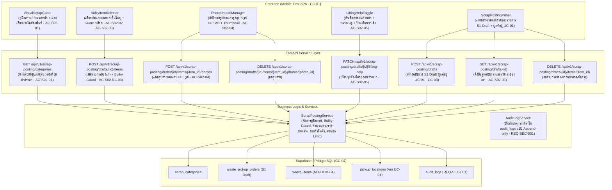

# แผนสถาปัตยกรรมและเทคโนโลยี: ระบบโพสต์ขายของเก่าของผู้ขาย (`specs/seller/02-scrap-posting/plan.md`)

- **Version:** `1.0` | **Status:** `ready-for-tasks` | **Owner:** กลุ่ม 2 (แพลตฟอร์มรับซื้อของเก่า/ซาเล้ง)
- **อ้างอิงสเปก:** [`specs/seller/02-scrap-posting/spec.md`](./spec.md) (v2.0)
- **ข้อจำกัดกลาง:** [`specs/000-shared/constraints.md`](../../000-shared/constraints.md) (`CC-01..CC-06`, `REQ-SEC-001..002`, `REQ-OP-001..002`, `D-00-01..03`)

---

## 1. เทคโนโลยีที่ใช้ (Tech Stack)

> [!NOTE]
> **หมายเหตุด้านเทคโนโลยี:** เทคโนโลยีที่ใช้ในโมดูลนี้ **`"ทีมเลือกเอง ไม่ได้มาจาก spec"`** เพื่อให้สอดคล้องกับสถาปัตยกรรมทั้งระบบของโครงการ:

- **Backend Framework:** **Python 3.11 + FastAPI**
  - สถาปัตยกรรม REST API แบบแยก Router, Controller (Service Layer) และ Data Access Layer
  - ตรวจสอบความถูกต้องของข้อมูล (Validation & Missing Sub-Category Guard) ด้วย **Pydantic v2**
  - จัดการข้อผิดพลาดตามมาตรฐาน HTTP Status Codes (`400 Bad Request`, `404 Not Found`, `422 Unprocessable Entity`)
- **Database & Storage:** **Supabase (PostgreSQL 15+)**
  - ตาราง `scrap_categories`, `waste_pickup_orders` (สถานะ `S1`), `waste_items`, และ `audit_logs`
  - รองรับ Concurrency Control ด้วยคอลัมน์ `version` และ Unique UUIDs (ตาม `CC-04`)
- **Frontend Framework:** **React 18 + Vite + TailwindCSS**
  - พัฒนาเป็น Single-Page Application (SPA) แบบ Mobile-First ตามข้อกำหนด `CC-01` (Viewport 375px–414px)
  - แผงคู่มือภาพ (Visual Scrap Guide) ที่แตะเลือกได้ง่ายไม่ต้องพิมพ์ศัพท์เฉพาะตาม `REQ-UX-002`
  - แคชข้อมูลฉบับร่างของเก่า (`saleng_draft_order`) ใน `localStorage` เพื่อรองรับการทำงานแบบออฟไลน์ (`CC-05`, `REQ-OP-001`)
- **Automated Testing Suite:**
  - หลังบ้าน: **Pytest** พร้อม `TestClient` (FastAPI)
  - หน้าบ้าน: **Vitest + React Testing Library + JSDOM**

---

## 2. สถาปัตยกรรมระบบ (System Architecture)



---

## 3. การตัดสินใจเชิงสถาปัตยกรรม (Architectural Decisions — `P-01` ถึง `P-06`)

### `P-01`: Visual Scrap Guide Catalog Service (`REQ-UX-002`, `AC-S02-01`, `Q-01`)
- **บริบท:** ผู้ขายบ้านพักอาศัยไม่คุ้นเคยกับคำศัพท์เฉพาะของวัสดุรีไซเคิล ต้องการคู่มือภาพที่แตะเลือกได้ทันที
- **การตัดสินใจ:**
  1. สร้าง Service บริการข้อมูลหมวดหมู่ของเก่าแบ่งเป็น 3 กลุ่มหลักชัดเจน:
     - `GENERAL_WEIGHT`: ชั่งกิโลกรัมทั่วไป (กระดาษลัง, กระดาษขาวดำ, ขวดพลาสติกใส, กระป๋องอลูมิเนียม, เศษเหล็ก)
     - `BOXED_CRATE_ITEMS`: วัสดุบรรจุลังแยกเฉพาะ (ขวดแก้วบรรจุลัง, ขวดพลาสติกบรรจุกระสอบ)
     - `BULKY_FLAT_RATE`: ของชิ้นใหญ่แบบเหมาจ่าย (ตู้เย็น, เครื่องซักผ้า, แอร์/คอมเพรสเซอร์, โซฟา)
  2. แต่ละประเภทมีไอคอน, รูปภาพตัวอย่าง, หน่วยนับ (`kg`, `crate`, `bag`, `piece`), และช่วงราคาอ้างอิงรายวัน

### `P-02`: Bulky Item Pricing & Missing Sub-Category Guard (`REQ-FN-003`, `Card 03`, `AC-S02-02`, `AC-S02-03`, `Q-02`)
- **บริบท:** ของชิ้นใหญ่ต้องให้ซาเล้งประเมินพื้นที่รถบรรทุก หากผู้ขายไม่ระบุว่าคืออะไร รถซาเล้งอาจบรรทุกไม่ได้
- **การตัดสินใจ:**
  1. เมื่อเลือกหมวด `BULKY_FLAT_RATE` ระบบจะบังคับให้เลือกประเภทย่อย (`sub_category`) เสมอ (เช่น ตู้เย็น, เครื่องซักผ้า) พร้อมแสดงช่วงราคาเหมาอ้างอิง (เช่น ตู้เย็น 200–300 บาท/ชิ้น)
  2. หากผู้ขายไม่ระบุประเภทย่อย ระบบจะบล็อกด้วย HTTP 422 Unprocessable Entity พร้อมข้อความแจ้งเตือนตาม `Card 03`:
     > *"กรุณาระบุประเภทของชิ้นใหญ่ เพื่อให้ผู้รับซื้อจัดสรรพื้นที่รถบรรทุกได้"*

### `P-03`: Boxed & Crate Items Estimation (`REQ-FN-003`, `Card 03 Alt Case`, `AC-S02-02`)
- **บริบท:** ร้านค้าหรือบ้านที่มีขวดแก้ว/พลาสติกแยกใส่ลังหรือกระสอบไว้แล้ว ต้องการประเมินราคาตามจำนวนบรรจุภัณฑ์
- **การตัดสินใจ:**
  1. รองรับหน่วย `crate` (ลัง) และ `bag` (กระสอบ) สำหรับวัสดุบรรจุลังแยกเฉพาะ
  2. คำนวณช่วงราคาประเมินตามจำนวนลัง เช่น ขวดแก้วบรรจุลัง 15–25 บาท/ลัง และส่งจำนวนลังไปยังผู้รับซื้ออย่างถูกต้องครบถ้วน

### `P-04`: Multi-Photo Attachment & Thumbnail Management (`REQ-FN-004`, `EV-03`, `EV-08`, `AC-S02-04`, `Q-03`)
- **บริบท:** ซาเล้งต้องการเห็นรูปของเก่าจริงก่อนรับงานเพื่อประเมินความคุ้มค่าและพื้นที่รถ
- **การตัดสินใจ:**
  1. อนุญาตให้แนบรูปถ่ายของเก่าได้สูงสุด 5 รูปต่อรายการ (`photo_urls: List[str]`)
  2. จำกัดขนาดไฟล์รูปภาพไม่เกิน 5 MB ต่อรูป เพื่อประหยัดแบนด์วิดท์ตาม `CC-01`
  3. รองรับการแสดงผลภาพตัวอย่าง Thumbnail และปุ่มลบรูปภาพออกก่อนส่งคำขอ

### `P-05`: Lifting Help Request & Logistics Notification (`REQ-FN-004`, `MD-DOM-04`, `AC-S02-05`, `Q-04`)
- **บริบท:** ของเก่าชิ้นใหญ่หรือมีน้ำหนักมาก ผู้ขายอาจต้องการให้ซาเล้งช่วยยกของขึ้นรถ
- **การตัดสินใจ:**
  1. เพิ่มฟิลด์ `need_lifting_help: bool = False` และ `lifting_help_notes: Optional[str] = None` ในโมเดล `WastePickupOrder`
  2. หากเลือกขอคนช่วยยก ระบบจะติดป้ายสัญลักษณ์แจ้งเตือน **`"⚠️ ขอคนช่วยยก"`** เด่นชัดบนการ์ดงานของซาเล้ง เพื่อให้ซาเล้งเตรียมแรงงาน/ผู้ช่วยล่วงหน้า

### `P-06`: Draft Order & Precondition Integration with UC-01 (`CC-03`, `MD-STM-04`, `S1 Draft`)
- **บริบท:** การโพสต์ขายของเก่าต้องผูกกับที่อยู่นัดหมายของผู้ขาย
- **การตัดสินใจ:**
  1. เมื่อผู้ขายเริ่มสร้างโพสต์ขายของเก่า ระบบจะสร้างคำขอในสถานะ **`S1: Draft`**
  2. ดึงที่อยู่นัดหมายเริ่มต้น (`PickupLocation`) ของผู้ขายจาก `UC-01` มาผูกเข้ากับคำขอโดยอัตโนมัติ หากผู้ขายยังไม่มีที่อยู่นัดหมาย ระบบจะแจ้งเตือนให้ไปเพิ่มที่อยู่ใน `UC-01` ก่อน (Precondition Guard)

---

## 4. โครงสร้างข้อมูลและ Schema (Data Models & Schemas)

### 4.1 SQL Database Schema (DDL สำหรับ Supabase / PostgreSQL)

```sql
-- 1. ตารางหมวดหมู่ของเก่าและคู่มือภาพ (Scrap Categories)
CREATE TABLE scrap_categories (
    category_code VARCHAR(50) PRIMARY KEY, -- เช่น BULKY-FRIDGE, BOXED-GLASS, MAT-CARDBOARD
    category_group VARCHAR(50) NOT NULL,    -- GENERAL_WEIGHT, BOXED_CRATE_ITEMS, BULKY_FLAT_RATE
    name VARCHAR(100) NOT NULL,             -- ชื่อไทย เช่น ตู้เย็น, กระดาษลัง
    icon VARCHAR(20) NOT NULL,              -- ไอคอน เช่น 🧊, 📦, 🍾
    unit VARCHAR(20) NOT NULL,              -- kg, crate, bag, piece
    min_price_per_unit NUMERIC(10, 2) NOT NULL,
    max_price_per_unit NUMERIC(10, 2) NOT NULL,
    sub_categories JSONB,                   -- รายการประเภทย่อยถ้ามี
    updated_at TIMESTAMPTZ NOT NULL DEFAULT NOW()
);

-- 2. ตารางคำขอรับซื้อของเก่าในสถานะฉบับร่าง (Orders S1 - MD-DOM-04)
CREATE TABLE waste_pickup_orders (
    order_id VARCHAR(64) PRIMARY KEY,
    seller_id VARCHAR(64) NOT NULL REFERENCES sellers(seller_id),
    pickup_location_id VARCHAR(64) NOT NULL REFERENCES pickup_locations(location_id),
    status VARCHAR(20) NOT NULL DEFAULT 'S1', -- S1: Draft, S2: Pending
    need_lifting_help BOOLEAN NOT NULL DEFAULT FALSE,
    lifting_help_notes TEXT,
    total_est_min_price NUMERIC(10, 2) NOT NULL DEFAULT 0.0,
    total_est_max_price NUMERIC(10, 2) NOT NULL DEFAULT 0.0,
    created_at TIMESTAMPTZ NOT NULL DEFAULT NOW(),
    updated_at TIMESTAMPTZ NOT NULL DEFAULT NOW()
);

-- 3. ตารางรายการของเก่าในคำขอ (Waste Items - MD-DOM-04)
CREATE TABLE waste_items (
    item_id VARCHAR(64) PRIMARY KEY,
    order_id VARCHAR(64) NOT NULL REFERENCES waste_pickup_orders(order_id) ON DELETE CASCADE,
    category_code VARCHAR(50) NOT NULL REFERENCES scrap_categories(category_code),
    category_group VARCHAR(50) NOT NULL,
    sub_category VARCHAR(100),
    quantity NUMERIC(10, 2) NOT NULL,
    unit VARCHAR(20) NOT NULL,
    est_min_price NUMERIC(10, 2) NOT NULL,
    est_max_price NUMERIC(10, 2) NOT NULL,
    photo_urls JSONB DEFAULT '[]'::jsonb,
    created_at TIMESTAMPTZ NOT NULL DEFAULT NOW()
);
```

### 4.2 Pydantic Data Models (`backend/app/models/scrap_posting_models.py`)

- `ScrapCategoryResponse`: `category_code: str`, `category_group: str`, `name: str`, `icon: str`, `unit: str`, `min_price_per_unit: float`, `max_price_per_unit: float`, `sub_categories: Optional[List[str]] = None`
- `CategoryCatalogResponse`: `categories: List[ScrapCategoryResponse]`
- `WasteItemCreateRequest`: `category_code: str`, `sub_category: Optional[str] = None`, `quantity: float`, `photo_urls: Optional[List[str]] = None`
- `WasteItemResponse`: `item_id: str`, `order_id: str`, `category_code: str`, `category_name: str`, `category_group: str`, `sub_category: Optional[str]`, `quantity: float`, `unit: str`, `est_min_price: float`, `est_max_price: float`, `photo_urls: List[str]`
- `LiftingHelpUpdateRequest`: `need_lifting_help: bool`, `lifting_help_notes: Optional[str] = None`
- `DraftOrderCreateRequest`: `seller_id: str`, `pickup_location_id: Optional[str] = None`
- `DraftOrderResponse`: `order_id: str`, `seller_id: str`, `pickup_location: Optional[dict]`, `status: str`, `need_lifting_help: bool`, `lifting_help_notes: Optional[str]`, `total_est_min_price: float`, `total_est_max_price: float`, `items: List[WasteItemResponse]`, `created_at: str`

---

## 5. รายการ API Endpoints

| Method | Path | ความรับผิดชอบ | รองรับ REQ / AC |
| :---: | :--- | :--- | :---: |
| **`GET`** | `/api/v1/scrap-posting/categories` | ดึงหมวดหมู่ของเก่าและคู่มือภาพ 3 หมวดหลักพร้อมช่วงราคาอ้างอิง | `REQ-UX-002`, `AC-S02-01`, `P-01` |
| **`POST`** | `/api/v1/scrap-posting/drafts` | สร้างคำขอโพสต์ขายของเก่าฉบับร่างใหม่ (`S1 Draft`) ผูกกับที่อยู่นัดหมาย | `UC-02`, `CC-03`, `P-06` |
| **`GET`** | `/api/v1/scrap-posting/drafts/{id}` | ดึงข้อมูลคำขอฉบับร่างและรายการของเก่าในตะกร้า | `UC-02`, `AC-S02-01`, `P-06` |
| **`POST`** | `/api/v1/scrap-posting/drafts/{id}/items` | เพิ่มรายการของเก่าลงในฉบับร่าง พร้อม Guard ตรวจสอบประเภทย่อยของชิ้นใหญ่ | `REQ-FN-003`, `Card 03`, `AC-S02-01..03`, `P-02` |
| **`DELETE`** | `/api/v1/scrap-posting/drafts/{id}/items/{item_id}` | ลบรายการของเก่าออกจากฉบับร่าง | `UC-02`, `AC-S02-01` |
| **`POST`** | `/api/v1/scrap-posting/drafts/{id}/items/{item_id}/photos` | แนบรูปถ่ายของเก่าประกอบรายการ (จำกัดไม่เกิน 5 รูป, <= 5 MB) | `REQ-FN-004`, `EV-03`, `AC-S02-04`, `P-04` |
| **`DELETE`** | `/api/v1/scrap-posting/drafts/{id}/items/{item_id}/photos/{idx}` | ลบรูปถ่ายของเก่าออกจากรายการ | `REQ-FN-004`, `AC-S02-04`, `P-04` |
| **`PATCH`** | `/api/v1/scrap-posting/drafts/{id}/lifting-help` | ปรับปรุงตัวเลือกขอคนช่วยยกของหนักและหมายเหตุหน้างาน | `REQ-FN-004`, `AC-S02-05`, `P-05` |

---

## 6. แผนการพัฒนาหน้าจอ (UI Plan)

1. **`VisualScrapGuide.jsx` (`REQ-UX-002`, `data-req="UC-02"`):**
   - แสดงแท็บสลับ 3 หมวดหมู่หลัก: "ชั่งกิโลกรัมทั่วไป", "บรรจุลัง/กระสอบ", "ของชิ้นใหญ่เหมาจ่าย"
   - การ์ดประเภทของเก่ามีไอคอนขนาดใหญ่ ชื่อภาษาไทย และช่วงราคาอ้างอิงให้แตะเลือกได้ทันทีโดยไม่ต้องพิมพ์
2. **`BulkyItemSelector.jsx` (`REQ-FN-003`, `Card 03`, `data-req="UC-02"`):**
   - แผงเลือกประเภทย่อยเมื่อเลือกหมวด "ของชิ้นใหญ่แบบเหมาจ่าย": แสดงตัวเลือกตู้เย็น (200–300 บ.), เครื่องซักผ้า (150–250 บ.), แอร์ (300–500 บ.), โซฟา (100–200 บ.)
   - มี Missing Sub-Category Guard แจ้งเตือนสีแดงทันทีหากไม่ได้ระบุประเภทย่อย
3. **`PhotoUploadManager.jsx` (`REQ-FN-004`, `EV-08`, `data-req="UC-02"`):**
   - ปุ่มถ่ายรูปหรือเลือกรูปจากเครื่อง แสดงจำนวนรูปปัจจุบัน (เช่น "2/5 รูป")
   - แสดง Thumbnail รูปถ่ายพร้อมปุ่มลบรูป (✕)
4. **`LiftingHelpToggle.jsx` (`REQ-FN-004`, `MD-DOM-04`, `data-req="UC-02"`):**
   - ช่องติ๊กถูกขอคนช่วยยกของหนัก พร้อมช่องกรอกหมายเหตุ/ข้อจำกัดหน้างาน
   - แสดงตัวอย่างป้ายสัญลักษณ์ `"⚠️ ขอคนช่วยยก"` ที่จะแสดงบนหน้าจอซาเล้ง
5. **`ScrapPostingPanel.jsx` (`CC-01`, `MD-DOM-04`, `data-req="UC-02"`):**
   - แผงควบคุมหลัก Mobile-First รวมตะกร้าของเก่าหลายรายการ คำนวณช่วงราคารวมเบื้องต้น แสดงที่อยู่นัดหมายที่ผูกไว้ และปุ่มยืนยันส่งต่อนัดหมาย

---

## 7. ตารางตรวจสอบความครบถ้วนของข้อจำกัดกลาง (Constraints Checklist — ครบทั้ง 13 ข้อ)

| รหัส Constraint | ข้อกำหนดใน Constraint กลาง (`specs/000-shared/constraints.md`) | สถานะการนำไปใช้ในโมดูลนี้ | รายละเอียดการปฏิบัติตาม |
| :---: | :--- | :---: | :--- |
| **`CC-01`** | Mobile-First Web SPA รองรับมือถือราคาประหยัด (`RAM >= 2 GB`) | **นำไปใช้** | ออกแบบ UI ด้วย React 18 + TailwindCSS แตะเลือกผ่านคู่มือภาพ ไม่เปลืองหน่วยความจำ จำกัดขนาดรูป <= 5 MB |
| **`CC-02`** | GPS Sync Interval ทุก 60 วินาทีขณะเปิดสถานะ Online | **ไม่เกี่ยวกับ feature นี้ เพราะ** | โมดูลนี้เป็นการเลือกประเภทของเก่าและสร้างโพสต์ของผู้ขาย ไม่ใช่การติดตามพิกัดรถซาเล้งขณะวิ่ง |
| **`CC-03`** | Road Distance API รัศมี <= 5 กม. พร้อม Haversine Fallback | **ไม่เกี่ยวกับ feature นี้ เพราะ** | โมดูลนี้เป็นการสร้างฉบับร่างของเก่า ยังไม่มีการคำนวณระยะทางบนโครงข่ายถนน |
| **`CC-04`** | PostgreSQL + Concurrency Control / Optimistic Locking | **นำไปใช้** | ใช้ Supabase (PostgreSQL 15+) พร้อม Unique IDs (`order_id`, `item_id`) ป้องกัน Concurrency Collision |
| **`CC-05`** | Offline Cache ใน IndexedDB / Local Storage | **นำไปใช้** | แคชข้อมูลฉบับร่างของเก่า (`saleng_draft_order`) ใน `localStorage` เพื่อให้เปิดดูและแก้ไขต่อได้แม้ออฟไลน์ |
| **`CC-06`** | PDPA & PII Masking ซ่อนบ้านเลขที่และพิกัดละเอียด | **นำไปใช้** | คำขอที่โพสต์จะแสดงเฉพาะตำบล/แขวง (`subDistrict`) สู่สาธารณะ และปกปิดเบอร์โทรศัพท์ผู้ขาย |
| **`REQ-SEC-001`** | บันทึกประวัติการเปลี่ยนสถานะใบงานลงในตาราง Audit Log | **นำไปใช้** | ทุกการสร้างฉบับร่าง, เพิ่ม/ลบรายการของเก่า, และปรับปรุงตัวเลือกขอคนช่วยยก ต้องบันทึกลง `audit_logs` |
| **`REQ-SEC-002`** | แปลงเบอร์โทรศัพท์เป็น `08X-XXX-XXXX` | **นำไปใช้** | เบอร์โทรศัพท์ของผู้ขายที่ผูกกับคำขอจะแสดงผลแบบ Mask PII เสมอ |
| **`REQ-OP-001`** | โหมด Offline Queue สำหรับดูข้อมูลที่แคชไว้ | **นำไปใช้** | รายการของเก่าในฉบับร่างสามารถเปิดดูจากแคชในเครื่องได้ตลอดเวลาแม้ไม่มีอินเทอร์เน็ต |
| **`REQ-OP-002`** | Haversine Fallback สำหรับการคำนวณระยะทาง | **ไม่เกี่ยวกับ feature นี้ เพราะ** | ไม่มีการคำนวณระยะทางถนนในการโพสต์ขายของเก่า |
| **`D-00-01`** | KYC เป็น Precondition ของระบบผู้ซื้อ | **ไม่เกี่ยวกับ feature นี้ เพราะ** | ขอบเขตโมดูลนี้เป็นระบบฝั่งผู้ขาย |
| **`D-00-02`** | ซ่อนพิกัดผู้ขายจนกว่าจะรับงาน | **นำไปใช้** | พิกัดบ้านผู้ขายที่ผูกกับคำขอจะถูกเก็บไว้เป็น PII และแสดงเฉพาะตำบล/แขวงก่อนซาเล้งกดรับงาน |
| **`D-00-03`** | ขอบเขตหยุดที่สถานะมีผู้รับงานแล้ว | **นำไปใช้** | โมดูลนี้ทำงานในสถานะ `S1 Draft` และเตรียมความพร้อมสู่ `S2` |

---

## 8. กลยุทธ์การทดสอบอัตโนมัติ (Automated Testing Strategy)

1. **Unit Tests (Backend):**
   - `test_T01_scrap_posting_models.py`: ทดสอบ Pydantic Validation, Bulky Guard Validation, และ Supabase Store CRUD
2. **Automated AC Tests (Backend):**
   - `test_AC_S02_01_visual_scrap_guide.py`: ทดสอบการดึงหมวดหมู่ 3 กลุ่มหลัก และการคำนวณช่วงราคาประเมิน
   - `test_AC_S02_02_bulky_and_boxed_items.py`: ทดสอบหมวดของชิ้นใหญ่เหมาจ่าย (ตู้เย็น 200–300 บ.) และวัสดุบรรจุลัง
   - `test_AC_S02_03_missing_bulky_sub_category.py`: ทดสอบ Guard บล็อกและข้อความแจ้งเตือนเมื่อไม่ระบุประเภทย่อยของชิ้นใหญ่
   - `test_AC_S02_04_photo_attachment.py`: ทดสอบการแนบรูปถ่ายสูงสุด 5 รูป และการจำกัดขนาด <= 5 MB
   - `test_AC_S02_05_lifting_help_badge.py`: ทดสอบตัวเลือกขอคนช่วยยกของหนักและหมายเหตุ
3. **Frontend Tests (Vitest + JSDOM):**
   - `scrapPostingApi.test.mjs`: ทดสอบ API Client และ LocalStorage Caching ฉบับร่าง
   - `AC-S02-01.test.jsx`: ทดสอบคอมโพเนนต์ `VisualScrapGuide` การแตะเลือกหมวดหมู่และกรอกปริมาณ
   - `AC-S02-02.test.jsx`: ทดสอบคอมโพเนนต์ `BulkyItemSelector` และ Missing Sub-Category Guard (`AC-S02-03`)
   - `AC-S02-04.test.jsx`: ทดสอบคอมโพเนนต์ `PhotoUploadManager` การแนบรูปและ Thumbnail Preview
   - `AC-S02-05.test.jsx`: ทดสอบคอมโพเนนต์ `LiftingHelpToggle` และป้ายสัญลักษณ์แจ้งเตือน
4. **Integration E2E Test (Backend):**
   - `test_e2e_scrap_posting.py`: ทดสอบครบวงจรตั้งแต่สร้างคำขอ S1 -> เลือกวัสดุชั่งกิโล -> เลือกของชิ้นใหญ่ตู้เย็น -> แนบรูปถ่าย 2 รูป -> ติ๊กขอคนช่วยยก -> ตรวจสอบ Audit Log ครบถ้วน

