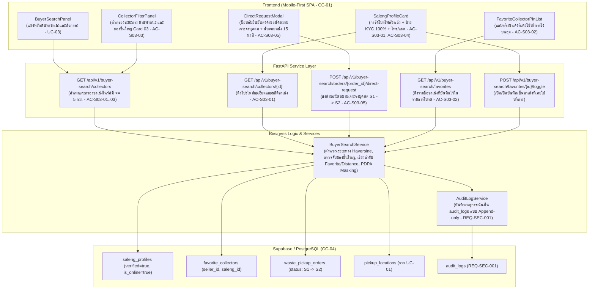

# แผนสถาปัตยกรรมและเทคโนโลยี: ระบบค้นหาและเลือกผู้รับซื้อ (`specs/seller/03-buyer-search-and-selection/plan.md`)

- **Version:** `1.0` | **Status:** `ready-for-tasks` | **Owner:** กลุ่ม 2 (แพลตฟอร์มรับซื้อของเก่า/ซาเล้ง)
- **อ้างอิงสเปก:** [`specs/seller/03-buyer-search-and-selection/spec.md`](./spec.md) (v2.0)
- **ข้อจำกัดกลาง:** [`specs/000-shared/constraints.md`](../../000-shared/constraints.md) (`CC-01..CC-06`, `REQ-SEC-001..002`, `REQ-OP-001..002`, `D-00-01..03`)

---

## 1. เทคโนโลยีที่ใช้ (Tech Stack)

> [!NOTE]
> **หมายเหตุด้านเทคโนโลยี:** เทคโนโลยีที่ใช้ในโมดูลนี้ **`"ทีมเลือกเอง ไม่ได้มาจาก spec"`** เพื่อให้สอดคล้องกับสถาปัตยกรรมทั้งระบบของโครงการ:

- **Backend Framework:** **Python 3.11 + FastAPI**
  - สถาปัตยกรรม REST API แบบแยก Router, Controller (Service Layer) และ Data Access Layer
  - ตรวจสอบความถูกต้องของข้อมูล (Validation & Filter Criteria) ด้วย **Pydantic v2**
  - จัดการข้อผิดพลาดตามมาตรฐาน HTTP Status Codes (`400 Bad Request`, `404 Not Found`, `422 Unprocessable Entity`)
- **Database & Storage:** **Supabase (PostgreSQL 15+)**
  - ตาราง `saleng_profiles` (ซาเล้งที่ผ่าน KYC และสถานะเปิดรับงาน), `favorite_collectors` (ซาเล้งที่บันทึกเป็นคนโปรดจาก `UC-10`), `waste_pickup_orders` (สถานะ `S1 -> S2`), และ `audit_logs`
  - รองรับ Concurrency Control ด้วยคอลัมน์ `version` และ Unique UUIDs (ตาม `CC-04`)
- **Distance Calculation Engine:**
  - คำนวณระยะทางแบบเส้นตรงด้วยสูตร Haversine พร้อมตัวคูณชดเชยโครงข่ายถนน (`Haversine × 1.35`) ตามข้อกำหนด `CC-03` และ `REQ-OP-002`
- **Frontend Framework:** **React 18 + Vite + TailwindCSS**
  - พัฒนาเป็น Single-Page Application (SPA) แบบ Mobile-First ตามข้อกำหนด `CC-01` (Viewport 375px–414px)
  - รายการการ์ดโปรไฟล์ซาเล้ง ตรึงคนโปรดไว้บนสุด และฟิลเตอร์ขนาดรถกระบะสำหรับของชิ้นใหญ่
  - แคชรายชื่อซาเล้งล่าสุดใน `localStorage` (`saleng_cached_collectors`) รองรับการเปิดดูแบบออฟไลน์ (`CC-05`, `REQ-OP-001`)
- **Automated Testing Suite:**
  - หลังบ้าน: **Pytest** พร้อม `TestClient` (FastAPI)
  - หน้าบ้าน: **Vitest + React Testing Library + JSDOM**

---

## 2. สถาปัตยกรรมระบบ (System Architecture)



---

## 3. การตัดสินใจเชิงสถาปัตยกรรม (Architectural Decisions — `P-01` ถึง `P-06`)

### `P-01`: Verified Saleng Discovery & Distance Calculation (`REQ-FN-001`, `REQ-QA-001`, `CC-03`, `AC-S03-01`)
- **บริบท:** ผู้ขายต้องการเห็นรายชื่อซาเล้งที่พร้อมรับงานจริงในละแวกบ้าน พร้อมข้อมูลยืนยันตัวตนเพื่อความมั่นใจ
- **การตัดสินใจ:**
  1. กรองเฉพาะซาเล้งที่มีสถานะ `is_online = true` และ `verified = true` (ผ่านการยืนยันตัวตน KYC 100% ตามข้อกำหนด `D-00-01`)
  2. คำนวณระยะทางจากพิกัดที่อยู่นัดหมายของผู้ขาย (`pickup_locations`) ไปยังพิกัดปัจจุบันของซาเล้ง โดยใช้สูตร Haversine พร้อมคูณตัวคูณถนนจริง `1.35` ตามข้อกำหนด `CC-03`
  3. กำหนดรัศมีทำการค่าเริ่มต้นไม่เกิน `5.0 กม.` และรองรับการขยายเป็น `10.0 กม.` หากไม่พบผู้รับซื้อในพื้นที่

### `P-02`: Top Pinning Favorites Logic (`REQ-UX-001`, `AC-S03-02`, `Q-02`)
- **บริบท:** ผู้ขายที่เคยซื้อขายสำเร็จและประทับใจบริการ ต้องการเรียกซาเล้งเจ้าเดิมซ้ำโดยไม่ต้องเสียเวลาค้นหาใหม่
- **การตัดสินใจ:**
  1. ดึงข้อมูลซาเล้งที่เคยใช้บริการจากตาราง `favorite_collectors` ของผู้ขายคนนั้น
  2. ในผลการค้นหา ระบบจะจัดลำดับแบบ 2 ลำดับขั้น (Two-Tier Sorting):
     - **ขั้นที่ 1 (Pinned Priority):** ซาเล้งที่เป็น "ซาเล้งที่เคยใช้บริการ" (`is_favorite = true`) จะถูกนำมาแสดงไว้บนสุดของรายการเสมอ พร้อมป้ายสัญลักษณ์ `"ซาเล้งที่เคยใช้บริการ"`
     - **ขั้นที่ 2 (Secondary Sort):** เรียงตามระยะทางใกล้ที่สุด (`distance_km ASC`) และตามด้วยคะแนนรีวิวเฉลี่ย (`rating DESC`)

### `P-03`: Bulky Items Auto-Detection & Vehicle Matching (`REQ-FN-001`, `Card 03`, `AC-S03-03`, `Q-03`)
- **บริบท:** หากผู้ขายมีของเก่าชิ้นใหญ่ (ตู้เย็น เครื่องซักผ้า แอร์ โซฟา) ซาเล้งซาเล้งสามล้อธรรมดาอาจไม่สามารถขนย้ายได้
- **การตัดสินใจ:**
  1. เมื่อผู้ขายส่ง `order_id` ของคำขอเข้ามา ระบบจะตรวจสอบว่ามีของเก่าหมวด `BULKY_FLAT_RATE` หรือไม่
  2. หากพบของชิ้นใหญ่ ระบบจะเปิดใช้งานตัวกรองแนะนำประเภทยานพาหนะเป็น **รถกระบะ (`PICKUP_TRUCK`)** หรือ **ซาเล้งพ่วงข้างขนาดใหญ่ (`LARGE_SIDECAR`)** โดยอัตโนมัติ
  3. แสดงแถบป้ายเตือนสีฟ้าบนหน้าจอ: *"📦 คำขอของคุณมีของชิ้นใหญ่ ระบบแนะนำซาเล้งที่มีรถกระบะหรือซาเล้งขนาดใหญ่"* เพื่อป้องกันปัญหาขนย้ายไม่ได้หน้างาน

### `P-04`: Direct Contact Hooks with PDPA Masking (`REQ-SEC-002`, `CC-06`, `AC-S03-04`, `Q-04`)
- **บริบท:** ผู้ขายต้องการโทรสอบถามเวลาเข้ามารับซื้อหรือตกลงเงื่อนไขเบื้องต้นก่อนนัดหมาย แต่ต้องคุ้มครองข้อมูลส่วนบุคคลตามกฎหมาย PDPA
- **การตัดสินใจ:**
  1. การโทร: แสดงปุ่มโทรด่วนที่ผูกกับ Native Phone Dialer (`tel:{saleng_phone}`) ของอุปกรณ์ โดยซาเล้งเป็นผู้ให้บริการที่ผ่าน KYC แล้ว
  2. การแชต: มีปุ่มส่งข้อความเชื่อมต่อห้องแชตในระบบ (`UC-08`)
  3. **การคุ้มครองข้อมูลส่วนบุคคลของผู้ขาย (`PDPA Masking`):** ระบบจะไม่เปิดเผยบ้านเลขที่จริง (`addressText`) และพิกัดแผนที่แบบละเอียด (`geoPoint`) ของผู้ขายผ่าน API จนกว่าซาเล้งจะกดยืนยันรับงานสำเร็จ (ซาเล้งเห็นเพียงตำบล/แขวง และระยะทางโดยประมาณ)

### `P-05`: Direct Appointment Request & 15-Minute Countdown Transition (`REQ-SEC-001`, `MD-STM-04`, `AC-S03-05`, `Q-01`)
- **บริบท:** ผู้ขายกดเลือกซาเล้งเจาะจงบุคคล เพื่อส่งคำขอให้ซาเล้งคนนั้นตอบรับ
- **การตัดสินใจ:**
  1. อัปเดตคำขอขาย (`waste_pickup_orders`) กำหนด `assigned_saleng_id = saleng_id`, กำหนด `direct_request_expires_at = now + 15 นาที`, และเปลี่ยนสถานะจาก `S1 (Draft)` เป็น `S2 (Matched / Pending)`
  2. บันทึกเหตุการณ์ลงใน `audit_logs`: `COLLECTOR_DIRECT_REQUESTED` พร้อมเวลาประทับ
  3. หน้าจอแสดงตัวนับเวลารอตอบรับ 15 นาที หากหมดเวลาหรือซาเล้งปฏิเสธ ระบบจะปลด `assigned_saleng_id` และแจ้งเตือนให้ผู้ขายเลือกคนใหม่ หรือสลับเป็นประกาศงานทั่วไป (`Open Broadcast`)

### `P-06`: Offline Fallback & LocalStorage Caching (`CC-05`, `REQ-OP-001`)
- **บริบท:** การใช้งานสมาร์ตโฟนในพื้นที่สัญญาณ 4G อ่อนหรือขาดหายชั่วคราว
- **การตัดสินใจ:**
  1. แคชรายชื่อซาเล้งที่ค้นพบล่าสุดและรายการโปรดลงใน `localStorage` (`saleng_cached_collectors`)
  2. หากแอปไม่สามารถเชื่อมต่ออินเทอร์เน็ตได้ ระบบจะดึงข้อมูลจากแคชขึ้นมาแสดงผล พร้อมป้ายเตือนสีส้ม *"โหมดออฟไลน์: กำลังแสดงรายชื่อผู้รับซื้อล่าสุดที่บันทึกไว้"* และปิดปุ่มส่งคำขอนัดหมายใหม่จนกว่าสัญญาณจะกลับมา

---

## 4. โครงสร้างข้อมูลและ Data Models (DDL Schema)

### 4.1 Schema Definition (PostgreSQL / Supabase)

```sql
-- 1. ตารางข้อมูลโปรไฟล์ซาเล้ง (Saleng Profiles)
CREATE TABLE IF NOT EXISTS saleng_profiles (
    saleng_id UUID PRIMARY KEY DEFAULT gen_random_uuid(),
    display_name VARCHAR(100) NOT NULL,
    phone VARCHAR(20) NOT NULL,
    avatar_url TEXT,
    verified BOOLEAN NOT NULL DEFAULT FALSE,
    rating NUMERIC(2, 1) NOT NULL DEFAULT 5.0,
    completed_jobs_count INT NOT NULL DEFAULT 0,
    vehicle_type VARCHAR(30) NOT NULL, -- 'TRICYCLE', 'LARGE_SIDECAR', 'PICKUP_TRUCK'
    max_capacity_kg NUMERIC(6, 1) NOT NULL DEFAULT 200.0,
    current_lat NUMERIC(9, 6) NOT NULL,
    current_lng NUMERIC(9, 6) NOT NULL,
    is_online BOOLEAN NOT NULL DEFAULT TRUE,
    accepted_categories TEXT[] DEFAULT '{}',
    created_at TIMESTAMPTZ DEFAULT NOW(),
    updated_at TIMESTAMPTZ DEFAULT NOW()
);

-- 2. ตารางซาเล้งที่เคยใช้บริการ / รายการโปรดของผู้ขาย (Favorite Collectors)
CREATE TABLE IF NOT EXISTS favorite_collectors (
    favorite_id UUID PRIMARY KEY DEFAULT gen_random_uuid(),
    seller_id UUID NOT NULL,
    saleng_id UUID NOT NULL REFERENCES saleng_profiles(saleng_id) ON DELETE CASCADE,
    created_at TIMESTAMPTZ DEFAULT NOW(),
    UNIQUE(seller_id, saleng_id)
);

-- 3. อัปเดตคอลัมน์ในตาราง waste_pickup_orders สำหรับ Direct Request
-- ALTER TABLE waste_pickup_orders ADD COLUMN IF NOT EXISTS assigned_saleng_id UUID REFERENCES saleng_profiles(saleng_id);
-- ALTER TABLE waste_pickup_orders ADD COLUMN IF NOT EXISTS direct_request_expires_at TIMESTAMPTZ;
```

### 4.2 Pydantic Data Models (Python / FastAPI)

```python
from pydantic import BaseModel, Field
from typing import Optional, List
from datetime import datetime

class SalengProfileResponse(BaseModel):
    saleng_id: str
    display_name: str
    phone: str
    avatar_url: Optional[str] = None
    verified: bool = True
    rating: float = 5.0
    completed_jobs_count: int = 0
    vehicle_type: str
    max_capacity_kg: float = 200.0
    distance_km: float
    is_favorite: bool = False
    is_online: bool = True
    accepted_categories: List[str] = []

class CollectorSearchQuery(BaseModel):
    order_id: Optional[str] = None
    radius_km: float = 5.0
    vehicle_type: Optional[str] = None
    min_rating: Optional[float] = None
    category: Optional[str] = None

class DirectAppointmentRequest(BaseModel):
    saleng_id: str
    notes: Optional[str] = None

class DirectAppointmentResponse(BaseModel):
    order_id: str
    assigned_saleng: SalengProfileResponse
    status: str = "S2"
    direct_request_expires_at: datetime
    message: str
```

---

## 5. แผนการสร้าง API Endpoints (FastAPI)

| Method | Endpoint Path | หน้าที่การทำงาน | รองรับ AC / REQ | HTTP Status |
| :---: | :--- | :--- | :---: | :---: |
| `GET` | `/api/v1/buyer-search/collectors` | ค้นหารายชื่อซาเล้งในรัศมี <= 5 กม. พร้อมระบบตรึง Favorite ไว้บนสุด และตัวกรอง | `AC-S03-01..03`<br>`REQ-FN-001`, `REQ-UX-001` | `200 OK` |
| `GET` | `/api/v1/buyer-search/collectors/{id}` | ดึงโปรไฟล์ละเอียด คะแนนรีวิว สถิติงาน และประเภทยานพาหนะของซาเล้ง | `AC-S03-01`<br>`REQ-QA-001` | `200 OK`<br>`404 Not Found` |
| `POST` | `/api/v1/buyer-search/orders/{order_id}/direct-request` | ส่งคำขอนัดหมายเจาะจงบุคคล เปลี่ยนสถานะเป็น S2 พร้อมนับถอยหลัง 15 นาที | `AC-S03-05`<br>`REQ-SEC-001`, `MD-STM-04` | `200 OK`<br>`400 Bad Request`<br>`404 Not Found` |
| `GET` | `/api/v1/buyer-search/favorites` | ดึงรายชื่อซาเล้งที่ผู้ขายเคยบันทึกไว้ในรายการโปรด | `AC-S03-02`<br>`REQ-UX-001` | `200 OK` |
| `POST` | `/api/v1/buyer-search/favorites/{saleng_id}/toggle` | เปิด/ปิดการบันทึกซาเล้งเป็นคนโปรด | `AC-S03-02`<br>`REQ-UX-001` | `200 OK` |

---

## 6. แผนพัฒนา UI Components (React 18 + TailwindCSS)

1. **`SalengProfileCard.jsx`:**
   - การ์ดโปรไฟล์ซาเล้ง แสดงรูปถ่าย, ชื่อ, ป้ายสัญลักษณ์ `"ยืนยันตัวตนแล้ว 100%"`, คะแนนดาว, ระยะทางเป็น กม., ป้ายยานพาหนะ
   - ปุ่มโทรด่วน (`tel:`) และปุ่มแชตข้อความ
   - ปุ่มหลักขนาดความสูง `>= 48px` สำหรับกด "เลือกซาเล้งท่านนี้" (`AC-S03-01`, `AC-S03-04`)
2. **`FavoriteCollectorPinList.jsx`:**
   - แถบแนวนอนด้านบนสุดสำหรับแสดงซาเล้งที่เคยใช้บริการ พร้อมป้ายสีเหลืองทอง `"⭐ ซาเล้งที่เคยใช้บริการ"` ให้เลือกนัดซ้ำได้ทันที (`AC-S03-02`)
3. **`CollectorFilterPanel.jsx`:**
   - ชิปตัวกรองสำหรับปรับระยะทาง (1 กม., 3 กม., 5 กม.), ประเภทยานพาหนะ (ซาเล้ง, รถกระบะ), คะแนนรีวิว
   - แถบเตือนของชิ้นใหญ่ (Bulky Items Auto-Filter Alert) เมื่อมีตู้เย็นหรือเครื่องซักผ้าในคำขอ (`AC-S03-03`)
4. **`DirectRequestModal.jsx`:**
   - โมดัลยืนยันการส่งคำขอนัดหมายเจาะจงบุคคล แสดงสรุปรายการของเก่า เวลารอตอบรับ 15 นาที และปุ่มยืนยัน (`AC-S03-05`)
5. **`BuyerSearchPanel.jsx`:**
   - แผงควบคุมหลัก Mobile-First Dashboard รวบรวม Header, Search Input, Filter Panel, Favorite Pin List, รายการการ์ดซาเล้ง และป้ายแจ้งเตือนโหมดออฟไลน์ (`CC-01`, `CC-05`)

---

## 7. ตารางตรวจสอบความครบถ้วนของข้อจำกัดกลาง (Constraints Checklist)

> ตรวจสอบข้อจำกัดกลางครบทั้ง 13 ข้อตาม `specs/000-shared/constraints.md` โดยระบุงานที่รองรับ หรือเหตุผลสำหรับข้อที่ไม่เกี่ยวข้อง

| รหัส Constraint | ข้อกำหนดใน Constraint กลาง (`specs/000-shared/constraints.md`) | สถานะการปฏิบัติตามในแผนนี้ (`P-xx`) | รายละเอียดการออกแบบ |
| :---: | :--- | :---: | :--- |
| **`CC-01`** | Mobile-First Web SPA รองรับมือถือราคาประหยัด (`RAM >= 2 GB`, Android 9.0+) | **รองรับ (`P-01`, `P-06`)** | ออกแบบ UI สำหรับหน้าจอมือถือ (375px–414px) ใช้ TailwindCSS ประหยัด DOM nodes และจำกัดขนาดข้อมูลที่ส่งผ่าน API |
| **`CC-02`** | GPS Sync Interval ทุก 60 วินาทีขณะเปิดสถานะ Online | **รองรับ (`P-01`)** | พิกัดของซาเล้งอ้างอิงจากพิกัด GPS ล่าสุดที่ซิงก์ทุก 60 วินาทีเพื่อคำนวณระยะทางที่แม่นยำ |
| **`CC-03`** | Road Distance API รัศมี <= 5.0 กม. พร้อม Haversine Fallback | **รองรับ (`P-01`)** | ค้นหาซาเล้งในรัศมีเริ่มต้นไม่เกิน 5.0 กม. โดยคำนวณระยะทางด้วยสูตร Haversine × 1.35 อัตโนมัติ |
| **`CC-04`** | PostgreSQL + Concurrency Control / Optimistic Locking | **รองรับ (`P-05`)** | การส่งคำขอนัดหมายเจาะจงบุคคลและเปลี่ยนสถานะเป็น S2 ใช้ระบบ Versioning และ Transaction ป้องกัน Concurrency Collision |
| **`CC-05`** | Offline Cache ใน IndexedDB / Local Storage | **รองรับ (`P-06`)** | แคชรายชื่อซาเล้งล่าสุดใน `localStorage` (`saleng_cached_collectors`) พร้อมป้ายเตือนโหมดออฟไลน์เมื่อเน็ตหลุด |
| **`CC-06`** | PDPA & PII Masking ซ่อนบ้านเลขที่และพิกัดละเอียด | **รองรับ (`P-04`)** | ระบบจะไม่ส่ง `addressText` และพิกัดละเอียดของผู้ขายผ่าน API ให้ซาเล้งเห็น จนกว่าจะกดยืนยันรับงาน |
| **`REQ-SEC-001`** | บันทึกประวัติการเปลี่ยนสถานะใบงานลงในตาราง Audit Log | **รองรับ (`P-05`)** | ทุกการส่งคำขอนัดหมายเจาะจงบุคคล และการเปลี่ยนสถานะสู่ S2 ต้องบันทึกลงตาราง `audit_logs` |
| **`REQ-SEC-002`** | แปลงเบอร์โทรศัพท์เป็น `08X-XXX-XXXX` และซ่อนบ้านเลขที่ | **รองรับ (`P-04`)** | ข้อมูลผู้ขายจะถูก Masking เสมอในขั้นตอนการค้นหาและเจรจา |
| **`REQ-OP-001`** | โหมด Offline Queue สำหรับดูข้อมูลที่แคชไว้ | **รองรับ (`P-06`)** | ผู้ขายสามารถเปิดดูรายชื่อซาเล้งและเบอร์โทรที่เคยแคชไว้ได้แม้ออฟไลน์ |
| **`REQ-OP-002`** | Haversine Fallback สำหรับการคำนวณระยะทาง | **รองรับ (`P-01`)** | ใช้สูตร `Haversine × 1.35` เป็นแกนหลักในการคำนวณระยะทางค้นหาซาเล้ง |
| **`D-00-01`** | KYC เป็น Precondition ของระบบผู้ซื้อ | **รองรับ (`P-01`)** | ซาเล้งที่จะปรากฏในผลการค้นหาต้องผ่านการอนุมัติ KYC (`verified = true`) เท่านั้น |
| **`D-00-02`** | ซ่อนพิกัดผู้ขายจนกว่าจะรับงาน | **รองรับ (`P-04`)** | พิกัดบ้านของผู้ขายจะแสดงเฉพาะระดับตำบล/แขวงให้ซาเล้งเห็นในขั้นตอนนี้ |
| **`D-00-03`** | ขอบเขตหยุดที่สถานะมีผู้รับงานแล้ว | **รองรับ (`P-05`)** | การเลือกซาเล้งจะเปลี่ยนสถานะคำขอเป็น `S2 (Matched / Pending)` เพื่อรอการตอบรับเข้าสู่ `S3` |

---

## 8. กลยุทธ์การทดสอบอัตโนมัติ (Automated Testing Strategy)

1. **Backend Tests (Pytest):**
   - `test_T01_buyer_search_models.py`: ทดสอบ Schema Validation, ค่าเริ่มต้น, และ Seed ข้อมูลซาเล้ง
   - `test_AC_S03_01_profile_and_kyc.py`: ทดสอบการแสดงผลโปรไฟล์และป้ายยืนยันตัวตน KYC 100%
   - `test_AC_S03_02_top_pinning_favorites.py`: ทดสอบการตรึงซาเล้งคนโปรดไว้บนสุดของผลการค้นหา
   - `test_AC_S03_03_multi_criteria_filter.py`: ทดสอบตัวกรองระยะทาง, ยานพาหนะ, และการจับคู่ของชิ้นใหญ่
   - `test_AC_S03_04_direct_contact_pdpa.py`: ทดสอบการดึงข้อมูลโทร/แชต และการปกปิดพิกัดละเอียดของผู้ขาย
   - `test_AC_S03_05_direct_request_transition.py`: ทดสอบการส่งคำขอเจาะจงบุคคล การเปลี่ยนสถานะเป็น S2 และ Audit Log
   - `test_e2e_buyer_search.py`: ทดสอบวงจรค้นหา กรอง เลือกซาเล้ง และส่งคำขอแบบครบวงจร
2. **Frontend Tests (Vitest + RTL):**
   - `buyerSearchApi.test.mjs`: ทดสอบ API Client และ Offline LocalStorage Caching
   - `AC-S03-01.test.jsx`: ทดสอบการแสดงผลการ์ดซาเล้งและป้ายยืนยันตัวตน 100%
   - `AC-S03-02.test.jsx`: ทดสอบการตรึงแถบซาเล้งที่เคยใช้บริการไว้บนสุด
   - `AC-S03-03.test.jsx`: ทดสอบตัวกรองยานพาหนะและแบนเนอร์เตือนของชิ้นใหญ่
   - `AC-S03-04.test.jsx`: ทดสอบปุ่มโทรด่วนและปุ่มแชตข้อความ
   - `AC-S03-05.test.jsx`: ทดสอบโมดัลยืนยันคำขอและตัวนับเวลา 15 นาที

