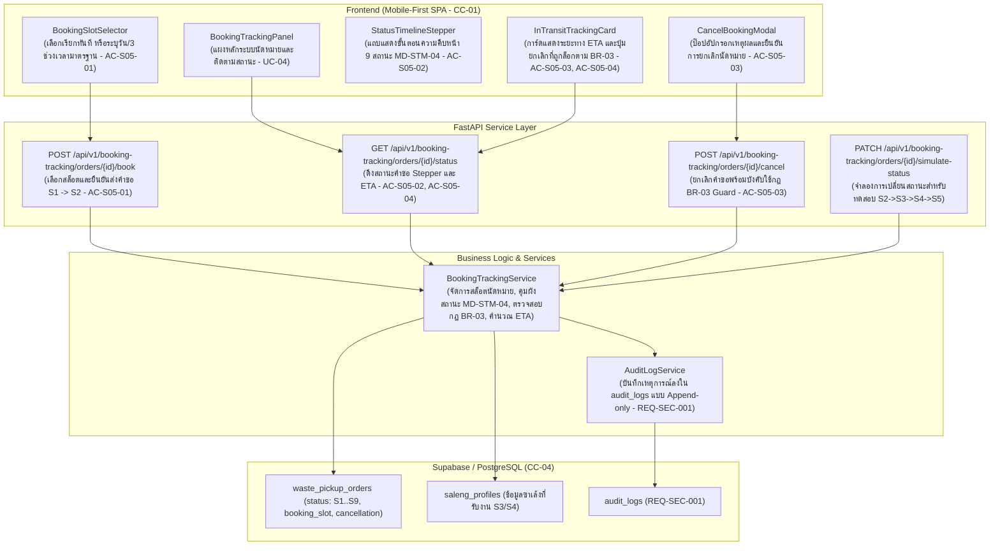

# แผนสถาปัตยกรรมและเทคโนโลยี: ระบบนัดหมายและติดตามสถานะ (`specs/seller/05-booking-and-status-tracking/plan.md`)

- **Version:** `1.0` | **Status:** `ready-for-tasks` | **Owner:** กลุ่ม 2 (แพลตฟอร์มรับซื้อของเก่า/ซาเล้ง)
- **อ้างอิงสเปก:** [`specs/seller/05-booking-and-status-tracking/spec.md`](./spec.md) (v2.0)
- **ข้อจำกัดกลาง:** [`specs/000-shared/constraints.md`](../../000-shared/constraints.md) (`CC-01..CC-06`, `REQ-SEC-001..002`, `REQ-OP-001..002`, `D-00-01..03`)

---

## 1. เทคโนโลยีที่ใช้ (Tech Stack)

> [!NOTE]
> **หมายเหตุด้านเทคโนโลยี:** เทคโนโลยีที่ใช้ในโมดูลนี้ **`"ทีมเลือกเอง ไม่ได้มาจาก spec"`** เพื่อให้สอดคล้องกับสถาปัตยกรรมทั้งระบบของโครงการ:

- **Backend Framework:** **Python 3.11 + FastAPI**
  - สถาปัตยกรรม REST API แบบแยก Router, Controller (Service Layer) และ Data Access Layer
  - ตรวจสอบความถูกต้องของข้อมูล (Validation & Cancellation Guard) ด้วย **Pydantic v2**
  - จัดการข้อผิดพลาดตามมาตรฐาน HTTP Status Codes (`400 Bad Request` สำหรับการละเมิดกฎ `BR-03`, `404 Not Found`)
- **Database & Storage:** **Supabase (PostgreSQL 15+)**
  - ตาราง `waste_pickup_orders` (สถานะ `S1` ถึง `S9`, ข้อมูลสล็อตนัดหมาย, และข้อมูลการยกเลิก) และ `audit_logs` (Append-only)
  - รองรับ Concurrency Control ด้วยคอลัมน์ `version` และ Transaction State Lock (ตาม `CC-04`)
- **Frontend Framework:** **React 18 + Vite + TailwindCSS**
  - พัฒนาเป็น Single-Page Application (SPA) แบบ Mobile-First ตามข้อกำหนด `CC-01` (Viewport 375px–414px)
  - ตัวแสดงขั้นตอนความคืบหน้า (Status Timeline Stepper) 9 สถานะตาม `MD-STM-04`
  - การล็อกปุ่มยกเลิก (Disabled State & Tooltip) เมื่อคำขอเข้าสู่สถานะ `S4 (กำลังเดินทาง)` ตามกฎ `BR-03`
  - แคชข้อมูลสถานะคำขอล่าสุดใน `localStorage` (`saleng_active_order_tracking`) เพื่อรองรับการเปิดดูแบบออฟไลน์ (`CC-05`, `REQ-OP-001`)
- **Automated Testing Suite:**
  - หลังบ้าน: **Pytest** พร้อม `TestClient` (FastAPI)
  - หน้าบ้าน: **Vitest + React Testing Library + JSDOM**

---

## 2. สถาปัตยกรรมระบบ (System Architecture)



---

## 3. การตัดสินใจเชิงสถาปัตยกรรม (Architectural Decisions — `P-01` ถึง `P-06`)

### `P-01`: Booking Slot Selection & Submission (`REQ-FN-003`, `AC-S05-01`, `Q-01`)
- **บริบท:** ผู้ขายต้องการความยืดหยุ่นในการนัดหมาย ทั้งแบบเร่งด่วนและแบบวางแผนล่วงหน้า
- **การตัดสินใจ:**
  1. รองรับ 2 ประเภทการนัดหมาย (`booking_type`):
     - `IMMEDIATE`: เรียกทันที (ด่วนใน 1–2 ชม.)
     - `SCHEDULED`: นัดหมายล่วงหน้า โดยระบุวันที่ (`scheduled_date`) และเลือก 1 ใน 3 ช่วงเวลามาตรฐาน (`scheduled_slot`):
       - `MORNING_09_12`: ช่วงเช้า (09:00 – 12:00 น.)
       - `AFTERNOON_13_16`: ช่วงบ่าย (13:00 – 16:00 น.)
       - `EVENING_16_18`: ช่วงเย็น (16:00 – 18:00 น.)
  2. เมื่อกดยืนยัน คำขอจะเปลี่ยนสถานะจาก `S1 (Draft)` เป็น `S2 (Pending / Open)` และบันทึก Audit Log `ORDER_SUBMITTED`

### `P-02`: Real-Time 9-State Timeline Stepper (`MD-STM-04`, `REQ-FN-003`, `AC-S05-02`)
- **บริบท:** ผู้ขายต้องการทราบขั้นตอนที่แน่ชัดว่าคำขออยู่ในกระบวนการใด
- **การตัดสินใจ:**
  1. ควบคุมสถานะให้ตรงกับผังสถานะกลาง `MD-STM-04` ทั้ง 9 สถานะ
  2. จัดกลุ่มแสดงผลบนหน้าจอเป็น 5 ขั้นตอนหลัก (Main Steps):
     - ขั้นที่ 1: ส่งคำขอนัดหมาย (`S1 -> S2`)
     - ขั้นที่ 2: มีผู้รับงานแล้ว (`S3`)
     - ขั้นที่ 3: ซาเล้งกำลังเดินทาง (`S4`)
     - ขั้นที่ 4: ถึงหน้าบ้านและชั่งน้ำหนัก (`S5`)
     - ขั้นที่ 5: ชำระเงินและปิดงาน (`S6 -> S7`)
     *(กรณี `S8 ยกเลิก` หรือ `S9 ข้อพิพาท` จะแสดงแถบสถานะพิเศษแยกต่างหาก)*

### `P-03`: Pre-Transit Cancellation Guard (`BR-03`, `AC-S05-03`, `Q-02`)
- **บริบท:** กฎธุรกิจ `BR-03` กำหนดว่าผู้ขายสามารถยกเลิกนัดหมายได้เฉพาะก่อนที่ซาเล้งกดยืนยันออกเดินทางแล้วเท่านั้น เพื่อป้องกันความเสียหายและเสียเวลาของซาเล้ง
- **การตัดสินใจ:**
  1. ตรวจสอบสถานะคำขอก่อนดำเนินการยกเลิก:
     - หากสถานะอยู่ในกลุ่ม `['S1', 'S2', 'S3']`: อนุญาตให้ยกเลิกได้ โดยเปลี่ยนสถานะเป็น `S8 (Cancelled)`, บันทึกเหตุผลการยกเลิก, ปลดภาระงานของซาเล้ง, และบันทึก Audit Log `ORDER_CANCELLED_BY_SELLER`
     - หากสถานะเข้าสู่ `S4 (In-Transit)` หรือหลังจากนั้น (`S5..S7`): ระบบจะ **บล็อกและปฏิเสธทันที** โดยโยน HTTP 400 Bad Request:
       > *"ไม่สามารถยกเลิกนัดหมายได้เนื่องจากซาเล้งกำลังเดินทางมายังหน้างานแล้วตามกฎ BR-03"*
  2. บนหน้าจอ UI: ล็อกปุ่มยกเลิก (Disabled) พร้อมแสดงข้อความเตือนให้ผู้ขายทราบ

### `P-04`: In-Transit ETA & Distance Display (`CC-02`, `CC-03`, `AC-S05-04`, `Q-03`)
- **บริบท:** ในระหว่างที่ซาเล้งกำลังเดินทาง ผู้ขายต้องการทราบระยะทางและเวลาที่คาดว่าจะมาถึง เพื่อเตรียมตัว
- **การตัดสินใจ:**
  1. เมื่ออยู่ในสถานะ `S4` ระบบจะคำนวณระยะทางที่เหลือ (กม.) ด้วยสูตร Haversine × 1.35 จากพิกัด GPS ปัจจุบันของซาเล้ง (`CC-02`)
  2. คำนวณเวลาประเมินถึงหน้างาน (ETA) โดยเฉลี่ยความเร็วรถซาเล้งในเขตเมือง (~15–20 กม./ชม.) เช่น ระยะทาง 1.5 กม. ใช้เวลาประมาณ 5–10 นาที
  3. แสดงข้อมูลโปรไฟล์ของซาเล้งที่กำลังเดินทาง (รูปถ่าย, ชื่อ, ป้าย KYC 100%, ประเภทยานพาหนะ) พร้อมปุ่มโทรด่วน (`tel:`)

### `P-05`: Status Transition Notifications (`REQ-SEC-001`, `AC-S05-04`, `Q-04`)
- **บริบท:** ผู้ขายต้องการทราบความเคลื่อนไหวโดยไม่ต้องคอยกดรีเฟรชหน้าจอเอง
- **การตัดสินใจ:**
  1. สร้างระบบแจ้งเตือนแบบ In-App Banner ใน 3 จังหวะสำคัญ:
     - เมื่อซาเล้งกดรับงาน (`S2 -> S3`): *"🎉 มีซาเล้งรับงานของคุณแล้ว"*
     - เมื่อซาเล้งเริ่มออกเดินทาง (`S3 -> S4`): *"🚚 ซาเล้งกำลังเดินทางมาหาคุณ"*
     - เมื่อซาเล้งเดินทางถึงหน้างาน (`S4 -> S5`): *"📍 ซาเล้งเดินทางถึงหน้าบ้านของคุณแล้ว"*
  2. ทุกการเปลี่ยนสถานะต้องบันทึกประวัติลงใน `audit_logs` แบบ Append-only

### `P-06`: Offline Status Persistence & LocalStorage Caching (`CC-05`, `REQ-OP-001`)
- **บริบท:** การใช้งานในพื้นที่ที่สัญญาณอินเทอร์เน็ตไม่เสถียร
- **การตัดสินใจ:**
  1. แคชข้อมูลสถานะและรายละเอียดคำขอล่าสุดลงใน `localStorage` (`saleng_active_order_tracking`)
  2. หากไม่สามารถเชื่อมต่อเซิร์ฟเวอร์ได้ หน้าจอจะดึงข้อมูลจากแคชขึ้นมาแสดงผล พร้อมแสดงป้ายสัญลักษณ์โหมดออฟไลน์

---

## 4. โครงสร้างข้อมูลและ Data Models (DDL Schema)

### 4.1 Schema Definition (PostgreSQL / Supabase)

```sql
-- อัปเดตคอลัมน์ในตาราง waste_pickup_orders สำหรับข้อมูลการนัดหมายและการยกเลิก
ALTER TABLE waste_pickup_orders ADD COLUMN IF NOT EXISTS booking_type VARCHAR(20) DEFAULT 'IMMEDIATE'; -- 'IMMEDIATE', 'SCHEDULED'
ALTER TABLE waste_pickup_orders ADD COLUMN IF NOT EXISTS scheduled_date DATE;
ALTER TABLE waste_pickup_orders ADD COLUMN IF NOT EXISTS scheduled_slot VARCHAR(30); -- 'MORNING_09_12', 'AFTERNOON_13_16', 'EVENING_16_18'
ALTER TABLE waste_pickup_orders ADD COLUMN IF NOT EXISTS cancellation_reason TEXT;
ALTER TABLE waste_pickup_orders ADD COLUMN IF NOT EXISTS cancelled_by VARCHAR(50);
ALTER TABLE waste_pickup_orders ADD COLUMN IF NOT EXISTS cancelled_at TIMESTAMPTZ;
```

### 4.2 Pydantic Data Models (Python / FastAPI)

```python
from pydantic import BaseModel, Field
from typing import Optional, List
from datetime import datetime

class BookingSlotRequest(BaseModel):
    booking_type: str = Field(..., description="IMMEDIATE หรือ SCHEDULED")
    scheduled_date: Optional[str] = Field(None, description="วันที่นัดหมาย (YYYY-MM-DD)")
    scheduled_slot: Optional[str] = Field(None, description="ช่วงเวลา: MORNING_09_12, AFTERNOON_13_16, EVENING_16_18")
    notes: Optional[str] = None

class OrderCancellationRequest(BaseModel):
    reason: str = Field(..., min_length=2, description="เหตุผลการยกเลิกนัดหมาย")

class OrderTrackingResponse(BaseModel):
    order_id: str
    status: str
    status_label: str
    stepper_step: int  # 1 ถึง 5
    booking_type: str
    scheduled_time_display: str
    assigned_saleng: Optional[dict] = None
    eta_minutes: Optional[int] = None
    distance_km: Optional[float] = None
    can_cancel: bool  # True หากสถานะอยู่ใน S1..S3, False หากอยู่ใน S4..S9 ตาม BR-03
    cancellation_reason: Optional[str] = None
    items_count: int = 0
    total_estimated_price: dict = {}
    updated_at: str
```

---

## 5. แผนการสร้าง API Endpoints (FastAPI)

| Method | Endpoint Path | หน้าที่การทำงาน | รองรับ AC / REQ | HTTP Status |
| :---: | :--- | :--- | :---: | :---: |
| `POST` | `/api/v1/booking-tracking/orders/{id}/book` | เลือกช่วงเวลานัดหมายและยืนยันส่งคำขอ (`S1 -> S2`) | `AC-S05-01`<br>`REQ-FN-003` | `200 OK`<br>`400 Bad Request`<br>`404 Not Found` |
| `GET` | `/api/v1/booking-tracking/orders/{id}/status` | ดึงสถานะคำขอ ข้อมูล Stepper, ETA, ซาเล้ง และสิทธิ์ยกเลิก | `AC-S05-02`, `AC-S05-04`<br>`MD-STM-04` | `200 OK`<br>`404 Not Found` |
| `POST` | `/api/v1/booking-tracking/orders/{id}/cancel` | ยกเลิกนัดหมายพร้อมบังคับใช้กฎเหล็ก `BR-03` | `AC-S05-03`<br>`BR-03`, `REQ-SEC-001` | `200 OK`<br>`400 Bad Request (บล็อก S4)`<br>`404 Not Found` |
| `PATCH` | `/api/v1/booking-tracking/orders/{id}/simulate-status` | จำลองการเปลี่ยนสถานะ (`S2->S3->S4->S5`) สำหรับทดสอบ | `AC-S05-02`, `AC-S05-03`<br>`MD-STM-04` | `200 OK`<br>`404 Not Found` |

---

## 6. แผนพัฒนา UI Components (React 18 + TailwindCSS)

1. **`BookingSlotSelector.jsx`:**
   - สวิตช์เลือก 2 รูปแบบ: "เรียกทันที" หรือ "นัดหมายล่วงหน้า"
   - ปฏิทิน/ตัวเลือกวันที่ และ 3 สล็อตเวลา (เช้า 09:00–12:00, บ่าย 13:00–16:00, เย็น 16:00–18:00)
   - ปุ่มหลักความสูง `>= 48px` สำหรับยืนยันการนัดหมาย (`AC-S05-01`, `REQ-UX-001`)
2. **`StatusTimelineStepper.jsx`:**
   - แถบแสดงขั้นตอนความคืบหน้า 5 ขั้นตอนหลักตาม `MD-STM-04` พร้อมไอคอนและสีระบุสถานะปัจจุบัน (`AC-S05-02`)
3. **`InTransitTrackingCard.jsx`:**
   - การ์ดแสดงข้อมูลระหว่างเดินทาง: แสดงระยะทางที่เหลือ (กม.), เวลาประเมินถึงหน้างาน (ETA), ข้อมูลซาเล้ง (รูปถ่าย, ชื่อ, ป้าย KYC 100%)
   - ปุ่มโทรด่วนหาซาเล้ง และปุ่มยกเลิกที่ถูกล็อก (Disabled) พร้อมป้ายเตือนตาม `BR-03` (`AC-S05-03`, `AC-S05-04`)
4. **`CancelBookingModal.jsx`:**
   - ป๊อปอัปให้ผู้ขายเลือก/กรอกเหตุผลการยกเลิกนัดหมาย พร้อมปุ่มยืนยันยกเลิก (`AC-S05-03`)
5. **`BookingTrackingPanel.jsx`:**
   - แผงควบคุมหลัก Mobile-First Dashboard รวบรวม Header, Timeline Stepper, Tracking Card, ปุ่มยกเลิก และป้ายเตือนออฟไลน์ (`CC-01`, `CC-05`)

---

## 7. ตารางตรวจสอบความครบถ้วนของข้อจำกัดกลาง (Constraints Checklist)

> ตรวจสอบข้อจำกัดกลางครบทั้ง 13 ข้อตาม `specs/000-shared/constraints.md` โดยระบุงานที่รองรับ หรือเหตุผลสำหรับข้อที่ไม่เกี่ยวข้อง

| รหัส Constraint | ข้อกำหนดใน Constraint กลาง (`specs/000-shared/constraints.md`) | สถานะการปฏิบัติตามในแผนนี้ (`P-xx`) | รายละเอียดการออกแบบ |
| :---: | :--- | :---: | :--- |
| **`CC-01`** | Mobile-First Web SPA รองรับมือถือราคาประหยัด (`RAM >= 2 GB`, Android 9.0+) | **รองรับ (`P-01`, `P-06`)** | ออกแบบ UI หน้าจอมือถือ (375px–414px) ใช้ TailwindCSS ประหยัด DOM nodes และจำกัดขนาดข้อมูล API |
| **`CC-02`** | GPS Sync Interval ทุก 60 วินาทีขณะเปิดสถานะ Online | **รองรับ (`P-04`)** | อัปเดตระยะทางและเวลาถึงหน้างาน (ETA) ของซาเล้งตามรอบพิกัด GPS ทุก 60 วินาที |
| **`CC-03`** | Road Distance API รัศมี <= 5.0 กม. พร้อม Haversine Fallback | **รองรับ (`P-04`)** | คำนวณระยะทางที่เหลือระหว่างซาเล้งและผู้ขายด้วยสูตร Haversine × 1.35 |
| **`CC-04`** | PostgreSQL + Concurrency Control / Optimistic Locking | **รองรับ (`P-01`, `P-03`)** | การส่งคำขอและการยกเลิกนัดหมายใช้ระบบ State Machine Guard ป้องกัน Concurrency Conflict |
| **`CC-05`** | Offline Cache ใน IndexedDB / Local Storage | **รองรับ (`P-06`)** | แคชข้อมูลสถานะและรายละเอียดคำขอนัดหมายล่าสุดใน `localStorage` (`saleng_active_order_tracking`) |
| **`CC-06`** | PDPA & PII Masking ซ่อนบ้านเลขที่และพิกัดละเอียด | **รองรับ (`P-04`)** | ข้อมูลพิกัดบ้านของผู้ขายจะเปิดเผยให้ซาเล้งเห็นเฉพาะหลังจากซาเล้งกดรับงานแล้วเท่านั้น |
| **`REQ-SEC-001`** | บันทึกประวัติการเปลี่ยนสถานะใบงานลงในตาราง Audit Log | **รองรับ (`P-01`, `P-03`, `P-05`)** | ทุกการส่งคำขอ (`S1->S2`), ซาเล้งรับงาน (`S2->S3`), ออกเดินทาง (`S3->S4`), และยกเลิก (`->S8`) ต้องบันทึกลง `audit_logs` |
| **`REQ-SEC-002`** | แปลงเบอร์โทรศัพท์เป็น `08X-XXX-XXXX` และซ่อนบ้านเลขที่ | **รองรับ (`P-02`)** | ข้อมูลผู้ขายจะแสดงผลแบบ Masking จนกว่าจะมีการรับงาน |
| **`REQ-OP-001`** | โหมด Offline Queue สำหรับดูข้อมูลที่แคชไว้ | **รองรับ (`P-06`)** | ผู้ขายสามารถเปิดดูสถานะและรายละเอียดนัดหมายล่าสุดได้แม้ออฟไลน์ |
| **`REQ-OP-002`** | Haversine Fallback สำหรับการคำนวณระยะทาง | **รองรับ (`P-04`)** | ใช้สูตร `Haversine × 1.35` ในการประเมินระยะทางและเวลาเดินทางถึงหน้างาน |
| **`D-00-01`** | KYC เป็น Precondition ของระบบผู้ซื้อ | **รองรับ (`P-02`, `P-04`)** | ซาเล้งที่รับงานต้องเป็นผู้ที่ผ่านการยืนยันตัวตน KYC 100% เท่านั้น |
| **`D-00-02`** | ซ่อนพิกัดผู้ขายจนกว่าจะรับงาน | **รองรับ (`P-02`)** | พิกัดบ้านผู้ขายจะถูกเปิดเผยให้เฉพาะซาเล้งที่รับงานในสถานะ S3/S4 เท่านั้น |
| **`D-00-03`** | ขอบเขตหยุดที่สถานะมีผู้รับงานแล้ว | **นำไปใช้ (`P-01`, `P-03`)** | โมดูลนี้ครอบคลุมการนัดหมาย การเปลี่ยนสถานะตามผัง `S1` ถึง `S9` และกฎการยกเลิก `BR-03` |

---

## 8. กลยุทธ์การทดสอบอัตโนมัติ (Automated Testing Strategy)

1. **Backend Tests (Pytest):**
   - `test_T01_booking_tracking_models.py`: ทดสอบ Schema Validation, ค่าเริ่มต้น, และโครงสร้างข้อมูลสล็อตนัดหมาย
   - `test_AC_S05_01_booking_slot_submission.py`: ทดสอบการเลือกสล็อตเวลา (ด่วน vs ล่วงหน้า) และการเปลี่ยนสถานะ `S1 -> S2`
   - `test_AC_S05_02_status_timeline_stepper.py`: ทดสอบการแสดงผลและดึงข้อมูลผังสถานะ 9 ขั้นตอน
   - `test_AC_S05_03_pre_transit_cancellation.py`: ทดสอบกฎ `BR-03` การยกเลิกใน `S1..S3` ผ่าน และการบล็อกใน `S4` โยน HTTP 400
   - `test_AC_S05_04_in_transit_eta_display.py`: ทดสอบการคำนวณระยะทางและ ETA ในสถานะ `S4`
   - `test_AC_S05_05_audit_logging.py`: ทดสอบการบันทึกประวัติลงใน `audit_logs` ครบทุกการเปลี่ยนสถานะ
   - `test_e2e_booking_and_status_tracking.py`: ทดสอบวงจรนัดหมาย ติดตามสถานะ ซาเล้งรับงาน ออกเดินทาง และทดสอบกฎ BR-03
2. **Frontend Tests (Vitest + RTL):**
   - `bookingTrackingApi.test.mjs`: ทดสอบ API Client และ Offline LocalStorage Caching
   - `AC-S05-01.test.jsx`: ทดสอบคอมโพเนนต์ BookingSlotSelector (เรียกทันที vs นัดล่วงหน้า)
   - `AC-S05-02.test.jsx`: ทดสอบคอมโพเนนต์ StatusTimelineStepper แสดงสถานะ 9 ขั้นตอน
   - `AC-S05-03.test.jsx`: ทดสอบการล็อกปุ่มยกเลิกในสถานะ S4 ตามกฎ BR-03 และการกดยกเลิกในสถานะ S2/S3
   - `AC-S05-04.test.jsx`: ทดสอบ InTransitTrackingCard แสดงระยะทางและเวลา ETA
   - `AC-S05-05.test.jsx`: ทดสอบ CancelBookingModal รับเหตุผลและส่งคำขอยกเลิก

