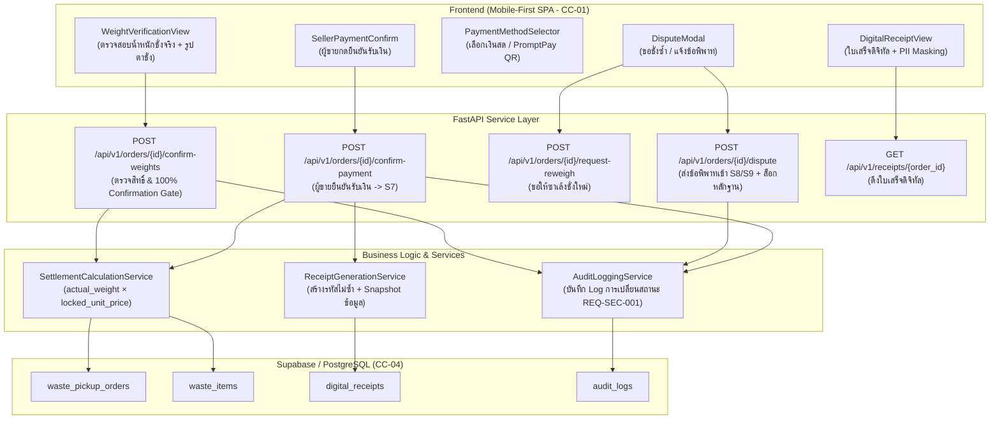

# แผนสถาปัตยกรรมและเทคโนโลยี: ระบบชำระเงินและตรวจสอบ (`specs/seller/06-payment-and-verification/plan.md`)

- **Version:** `1.0` | **Status:** `ready-for-tasks` | **Owner:** กลุ่ม 2 (แพลตฟอร์มรับซื้อของเก่า/ซาเล้ง)
- **อ้างอิงสเปก:** [`specs/seller/06-payment-and-verification/spec.md`](./spec.md) (v2.0)
- **ข้อจำกัดกลาง:** [`specs/000-shared/constraints.md`](../../000-shared/constraints.md) (`CC-01..CC-06`, `REQ-SEC-001..002`, `REQ-OP-001..002`, `D-00-01..03`)

---

## 1. เทคโนโลยีที่ใช้ (Tech Stack)

> [!NOTE]
> **หมายเหตุด้านเทคโนโลยี:** เทคโนโลยีที่ใช้ในโมดูลนี้ **`"ทีมเลือกเอง ไม่ได้มาจาก spec"`** เพื่อให้สอดคล้องกับโครงสร้างและฐานโค้ดที่สร้างไว้แล้วใน `seller-04`:

- **Backend Framework:** **Python 3.11 + FastAPI**
  - สถาปัตยกรรม REST API แบบแยก Router, Controller (Service Layer) และ Data Access Layer
  - ตรวจสอบความถูกต้องของข้อมูล Request/Response ด้วย **Pydantic v2**
  - จัดการข้อผิดพลาดและ HTTP Status Codes ตามมาตรฐาน (เช่น `400 Bad Request`, `403 Forbidden`, `422 Unprocessable Entity`)
- **Database & Storage:** **Supabase (PostgreSQL 15+)**
  - ตาราง `waste_pickup_orders`, `waste_items`, `digital_receipts`, และ `audit_logs`
  - รองรับ Concurrency Control ด้วยคอลัมน์ `version` (Optimistic Locking ตาม `CC-04`)
- **Frontend Framework:** **React 18 + Vite + TailwindCSS**
  - ออกแบบเป็น Single-Page Application (SPA) แบบ Mobile-First ตามข้อกำหนด `CC-01`
  - รองรับหน้าจอสมาร์ตโฟนขนาด 375px–414px (Viewport มาตรฐาน)
- **Automated Testing Suite:**
  - หลังบ้าน: **Pytest** พร้อม `TestClient` (FastAPI)
  - หน้าบ้าน: **Vitest + React Testing Library + JSDOM**

---

## 2. สถาปัตยกรรมระบบ (System Architecture)



---

## 3. ฐานข้อมูล (Data Model — Supabase / PostgreSQL)

### 3.1 ตาราง `waste_pickup_orders` (คำขอนัดหมาย — ส่วนต่อขยายสถานะ `S4..S7`, `S8/S9`)
```sql
ALTER TABLE waste_pickup_orders
ADD COLUMN IF NOT EXISTS actual_arrived_at TIMESTAMPTZ NULL,
ADD COLUMN IF NOT EXISTS seller_confirmed_weight_at TIMESTAMPTZ NULL,
ADD COLUMN IF NOT EXISTS total_settled_amount NUMERIC(10, 2) NULL, -- ยอดเงินสุทธิจริงหลังคูณน้ำหนักชั่งจริง
ADD COLUMN IF NOT EXISTS payment_method VARCHAR(20) NULL, -- 'CASH' หรือ 'PROMPTPAY'
ADD COLUMN IF NOT EXISTS payment_confirmed_at TIMESTAMPTZ NULL,
ADD COLUMN IF NOT EXISTS dispute_reason TEXT NULL,
ADD COLUMN IF NOT EXISTS scale_photo_url TEXT NULL; -- รูปถ่ายหน้าตาชั่งดิจิทัล (REQ-FN-002)
```

### 3.2 ตาราง `waste_items` (รายการของเก่าในคำขอ — ส่วนต่อขยายน้ำหนักชั่งจริง)
```sql
ALTER TABLE waste_items
ADD COLUMN IF NOT EXISTS actual_quantity NUMERIC(10, 2) NULL, -- ค่าน้ำหนักชั่งจริง (กก.) หรือจำนวนกระสอบ
ADD COLUMN IF NOT EXISTS settled_item_price NUMERIC(10, 2) NULL; -- actual_quantity * locked_unit_price
```

### 3.3 ตาราง `digital_receipts` (ใบเสร็จสรุปรายการดิจิทัล — `REQ-FN-005`, `SC-03`)
```sql
CREATE TABLE digital_receipts (
    receipt_id UUID PRIMARY KEY DEFAULT gen_random_uuid(),
    receipt_no VARCHAR(50) NOT NULL UNIQUE, -- รูปแบบ: REC-YYYYMMDD-XXXX
    order_id UUID NOT NULL REFERENCES waste_pickup_orders(order_id) ON DELETE RESTRICT,
    seller_id UUID NOT NULL,
    buyer_id UUID NOT NULL,
    seller_phone_masked VARCHAR(20) NOT NULL, -- 08X-XXX-XXXX (REQ-SEC-002)
    buyer_phone_masked VARCHAR(20) NOT NULL,
    total_amount NUMERIC(10, 2) NOT NULL CHECK (total_amount >= 0),
    payment_method VARCHAR(20) NOT NULL, -- 'CASH' หรือ 'PROMPTPAY'
    items_snapshot JSONB NOT NULL, -- Snapshot รายการของเก่า น้ำหนัก ราคาต่อหน่วย และยอดเงิน
    issued_at TIMESTAMPTZ NOT NULL DEFAULT NOW()
);
```

---

## 4. รายการ API (Endpoints)

| ลำดับ | Method | Path | Request Body | Response Body / Status | รองรับ `REQ` / `AC` |
|---|---|---|---|---|---|
| 1 | `POST` | `/api/v1/orders/{order_id}/record-weighing` | `{ scale_photo_url, items: [ { item_id, actual_quantity } ] }` | `200 OK` `{ order_id, status: "S5", preview_settlement }` | `REQ-FN-004`, `REQ-BR-002` (ซาเล้งกรอกน้ำหนักจริง) |
| 2 | `POST` | `/api/v1/orders/{order_id}/confirm-weights` | `{ seller_id }` | `200 OK` `{ order_id, status: "S6", total_settled_amount }`<br>`403 Forbidden` หากผู้กดไม่ใช่ผู้ขาย | `REQ-FN-004`, `AC-S06-01`, `Q-01` (100% Confirmation Gate) |
| 3 | `POST` | `/api/v1/orders/{order_id}/request-reweigh` | `{ seller_id, reason }` | `200 OK` `{ order_id, status: "S4", message: "ส่งคำขอชั่งซ้ำแล้ว" }` | `AC-S06-02`, `Q-02` (ขอให้ชั่งซ้ำ) |
| 4 | `POST` | `/api/v1/orders/{order_id}/dispute` | `{ seller_id, dispute_reason }` | `200 OK` `{ order_id, status: "S8", dispute_reason }` | `REQ-FN-006`, `AC-S06-02`, `Q-02` (ปฏิเสธผลชั่ง แจ้งข้อพิพาท) |
| 5 | `POST` | `/api/v1/orders/{order_id}/confirm-payment` | `{ seller_id, payment_method: "CASH" \| "PROMPTPAY" }` | `200 OK` `{ order_id, status: "S7", receipt_id, receipt_no }`<br>`400 Bad Request` หากยังไม่ผ่านการยืนยันน้ำหนัก (S6) | `UC-07`, `REQ-FN-005`, `AC-S06-03`, `Q-03` |
| 6 | `GET` | `/api/v1/receipts/{order_id}` | ไม่มี | `200 OK` `{ receipt_id, receipt_no, items_snapshot, total_amount, issued_at, ... }` | `REQ-FN-005`, `REQ-SEC-002`, `AC-S06-04`, `Q-04` |

---

## 5. การต่อระบบภายนอกและบริการจำลอง (External Interfaces & Mocking)

1. **Supabase PostgreSQL Interface:**
   - บันทึกการเปลี่ยนสถานะใบงานแบบ Atomic Transaction ด้วย `Optimistic Concurrency Control` (`version` column)
2. **PromptPay QR Code Generator Interface:**
   - จำลองการสร้าง PromptPay Payload สำหรับสแกนจ่ายค่าของเก่าตามยอดเงินสุทธิ
3. **Mock Weighing & Camera Adapter:**
   - จำลองภาพถ่ายหน้าตาชั่งดิจิทัลและค่าน้ำหนักชั่งจริงสำหรับการทดสอบ Unit / Integration Tests

---

## 6. แผนหน้าจอ (UI Plan)

ออกแบบเป็น Mobile-First SPA (รองรับ Viewport 375px–414px ตาม `CC-01`):
1. **หน้าตรวจสอบผลชั่งจริง (`WeightVerificationView` — `AC-S06-01`):**
   - แสดงรายการของเก่าเทียบชัดเจนระหว่าง: ปริมาณประเมินเดิม vs **ค่าน้ำหนักชั่งจริงหน้างาน**
   - แสดงภาพถ่ายหน้าตาชั่งดิจิทัลที่ซาเล้งแนบมา
   - แสดงราคาต่อหน่วยที่ล็อกไว้ (`locked_unit_price`) และยอดเงินคำนวณสุทธิ
   - ปุ่มหลัก: **`"กดยืนยันตัวเลขน้ำหนัก (เข้าสู่การชำระเงิน)"`** (บล็อก 100% จนกว่าจะกด)
   - ปุ่มรอง: *"ขอให้ชั่งซ้ำ"* และ *"ปฏิเสธผลชั่ง / แจ้งข้อพิพาท"* (`AC-S06-02`)
2. **หน้าเลือกช่องทางรับเงินและยืนยันรับเงิน (`PaymentConfirmationView` — `AC-S06-03`):**
   - แสดงยอดเงินสุทธิรวมตัวเลขขนาดใหญ่ชัดเจน
   - ตัวเลือกรับเงิน 2 ช่องทาง:
     - **`เงินสด (Cash)`**: แสดงปุ่ม *"ข้าพเจ้าได้รับเงินสดครบถ้วนแล้ว"*
     - **`PromptPay QR Code`**: แสดง QR Code สำหรับรับเงิน พร้อมปุ่ม *"ข้าพเจ้าได้รับเงินโอนเรียบร้อย"*
3. **หน้าแสดงใบเสร็จดิจิทัล (`DigitalReceiptView` — `AC-S06-04`):**
   - แสดงใบเสร็จสวยงาม มีรหัส `REC-YYYYMMDD-XXXX`
   - ปกปิดเบอร์โทรศัพท์เป็น `08X-XXX-XXXX` ตาม `REQ-SEC-002`
   - ตารางสรุปรายการ น้ำหนัก ราคาต่อหน่วย ยอดรวม และวิธีชำระเงิน
   - ปุ่ม *"บันทึกรูปภาพใบเสร็จ"* และ *"กลับสู่หน้าหลัก"*

---

## 7. การจัดการค่าคงที่และการแยก Config (Config Isolation)

| รหัส Config | ค่าตั้งต้น | การใช้งานและความหมาย | อ้างอิง |
|---|---|---|---|
| `WEIGHT_CONFIRMATION_TIMEOUT_MINUTES` | `15` | ระยะเวลาที่ระบบเปิดให้ผู้ขายตรวจสอบน้ำหนักหน้างานก่อนแจ้งเตือน | `REQ-OP-001` |
| `PII_MASK_PHONE_PATTERN` | `"08X-XXX-XXXX"` | รูปแบบการปิดบังเบอร์โทรศัพท์บนใบเสร็จดิจิทัล | `REQ-SEC-002` |
| `RECEIPT_PREFIX` | `"REC"` | คำนำหน้ารหัสใบเสร็จดิจิทัล | `REQ-FN-005` |
| `ALLOWED_PAYMENT_METHODS` | `["CASH", "PROMPTPAY"]` | ช่องทางการชำระเงินที่ระบบรองรับ | `UC-07`, `Q-03` |

---

## 8. ตารางตรวจ Constraints กลาง และ Non-goals

### 8.1 ตารางตรวจสอบ Constraints กลางจาก `specs/000-shared/constraints.md`

| รหัส Constraint | ข้อกำหนดใน Constraint กลาง (`constraints.md`) | ผลการตรวจสอบในแผนนี้ |
| :---: | :--- | :--- |
| **`CC-01`** | Web App แบบ Mobile-First SPA รองรับสมาร์ตโฟนราคาประหยัด (`RAM >= 2 GB`) | **สอดคล้อง** — ออกแบบหน้าจอด้วย React + TailwindCSS แบบ Single-Page น้ำหนักเบา โหลดเร็ว ไม่กิน RAM |
| **`CC-02`** | GPS Sync Interval ทุก 60 วินาทีขณะพร้อมรับงาน | **ไม่เกี่ยวกับ feature นี้ เพราะ** หน้านี้เป็นขั้นตอนการชำระเงินหน้างานที่ตำแหน่งพิกัดถูกบันทึกตั้งแต่ตอนถึงหน้างาน (`S4`) แล้ว |
| **`CC-03`** | Road Distance API รัศมี <= 5 กม. พร้อม Haversine Fallback | **ไม่เกี่ยวกับ feature นี้ เพราะ** การคำนวณระยะทางถนนเสร็จสิ้นตั้งแต่ขั้นตอนเดินทางมารับของ |
| **`CC-04`** | PostgreSQL + PostGIS พร้อม Optimistic Concurrency Control | **สอดคล้อง** — ใช้ Supabase (PostgreSQL) พร้อมฟิลด์ `version` ในตาราง `waste_pickup_orders` ป้องกัน Race Condition |
| **`CC-05`** | Offline Cache ใน IndexedDB / Local Storage | **สอดคล้อง** — หน้าบ้านแคชใบเสร็จดิจิทัลล่าสุดไว้ใน Local Storage เพื่อให้เปิดดูได้แม้ออฟไลน์ |
| **`CC-06`** | PDPA & PII Masking ซ่อนพิกัดละเอียดจนกว่าจะรับงาน | **สอดคล้อง** — หน้านี้แสดงเฉพาะข้อมูลที่จำเป็น และปกปิดข้อมูลส่วนบุคคลบนใบเสร็จดิจิทัล |
| **`REQ-SEC-001`** | บันทึกการเปลี่ยนสถานะใบงานลงใน Audit Log แบบ Append-only | **สอดคล้อง** — บันทึก Log ทุกการเปลี่ยนสถานะ `S4 -> S5 -> S6 -> S7` (หรือ `S8/S9`) |
| **`REQ-SEC-002`** | ปกปิดบ้านเลขที่และแปลงเบอร์โทรศัพท์เป็น `08X-XXX-XXXX` | **สอดคล้อง** — บนใบเสร็จดิจิทัล แปลงเบอร์โทรศัพท์ของผู้ขายและซาเล้งเป็นรูปแบบ `08X-XXX-XXXX` |
| **`REQ-OP-001`** | รองรับการทำงานในโหมด Offline Queue สำหรับดูข้อมูลที่แคชไว้ | **สอดคล้อง** — สามารถเปิดดูใบเสร็จดิจิทัลที่เคยสร้างแล้วได้แม้อินเทอร์เน็ตขาดหาย |
| **`REQ-OP-002`** | Fallback การคำนวณระยะทางเมื่อ Maps API ล่ม | **ไม่เกี่ยวกับ feature นี้ เพราะ** ไม่มีการเรียก Routing API ในขั้นตอนชำระเงินและออกใบเสร็จ |
| **`D-00-01`** | KYC เป็น Precondition ของระบบผู้ซื้อ | **ไม่เกี่ยวกับ feature นี้ เพราะ** เป็นเงื่อนไขของบัญชีก่อนเริ่มงาน |
| **`D-00-02`** | ซ่อนพิกัดผู้ขายจนกว่าจะรับงาน | **สอดคล้อง** — ขั้นตอนนี้เกิดขึ้นหน้างานหลังจากซาเล้งรับงานแล้ว |
| **`D-00-03`** | ขอบเขตหยุดที่สถานะมีผู้รับงานแล้ว | **ไม่เกี่ยวกับ feature นี้ เพราะ** ฟีเจอร์นี้ดูแลขั้นตอนชำระเงินหน้างาน (`S4 -> S7`) |

### 8.2 การยืนยันขอบเขตและ Non-goals
- **ยืนยันไม่ทำระบบ In-App Wallet หรือ Payment Gateway ตัดบัตร:** ยึดตามมติ `Q-05` ช่องทางการชำระเงินใช้เงินสดหน้างาน และการโอน PromptPay ผ่านแอปธนาคารภายนอกเท่านั้น
- **ยืนยันไม่รวมระบบให้คะแนนรีวิวและบันทึกซาเล้งคนโปรด:** แยกไปอยู่ใน [`specs/seller/07-post-transaction/`](../07-post-transaction/spec.md) (`UC-10`) เพื่อความชัดเจนของขอบเขต

---

## 9. ตารางความครอบคลุมการตัดสินใจเชิงสถาปัตยกรรม (`Traceability Matrix: REQ / AC -> P-xx`)

| รหัสการตัดสินใจ | รายละเอียดสถาปัตยกรรม (`Architectural Decision`) | รองรับ `REQ` | รองรับ `AC` |
| :---: | :--- | :---: | :---: |
| **`P-01`** | สร้าง `WeightConfirmationService` ตรวจสอบน้ำหนักชั่งจริง และบังคับ Seller Confirmation Gate 100% ก่อนปลดล็อกเข้าสู่ `S6` | `REQ-FN-004` | `AC-S06-01` |
| **`P-02`** | พัฒนาระบบ Dispute & Re-Weigh รองรับทางเลือกขอชั่งซ้ำ และส่งคำขอเข้าสถานะ `S8: Disputed` พร้อมล็อกภาพถ่ายหน้าตาชั่งส่งแอดมิน | `REQ-FN-006` | `AC-S06-02` |
| **`P-03`** | สร้าง `SettlementCalculationService` คำนวณยอดเงินสุทธิจาก `actual_quantity * locked_unit_price` | `REQ-BR-002` | `AC-S06-03` |
| **`P-04`** | สร้างระบบ Payment Confirmation Flow รองรับเงินสดและ PromptPay พร้อมบังคับให้ผู้ขายเป็นผู้กดยืนยันรับเงินก่อนเปลี่ยนเป็น `S7` | `UC-07` | `AC-S06-03` |
| **`P-05`** | สร้าง `ReceiptGenerationService` ผลิตใบเสร็จดิจิทัล (`DigitalReceipt`) พร้อมรหัสไม่ซ้ำ และแปลงเบอร์โทรเป็น `08X-XXX-XXXX` | `REQ-FN-005`, `REQ-SEC-002` | `AC-S06-04` |
| **`P-06`** | พัฒนา State Machine Transition Controller และบันทึกประวัติลง Audit Log ตรวจสอบย้อนกลับได้ | `REQ-SEC-001`, `CC-04` | `AC-S06-05` |

