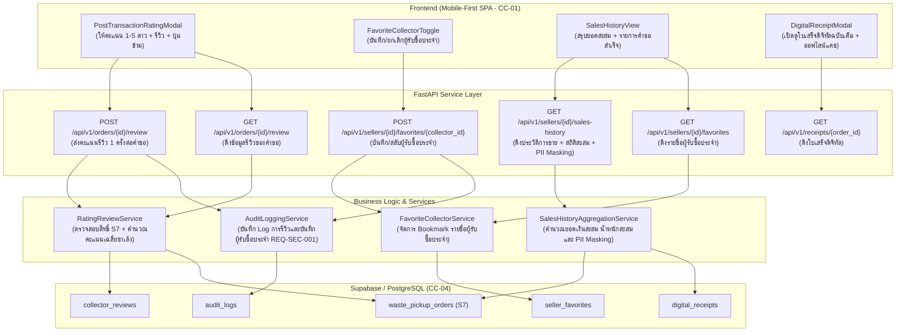

# แผนสถาปัตยกรรมและเทคโนโลยี: ระบบหลังทำธุรกรรม (`specs/seller/07-post-transaction/plan.md`)

- **Version:** `1.0` | **Status:** `ready-for-tasks` | **Owner:** กลุ่ม 2 (แพลตฟอร์มรับซื้อของเก่า/ซาเล้ง)
- **อ้างอิงสเปก:** [`specs/seller/07-post-transaction/spec.md`](./spec.md) (v2.0)
- **ข้อจำกัดกลาง:** [`specs/000-shared/constraints.md`](../../000-shared/constraints.md) (`CC-01..CC-06`, `REQ-SEC-001..002`, `REQ-OP-001..002`, `D-00-01..03`)

---

## 1. เทคโนโลยีที่ใช้ (Tech Stack)

> [!NOTE]
> **หมายเหตุด้านเทคโนโลยี:** เทคโนโลยีที่ใช้ในโมดูลนี้ **`"ทีมเลือกเอง ไม่ได้มาจาก spec"`** เพื่อให้สอดคล้องกับโครงสร้างและฐานโค้ดที่สร้างไว้แล้วใน `seller-04` และ `seller-06`:

- **Backend Framework:** **Python 3.11 + FastAPI**
  - สถาปัตยกรรม REST API แบบแยก Router, Controller (Service Layer) และ Data Access Layer
  - ตรวจสอบความถูกต้องของข้อมูล Request/Response ด้วย **Pydantic v2**
  - จัดการข้อผิดพลาดและ HTTP Status Codes ตามมาตรฐาน (`400 Bad Request`, `404 Not Found`, `409 Conflict`, `422 Unprocessable Entity`)
- **Database & Storage:** **Supabase (PostgreSQL 15+)**
  - ตาราง `waste_pickup_orders`, `digital_receipts`, `collector_reviews`, `seller_favorites`, และ `audit_logs`
  - รองรับ Concurrency Control ด้วยคอลัมน์ `version` (Optimistic Locking ตาม `CC-04`)
- **Frontend Framework:** **React 18 + Vite + TailwindCSS**
  - ออกแบบเป็น Single-Page Application (SPA) แบบ Mobile-First ตามข้อกำหนด `CC-01`
  - รองรับหน้าจอสมาร์ตโฟนขนาด 375px–414px (Viewport มาตรฐาน)
  - แคชข้อมูลประวัติและใบเสร็จดิจิทัลลงใน `localStorage` เพื่อรองรับการเปิดดูออฟไลน์ (`CC-05`, `REQ-OP-001`)
- **Automated Testing Suite:**
  - หลังบ้าน: **Pytest** พร้อม `TestClient` (FastAPI)
  - หน้าบ้าน: **Vitest + React Testing Library + JSDOM**

---

## 2. สถาปัตยกรรมระบบ (System Architecture)



---

## 3. การตัดสินใจเชิงสถาปัตยกรรม (Architectural Decisions — `P-01` ถึง `P-06`)

### `P-01`: Rating & Review Service (`UC-10`, `SC-05`, `AC-S07-01`)
- **บริบท:** เมื่อคำขอเข้าสู่ `S7: Completed` ผู้ขายสามารถให้คะแนนดาว 1–5 ดาวและเขียนข้อความรีวิว
- **การตัดสินใจ:**
  1. สร้าง `RatingReviewService` ตรวจสอบว่าคำขอต้องมีสถานะ `S7` และผู้เรียกคือผู้ขายเจ้าของคำขอ (`seller_id`)
  2. อนุญาตให้ส่งรีวิวได้ **1 ครั้งต่อ 1 คำขอ (`order_id`)** หากมีการส่งซ้ำจะตอบกลับด้วย `409 Conflict` ป้องกันการปั่นคะแนน
  3. ตรวจสอบเงื่อนไขคะแนนดาว: ต้องเป็นจำนวนเต็ม `1 <= rating <= 5` และข้อความรีวิว `len(comment) <= 500`
  4. การรีวิว **ไม่บังคับ (Optional)** หน้าระบบมีปุ่ม *"ข้าม / ดูใบเสร็จ"* ผู้ขายสามารถเลือกไม่ส่งรีวิวได้

### `P-02`: Favorite Collector Service (`UC-10`, `SC-05`, `AC-S07-02`)
- **บริบท:** ผู้ขายต้องการบันทึกซาเล้งที่บริการดีไว้เป็น "ผู้รับซื้อประจำ"
- **การตัดสินใจ:**
  1. สร้างตาราง `seller_favorites` จัดเก็บคู่ความสัมพันธ์ `(seller_id, collector_id, created_at)`
  2. มี API แบบ Toggle Bookmark: หากยังไม่เคยบันทึกจะทำการ Insert หากเคยบันทึกแล้วจะทำการ Delete (Unfavorite)
  3. สามารถกดบันทึกได้ทั้งจากหน้าจอหลังจบงาน (`PostTransactionRatingModal`) หรือจากหน้ารายการประวัติการขายย้อนหลัง

### `P-03`: Sales History & Aggregation Service (`REQ-FN-005`, `REQ-SEC-002`, `AC-S07-03`)
- **บริบท:** ผู้ขายต้องการดูประวัติการขายของเก่าในอดีตพร้อมสรุปยอดเงินและน้ำหนักสะสม
- **การตัดสินใจ:**
  1. สร้าง `SalesHistoryAggregationService` ดึงรายการคำขอสถานะ `S7` ทั้งหมดของผู้ขาย
  2. คำนวณค่าสถิติสะสม (Aggregation):
     - `total_sales_amount`: ผลรวมยอดเงินสุทธิทั้งหมดที่ได้รับ (บาท)
     - `total_weight_kg`: ผลรวมน้ำหนักของเก่าทั้งหมดที่ขายสำเร็จ (กก.)
     - `total_completed_orders`: จำนวนครั้งที่ซื้อขายสำเร็จ (รายการ)
  3. **PII Masking (`REQ-SEC-002`):** เบอร์โทรศัพท์ของซาเล้งบนการ์ดประวัติการขายต้องผ่านฟังก์ชัน `mask_phone` เป็นรูปแบบ `08X-XXX-XXXX` และไม่เปิดเผยบ้านเลขที่จริง

### `P-04`: Digital Receipt Inspection & Offline Access (`REQ-FN-005`, `REQ-OP-001`, `CC-05`, `AC-S07-04`)
- **บริบท:** ผู้ขายสามารถเปิดดูใบเสร็จดิจิทัลฉบับเต็มของแต่ละรายการได้ตลอดเวลา ทั้งในโหมดออนไลน์และออฟไลน์
- **การตัดสินใจ:**
  1. Frontend Client มีโมดูลแคช `localStorage` สำหรับเก็บรายการประวัติการขายและใบเสร็จดิจิทัล
  2. เมื่อผู้ใช้เปิดดูใบเสร็จดิจิทัล ระบบจะบันทึกลงในแคชอัตโนมัติ หากสัญญาณเน็ตขาดหาย สามารถเปิดดูจากแคชในเครื่องได้ทันที พร้อมแสดงป้ายสถานะ *"เปิดจากข้อมูลแคชออฟไลน์"*

### `P-05`: Audit Logging for Post-Transaction Events (`REQ-SEC-001`, `AC-S07-05`)
- **บริบท:** การกระทำสำคัญหลังจบงานต้องตรวจสอบย้อนกลับได้
- **การตัดสินใจ:**
  1. บันทึก Audit Log แบบ Append-only ลงในตาราง `audit_logs` สำหรับเหตุการณ์:
     - `SELLER_SUBMIT_REVIEW`: เมื่อผู้ขายส่งคะแนนรีวิว
     - `SELLER_ADD_FAVORITE`: เมื่อผู้ขายเพิ่มซาเล้งเป็นผู้รับซื้อประจำ
     - `SELLER_REMOVE_FAVORITE`: เมื่อผู้ขายยกเลิกซาเล้งออกจากผู้รับซื้อประจำ
  2. ระบุ `actor_id`, `entity_id`, `action`, และ `timestamp` ชัดเจน

### `P-06`: Mobile-First UI Architecture (`CC-01`, `AC-S07-01..05`)
- **บริบท:** ออกแบบหน้าจอ SPA สำหรับสมาร์ตโฟนหน้าจอ 375px–414px
- **การตัดสินใจ:**
  1. สร้างคอมโพเนนต์ React ที่มีน้ำหนักเบา:
     - `PostTransactionRatingModal.jsx`: หน้าต่างให้คะแนนดาว, เขียนรีวิว, ปุ่มบันทึกผู้รับซื้อประจำ, และปุ่มข้าม
     - `SalesSummaryCards.jsx`: การ์ดแสดงสถิติสะสม 3 ค่า (ยอดเงิน, น้ำหนัก, จำนวนครั้ง)
     - `SalesOrderCard.jsx`: การ์ดแสดงรายการคำขอสำเร็จ พร้อมป้ายกำกับผู้รับซื้อประจำ และปุ่มเปิดดูใบเสร็จ
     - `SalesHistoryPage.jsx`: หน้าจอหลักรวมประวัติการขายย้อนหลัง
  2. กำกับ `data-req="UC-10"`, `data-req="REQ-FN-005"`, `data-req="REQ-SEC-002"` ให้ตรงตามสเปก

---

## 4. โครงสร้างฐานข้อมูล (Data Model — Supabase / PostgreSQL)

### 4.1 ตาราง `collector_reviews` (การให้คะแนนและรีวิว)
```sql
CREATE TABLE IF NOT EXISTS collector_reviews (
    id VARCHAR(50) PRIMARY KEY,
    order_id VARCHAR(50) NOT NULL UNIQUE, -- 1 รีวิว ต่อ 1 คำขอ
    seller_id VARCHAR(50) NOT NULL,
    collector_id VARCHAR(50) NOT NULL,
    rating INTEGER NOT NULL CHECK (rating >= 1 AND rating <= 5),
    comment VARCHAR(500) NULL,
    created_at TIMESTAMPTZ NOT NULL DEFAULT NOW()
);
CREATE INDEX IF NOT EXISTS idx_collector_reviews_collector_id ON collector_reviews(collector_id);
CREATE INDEX IF NOT EXISTS idx_collector_reviews_seller_id ON collector_reviews(seller_id);
```

### 4.2 ตาราง `seller_favorites` (รายการผู้รับซื้อประจำ)
```sql
CREATE TABLE IF NOT EXISTS seller_favorites (
    id VARCHAR(50) PRIMARY KEY,
    seller_id VARCHAR(50) NOT NULL,
    collector_id VARCHAR(50) NOT NULL,
    created_at TIMESTAMPTZ NOT NULL DEFAULT NOW(),
    CONSTRAINT uq_seller_collector UNIQUE(seller_id, collector_id)
);
CREATE INDEX IF NOT EXISTS idx_seller_favorites_seller_id ON seller_favorites(seller_id);
```

---

## 5. การออกแบบ API Endpoints (FastAPI)

| HTTP Method | เส้นทาง (Endpoint) | คำอธิบาย | รองรับ AC / REQ | P-Decision |
|---|---|---|---|---|
| `POST` | `/api/v1/orders/{order_id}/review` | บันทึกคะแนนรีวิว 1–5 ดาว และความคิดเห็น (จำกัด 1 ครั้งต่อคำขอ) | `AC-S07-01`, `UC-10` | `P-01`, `P-05` |
| `GET` | `/api/v1/orders/{order_id}/review` | ดึงข้อมูลรีวิวของคำขอนั้น (หากเคยรีวิวแล้ว) | `AC-S07-01`, `UC-10` | `P-01` |
| `POST` | `/api/v1/sellers/{seller_id}/favorites/{collector_id}` | สลับสถานะ (Toggle) เพิ่มหรือยกเลิกผู้รับซื้อประจำ | `AC-S07-02`, `UC-10` | `P-02`, `P-05` |
| `GET` | `/api/v1/sellers/{seller_id}/favorites` | ดึงรายชื่อรหัสซาเล้งที่เป็นผู้รับซื้อประจำของผู้ขายรายนี้ | `AC-S07-02`, `UC-10` | `P-02` |
| `GET` | `/api/v1/sellers/{seller_id}/sales-history` | ดึงสรุปยอดสะสมและรายการประวัติการขายที่ปิดงานแล้ว (`S7`) พร้อม PII Masking | `AC-S07-03`, `REQ-FN-005`, `REQ-SEC-002` | `P-03` |
| `GET` | `/api/v1/receipts/{order_id}` | ดึงข้อมูลใบเสร็จดิจิทัลฉบับสมบูรณ์ (Reuse จาก `seller-06`) | `AC-S07-04`, `REQ-FN-005` | `P-04` |

---

## 6. แผนการจัดสร้างส่วนติดต่อผู้ใช้ (Frontend UI Plan)

1. **`PostTransactionRatingModal.jsx` (Mobile Dialog / Modal):**
   - ส่วนหัว: แสดงหัวข้อ "ให้คะแนนและรีวิวบริการ" และชื่อซาเล้งผู้รับซื้อ
   - แถบดาว 5 ดวง: ให้ผู้ขายแตะเลือกคะแนน 1–5 ดาว (Interactive Stars)
   - กล่องข้อความ: กรอกความประทับใจหรือข้อเสนอแนะ (Placeholder: "เช่น ตรงต่อเวลา ตาชั่งได้มาตรฐาน สุภาพ...") พร้อมตัวนับจำนวนอักษร `0/500`
   - ปุ่มทางลัด: แตะปุ่ม *"⭐ บันทึกเป็นผู้รับซื้อประจำ"*
   - แถบปุ่มดำเนินการ:
     - ปุ่มรอง: *"ข้าม / ดูใบเสร็จ"* (`data-req="UC-10"`)
     - ปุ่มหลัก: *"ส่งรีวิว"* (`data-req="UC-10"`, ปิดการกดหากยังไม่ได้เลือกดาว)

2. **`SalesSummaryCards.jsx` (Summary Cards):**
   - การ์ด 3 ช่องแนวนอน:
     1. 💰 รายรับสะสม: `฿XX,XXX`
     2. ⚖️ น้ำหนักสะสม: `XXX กก.`
     3. 📦 สำเร็จ: `XX ครั้ง`

3. **`SalesOrderCard.jsx` (Order History Card):**
   - วันที่และเวลาที่ปิดงาน
   - รายการวัสดุหลักและน้ำหนักรวม
   - ยอดเงินสุทธิ (`฿XXX.XX`)
   - ชื่อซาเล้ง พร้อมเบอร์โทร `08X-XXX-XXXX` และป้ายไอคอน *"ผู้รับซื้อประจำ"* (หากเคยบุ๊กมาร์กไว้)
   - ปุ่มกด: *"ดูใบเสร็จดิจิทัล"* (เปิด `DigitalReceiptModal`)

4. **`SalesHistoryPage.jsx` (Main View):**
   - แถบ Navigation ด้านบน: ปุ่มย้อนกลับ และหัวข้อ "ประวัติการขายของเก่า"
   - ส่วนสรุปสถิติสะสม (`SalesSummaryCards`)
   - รายการการ์ดประวัติย้อนหลัง (`SalesOrderCard`)
   - ป้ายเตือนออฟไลน์: แสดงเมื่อดึงข้อมูลจาก LocalStorage

---

## 7. ตารางตรวจสอบข้อจำกัดกลางครบทั้ง 13 ข้อ (Central Constraints Compliance Table)

> [!IMPORTANT]
> ตามกติกาข้อ 9 ของ `AGENTS.md`: แผนงานต้องตรวจข้อจำกัดกลางครบทุกข้อ ข้อที่ไม่เกี่ยวข้องต้องระบุเหตุผลชัดเจน

| รหัสข้อจำกัด | ข้อกำหนดในเอกสารกลาง (`specs/000-shared/constraints.md`) | สถานะการปฏิบัติตามในโมดูลนี้ | รายละเอียดการออกแบบให้สอดคล้อง |
| :---: | :--- | :---: | :--- |
| **`CC-01`** | Mobile-First Web SPA รองรับมือถือราคาประหยัด (`RAM >= 2 GB`) | **สอดคล้อง** | พัฒนาด้วย React 18 + TailwindCSS น้ำหนักเบา ออกแบบ UI ให้พอดีหน้าจอมือถือขนาด 375px–414px |
| **`CC-02`** | GPS Sync Interval ทุก 60 วินาทีขณะเปิดสถานะ Online | **ไม่เกี่ยวกับ feature นี้ เพราะ** | ขั้นตอนนี้เป็นระบบหลังจบงาน (`S7`) ไม่มีการติดตามพิกัดการเดินทางของรถซาเล้ง |
| **`CC-03`** | Road Distance API รัศมี <= 5 กม. พร้อม Haversine Fallback | **ไม่เกี่ยวกับ feature นี้ เพราะ** | ขั้นตอนนี้เป็นการดูประวัติการขายและให้คะแนนรีวิว ไม่มีการคำนวณเส้นทางถนน |
| **`CC-04`** | PostgreSQL + Concurrency Control / Optimistic Locking | **สอดคล้อง** | ใช้ Supabase (PostgreSQL 15+) พร้อม Unique Constraint บน `order_id` ในตารางรีวิว ป้องกันการส่งรีวิวซ้ำซ้อน |
| **`CC-05`** | Offline Cache ใน IndexedDB / Local Storage | **สอดคล้อง** | แคชข้อมูลรายการประวัติการขายและใบเสร็จดิจิทัลลงใน `localStorage` ให้เปิดดูได้แม้ออฟไลน์ |
| **`CC-06`** | PDPA & PII Masking ซ่อนบ้านเลขที่และพิกัดละเอียด | **สอดคล้อง** | ซ่อนบ้านเลขที่และพิกัดละเอียดของผู้ขายเมื่อจบงานเกิน 24 ชั่วโมง และแปลงเบอร์โทรศัพท์บนการ์ดเป็น `08X-XXX-XXXX` |
| **`REQ-SEC-001`** | บันทึกประวัติการเปลี่ยนสถานะใบงานลงในตาราง Audit Log | **สอดคล้อง** | บันทึก Audit Log เมื่อผู้ขายส่งคะแนนรีวิว หรือทำการเพิ่ม/ลบผู้รับซื้อประจำ |
| **`REQ-SEC-002`** | แปลงเบอร์โทรศัพท์เป็น `08X-XXX-XXXX` | **สอดคล้อง** | ฟังก์ชันดึงประวัติการขายแปลงเบอร์โทรศัพท์ของซาเล้งเป็น `08X-XXX-XXXX` เสมอ |
| **`REQ-OP-001`** | โหมด Offline Queue สำหรับดูข้อมูลที่แคชไว้ | **สอดคล้อง** | รองรับการเปิดดูประวัติการขายย้อนหลังและใบเสร็จดิจิทัลที่เคยบันทึกไว้ใน Local Storage |
| **`REQ-OP-002`** | Haversine Fallback สำหรับการคำนวณระยะทาง | **ไม่เกี่ยวกับ feature นี้ เพราะ** | ไม่มีการคำนวณระยะทางในระบบหลังทำธุรกรรม |
| **`D-00-01`** | KYC เป็น Precondition ของระบบผู้ซื้อ | **ไม่เกี่ยวกับ feature นี้ เพราะ** | ขอบเขตโมดูลนี้เป็นฝั่งผู้ขาย |
| **`D-00-02`** | ซ่อนพิกัดผู้ขายจนกว่าจะรับงาน | **ไม่เกี่ยวกับ feature นี้ เพราะ** | โมดูลนี้ทำงานในสถานะ `S7: Completed` (จบงานเรียบร้อยแล้ว) |
| **`D-00-03`** | ขอบเขตหยุดที่สถานะมีผู้รับงานแล้ว | **ไม่เกี่ยวกับ feature นี้ เพราะ** | โมดูลนี้ดูแลระบบหลังจบงาน (`S7`) |

---

## 8. แผนการจัดเตรียมชุดทดสอบ (Automated Test Plan)

1. **Backend Tests (Pytest):**
   - `test_AC_S07_01_rating_and_review.py`: ทดสอบการส่งรีวิว 1–5 ดาว, ความคิดเห็น, ตรวจสิทธิ์คำขอสถานะ `S7`, ป้องกันการส่งรีวิวซ้ำ (`409 Conflict`), และการคำนวณคะแนนเฉลี่ยซาเล้ง
   - `test_AC_S07_02_favorite_collector.py`: ทดสอบการ Toggle Bookmark ผู้รับซื้อประจำ (เพิ่ม/ลบ), ตรวจสอบรายการในตาราง `seller_favorites`
   - `test_AC_S07_03_sales_history_and_masking.py`: ทดสอบการคำนวณสถิติสะสม (ยอดเงิน, น้ำหนัก, จำนวนครั้ง) และตรวจสอบ PII Masking `08X-XXX-XXXX`
   - `test_AC_S07_05_audit_logs.py`: ทดสอบการบันทึก Audit Log ของทุก Action
   - `test_e2e_post_transaction.py`: ทดสอบวงจรเต็มแบบบูรณาการตั้งแต่จบงาน `S7` -> รีวิว -> เพิ่มผู้รับซื้อประจำ -> ตรวจดูประวัติการขาย
2. **Frontend Tests (Vitest):**
   - `AC-S07-01.test.jsx`: ทดสอบคอมโพเนนต์ `PostTransactionRatingModal` แตะเลือกดาว, พิมพ์รีวิว, และการกดปุ่มข้าม
   - `AC-S07-02.test.jsx`: ทดสอบการกดปุ่มบันทึก/ยกเลิกผู้รับซื้อประจำ และการเปลี่ยนสถานะของปุ่ม
   - `AC-S07-03.test.jsx`: ทดสอบคอมโพเนนต์ `SalesHistoryPage` แสดงสถิติสะสม และตรวจสอบการ Masking เบอร์โทรศัพท์
   - `AC-S07-04.test.jsx`: ทดสอบการเปิดดูใบเสร็จดิจิทัลจากประวัติ และการทำงานในโหมด Offline Cache

