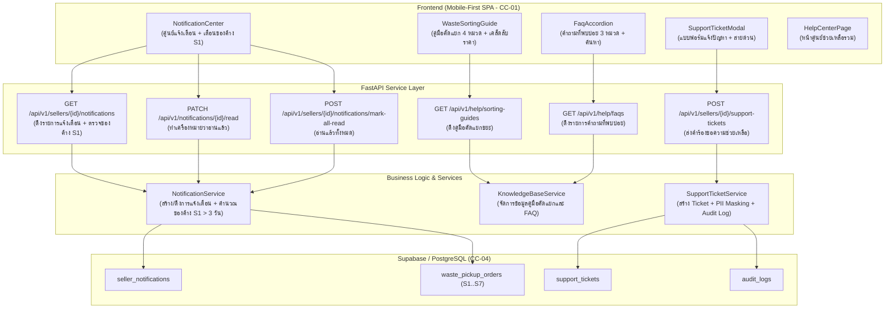

# แผนสถาปัตยกรรมและเทคโนโลยี: ระบบแจ้งเตือนและการช่วยเหลือ (`specs/seller/08-notifications-and-help/plan.md`)

- **Version:** `1.0` | **Status:** `ready-for-tasks` | **Owner:** กลุ่ม 2 (แพลตฟอร์มรับซื้อของเก่า/ซาเล้ง)
- **อ้างอิงสเปก:** [`specs/seller/08-notifications-and-help/spec.md`](./spec.md) (v2.0)
- **ข้อจำกัดกลาง:** [`specs/000-shared/constraints.md`](../../000-shared/constraints.md) (`CC-01..CC-06`, `REQ-SEC-001..002`, `REQ-OP-001..002`, `D-00-01..03`)

---

## 1. เทคโนโลยีที่ใช้ (Tech Stack)

> [!NOTE]
> **หมายเหตุด้านเทคโนโลยี:** เทคโนโลยีที่ใช้ในโมดูลนี้ **`"ทีมเลือกเอง ไม่ได้มาจาก spec"`** เพื่อให้สอดคล้องกับสถาปัตยกรรมทั้งระบบของโครงการ:

- **Backend Framework:** **Python 3.11 + FastAPI**
  - สถาปัตยกรรม REST API แบบแยก Router, Controller (Service Layer) และ Data Access Layer
  - ตรวจสอบความถูกต้องของข้อมูลด้วย **Pydantic v2**
  - จัดการข้อผิดพลาดตามมาตรฐาน HTTP Status Codes (`400 Bad Request`, `404 Not Found`, `422 Unprocessable Entity`)
- **Database & Storage:** **Supabase (PostgreSQL 15+)**
  - ตาราง `seller_notifications`, `support_tickets`, และ `audit_logs`
  - รองรับ Concurrency Control ด้วยคอลัมน์ `version` (Optimistic Locking ตาม `CC-04`)
- **Frontend Framework:** **React 18 + Vite + TailwindCSS**
  - ออกแบบเป็น Single-Page Application (SPA) แบบ Mobile-First ตามข้อกำหนด `CC-01` (Viewport 375px–414px)
  - แคชข้อมูลคู่มือคัดแยกขยะและคำถามที่พบบ่อย (FAQ) ลงใน `localStorage` รองรับการเปิดอ่านออฟไลน์ (`CC-05`, `REQ-OP-001`)
- **Automated Testing Suite:**
  - หลังบ้าน: **Pytest** พร้อม `TestClient` (FastAPI)
  - หน้าบ้าน: **Vitest + React Testing Library + JSDOM**

---

## 2. สถาปัตยกรรมระบบ (System Architecture)



---

## 3. การตัดสินใจเชิงสถาปัตยกรรม (Architectural Decisions — `P-01` ถึง `P-06`)

### `P-01`: In-App Notification Feed & Reminder Service (`UC-08`, `AC-S08-01`, `Q-01`)
- **บริบท:** ผู้ขายต้องการรับทราบสถานะคำขอ และแจ้งเตือนเมื่อมีของเก่าค้างอยู่ในฉบับร่าง (`S1`) นานเกินกำหนด
- **การตัดสินใจ:**
  1. สร้าง `NotificationService` และตาราง `seller_notifications` เก็บรายการแจ้งเตือนในแอป
  2. เมื่อผู้ขายเรียกดูการแจ้งเตือน ระบบจะตรวจสอบคำขอของผู้ขายในสถานะ `S1` ที่สร้างมาเกิน 3 วัน (72 ชั่วโมง) หากยังไม่มีการแจ้งเตือนประเภท `DRAFT_REMINDER` สำหรับคำขอนั้น ระบบจะสร้างให้อัตโนมัติ
  3. รองรับการแจ้งเตือนสถานะคำขอ (`ORDER_STATUS_UPDATE`) สำหรับสถานะ `S3 (มีผู้รับงาน)`, `S4 (ถึงหน้างาน)`, `S5 (รอยืนยันน้ำหนัก)`, และ `S7 (ปิดงานสำเร็จ)`
  4. มี API สำหรับทำเครื่องหมายว่าอ่านแล้วรายข้อ และอ่านแล้วทั้งหมด

### `P-02`: Waste Sorting & Value-Add Knowledge Base (`UC-08`, `CC-05`, `AC-S08-02`, `Q-02`)
- **บริบท:** ผู้ขายต้องการทราบวิธีเตรียมของเก่าให้ได้ราคาสูงขึ้น
- **การตัดสินใจ:**
  1. จัดทำชุดข้อมูลคู่มือแนะนำการคัดแยก 4 หมวดวัสดุหลัก (`MAT-CARDBOARD`, `MAT-WHITE-PAPER`, `MAT-GLASS-BOTTLE`, `MAT-PLASTIC-PET`)
  2. ระบุชื่อ ภาพประกอบ เคล็ดลับการเตรียมเพื่อเพิ่มมูลค่า (เช่น การแยกกระดาษขาวดำได้ 6–7 บาท/กก., การบีบขวด PET, การแยกสีขวดแก้ว) และข้อควรระวัง
  3. ฝั่ง Frontend จะทำการแคชชุดข้อมูลนี้ลง `localStorage` เพื่อให้สามารถเปิดอ่านได้แม้ออฟไลน์ (`CC-05`, `REQ-OP-001`)

### `P-03`: Categorized FAQ Knowledge Base with Search Filter (`UC-08`, `CC-05`, `AC-S08-03`, `Q-03`)
- **บริบท:** ผู้ขายต้องการค้นหาคำตอบสำหรับข้อสงสัยทั่วไปอย่างรวดเร็ว
- **การตัดสินใจ:**
  1. จัดหมวดหมู่ FAQ ออกเป็น 3 กลุ่ม:
     - `MINIMUM_AND_BOOKING`: เงื่อนไขขั้นต่ำ 500 บาท / 2 กระสอบ และการฝากรวมจุดรับทางผ่าน
     - `WEIGHING_AND_PRICING`: การตรวจสอบรูปถ่ายตาชั่งดิจิทัล, การล็อกราคากลาง, เกณฑ์ส่วนต่าง ±15%
     - `PAYMENT_AND_RECEIPT`: ช่องทางเงินสด/PromptPay, การดูใบเสร็จดิจิทัล
  2. ออกแบบ UI แบบ Accordion (กดเพื่อพับ/ขยาย) พร้อมกล่องค้นหา (Search Filter) ค้นหาจากคำถามหรือคำตอบแบบ Real-time
  3. รองรับการแคชออฟไลน์ใน Local Storage

### `P-04`: Customer Support Ticket & Help Center Service (`UC-08`, `UC-13`, `REQ-SEC-002`, `AC-S08-04`, `Q-04`)
- **บริบท:** ผู้ขายต้องการช่องทางแจ้งปัญหาหรือส่งเรื่องร้องเรียนไปยัง Admin
- **การตัดสินใจ:**
  1. สร้างตาราง `support_tickets` เก็บข้อมูลคำร้องขอความช่วยเหลือ: รหัสตั๋ว (`TCK-YYYYMMDD-XXXX`), ผู้แจ้ง (`seller_id`), หมวดหมู่ปัญหา, รายละเอียด, และเบอร์โทรศัพท์ติดต่อ
  2. ทำ **PII Masking (`REQ-SEC-002`)**: แปลงเบอร์โทรศัพท์เป็น `08X-XXX-XXXX` เสมอในส่วนแสดงผล
  3. แสดงข้อมูลติดต่อด่วน: Call Center (`02-123-4567`, เวลาทำการ 08:00 - 18:00 น.) และ LINE Official (@saleng-help)

### `P-05`: Audit Logging for Support Events (`REQ-SEC-001`, `AC-S08-05`)
- **บริบท:** การส่งคำร้องขอความช่วยเหลือและการจัดการการแจ้งเตือนต้องสามารถตรวจสอบย้อนหลังได้
- **การตัดสินใจ:**
  1. บันทึก Audit Log ลงในตาราง `audit_logs` สำหรับเหตุการณ์:
     - `SELLER_SUBMIT_SUPPORT_TICKET`: เมื่อผู้ขายส่งคำร้องขอความช่วยเหลือ
     - `SELLER_CLEAR_NOTIFICATIONS`: เมื่อผู้ขายทำเครื่องหมายอ่านการแจ้งเตือนทั้งหมด

### `P-06`: Mobile-First UI Architecture (`CC-01`, `AC-S08-01..05`)
- **บริบท:** ออกแบบหน้าจอ SPA ให้ใช้งานง่ายบนมือถือขนาด 375px–414px
- **การตัดสินใจ:**
  1. สร้างคอมโพเนนต์ React ที่มีน้ำหนักเบาและตอบสนองรวดเร็ว:
     - `NotificationCenterModal.jsx`: หน้าต่างศูนย์แจ้งเตือน พร้อมตัวเลขแจ้งเตือนยังไม่ได้อ่าน
     - `WasteSortingGuideCard.jsx`: การ์ดแสดงคำแนะนำคัดแยกขยะพร้อมแท็บหมวดหมู่
     - `FaqAccordionView.jsx`: คำถามที่พบบ่อย 3 หมวดหมู่ พร้อมช่องค้นหาคำสำคัญ
     - `SupportTicketModal.jsx`: แบบฟอร์มส่ง Ticket และการ์ดข้อมูลติดต่อสายด่วน
     - `HelpCenterPage.jsx`: หน้าจอหลักรวมศูนย์ช่วยเหลือและการแจ้งเตือน

---

## 4. โครงสร้างฐานข้อมูล (Data Model — Supabase / PostgreSQL)

### 4.1 ตาราง `seller_notifications` (การแจ้งเตือนผู้ขาย)
```sql
CREATE TABLE IF NOT EXISTS seller_notifications (
    id VARCHAR(50) PRIMARY KEY,
    seller_id VARCHAR(50) NOT NULL,
    type VARCHAR(30) NOT NULL, -- 'DRAFT_REMINDER', 'ORDER_STATUS_UPDATE'
    title VARCHAR(100) NOT NULL,
    message TEXT NOT NULL,
    order_id VARCHAR(50) NULL,
    is_read BOOLEAN NOT NULL DEFAULT FALSE,
    created_at TIMESTAMPTZ NOT NULL DEFAULT NOW()
);
CREATE INDEX IF NOT EXISTS idx_notifications_seller ON seller_notifications(seller_id);
```

### 4.2 ตาราง `support_tickets` (คำร้องขอความช่วยเหลือ)
```sql
CREATE TABLE IF NOT EXISTS support_tickets (
    id VARCHAR(50) PRIMARY KEY,
    ticket_no VARCHAR(50) NOT NULL UNIQUE, -- 'TCK-YYYYMMDD-XXXX'
    seller_id VARCHAR(50) NOT NULL,
    category VARCHAR(50) NOT NULL, -- 'BOOKING', 'WEIGHING', 'PAYMENT', 'APP_ISSUE', 'OTHER'
    subject VARCHAR(150) NOT NULL,
    description TEXT NOT NULL,
    contact_phone_masked VARCHAR(20) NOT NULL, -- '08X-XXX-XXXX' (REQ-SEC-002)
    status VARCHAR(20) NOT NULL DEFAULT 'OPEN', -- 'OPEN', 'IN_PROGRESS', 'RESOLVED'
    created_at TIMESTAMPTZ NOT NULL DEFAULT NOW()
);
CREATE INDEX IF NOT EXISTS idx_support_tickets_seller ON support_tickets(seller_id);
```

---

## 5. การออกแบบ API Endpoints (FastAPI)

| HTTP Method | เส้นทาง (Endpoint) | คำอธิบาย | รองรับ AC / REQ | P-Decision |
|---|---|---|---|---|
| `GET` | `/api/v1/sellers/{seller_id}/notifications` | ดึงรายการแจ้งเตือนทั้งหมด พร้อมตรวจสอบของค้างใน S1 > 3 วัน | `AC-S08-01`, `UC-08` | `P-01` |
| `PATCH` | `/api/v1/notifications/{notification_id}/read` | ทำเครื่องหมายแจ้งเตือนว่าอ่านแล้ว | `AC-S08-01`, `UC-08` | `P-01` |
| `POST` | `/api/v1/sellers/{seller_id}/notifications/mark-all-read` | ทำเครื่องหมายแจ้งเตือนทั้งหมดว่าอ่านแล้ว | `AC-S08-01`, `UC-08` | `P-01`, `P-05` |
| `GET` | `/api/v1/help/sorting-guides` | ดึงข้อมูลคู่มือแนะนำการคัดแยกขยะ 4 หมวดหลัก | `AC-S08-02`, `UC-08`, `CC-05` | `P-02` |
| `GET` | `/api/v1/help/faqs` | ดึงข้อมูลคำถามที่พบบ่อย 3 หมวดหมู่ พร้อมค้นหา | `AC-S08-03`, `UC-08`, `CC-05` | `P-03` |
| `POST` | `/api/v1/sellers/{seller_id}/support-tickets` | ส่งคำร้องขอความช่วยเหลือ (Support Ticket) | `AC-S08-04`, `UC-13`, `REQ-SEC-002` | `P-04`, `P-05` |

---

## 6. ตารางตรวจสอบข้อจำกัดกลางครบทั้ง 13 ข้อ (Central Constraints Compliance Table)

| รหัสข้อจำกัด | ข้อกำหนดในเอกสารกลาง (`specs/000-shared/constraints.md`) | สถานะการปฏิบัติตามในโมดูลนี้ | รายละเอียดการออกแบบให้สอดคล้อง |
| :---: | :--- | :---: | :--- |
| **`CC-01`** | Mobile-First Web SPA รองรับมือถือราคาประหยัด (`RAM >= 2 GB`) | **สอดคล้อง** | พัฒนาด้วย React 18 + TailwindCSS น้ำหนักเบา รองรับจอมือถือขนาด 375px–414px |
| **`CC-02`** | GPS Sync Interval ทุก 60 วินาทีขณะเปิดสถานะ Online | **ไม่เกี่ยวกับ feature นี้ เพราะ** | ขั้นตอนนี้เป็นศูนย์ช่วยเหลือและการแจ้งเตือน ไม่มีการติดตามพิกัดยานพาหนะ |
| **`CC-03`** | Road Distance API รัศมี <= 5 กม. พร้อม Haversine Fallback | **ไม่เกี่ยวกับ feature นี้ เพราะ** | ขั้นตอนนี้เป็นการดูคู่มือและแจ้งปัญหา ไม่มีการคำนวณเส้นทางถนน |
| **`CC-04`** | PostgreSQL + Concurrency Control / Optimistic Locking | **สอดคล้อง** | ใช้ Supabase (PostgreSQL 15+) พร้อมรหัสตั๋วไม่ซ้ำ `ticket_no` ป้องกัน Concurrency Collision |
| **`CC-05`** | Offline Cache ใน IndexedDB / Local Storage | **สอดคล้อง** | แคชคู่มือคัดแยกขยะและคำถามที่พบบ่อย (FAQ) ลงใน `localStorage` ให้เปิดอ่านได้แม้ออฟไลน์ |
| **`CC-06`** | PDPA & PII Masking ซ่อนบ้านเลขที่และพิกัดละเอียด | **สอดคล้อง** | แปลงเบอร์โทรศัพท์ของผู้ขายในตั๋วแจ้งปัญหาเป็น `08X-XXX-XXXX` ตามหลัก PDPA |
| **`REQ-SEC-001`** | บันทึกประวัติการเปลี่ยนสถานะใบงานลงในตาราง Audit Log | **สอดคล้อง** | บันทึก Audit Log เมื่อผู้ขายส่งตั๋วแจ้งปัญหา (`SELLER_SUBMIT_SUPPORT_TICKET`) หรือเคลียร์การแจ้งเตือน |
| **`REQ-SEC-002`** | แปลงเบอร์โทรศัพท์เป็น `08X-XXX-XXXX` | **สอดคล้อง** | เบอร์โทรศัพท์ของผู้ขายที่ส่งตั๋วแจ้งปัญหาจะถูกแปลงเป็น `08X-XXX-XXXX` เสมอ |
| **`REQ-OP-001`** | โหมด Offline Queue สำหรับดูข้อมูลที่แคชไว้ | **สอดคล้อง** | รองรับการเปิดอ่านคู่มือคัดแยกขยะและคำถามที่พบบ่อยจากแคชในเครื่องเมื่อออฟไลน์ |
| **`REQ-OP-002`** | Haversine Fallback สำหรับการคำนวณระยะทาง | **ไม่เกี่ยวกับ feature นี้ เพราะ** | ไม่มีการคำนวณระยะทางในศูนย์ช่วยเหลือ |
| **`D-00-01`** | KYC เป็น Precondition ของระบบผู้ซื้อ | **ไม่เกี่ยวกับ feature นี้ เพราะ** | ขอบเขตโมดูลนี้เป็นฝั่งผู้ขาย |
| **`D-00-02`** | ซ่อนพิกัดผู้ขายจนกว่าจะรับงาน | **ไม่เกี่ยวกับ feature นี้ เพราะ** | โมดูลนี้เป็นศูนย์ช่วยเหลือทั่วไป ไม่มีการเปิดเผยพิกัดที่พักอาศัย |
| **`D-00-03`** | ขอบเขตหยุดที่สถานะมีผู้รับงานแล้ว | **ไม่เกี่ยวกับ feature นี้ เพราะ** | โมดูลนี้เป็นฟังก์ชันช่วยเหลือที่เข้าถึงได้ตลอดเวลา |

---

## 7. แผนการจัดเตรียมชุดทดสอบ (Automated Test Plan)

1. **Backend Tests (Pytest):**
   - `test_AC_S08_01_notifications.py`: ทดสอบการดึงรายการแจ้งเตือน, การสร้าง Draft Reminder สำหรับคำขอ S1 > 3 วัน, และการทำเครื่องหมายว่าอ่านแล้ว
   - `test_AC_S08_02_sorting_guides.py`: ทดสอบการดึงข้อมูลคู่มือ 4 หมวดหลัก และเคล็ดลับการเพิ่มมูลค่าราคา
   - `test_AC_S08_03_faqs.py`: ทดสอบการดึง FAQ 3 หมวดหมู่ และการค้นหาตามคำสำคัญ
   - `test_AC_S08_04_support_tickets.py`: ทดสอบการส่ง Support Ticket, การสร้างรหัส `TCK-`, และการปกปิดเบอร์โทรศัพท์ `08X-XXX-XXXX`
   - `test_e2e_notifications_and_help.py`: ทดสอบวงจรเต็มแบบบูรณาการ
2. **Frontend Tests (Vitest):**
   - `AC-S08-01.test.jsx`: ทดสอบคอมโพเนนต์ Notification Modal และการกดอ่านแล้ว
   - `AC-S08-02.test.jsx`: ทดสอบการแสดงคู่มือคัดแยกขยะ และการเปิดอ่านแบบออฟไลน์
   - `AC-S08-03.test.jsx`: ทดสอบ FAQ Accordion และกล่องค้นหาคำสำคัญ
   - `AC-S08-04.test.jsx`: ทดสอบแบบฟอร์มส่ง Ticket และการแสดงข้อมูลสายด่วน

