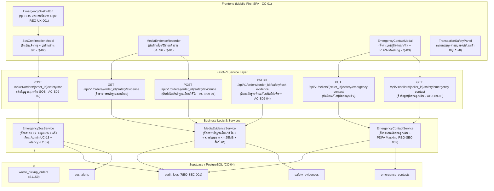

# แผนสถาปัตยกรรมและเทคโนโลยี: ระบบความปลอดภัยขณะทำธุรกรรม (`specs/seller/09-transaction-safety/plan.md`)

- **Version:** `1.0` | **Status:** `ready-for-tasks` | **Owner:** กลุ่ม 2 (แพลตฟอร์มรับซื้อของเก่า/ซาเล้ง)
- **อ้างอิงสเปก:** [`specs/seller/09-transaction-safety/spec.md`](./spec.md) (v2.0)
- **ข้อจำกัดกลาง:** [`specs/000-shared/constraints.md`](../../000-shared/constraints.md) (`CC-01..CC-06`, `REQ-SEC-001..002`, `REQ-OP-001..002`, `D-00-01..03`)

---

## 1. เทคโนโลยีที่ใช้ (Tech Stack)

> [!NOTE]
> **หมายเหตุด้านเทคโนโลยี:** เทคโนโลยีที่ใช้ในโมดูลนี้ **`"ทีมเลือกเอง ไม่ได้มาจาก spec"`** เพื่อให้สอดคล้องกับสถาปัตยกรรมทั้งระบบของโครงการ:

- **Backend Framework:** **Python 3.11 + FastAPI**
  - สถาปัตยกรรม REST API แบบแยก Router, Controller (Service Layer) และ Data Access Layer
  - ตรวจสอบความถูกต้องของข้อมูลด้วย **Pydantic v2**
  - จัดการข้อผิดพลาดตามมาตรฐาน HTTP Status Codes (`400 Bad Request`, `403 Forbidden`, `404 Not Found`, `409 Conflict`, `422 Unprocessable Entity`)
- **Database & Storage:** **Supabase (PostgreSQL 15+)**
  - ตาราง `safety_evidences`, `emergency_contacts`, `sos_alerts`, และ `audit_logs`
  - รองรับ Concurrency Control ด้วยคอลัมน์ `version` (Optimistic Locking ตาม `CC-04`)
- **Frontend Framework:** **React 18 + Vite + TailwindCSS**
  - ออกแบบเป็น Single-Page Application (SPA) แบบ Mobile-First ตามข้อกำหนด `CC-01` (Viewport 375px–414px)
  - รองรับ HTML5 MediaRecorder API สำหรับบันทึกเสียง/วิดีโอ พร้อมระบบ Mock Fallback สำหรับสภาพแวดล้อมทดสอบ
  - แคชข้อมูลผู้ติดต่อฉุกเฉินและสถานะหลักฐานลงใน `localStorage` (`CC-05`, `REQ-OP-001`)
- **Automated Testing Suite:**
  - หลังบ้าน: **Pytest** พร้อม `TestClient` (FastAPI)
  - หน้าบ้าน: **Vitest + React Testing Library + JSDOM**

---

## 2. สถาปัตยกรรมระบบ (System Architecture)



---

## 3. การตัดสินใจเชิงสถาปัตยกรรม (Architectural Decisions — `P-01` ถึง `P-06`)

### `P-01`: In-Transaction Media Evidence Recording Service (`UC-09`, `AC-S09-01`, `Q-01`)
- **บริบท:** ผู้ขายต้องการมีหลักฐานเสียงหรือวิดีโอเพื่อความอุ่นใจเมื่อมีคนแปลกหน้าเข้ามาในบ้าน และใช้ตรวจสอบกรณีเกิดข้อพิพาทหน้างาน
- **การตัดสินใจ:**
  1. พัฒนา `MediaEvidenceService` และตาราง `safety_evidences` จัดเก็บข้อมูลไฟล์หลักฐานเสียงและวิดีโอ
  2. อนุญาตให้บันทึกหลักฐานเฉพาะคำขอที่อยู่ในสถานะหน้างาน **`S4 (ถึงหน้างาน)`**, **`S5 (ชั่งน้ำหนัก)`**, และ **`S6 (รอชำระเงิน)`**
  3. กำหนดขนาดไฟล์หลักฐานสูงสุดไม่เกิน `25 MB` ต่อไฟล์ และจำกัดความยาวไม่เกิน 15 นาที เพื่อประหยัดแบนด์วิดท์ตาม `CC-01`
  4. บันทึก Metadata ครบถ้วน: `evidence_id`, `order_id`, `seller_id`, `media_type` (`AUDIO` หรือ `VIDEO`), `file_url`, `file_size_bytes`, `duration_seconds`, `is_locked`, และ `created_at`

### `P-02`: Emergency SOS Dispatch Service (`UC-09`, `REQ-UX-001`, `REQ-QA-001`, `AC-S09-02`, `Q-02`)
- **บริบท:** ผู้ขาย (โดยเฉพาะผู้สูงอายุหรือผู้ที่อยู่บ้านคนเดียวตาม `SH-06`) ต้องสามารถส่งสัญญาณขอความช่วยเหลือได้ทันทีเมื่อเกิดเหตุฉุกเฉิน
- **การตัดสินใจ:**
  1. พัฒนา `EmergencySosService` และตาราง `sos_alerts` รองรับการกดปุ่ม SOS ได้ในสถานะ **`S3 (กำลังเดินทางมา)`**, **`S4`**, **`S5`**, และ **`S6`**
  2. เมื่อกด SOS ระบบจะบันทึกแจ้งเหตุลงตาราง `sos_alerts` และส่งข้อมูลไปยังศูนย์ดูแลระบบ Admin (`UC-13`) ทันที พร้อมพิกัดบ้านผู้ขาย (`geo_point`), ข้อมูลซาเล้ง (`saleng_id`, `saleng_name`, เบอร์โทร), และรหัสคำขอ (`order_id`) โดยรับประกันเวลาประมวลผลไม่เกิน `2.0 วินาที` (`REQ-QA-001`)
  3. API ตอบกลับข้อมูลผู้ติดต่อฉุกเฉินและเบอร์โทรด่วน (`tel:...`) เพื่อให้หน้าบ้านสามารถแสดงปุ่มโทรออกด่วนผ่านเครือข่ายมือถือได้ทันที

### `P-03`: Trusted Emergency Contact Management & Masking (`UC-09`, `REQ-SEC-002`, `AC-S09-03`, `Q-03`)
- **บริบท:** ผู้ขายต้องการระบุเบอร์โทรศัพท์ของบุคคลใกล้ชิดที่ไว้ใจได้ แต่ต้องปลอดภัยตามมาตรฐาน PDPA
- **การตัดสินใจ:**
  1. พัฒนา `EmergencyContactService` และตาราง `emergency_contacts` เก็บชื่อ ความสัมพันธ์ และเบอร์โทรศัพท์ของผู้ติดต่อฉุกเฉิน
  2. นำฟังก์ชัน `mask_phone` มาแปลงเบอร์โทรศัพท์ให้แสดงผลในรูปแบบ `08X-XXX-XXXX` เสมอ (`REQ-SEC-002`)
  3. กำหนดค่าเริ่มต้น (Default Fallback) เป็นศูนย์ช่วยเหลือ Saleng Hotline (`02-123-4567`) กรณีที่ผู้ขายยังไม่ได้บันทึกเบอร์ผู้ติดต่อฉุกเฉินส่วนตัว

### `P-04`: Evidence Immutability & Admin Dispute Escalation (`REQ-FN-006`, `UC-13`, `AC-S09-04`, `Q-04`)
- **บริบท:** เมื่อเกิดข้อพิพาทหรือมีการกดแจ้งเหตุฉุกเฉิน หลักฐานเสียงและวิดีโอต้องไม่สามารถถูกลบหรือแก้ไขเพื่อป้องกันการทำลายหลักฐาน
- **การตัดสินใจ:**
  1. เมื่อใบงานถูกเปลี่ยนสถานะเป็น **`S8: Disputed`** หรือมีการกดปุ่ม SOS ในใบงานนั้น ระบบจะทำการล็อกหลักฐาน (`is_locked = True`) อัตโนมัติ
  2. บล็อกการลบหรือแก้ไขหลักฐานที่ถูกล็อก (`403 Forbidden: Evidence is locked for dispute investigation`)
  3. ข้อมูลหลักฐานที่ถูกล็อกจะเชื่อมโยงเข้าสู่ศูนย์จัดการข้อพิพาทของ Admin ใน `UC-13` ทันที

### `P-05`: Security Audit Logging for Safety Events (`REQ-SEC-001`, `AC-S09-05`)
- **บริบท:** ข้อกำหนดความปลอดภัย `REQ-SEC-001` กำหนดให้ทุกธุรกรรมที่เกี่ยวกับความปลอดภัยต้องมี Audit Trail ตรวจสอบย้อนหลังได้
- **การตัดสินใจ:**
  - บันทึกประวัติการกระทำลงในตาราง `audit_logs` แบบ Append-only สำหรับทุกการกระทำ:
    1. `SELLER_START_EVIDENCE_RECORDING`: บันทึกเมื่อเริ่มอัดเสียง/วิดีโอ
    2. `SELLER_STOP_EVIDENCE_RECORDING`: บันทึกเมื่อหยุดอัดและบันทึกไฟล์สำเร็จ
    3. `SELLER_TRIGGER_SOS`: บันทึกเมื่อผู้ขายกดปุ่ม SOS ฉุกเฉิน
    4. `SELLER_UPDATE_EMERGENCY_CONTACT`: บันทึกเมื่อมีการแก้ไขเบอร์ผู้ติดต่อฉุกเฉิน
    5. `SYSTEM_LOCK_EVIDENCE`: บันทึกเมื่อระบบทำการล็อกหลักฐานเนื่องจากเกิดข้อพิพาท

### `P-06`: Mobile-First UI Architecture & Big SOS Button (`CC-01`, `REQ-UX-001`, `AC-S09-01..05`)
- **บริบท:** ในสถานการณ์ฉุกเฉิน ผู้ขายต้องสามารถมองเห็นและกดปุ่ม SOS ได้ง่ายด้วยมือข้างเดียวบนหน้าจอมือถือ
- **การตัดสินใจ:**
  1. สร้างคอมโพเนนต์ `EmergencySosButton` เป็นปุ่มสีแดงสะดุดตา มีความสูงไม่น้อยกว่า `48px` (`REQ-UX-001`) และมีไอคอนกระดิ่ง/เตือนภัยเด่นชัด
  2. สร้าง `SosConfirmationModal` สำหรับแสดงสถานะการส่งสัญญาณแจ้งเหตุ พิกัดที่ส่ง และปุ่มต่อสายตรง (`Direct Dial: tel:...`)
  3. สร้าง `MediaEvidenceRecorder` มีตัวจับเวลาระยะเวลาที่บันทึก (Recording Timer) และสัญญาณคลื่นเสียง (Waveform indicator)
  4. ทุกคอมโพเนนต์มีแอตทริบิวต์ `data-req="UC-09"` กำกับตรงตามสเปก

---

## 4. โครงสร้างข้อมูล (Data Models & Schemas)

### 4.1 Schema ตารางฐานข้อมูล (Supabase / PostgreSQL)

```sql
-- 1. ตารางไฟล์หลักฐานเสียง/วิดีโอระหว่างทำธุรกรรม (AC-S09-01, P-01)
CREATE TABLE safety_evidences (
    id UUID PRIMARY KEY DEFAULT gen_random_uuid(),
    evidence_id VARCHAR(64) UNIQUE NOT NULL, -- รหัส EVD-YYYYMMDD-XXXX
    order_id VARCHAR(64) NOT NULL REFERENCES waste_pickup_orders(order_id),
    seller_id VARCHAR(64) NOT NULL,
    media_type VARCHAR(16) NOT NULL, -- 'AUDIO' หรือ 'VIDEO'
    file_url TEXT NOT NULL,
    file_size_bytes INTEGER NOT NULL,
    duration_seconds INTEGER NOT NULL,
    is_locked BOOLEAN NOT NULL DEFAULT FALSE, -- ถูกล็อกห้ามลบเมื่อเกิดข้อพิพาท (P-04)
    created_at TIMESTAMPTZ NOT NULL DEFAULT NOW()
);

-- 2. ตารางเบอร์ผู้ติดต่อฉุกเฉินที่ไว้ใจได้ (AC-S09-03, P-03)
CREATE TABLE emergency_contacts (
    id UUID PRIMARY KEY DEFAULT gen_random_uuid(),
    seller_id VARCHAR(64) UNIQUE NOT NULL,
    contact_name VARCHAR(120) NOT NULL,
    relationship VARCHAR(60) NOT NULL,
    contact_phone VARCHAR(20) NOT NULL,
    updated_at TIMESTAMPTZ NOT NULL DEFAULT NOW()
);

-- 3. ตารางประวัติการส่งสัญญาณฉุกเฉิน SOS (AC-S09-02, P-02)
CREATE TABLE sos_alerts (
    id UUID PRIMARY KEY DEFAULT gen_random_uuid(),
    sos_id VARCHAR(64) UNIQUE NOT NULL, -- รหัส SOS-YYYYMMDD-XXXX
    order_id VARCHAR(64) NOT NULL REFERENCES waste_pickup_orders(order_id),
    seller_id VARCHAR(64) NOT NULL,
    saleng_id VARCHAR(64) NOT NULL,
    geo_point JSONB NOT NULL, -- {"lat": 13.7563, "lng": 100.5018}
    status VARCHAR(20) NOT NULL DEFAULT 'TRIGGERED', -- 'TRIGGERED', 'DISPATCHED', 'RESOLVED'
    created_at TIMESTAMPTZ NOT NULL DEFAULT NOW()
);
```

### 4.2 Pydantic Data Models (`backend/app/models/safety_models.py`)

- `EvidenceUploadRequest`: `order_id`, `media_type` (`AUDIO` | `VIDEO`), `duration_seconds`, `file_size_bytes`, `file_url` (optional)
- `EvidenceItemResponse`: `evidence_id`, `order_id`, `seller_id`, `media_type`, `file_url`, `file_size_bytes`, `duration_seconds`, `is_locked`, `created_at`
- `EvidenceListResponse`: `order_id`, `total_evidences`, `evidences: List[EvidenceItemResponse]`
- `EmergencyContactUpdateRequest`: `contact_name`, `relationship`, `contact_phone`
- `EmergencyContactResponse`: `seller_id`, `contact_name`, `relationship`, `contact_phone_masked`, `updated_at`
- `SosTriggerRequest`: `order_id`, `current_lat`: Optional[float], `current_lng`: Optional[float]
- `SosAlertResponse`: `sos_id`, `order_id`, `seller_id`, `saleng_id`, `geo_point`, `status`, `emergency_phone_to_call`, `created_at`

---

## 5. รายการ API Endpoints

| Method | Path | ความรับผิดชอบ | รองรับ REQ / AC |
| :---: | :--- | :--- | :---: |
| **`POST`** | `/api/v1/orders/{order_id}/safety/evidence` | บันทึก/อัปโหลดไฟล์หลักฐานเสียงหรือวิดีโอหน้างาน (จำกัด <= 25 MB) | `UC-09`, `AC-S09-01`, `P-01` |
| **`GET`** | `/api/v1/orders/{order_id}/safety/evidence` | ดึงรายการหลักฐานทั้งหมดที่แนบไว้กับคำขอนี้ | `UC-09`, `AC-S09-01`, `AC-S09-04` |
| **`POST`** | `/api/v1/orders/{order_id}/safety/sos` | ส่งสัญญาณฉุกเฉิน SOS ไปยัง Admin พร้อมพิกัดและข้อมูลซาเล้ง (< 2.0s) | `UC-09`, `REQ-QA-001`, `AC-S09-02`, `P-02` |
| **`GET`** | `/api/v1/sellers/{seller_id}/safety/emergency-contact` | ดึงข้อมูลผู้ติดต่อฉุกเฉินที่ไว้ใจได้ พร้อม PII Masking `08X-XXX-XXXX` | `UC-09`, `REQ-SEC-002`, `AC-S09-03`, `P-03` |
| **`PUT`** | `/api/v1/sellers/{seller_id}/safety/emergency-contact` | บันทึกหรือแก้ไขข้อมูลผู้ติดต่อฉุกเฉิน | `UC-09`, `REQ-SEC-002`, `AC-S09-03`, `P-03` |
| **`PATCH`** | `/api/v1/orders/{order_id}/safety/lock-evidence` | ล็อกหลักฐานของคำขอเมื่อเกิดข้อพิพาท (`S8`) หรือกด SOS ห้ามแก้ไข | `REQ-FN-006`, `UC-13`, `AC-S09-04`, `P-04` |

---

## 6. แผนการพัฒนาหน้าจอ (UI Plan)

1. **`EmergencySosButton.jsx` (`REQ-UX-001`, `data-req="UC-09"`):**
   - ปุ่มสีแดงเด่นสะดุดตา ความสูงขั้นต่ำ 48px มีข้อความ "SOS ฉุกเฉิน" และไอคอนเตือนภัย
   - ฝังอยู่บนหน้าจอติดตามงานและการทำธุรกรรม (`S3..S6`) ในตำแหน่งที่กดได้ทันที
2. **`SosConfirmationModal.jsx` (`UC-09`, `data-req="UC-09"`):**
   - ป๊อปอัปแจ้งเตือนฉุกเฉิน แสดงสถานะการส่งสัญญาณไปยังศูนย์ Admin, แสดงพิกัดบ้าน, และปุ่มโทรออกด่วน (`tel:...`) ไปยังเบอร์ผู้ติดต่อฉุกเฉิน หรือสายด่วน Saleng Hotline
3. **`MediaEvidenceRecorder.jsx` (`UC-09`, `data-req="UC-09"`):**
   - แผงควบคุมการบันทึกเสียง/วิดีโอ มีตัวนับเวลา (Timer), คลื่นเสียง (Waveform indicator), ปุ่มเริ่ม/หยุดบันทึก, และรายการหลักฐานที่บันทึกไว้ในคำขอนั้น
4. **`EmergencyContactModal.jsx` (`UC-09`, `REQ-SEC-002`, `data-req="UC-09"`):**
   - ฟอร์มตั้งค่าเบอร์ติดต่อฉุกเฉิน (ชื่อ, ความสัมพันธ์, เบอร์โทร) พร้อมแสดงผลเบอร์แบบ Mask PII `08X-XXX-XXXX`
5. **`TransactionSafetyPanel.jsx` (`CC-01`, `data-req="UC-09"`):**
   - คอมโพเนนต์หลักที่รวมปุ่ม SOS และแผงบันทึกหลักฐานเข้าด้วยกัน เพื่อนำไปฝังในหน้าทำธุรกรรมฝั่งผู้ขาย

---

## 7. ตารางตรวจสอบความครบถ้วนของข้อจำกัดกลาง (Constraints Checklist — ครบทั้ง 13 ข้อ)

| รหัส Constraint | ข้อกำหนดใน Constraint กลาง (`specs/000-shared/constraints.md`) | สถานะการนำไปใช้ในโมดูลนี้ | รายละเอียดการปฏิบัติตาม |
| :---: | :--- | :---: | :--- |
| **`CC-01`** | Mobile-First Web SPA รองรับมือถือราคาประหยัด (`RAM >= 2 GB`) | **นำไปใช้** | ออกแบบ UI ด้วย React 18 + TailwindCSS สำหรับจอมือถือ 375px–414px จำกัดขนาดไฟล์หลักฐานไม่เกิน 25 MB เพื่อไม่ให้เปลือง RAM |
| **`CC-02`** | GPS Sync Interval ทุก 60 วินาทีขณะเปิดสถานะ Online | **ไม่เกี่ยวกับ feature นี้ เพราะ** | ขั้นตอนนี้เป็นระบบความปลอดภัยฝั่งผู้ขาย ไม่ใช่การติดตามพิกัดยานพาหนะของซาเล้งระหว่างวิ่งรถ |
| **`CC-03`** | Road Distance API รัศมี <= 5 กม. พร้อม Haversine Fallback | **ไม่เกี่ยวกับ feature นี้ เพราะ** | ขั้นตอนนี้เป็นการส่งสัญญาณฉุกเฉินและบันทึกหลักฐาน ไม่มีการคำนวณระยะทางบนโครงข่ายถนน |
| **`CC-04`** | PostgreSQL + Concurrency Control / Optimistic Locking | **นำไปใช้** | ใช้ Supabase (PostgreSQL 15+) พร้อมรหัสเอกสารไม่ซ้ำ (`sos_id`, `evidence_id`) ป้องกัน Concurrency Collision |
| **`CC-05`** | Offline Cache ใน IndexedDB / Local Storage | **นำไปใช้** | แคชข้อมูลผู้ติดต่อฉุกเฉินและรายการหลักฐานลงใน `localStorage` ฝั่งหน้าบ้านเพื่อให้แสดงผลได้แม้เน็ตหลุด |
| **`CC-06`** | PDPA & PII Masking ซ่อนบ้านเลขที่และพิกัดละเอียด | **นำไปใช้** | เบอร์โทรศัพท์ของผู้ติดต่อฉุกเฉินจะถูกแปลงเป็น `08X-XXX-XXXX` ก่อนแสดงผลบนหน้าจอเสมอ |
| **`REQ-SEC-001`** | บันทึกประวัติการเปลี่ยนสถานะใบงานลงในตาราง Audit Log | **นำไปใช้** | ทุกการกดปุ่ม SOS ฉุกเฉิน, การเริ่ม/หยุดบันทึกหลักฐาน, และการแก้ไขผู้ติดต่อฉุกเฉิน ต้องบันทึกลง `audit_logs` |
| **`REQ-SEC-002`** | แปลงเบอร์โทรศัพท์เป็น `08X-XXX-XXXX` | **นำไปใช้** | ใช้ฟังก์ชัน `mask_phone` ปิดบังเบอร์โทรศัพท์ผู้ติดต่อฉุกเฉินในทุก Response และหน้าจอ UI |
| **`REQ-OP-001`** | โหมด Offline Queue สำหรับดูข้อมูลที่แคชไว้ | **นำไปใช้** | ข้อมูลผู้ติดต่อฉุกเฉินและเบอร์สายด่วนสามารถเปิดดูจากแคชในเครื่องได้ตลอดเวลาแม้ไม่มีอินเทอร์เน็ต |
| **`REQ-OP-002`** | Haversine Fallback สำหรับการคำนวณระยะทาง | **ไม่เกี่ยวกับ feature นี้ เพราะ** | ไม่มีการคำนวณระยะทางถนนในโมดูลความปลอดภัย |
| **`D-00-01`** | KYC เป็น Precondition ของระบบผู้ซื้อ | **ไม่เกี่ยวกับ feature นี้ เพราะ** | ขอบเขตโมดูลนี้เป็นระบบความปลอดภัยฝั่งผู้ขาย |
| **`D-00-02`** | ซ่อนพิกัดผู้ขายจนกว่าจะรับงาน | **นำไปใช้** | พิกัดบ้านผู้ขายจะถูกส่งไปยังศูนย์ Admin เฉพาะตอนที่ผู้ขายกดปุ่ม SOS ฉุกเฉินเท่านั้น ไม่มีการเปิดเผยสู่สาธารณะ |
| **`D-00-03`** | ขอบเขตหยุดที่สถานะมีผู้รับงานแล้ว | **ไม่เกี่ยวกับ feature นี้ เพราะ** | โมดูลนี้ทำงานในสถานะที่เกิดการจับคู่งานแล้ว (`S3..S6`) เพื่อคุ้มครองความปลอดภัยขณะทำธุรกรรม |

---

## 8. กลยุทธ์การทดสอบอัตโนมัติ (Automated Testing Strategy)

1. **Unit Tests (Backend):**
   - `test_T01_safety_models.py`: ทดสอบ Pydantic Validation, Schema, และฟังก์ชัน Store ใน Supabase
2. **Automated AC Tests (Backend):**
   - `test_AC_S09_01_media_evidence.py`: ทดสอบการบันทึกหลักฐานเสียง/วิดีโอ การตรวจสอบสถานะ `S4..S6` และการจำกัดขนาด <= 25 MB
   - `test_AC_S09_02_emergency_sos.py`: ทดสอบการกดปุ่ม SOS ฉุกเฉิน การส่งข้อมูลพิกัดและซาเล้ง และเกณฑ์เวลา <= 2.0 วินาที
   - `test_AC_S09_03_emergency_contact.py`: ทดสอบการตั้งค่าผู้ติดต่อฉุกเฉิน และ PII Masking `08X-XXX-XXXX`
   - `test_AC_S09_04_evidence_immutability.py`: ทดสอบการล็อกหลักฐานเป็น Read-only เมื่อมีข้อพิพาท `S8` หรือกด SOS
3. **Frontend Tests (Vitest + JSDOM):**
   - `safetyApi.test.mjs`: ทดสอบ API Client และ Offline LocalStorage Caching
   - `AC-S09-01.test.jsx`: ทดสอบคอมโพเนนต์บันทึกเสียง/วิดีโอ ตัวจับเวลา และคลื่นเสียง Waveform
   - `AC-S09-02.test.jsx`: ทดสอบปุ่ม SOS ฉุกเฉินขนาด >= 48px และ Modal โทรออกด่วน
   - `AC-S09-03.test.jsx`: ทดสอบฟอร์มตั้งค่าเบอร์ติดต่อฉุกเฉิน และการแสดงผล Mask PII
4. **Integration E2E Test (Backend):**
   - `test_e2e_transaction_safety.py`: ทดสอบครบวงจร ตั้งแต่บันทึกหลักฐานเสียงหน้างาน -> กด SOS ฉุกเฉิน -> ระบบล็อกหลักฐานอัตโนมัติ -> ตรวจสอบ Audit Log ครบทุกเหตุการณ์ตาม `AC-S09-05`

